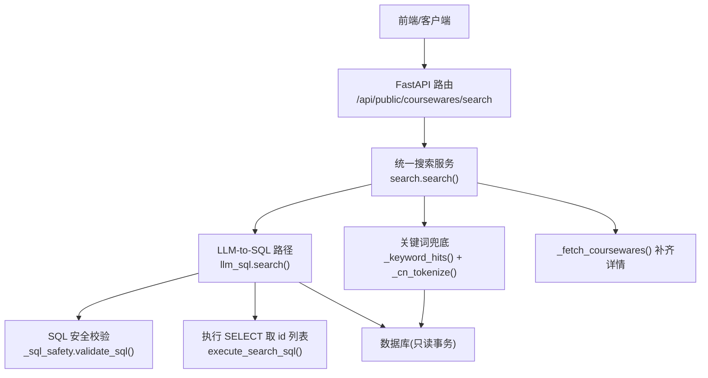
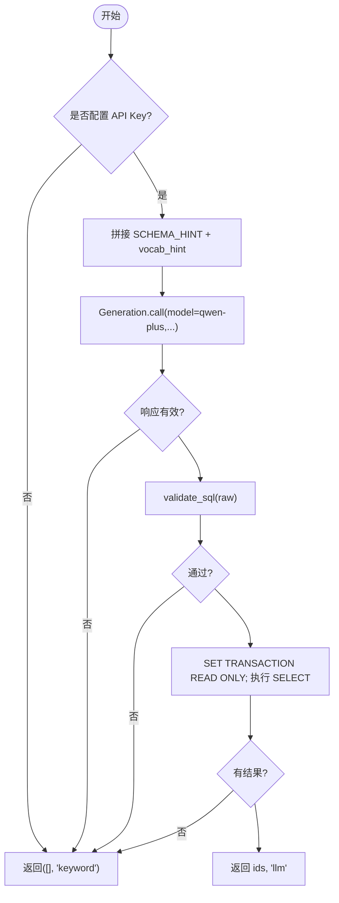
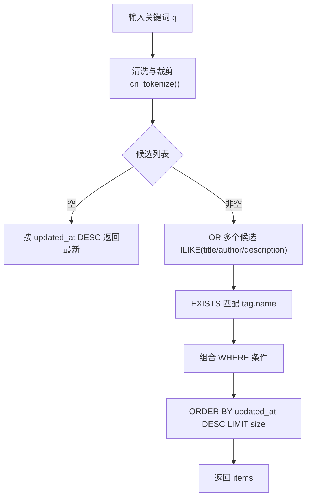
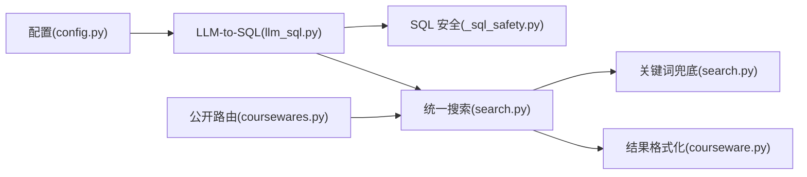

# 智能搜索系统

<cite>
**本文引用的文件列表**
- [backend/app/services/search.py](file://backend/app/services/search.py)
- [backend/app/services/llm_sql.py](file://backend/app/services/llm_sql.py)
- [backend/app/services/_sql_safety.py](file://backend/app/services/_sql_safety.py)
- [backend/app/api/public/coursewares.py](file://backend/app/api/public/coursewares.py)
- [backend/app/core/config.py](file://backend/app/core/config.py)
- [backend/app/services/courseware.py](file://backend/app/services/courseware.py)
- [backend/tests/test_search_llm.py](file://backend/tests/test_search_llm.py)
</cite>

## 目录
1. [简介](#简介)
2. [项目结构](#项目结构)
3. [核心组件](#核心组件)
4. [架构总览](#架构总览)
5. [详细组件分析](#详细组件分析)
6. [依赖关系分析](#依赖关系分析)
7. [性能与排序优化](#性能与排序优化)
8. [配置与使用示例](#配置与使用示例)
9. [故障排查指南](#故障排查指南)
10. [结论](#结论)

## 简介
本技术文档面向 Learning Hub 的智能搜索子系统，聚焦 LLM-to-SQL 转换机制、SQL 安全性校验、关键词兜底策略（中文清洗、正则匹配、ILIKE 优化）、搜索结果排序与性能优化、错误处理与降级机制，并提供端到端的使用示例与调优建议。该方案以阿里云百炼 Qwen 模型为核心，结合本地 ILIKE 兜底，确保在外部服务不可用时仍能提供稳定可用的检索体验。

## 项目结构
智能搜索相关代码主要位于后端 services 层与 public API 路由中：
- 统一搜索入口与降级逻辑：search.py
- LLM-to-SQL 生成与执行：llm_sql.py
- SQL 白名单与安全校验：_sql_safety.py
- 公开搜索接口：coursewares.py
- 配置项（LLM 开关、超时、最大行数等）：config.py
- 结果序列化与关联加载：courseware.py
- 行为验证测试：test_search_llm.py



图表来源
- [backend/app/api/public/coursewares.py:32-54](file://backend/app/api/public/coursewares.py#L32-L54)
- [backend/app/services/search.py:209-242](file://backend/app/services/search.py#L209-L242)
- [backend/app/services/llm_sql.py:442-478](file://backend/app/services/llm_sql.py#L442-L478)
- [backend/app/services/_sql_safety.py:165-210](file://backend/app/services/_sql_safety.py#L165-L210)
- [backend/app/services/courseware.py:290-332](file://backend/app/services/courseware.py#L290-L332)

章节来源
- [backend/app/api/public/coursewares.py:32-54](file://backend/app/api/public/coursewares.py#L32-L54)
- [backend/app/services/search.py:1-263](file://backend/app/services/search.py#L1-L263)
- [backend/app/services/llm_sql.py:1-490](file://backend/app/services/llm_sql.py#L1-L490)
- [backend/app/services/_sql_safety.py:1-220](file://backend/app/services/_sql_safety.py#L1-L220)
- [backend/app/core/config.py:65-71](file://backend/app/core/config.py#L65-L71)
- [backend/app/services/courseware.py:290-332](file://backend/app/services/courseware.py#L290-L332)

## 核心组件
- 统一搜索服务 search.search(): 优先走 LLM-to-SQL，失败或禁用时回退到关键词 ILIKE；返回 items、source、total。
- LLM-to-SQL 模块 llm_sql: 负责调用 qwen-plus 生成 SQL、注入 schema/vocab 提示词、执行只读事务查询并返回 id 列表。
- SQL 安全校验 _sql_safety: 七道闸白名单校验，拒绝危险语句、强制 LIMIT、限制表集合。
- 关键词兜底 _keyword_hits: 中文查询清洗、多候选 ILIKE、EXISTS 标签匹配、按更新时间倒序。
- 结果补齐 _fetch_coursewares: 按 id 顺序拉取完整 CoursewareItem（含 tags/materials/category/access_tokens）。
- 公开 API /api/public/coursewares/search: 封装统一搜索服务，返回分页元数据与 source 标识。

章节来源
- [backend/app/services/search.py:105-242](file://backend/app/services/search.py#L105-L242)
- [backend/app/services/llm_sql.py:267-478](file://backend/app/services/llm_sql.py#L267-L478)
- [backend/app/services/_sql_safety.py:165-210](file://backend/app/services/_sql_safety.py#L165-L210)
- [backend/app/api/public/coursewares.py:32-54](file://backend/app/api/public/coursewares.py#L32-L54)

## 架构总览
下图展示一次搜索请求的端到端流程，包括 LLM 路径与关键词兜底的分支控制、超时与异常处理、以及最终结果组装。

```mermaid
sequenceDiagram
participant C as "客户端"
participant API as "FastAPI 路由"
participant S as "统一搜索服务"
participant L as "LLM-to-SQL"
participant V as "SQL 安全校验"
participant D as "数据库(只读)"
participant K as "关键词兜底"
C->>API : GET /api/public/coursewares/search?q=...&size=...
API->>S : search(db, keyword, size)
alt LLM 启用且有关键词
S->>L : generate_sql(q, schema_hint, vocab_hint)
L-->>S : raw SQL 或 None
alt 有 raw SQL
S->>V : validate_sql(raw)
V-->>S : 清洗后 SQL 或 None
alt 通过校验
S->>D : SET TRANSACTION READ ONLY; 执行 SELECT
D-->>S : id 列表(已排序)
S->>S : _fetch_coursewares(ids, size)
S-->>API : SearchResult(source="llm", items, total)
else 校验拒绝
S->>K : _keyword_hits(keyword, size)
K-->>S : items
S-->>API : SearchResult(source="keyword", items, total)
end
else 无 raw SQL
S->>K : _keyword_hits(keyword, size)
K-->>S : items
S-->>API : SearchResult(source="keyword", items, total)
end
else LLM 未启用或空关键词
S->>K : _keyword_hits(keyword, size)
K-->>S : items
S-->>API : SearchResult(source="keyword", items, total)
end
Note over S,D : 若 LLM 调用超时/异常 → 直接降级至关键词兜底
```

图表来源
- [backend/app/api/public/coursewares.py:32-54](file://backend/app/api/public/coursewares.py#L32-L54)
- [backend/app/services/search.py:209-242](file://backend/app/services/search.py#L209-L242)
- [backend/app/services/llm_sql.py:276-344](file://backend/app/services/llm_sql.py#L276-L344)
- [backend/app/services/_sql_safety.py:165-210](file://backend/app/services/_sql_safety.py#L165-L210)
- [backend/app/services/llm_sql.py:384-437](file://backend/app/services/llm_sql.py#L384-L437)
- [backend/app/services/search.py:115-160](file://backend/app/services/search.py#L115-L160)

## 详细组件分析

### LLM-to-SQL 转换机制（qwen-plus 集成）
- 启用检测：读取配置中的 dashscope_api_key，为空则禁用 LLM 路径。
- 提示词构建：SCHEMA_HINT 描述业务背景、核心字段、约束与示例；动态注入 vocab_hint（category.name/tag.name 实际值），提升对“分类/标签名”识别能力。
- 调用生成：temperature=0.0，top_p=0.9，result_format=message，timeout 由配置决定。
- 安全校验：七道闸白名单，禁止 DDL/DML、注释、多语句、非白名单表、强制 LIMIT。
- 执行策略：SET TRANSACTION READ ONLY 后执行 SELECT，仅取 id 列，避免敏感字段泄露；去重并按 size 截断。
- 主入口：失败/超时/校验拒绝/无结果均返回 ([], 'keyword')，由上层降级。



图表来源
- [backend/app/services/llm_sql.py:267-344](file://backend/app/services/llm_sql.py#L267-L344)
- [backend/app/services/_sql_safety.py:165-210](file://backend/app/services/_sql_safety.py#L165-L210)
- [backend/app/services/llm_sql.py:384-437](file://backend/app/services/llm_sql.py#L384-L437)
- [backend/app/services/llm_sql.py:442-478](file://backend/app/services/llm_sql.py#L442-L478)

章节来源
- [backend/app/services/llm_sql.py:126-261](file://backend/app/services/llm_sql.py#L126-L261)
- [backend/app/services/llm_sql.py:267-344](file://backend/app/services/llm_sql.py#L267-L344)
- [backend/app/services/_sql_safety.py:23-88](file://backend/app/services/_sql_safety.py#L23-88)
- [backend/app/services/_sql_safety.py:165-210](file://backend/app/services/_sql_safety.py#L165-L210)
- [backend/app/services/llm_sql.py:384-437](file://backend/app/services/llm_sql.py#L384-L437)
- [backend/app/services/llm_sql.py:442-478](file://backend/app/services/llm_sql.py#L442-L478)

### SQL 安全性验证（七道闸白名单）
- 闸1：去除 markdown fence 包裹。
- 闸2：单语句，不允许中间分号。
- 闸3：禁止行注释与块注释。
- 闸4：首词必须为 SELECT。
- 闸5：黑名单关键字整词匹配（DROP/DELETE/UPDATE/INSERT/ALTER/CREATE/TRUNCATE/GRANT/REVOKE/EXEC/COPY/VACUUM/LOCK/COMMENT/SET/RESET/CALL/DO/UNION/INTERSECT/EXCEPT）。
- 闸6：FROM/JOIN 中的表必须在白名单内，且不允许 schema 限定与系统表前缀。
- 闸7：强制 LIMIT，缺失则追加默认值，超过上限则截断。

章节来源
- [backend/app/services/_sql_safety.py:23-88](file://backend/app/services/_sql_safety.py#L23-88)
- [backend/app/services/_sql_safety.py:165-210](file://backend/app/services/_sql_safety.py#L165-L210)

### 关键词兜底策略（中文清洗、正则匹配、ILIKE 优化）
- 中文查询清洗：
  - 去除礼貌/求助语气（如“请帮我找一下”、“麻烦帮我查一下”）。
  - 去除“一下”软化语气。
  - 提取“与/跟/和 XX 相关的”中心词。
  - 过滤平台术语（课件/课程/资料/文档/视频/PPT/PDF）。
  - 停用词过滤（我/你/他/的/了/是/在/有/和/与/跟/以及/和/及/请/帮我/麻烦/劳驾/一下/若干/哪个/哪些/什么/怎么/如何/为啥/为什么）。
- 多候选生成：原始串作为第一候选，逐轮应用裁剪正则，最多 4 轮防循环，去重与长度过滤。
- ILIKE 搜索：
  - 标题/作者/描述 OR 多个候选 ILIKE。
  - 标签匹配使用 EXISTS 子查询，避免大表 JOIN 成本。
  - 默认按 updated_at 倒序，空关键词返回最新。
- 结果补齐：复用 courseware._to_item 构造标准 item 结构。



图表来源
- [backend/app/services/search.py:40-102](file://backend/app/services/search.py#L40-L102)
- [backend/app/services/search.py:115-160](file://backend/app/services/search.py#L115-L160)
- [backend/app/services/courseware.py:290-332](file://backend/app/services/courseware.py#L290-L332)

章节来源
- [backend/app/services/search.py:40-102](file://backend/app/services/search.py#L40-L102)
- [backend/app/services/search.py:115-160](file://backend/app/services/search.py#L115-L160)
- [backend/app/services/courseware.py:290-332](file://backend/app/services/courseware.py#L290-L332)

### 搜索结果排序算法与性能优化
- LLM 路径：
  - 由 LLM 生成的 SQL 自带 ORDER BY（默认 updated_at DESC），服务端仅取 id 列表，不改变排序。
  - 只读事务执行，避免写操作风险。
  - 去重与硬上限截断（HARD_LIMIT_CEIL=50）。
- 关键词路径：
  - 默认按 updated_at 倒序，空关键词返回最新。
  - 使用 EXISTS 替代 JOIN 进行标签匹配，降低大表 JOIN 开销。
  - selectinload 预加载 tags/materials/category/access_tokens，减少 N+1 查询。
- 结果补齐：
  - _fetch_coursewares 按 id 顺序拉取完整对象，保持 LLM 排序语义。

章节来源
- [backend/app/services/llm_sql.py:384-437](file://backend/app/services/llm_sql.py#L384-L437)
- [backend/app/services/search.py:115-160](file://backend/app/services/search.py#L115-L160)
- [backend/app/services/search.py:166-190](file://backend/app/services/search.py#L166-L190)

### 公开 API 与前端交互
- 路由：GET /api/public/coursewares/search
- 参数：q（可选）、page（默认 1）、size（默认 20，范围 1-50）
- 响应 envelope：data.items、data.source、data.total、data.page、data.size
- source 枚举："llm" 表示 LLM 命中；"keyword" 表示降级 ILIKE。前端据此显示徽标文案。

章节来源
- [backend/app/api/public/coursewares.py:32-54](file://backend/app/api/public/coursewares.py#L32-L54)

## 依赖关系分析
- 统一搜索服务依赖：
  - llm_sql：生成 SQL、执行查询、返回 id 列表。
  - _sql_safety：SQL 白名单校验。
  - courseware：结果序列化与关联加载。
- 配置依赖：
  - config.get_settings：读取 dashscope_api_key、llm_search_model、llm_sql_timeout_seconds、llm_sql_max_rows。
- 测试依赖：
  - test_search_llm：覆盖 LLM 禁用、生成失败、校验拒绝、超时、空关键词等场景。



图表来源
- [backend/app/core/config.py:65-71](file://backend/app/core/config.py#L65-L71)
- [backend/app/services/llm_sql.py:267-344](file://backend/app/services/llm_sql.py#L267-L344)
- [backend/app/services/_sql_safety.py:165-210](file://backend/app/services/_sql_safety.py#L165-L210)
- [backend/app/services/search.py:209-242](file://backend/app/services/search.py#L209-L242)
- [backend/app/services/courseware.py:290-332](file://backend/app/services/courseware.py#L290-L332)
- [backend/app/api/public/coursewares.py:32-54](file://backend/app/api/public/coursewares.py#L32-L54)

章节来源
- [backend/app/core/config.py:65-71](file://backend/app/core/config.py#L65-L71)
- [backend/app/services/llm_sql.py:267-344](file://backend/app/services/llm_sql.py#L267-L344)
- [backend/app/services/_sql_safety.py:165-210](file://backend/app/services/_sql_safety.py#L165-L210)
- [backend/app/services/search.py:209-242](file://backend/app/services/search.py#L209-L242)
- [backend/app/services/courseware.py:290-332](file://backend/app/services/courseware.py#L290-L332)
- [backend/app/api/public/coursewares.py:32-54](file://backend/app/api/public/coursewares.py#L32-L54)

## 性能与排序优化
- LLM 侧：
  - 进程级词汇缓存（TTL 60s）减少每次请求对 category/tag 表的重复查询。
  - 只读事务与仅取 id 列，避免大字段传输与潜在安全风险。
  - 超时控制：异步 wait_for 包装同步 LLM 调用，防止阻塞事件循环。
- 关键词侧：
  - 多候选 ILIKE 与 EXISTS 标签匹配，避免大表 JOIN。
  - selectinload 批量预加载关联，减少 N+1 查询。
  - 默认按 updated_at 倒序，空关键词返回最新，保证用户体验。
- 上限控制：
  - HARD_LIMIT_CEIL=50，防止过大 LIMIT 导致性能问题。
  - 前端 size 参数限制 1-50，避免滥用。

[本节为通用性能讨论，无需具体文件引用]

## 配置与使用示例
- 环境变量（.env）关键项：
  - DASHSCOPE_API_KEY：留空则禁用 LLM 路径，自动降级关键词。
  - LLM_SEARCH_MODEL：默认 qwen-plus。
  - LLM_SQL_TIMEOUT_SECONDS：默认 8.0 秒。
  - LLM_SQL_MAX_ROWS：默认 20。
- HTTP 调用示例：
  - GET /api/public/coursewares/search?q=项目管理&size=20&page=1
  - 成功响应包含 data.items、data.source、data.total、data.page、data.size。
- 错误处理与降级：
  - LLM 超时或异常：记录警告日志，降级关键词路径。
  - SQL 校验拒绝：记录信息日志，降级关键词路径。
  - 无 API Key：is_enabled=False，直接关键词路径。
  - 空关键词：不调用 LLM，直接关键词路径返回最新。
- 超时控制：
  - 通过 asyncio.wait_for 包装 LLM 同步调用，超时阈值来自配置。
- 降级机制：
  - 任一环节失败均返回 source="keyword"，前端可显示“AI 智能搜索 · 降级中”。

章节来源
- [backend/app/core/config.py:65-71](file://backend/app/core/config.py#L65-L71)
- [backend/app/api/public/coursewares.py:32-54](file://backend/app/api/public/coursewares.py#L32-L54)
- [backend/app/services/search.py:209-242](file://backend/app/services/search.py#L209-L242)
- [backend/tests/test_search_llm.py:119-158](file://backend/tests/test_search_llm.py#L119-L158)

## 故障排查指南
- 现象：source 始终为 "keyword"
  - 检查 DASHSCOPE_API_KEY 是否配置且非空。
  - 查看日志中是否有 “dashscope import failed” 或 “Generation.call failed”。
  - 确认 validate_sql 是否拒绝（黑名单/表白名单/LIMIT 问题）。
- 现象：LLM 超时
  - 调整 llm_sql_timeout_seconds，增大超时阈值。
  - 观察网络延迟与模型响应时间。
- 现象：结果为空
  - 检查 LLM 生成的 SQL 是否合法且命中数据。
  - 关键词路径下确认是否存在匹配的 title/author/description/tag。
- 现象：性能抖动
  - 关注 vocab_hint 缓存失效周期（默认 60s）。
  - 评估 EXISTS 标签匹配与 ILIKE 的性能影响，必要时增加索引。

章节来源
- [backend/app/services/llm_sql.py:300-344](file://backend/app/services/llm_sql.py#L300-L344)
- [backend/app/services/_sql_safety.py:165-210](file://backend/app/services/_sql_safety.py#L165-L210)
- [backend/app/services/search.py:209-242](file://backend/app/services/search.py#L209-L242)
- [backend/tests/test_search_llm.py:119-158](file://backend/tests/test_search_llm.py#L119-L158)

## 结论
Learning Hub 的智能搜索系统通过 LLM-to-SQL 与关键词兜底的双通道设计，在保证高可用性的同时提升了自然语言检索的准确性与灵活性。七道闸白名单校验确保了 SQL 的安全性，中文清洗与 ILIKE 优化保障了兜底路径的命中率与性能。配合合理的超时控制、降级机制与结果补齐策略，系统在复杂环境下仍能稳定输出高质量搜索结果。