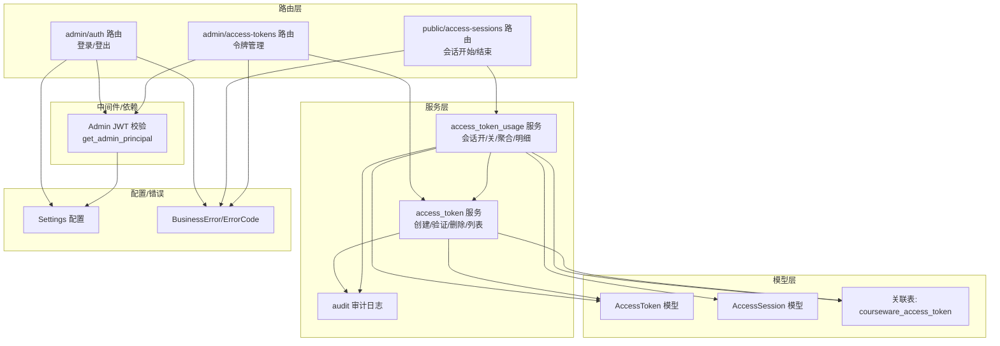
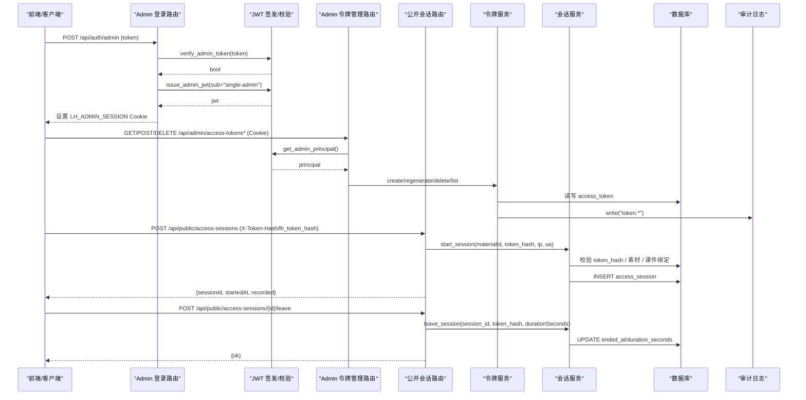
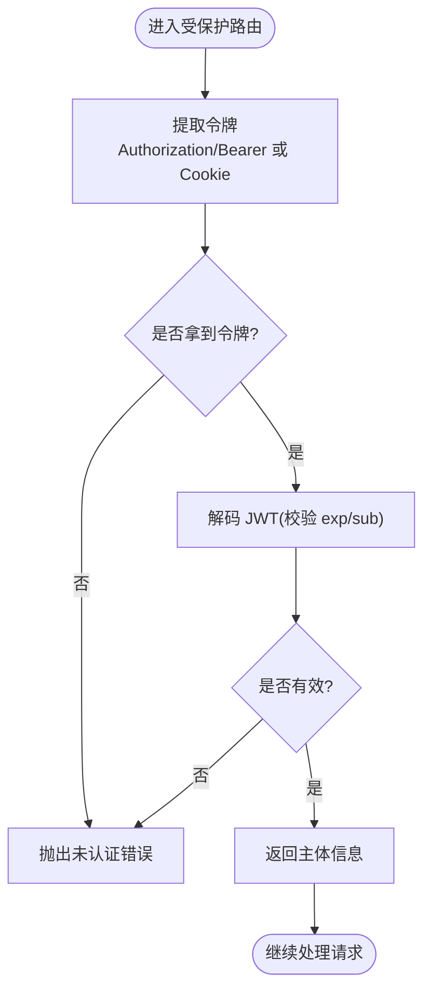
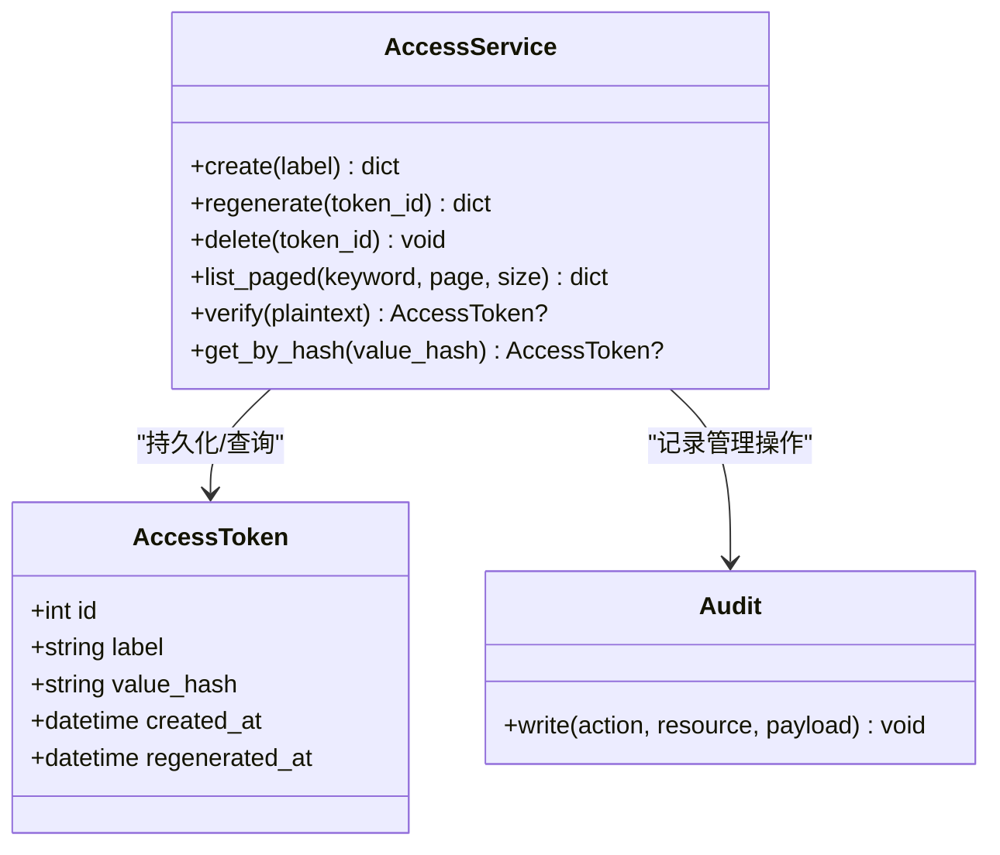
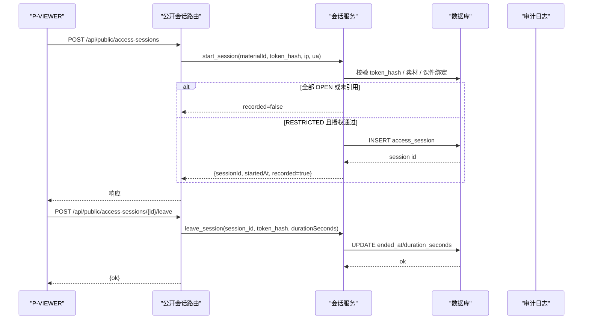
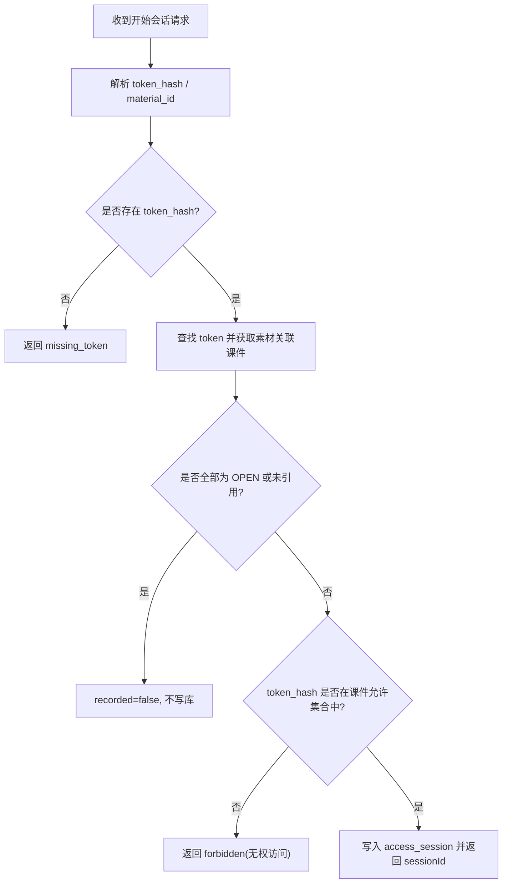
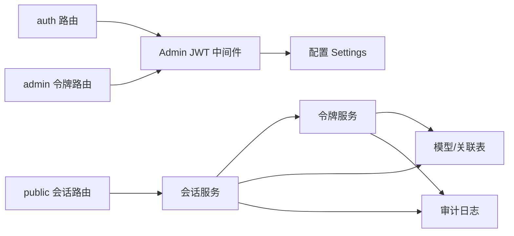

# 权限控制系统

<cite>
**本文引用的文件**   
- [backend/app/api/auth.py](file://backend/app/api/auth.py)
- [backend/app/middleware/admin_auth.py](file://backend/app/middleware/admin_auth.py)
- [backend/app/core/config.py](file://backend/app/core/config.py)
- [backend/app/models/access_token.py](file://backend/app/models/access_token.py)
- [backend/app/models/access_session.py](file://backend/app/models/access_session.py)
- [backend/app/models/association.py](file://backend/app/models/association.py)
- [backend/app/services/access_token.py](file://backend/app/services/access_token.py)
- [backend/app/services/access_token_usage.py](file://backend/app/services/access_token_usage.py)
- [backend/app/api/public/access_sessions.py](file://backend/app/api/public/access_sessions.py)
- [backend/app/api/admin/access_tokens.py](file://backend/app/api/admin/access_tokens.py)
- [backend/app/schemas/access_token.py](file://backend/app/schemas/access_token.py)
- [backend/app/schemas/access_token_usage.py](file://backend/app/schemas/access_token_usage.py)
- [backend/app/schemas/auth.py](file://backend/app/schemas/auth.py)
- [backend/app/core/errors.py](file://backend/app/core/errors.py)
- [backend/app/services/audit.py](file://backend/app/services/audit.py)
</cite>

## 目录
1. [简介](#简介)
2. [项目结构](#项目结构)
3. [核心组件](#核心组件)
4. [架构总览](#架构总览)
5. [详细组件分析](#详细组件分析)
6. [依赖关系分析](#依赖关系分析)
7. [性能考虑](#性能考虑)
8. [故障排除指南](#故障排除指南)
9. [结论](#结论)
10. [附录](#附录)

## 简介
本技术文档聚焦 Learning Hub 的权限控制系统，围绕“双轨鉴权”（开放访问与令牌解锁）机制、访问令牌生命周期管理、访问会话管理与审计日志、JWT 认证中间件与安全实践、以及性能优化与排障策略进行系统化说明。目标是帮助开发者快速理解并正确扩展该权限体系。

## 项目结构
后端采用 FastAPI + SQLAlchemy 分层架构：路由层负责 HTTP 接口；服务层封装业务规则；模型层定义数据表；配置集中管理密钥与开关；错误码统一映射到 HTTP 状态码。

图表来源
- [backend/app/api/auth.py:1-49](file://backend/app/api/auth.py#L1-L49)
- [backend/app/middleware/admin_auth.py:1-66](file://backend/app/middleware/admin_auth.py#L1-L66)
- [backend/app/api/public/access_sessions.py:1-137](file://backend/app/api/public/access_sessions.py#L1-L137)
- [backend/app/api/admin/access_tokens.py:1-120](file://backend/app/api/admin/access_tokens.py#L1-L120)
- [backend/app/services/access_token.py:1-235](file://backend/app/services/access_token.py#L1-L235)
- [backend/app/services/access_token_usage.py:1-518](file://backend/app/services/access_token_usage.py#L1-L518)
- [backend/app/models/access_token.py:1-34](file://backend/app/models/access_token.py#L1-L34)
- [backend/app/models/access_session.py:1-129](file://backend/app/models/access_session.py#L1-L129)
- [backend/app/models/association.py:1-41](file://backend/app/models/association.py#L1-L41)
- [backend/app/core/config.py:1-88](file://backend/app/core/config.py#L1-L88)
- [backend/app/core/errors.py:1-144](file://backend/app/core/errors.py#L1-L144)
- [backend/app/services/audit.py:1-45](file://backend/app/services/audit.py#L1-L45)

章节来源
- [backend/app/api/auth.py:1-49](file://backend/app/api/auth.py#L1-L49)
- [backend/app/api/public/access_sessions.py:1-137](file://backend/app/api/public/access_sessions.py#L1-L137)
- [backend/app/api/admin/access_tokens.py:1-120](file://backend/app/api/admin/access_tokens.py#L1-L120)
- [backend/app/middleware/admin_auth.py:1-66](file://backend/app/middleware/admin_auth.py#L1-L66)
- [backend/app/services/access_token.py:1-235](file://backend/app/services/access_token.py#L1-L235)
- [backend/app/services/access_token_usage.py:1-518](file://backend/app/services/access_token_usage.py#L1-L518)
- [backend/app/models/access_token.py:1-34](file://backend/app/models/access_token.py#L1-L34)
- [backend/app/models/access_session.py:1-129](file://backend/app/models/access_session.py#L1-L129)
- [backend/app/models/association.py:1-41](file://backend/app/models/association.py#L1-L41)
- [backend/app/core/config.py:1-88](file://backend/app/core/config.py#L1-L88)
- [backend/app/core/errors.py:1-144](file://backend/app/core/errors.py#L1-L144)
- [backend/app/services/audit.py:1-45](file://backend/app/services/audit.py#L1-L45)

## 核心组件
- 管理员鉴权与 JWT 签发：通过 Admin Token 换取短期 JWT，写入 HttpOnly Cookie，后续请求携带 Cookie 或 Authorization 头完成鉴权。
- 访问令牌管理：支持创建、重新生成、删除、分页查询；数据库仅存储 SHA-256 摘要，明文仅在创建/重生成时返回一次。
- 访问会话记录：公开接口基于 token_hash 开启/结束会话，记录 IP、UA、起止时间、停留时长等，供审计与分析。
- 双轨鉴权：素材可被 OPEN 或 RESTRICTED 课件引用；OPEN 不记录且无需授权；RESTRICTED 需匹配课件绑定的令牌集合。
- 审计日志：关键管理操作以 JSON Lines 追加写入本地日志文件，失败不影响主流程。

章节来源
- [backend/app/api/auth.py:1-49](file://backend/app/api/auth.py#L1-L49)
- [backend/app/middleware/admin_auth.py:1-66](file://backend/app/middleware/admin_auth.py#L1-L66)
- [backend/app/services/access_token.py:1-235](file://backend/app/services/access_token.py#L1-L235)
- [backend/app/services/access_token_usage.py:1-518](file://backend/app/services/access_token_usage.py#L1-L518)
- [backend/app/api/public/access_sessions.py:1-137](file://backend/app/api/public/access_sessions.py#L1-L137)
- [backend/app/services/audit.py:1-45](file://backend/app/services/audit.py#L1-L45)

## 架构总览
下图展示从前端到后端的完整调用链，包括管理员登录、令牌管理、公开会话接口与数据库交互。

图表来源
- [backend/app/api/auth.py:1-49](file://backend/app/api/auth.py#L1-L49)
- [backend/app/middleware/admin_auth.py:1-66](file://backend/app/middleware/admin_auth.py#L1-L66)
- [backend/app/api/admin/access_tokens.py:1-120](file://backend/app/api/admin/access_tokens.py#L1-L120)
- [backend/app/api/public/access_sessions.py:1-137](file://backend/app/api/public/access_sessions.py#L1-L137)
- [backend/app/services/access_token.py:1-235](file://backend/app/services/access_token.py#L1-L235)
- [backend/app/services/access_token_usage.py:1-518](file://backend/app/services/access_token_usage.py#L1-L518)
- [backend/app/services/audit.py:1-45](file://backend/app/services/audit.py#L1-L45)

## 详细组件分析

### 管理员鉴权与 JWT 中间件
- 登录流程：使用预置的 Admin Token 校验通过后签发短期 JWT，写入 HttpOnly Cookie，同时返回过期时间。
- 鉴权依赖：优先从 Authorization: Bearer 提取，其次从 Cookie LH_ADMIN_SESSION 提取；解码时要求 exp/sub 字段，失败返回未认证错误。
- 安全要点：Secret 与算法来自配置；TTL 默认 8 小时；建议生产环境更换强随机 Secret 并限制 CORS。

图表来源
- [backend/app/middleware/admin_auth.py:1-66](file://backend/app/middleware/admin_auth.py#L1-L66)
- [backend/app/api/auth.py:1-49](file://backend/app/api/auth.py#L1-L49)
- [backend/app/core/config.py:1-88](file://backend/app/core/config.py#L1-L88)
- [backend/app/core/errors.py:1-144](file://backend/app/core/errors.py#L1-L144)

章节来源
- [backend/app/api/auth.py:1-49](file://backend/app/api/auth.py#L1-L49)
- [backend/app/middleware/admin_auth.py:1-66](file://backend/app/middleware/admin_auth.py#L1-L66)
- [backend/app/core/config.py:1-88](file://backend/app/core/config.py#L1-L88)
- [backend/app/core/errors.py:1-144](file://backend/app/core/errors.py#L1-L144)

### 访问令牌生命周期管理
- 生成：标签唯一性校验，生成 24 位 base36 随机值，仅存 SHA-256 摘要，返回明文一次。
- 验证：常量时间比较哈希，避免时序攻击。
- 续期：重新生成会覆盖旧 hash，旧令牌即刻失效；记录 regenerated_at。
- 撤销：删除前检查是否被课件引用，且至少保留一个 active 令牌。
- 列表：分页返回，附带引用计数，仅暴露 valueHash。

图表来源
- [backend/app/models/access_token.py:1-34](file://backend/app/models/access_token.py#L1-L34)
- [backend/app/services/access_token.py:1-235](file://backend/app/services/access_token.py#L1-L235)
- [backend/app/services/audit.py:1-45](file://backend/app/services/audit.py#L1-L45)

章节来源
- [backend/app/services/access_token.py:1-235](file://backend/app/services/access_token.py#L1-L235)
- [backend/app/models/access_token.py:1-34](file://backend/app/models/access_token.py#L1-L34)
- [backend/app/services/audit.py:1-45](file://backend/app/services/audit.py#L1-L45)

### 访问会话管理与审计
- 开始会话：校验 token_hash 与素材归属课件的绑定关系；若全部为 OPEN 则不记录；否则写入 access_session 并返回 sessionId。
- 结束会话：幂等更新 ended_at 与 duration_seconds；对客户端上报时长与服务端计算差值超过阈值时以服务端为准。
- 审计：会话写入失败时记录审计日志，但不影响前台体验。

图表来源
- [backend/app/api/public/access_sessions.py:1-137](file://backend/app/api/public/access_sessions.py#L1-L137)
- [backend/app/services/access_token_usage.py:1-518](file://backend/app/services/access_token_usage.py#L1-L518)
- [backend/app/models/access_session.py:1-129](file://backend/app/models/access_session.py#L1-L129)
- [backend/app/services/audit.py:1-45](file://backend/app/services/audit.py#L1-L45)

章节来源
- [backend/app/api/public/access_sessions.py:1-137](file://backend/app/api/public/access_sessions.py#L1-L137)
- [backend/app/services/access_token_usage.py:1-518](file://backend/app/services/access_token_usage.py#L1-L518)
- [backend/app/models/access_session.py:1-129](file://backend/app/models/access_session.py#L1-L129)
- [backend/app/services/audit.py:1-45](file://backend/app/services/audit.py#L1-L45)

### 双轨鉴权机制（开放访问与令牌解锁）
- 开放访问（OPEN）：当素材仅被 OPEN 课件引用或未被子课件引用时，直接放行且不记录会话。
- 令牌解锁（RESTRICTED）：素材被至少一个 RESTRICTED 课件引用时，必须提供匹配的 token_hash；否则拒绝访问。
- 切换逻辑：在开始会话时根据素材关联课件的访问模式判定是否记录与会话授权。

图表来源
- [backend/app/services/access_token_usage.py:1-518](file://backend/app/services/access_token_usage.py#L1-L518)
- [backend/app/models/association.py:1-41](file://backend/app/models/association.py#L1-L41)

章节来源
- [backend/app/services/access_token_usage.py:1-518](file://backend/app/services/access_token_usage.py#L1-L518)
- [backend/app/models/association.py:1-41](file://backend/app/models/association.py#L1-L41)

### 管理后台令牌管理 API
- 列表：分页查询，支持关键词过滤，返回引用计数与时间戳。
- 详情：可选附加 usageSummary（全时段聚合），避免列表页 N+1。
- 创建/重新生成：返回一次性明文与哈希；重新生成会覆盖旧哈希。
- 删除：检查引用与最后令牌约束。

章节来源
- [backend/app/api/admin/access_tokens.py:1-120](file://backend/app/api/admin/access_tokens.py#L1-L120)
- [backend/app/services/access_token.py:1-235](file://backend/app/services/access_token.py#L1-L235)
- [backend/app/schemas/access_token.py:1-53](file://backend/app/schemas/access_token.py#L1-L53)

## 依赖关系分析
- 路由依赖中间件：所有 admin 路由通过 Depends(get_admin_principal) 强制校验 JWT。
- 服务间耦合：会话服务依赖令牌服务进行 token_hash 解析与校验；两者均依赖模型与关联表。
- 外部依赖：JWT 库用于签名与验签；SQLAlchemy 用于 ORM 与跨方言 SQL 表达式。

图表来源
- [backend/app/api/auth.py:1-49](file://backend/app/api/auth.py#L1-L49)
- [backend/app/api/admin/access_tokens.py:1-120](file://backend/app/api/admin/access_tokens.py#L1-L120)
- [backend/app/api/public/access_sessions.py:1-137](file://backend/app/api/public/access_sessions.py#L1-L137)
- [backend/app/middleware/admin_auth.py:1-66](file://backend/app/middleware/admin_auth.py#L1-L66)
- [backend/app/services/access_token.py:1-235](file://backend/app/services/access_token.py#L1-L235)
- [backend/app/services/access_token_usage.py:1-518](file://backend/app/services/access_token_usage.py#L1-L518)
- [backend/app/models/association.py:1-41](file://backend/app/models/association.py#L1-L41)
- [backend/app/core/config.py:1-88](file://backend/app/core/config.py#L1-L88)
- [backend/app/services/audit.py:1-45](file://backend/app/services/audit.py#L1-L45)

章节来源
- [backend/app/api/auth.py:1-49](file://backend/app/api/auth.py#L1-L49)
- [backend/app/api/admin/access_tokens.py:1-120](file://backend/app/api/admin/access_tokens.py#L1-L120)
- [backend/app/api/public/access_sessions.py:1-137](file://backend/app/api/public/access_sessions.py#L1-L137)
- [backend/app/middleware/admin_auth.py:1-66](file://backend/app/middleware/admin_auth.py#L1-L66)
- [backend/app/services/access_token.py:1-235](file://backend/app/services/access_token.py#L1-L235)
- [backend/app/services/access_token_usage.py:1-518](file://backend/app/services/access_token_usage.py#L1-L518)
- [backend/app/models/association.py:1-41](file://backend/app/models/association.py#L1-L41)
- [backend/app/core/config.py:1-88](file://backend/app/core/config.py#L1-L88)
- [backend/app/services/audit.py:1-45](file://backend/app/services/audit.py#L1-L45)

## 性能考虑
- 进程内限流：公开会话接口实现滑动窗口限流（每 IP 每分钟 60 次），多进程部署建议结合反向代理（如 nginx limit_req）。
- 降级策略：DB 异常或限流命中时，会话记录降级为不记录，确保前台主流程不被阻塞。
- 查询优化：列表接口按需附加 usageSummary，避免 N+1；索引覆盖 token_id、material_id、courseware_id 与时间字段。
- 跨方言表达式：使用自定义 _EpochDiff 表达式适配 PostgreSQL 与 SQLite 的时间差计算，减少应用层开销。

章节来源
- [backend/app/api/public/access_sessions.py:1-137](file://backend/app/api/public/access_sessions.py#L1-L137)
- [backend/app/services/access_token_usage.py:1-518](file://backend/app/services/access_token_usage.py#L1-L518)
- [backend/app/models/access_session.py:1-129](file://backend/app/models/access_session.py#L1-L129)

## 故障排除指南
- 未认证/会话过期：检查 Cookie LH_ADMIN_SESSION 或 Authorization 头是否正确携带；确认 JWT 未过期。
- 令牌无效或缺失：确认 X-Token-Hash 或 lh_token_hash 是否传递；检查 token_hash 是否与数据库中 value_hash 一致。
- 无权访问：确认当前 token_hash 是否被目标 RESTRICTED 课件绑定；检查课件与令牌的关联关系。
- 数据库异常：会话写入失败会被吞错并降级为不记录；查看审计日志 audit.jsonl 中的错误片段。
- 限流触发：IP 命中限流将返回 recorded=false；检查并发与上游限流配置。

章节来源
- [backend/app/middleware/admin_auth.py:1-66](file://backend/app/middleware/admin_auth.py#L1-L66)
- [backend/app/api/public/access_sessions.py:1-137](file://backend/app/api/public/access_sessions.py#L1-L137)
- [backend/app/services/access_token_usage.py:1-518](file://backend/app/services/access_token_usage.py#L1-L518)
- [backend/app/services/audit.py:1-45](file://backend/app/services/audit.py#L1-L45)
- [backend/app/core/errors.py:1-144](file://backend/app/core/errors.py#L1-L144)

## 结论
Learning Hub 的权限控制以“开放访问 + 令牌解锁”的双轨机制为核心，配合严格的令牌哈希存储与 JWT 会话管理，实现了高可用与可审计的访问控制。通过进程内限流与降级策略保障前台体验，并通过审计日志与管理后台能力满足运营与合规需求。生产环境应重点关注 JWT Secret 强度、CORS 策略与反向代理限流配置。

## 附录
- 配置项参考：
  - JWT 相关：jwt_secret、jwt_algorithm、jwt_ttl_hours
  - Admin 登录：admin_token
  - 存储路径：storage_path（审计日志存放于其父目录 logs）
- 错误码参考：
  - 认证类：unauthenticated、invalid_admin_token
  - 令牌类：missing_token、invalid_token、token_not_found、last_token_required、token_referenced
  - 资源类：material_not_found、courseware_acl_locked

章节来源
- [backend/app/core/config.py:1-88](file://backend/app/core/config.py#L1-L88)
- [backend/app/core/errors.py:1-144](file://backend/app/core/errors.py#L1-L144)
- [backend/app/services/audit.py:1-45](file://backend/app/services/audit.py#L1-L45)