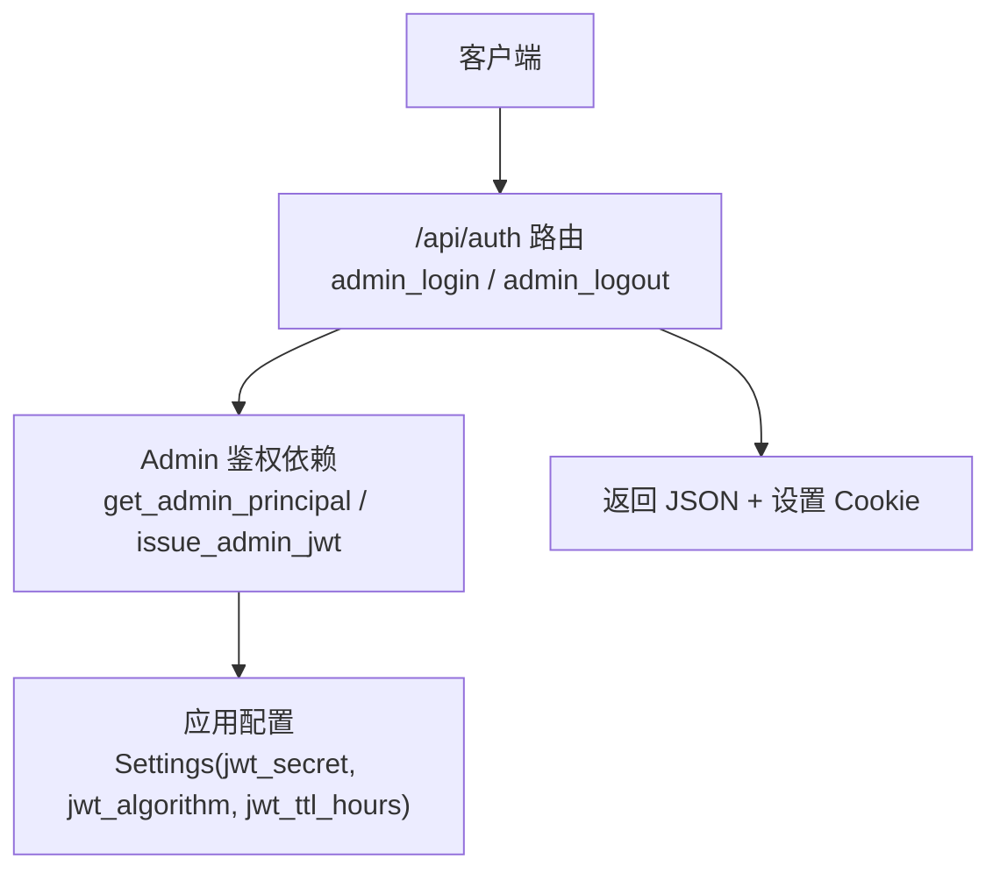
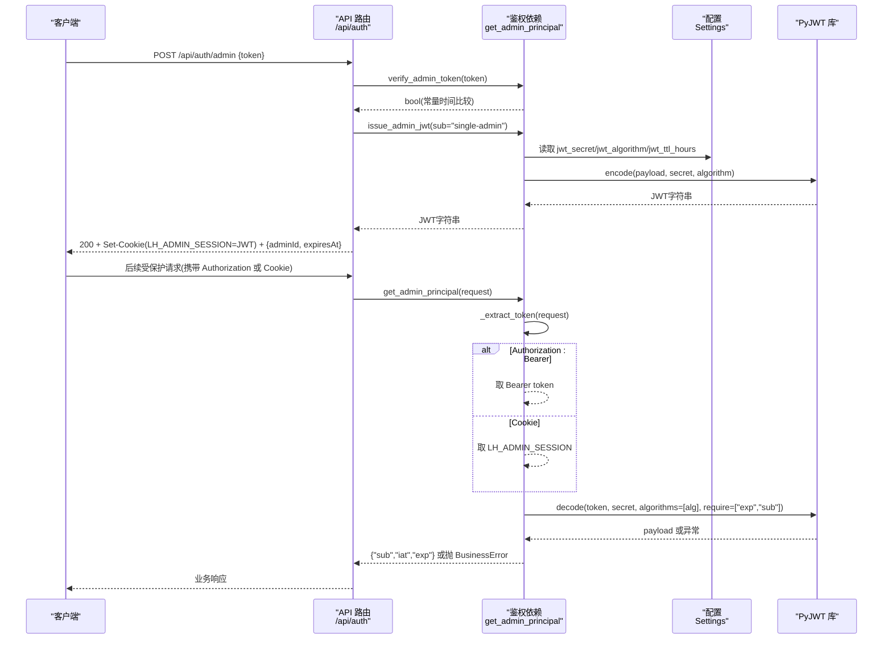
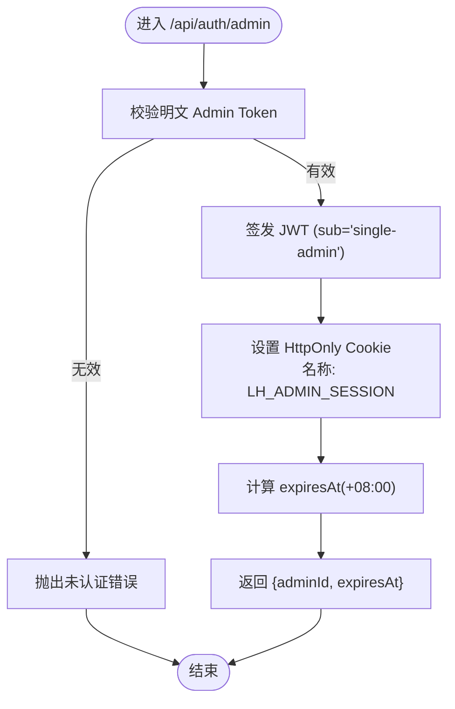
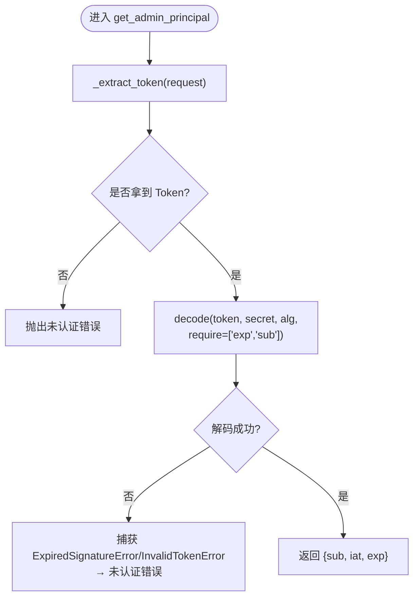
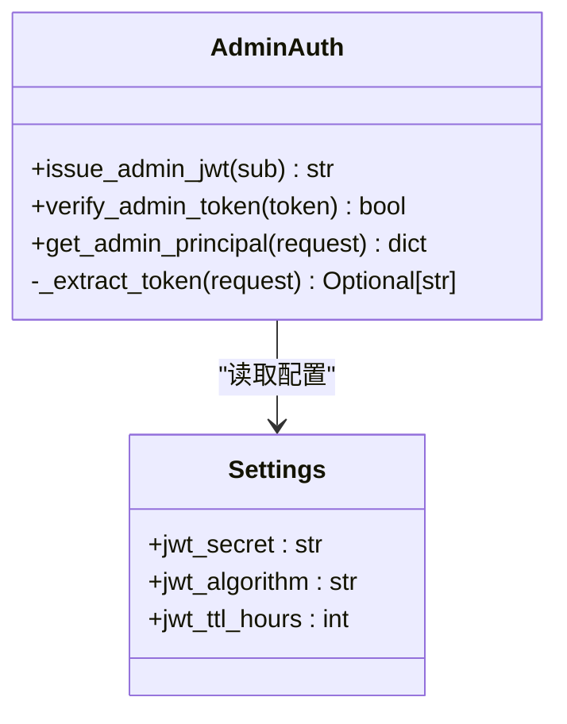
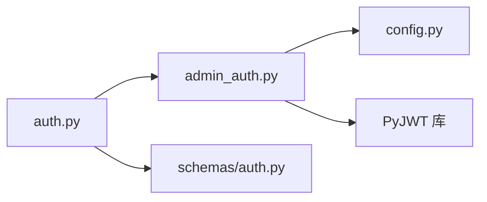

# JWT Token管理

<cite>
**本文引用的文件**
- [backend/app/api/auth.py](file://backend/app/api/auth.py)
- [backend/app/middleware/admin_auth.py](file://backend/app/middleware/admin_auth.py)
- [backend/app/core/config.py](file://backend/app/core/config.py)
- [backend/app/schemas/auth.py](file://backend/app/schemas/auth.py)
</cite>

## 目录
1. [简介](#简介)
2. [项目结构](#项目结构)
3. [核心组件](#核心组件)
4. [架构总览](#架构总览)
5. [详细组件分析](#详细组件分析)
6. [依赖关系分析](#依赖关系分析)
7. [性能与安全性考量](#性能与安全性考量)
8. [故障排查指南](#故障排查指南)
9. [结论](#结论)

## 简介
本技术文档聚焦 Learning Hub 后端中基于 JWT 的管理员鉴权机制，覆盖以下关键主题：
- Token 签发流程：payload 结构设计、时间戳处理、过期策略配置
- Token 验证机制：签名验证、过期检查、必需字段校验
- Token 提取逻辑：Authorization Bearer 头优先，其次 Cookie
- 安全最佳实践：密钥管理、算法选择、防重放攻击策略
- 错误处理模式与可观测性建议

## 项目结构
JWT 相关实现集中在以下模块：
- API 路由层：管理员登录/登出接口，负责签发并下发 JWT（通过 HttpOnly Cookie）
- 中间件/依赖注入：Token 提取、解码与主体解析
- 配置中心：JWT 密钥、算法、TTL 等参数来源
- Schema：登录请求/响应数据模型

图表来源
- [backend/app/api/auth.py:1-49](file://backend/app/api/auth.py#L1-L49)
- [backend/app/middleware/admin_auth.py:1-66](file://backend/app/middleware/admin_auth.py#L1-L66)
- [backend/app/core/config.py:40-47](file://backend/app/core/config.py#L40-L47)

章节来源
- [backend/app/api/auth.py:1-49](file://backend/app/api/auth.py#L1-L49)
- [backend/app/middleware/admin_auth.py:1-66](file://backend/app/middleware/admin_auth.py#L1-L66)
- [backend/app/core/config.py:1-88](file://backend/app/core/config.py#L1-L88)
- [backend/app/schemas/auth.py:1-17](file://backend/app/schemas/auth.py#L1-L17)

## 核心组件
- 管理员登录接口：校验“明文 Admin Token”，成功后签发 JWT，并通过 HttpOnly Cookie 下发。同时返回 expiresAt 用于前端展示会话到期时间。
- 管理员鉴权依赖：从请求中提取 Token（Bearer 优先，Cookie 次之），解码并校验 exp/sub 等必需字段，失败则抛出未认证错误。
- 配置项：jwt_secret、jwt_algorithm、jwt_ttl_hours 来自 Settings，支持环境变量覆盖。

章节来源
- [backend/app/api/auth.py:21-45](file://backend/app/api/auth.py#L21-L45)
- [backend/app/middleware/admin_auth.py:16-42](file://backend/app/middleware/admin_auth.py#L16-L42)
- [backend/app/core/config.py:43-46](file://backend/app/core/config.py#L43-L46)

## 架构总览
下图展示了管理员登录到受保护资源访问的完整调用链，包括 Token 提取、解码与主体注入过程。

图表来源
- [backend/app/api/auth.py:21-45](file://backend/app/api/auth.py#L21-L45)
- [backend/app/middleware/admin_auth.py:16-42](file://backend/app/middleware/admin_auth.py#L16-L42)
- [backend/app/middleware/admin_auth.py:45-55](file://backend/app/middleware/admin_auth.py#L45-L55)
- [backend/app/core/config.py:43-46](file://backend/app/core/config.py#L43-L46)

## 详细组件分析

### 管理员登录与登出（API 路由）
- 登录流程
  - 校验传入的明文 Admin Token（常量时间比较，避免时序侧信道）
  - 签发 JWT，设置 Cookie（HttpOnly、SameSite=Lax、路径为根路径）
  - 计算并返回 expiresAt（ISO-8601 格式，+08:00 时区）
- 登出流程
  - 删除 Cookie，结束会话

图表来源
- [backend/app/api/auth.py:21-45](file://backend/app/api/auth.py#L21-L45)

章节来源
- [backend/app/api/auth.py:21-45](file://backend/app/api/auth.py#L21-L45)
- [backend/app/schemas/auth.py:7-16](file://backend/app/schemas/auth.py#L7-L16)

### Token 提取与验证（鉴权依赖）
- 提取优先级
  - 优先 Authorization: Bearer <token>
  - 其次 Cookie LH_ADMIN_SESSION
- 验证规则
  - 使用配置的算法和密钥进行签名验证
  - 强制要求包含 exp 与 sub 字段
  - 捕获过期与无效令牌异常，统一转换为未认证错误
- 主体返回
  - 返回包含 sub、iat、exp 的字典供下游使用

图表来源
- [backend/app/middleware/admin_auth.py:16-42](file://backend/app/middleware/admin_auth.py#L16-L42)

章节来源
- [backend/app/middleware/admin_auth.py:16-42](file://backend/app/middleware/admin_auth.py#L16-L42)

### Token 签发（内部函数）
- Payload 设计
  - sub：主体标识（默认 single-admin）
  - iat：签发时间（Unix 秒）
  - exp：过期时间（当前时间 + TTL 小时数 × 3600）
- 算法与密钥
  - 算法与密钥均来自 Settings，便于环境隔离与轮换
- 返回值
  - 返回编码后的 JWT 字符串

图表来源
- [backend/app/middleware/admin_auth.py:45-55](file://backend/app/middleware/admin_auth.py#L45-L55)
- [backend/app/core/config.py:43-46](file://backend/app/core/config.py#L43-L46)

章节来源
- [backend/app/middleware/admin_auth.py:45-55](file://backend/app/middleware/admin_auth.py#L45-L55)
- [backend/app/core/config.py:43-46](file://backend/app/core/config.py#L43-L46)

### 配置项与生效范围
- jwt_secret：JWT 签名密钥，生产环境必须替换为高强度随机值
- jwt_algorithm：签名算法，默认 HS256
- jwt_ttl_hours：会话有效期（小时），默认 8 小时
- 上述配置均支持通过环境变量覆盖，且被缓存为全局单例

章节来源
- [backend/app/core/config.py:43-46](file://backend/app/core/config.py#L43-L46)

## 依赖关系分析
- 模块耦合
  - API 路由依赖鉴权依赖（签发与验证）
  - 鉴权依赖依赖配置中心获取密钥与算法
  - 登录接口依赖 Pydantic Schema 做入参校验
- 外部依赖
  - PyJWT：用于编解码 JWT
  - FastAPI：提供 Request/Response、Depends 等能力

图表来源
- [backend/app/api/auth.py:1-49](file://backend/app/api/auth.py#L1-L49)
- [backend/app/middleware/admin_auth.py:1-66](file://backend/app/middleware/admin_auth.py#L1-L66)
- [backend/app/core/config.py:1-88](file://backend/app/core/config.py#L1-L88)
- [backend/app/schemas/auth.py:1-17](file://backend/app/schemas/auth.py#L1-L17)

章节来源
- [backend/app/api/auth.py:1-49](file://backend/app/api/auth.py#L1-L49)
- [backend/app/middleware/admin_auth.py:1-66](file://backend/app/middleware/admin_auth.py#L1-L66)
- [backend/app/core/config.py:1-88](file://backend/app/core/config.py#L1-L88)
- [backend/app/schemas/auth.py:1-17](file://backend/app/schemas/auth.py#L1-L17)

## 性能与安全性考量

### 性能特性
- Token 提取与解码为轻量操作，主要开销在 HMAC 签名验证；HS256 在常规负载下开销极低
- Cookie 下发与读取由 Web 框架处理，无额外数据库访问
- 建议在网关层启用 TLS，减少跨域与 Cookie 传输风险

### 安全性最佳实践
- 密钥管理
  - 生产环境务必替换 jwt_secret 为高强度随机值，并通过环境变量注入
  - 定期轮换密钥；若需在线轮换，可引入双密钥窗口期并在解码时允许新旧密钥
- 算法选择
  - 默认 HS256 已满足多数场景；如需非对称签名，可迁移至 RS256/ES256，但需调整配置与验证逻辑
- 防重放攻击
  - 当前实现未包含 jti（一次性 ID）与黑名单机制；如需强防重放，可在 payload 中加入 jti，并在 Redis 中记录已使用 jti 的短期白名单
  - 结合短 TTL（如 15~30 分钟）与刷新令牌（Refresh Token）机制，降低泄露影响面
- 传输与存储
  - 使用 HTTPS 全站加密
  - Cookie 保持 HttpOnly、SameSite=Lax/Strict，必要时开启 Secure
  - 避免将敏感信息写入 JWT payload

[本节为通用指导，不直接分析具体文件]

## 故障排查指南
- 常见错误与定位
  - 未认证/会话失效：检查 Authorization 头或 Cookie 是否存在且格式正确
  - 会话已过期：确认本地系统时间与服务器一致，或延长 jwt_ttl_hours
  - 会话无效：核对 jwt_secret 与 jwt_algorithm 是否与签发端一致
- 日志与可观测性建议
  - 在解码前后记录请求来源 IP、User-Agent、Token 指纹（仅哈希）
  - 对未认证错误进行分类统计，识别异常来源
- 复现步骤建议
  - 使用 cURL 或 Postman 模拟登录与受保护接口访问
  - 分别测试 Authorization 头与 Cookie 两种路径

章节来源
- [backend/app/middleware/admin_auth.py:26-42](file://backend/app/middleware/admin_auth.py#L26-L42)
- [backend/app/api/auth.py:21-45](file://backend/app/api/auth.py#L21-L45)

## 结论
Learning Hub 的管理员鉴权采用标准 JWT 方案，具备清晰的签发与验证流程、明确的字段约束与错误处理。通过配置化密钥与算法、合理的 Cookie 安全属性以及可选的防重放增强，可满足生产环境的安全与可用性需求。建议在生产部署中严格管理密钥、启用 HTTPS，并根据业务需要评估引入 Refresh Token 与 jti 黑名单以进一步提升安全性。