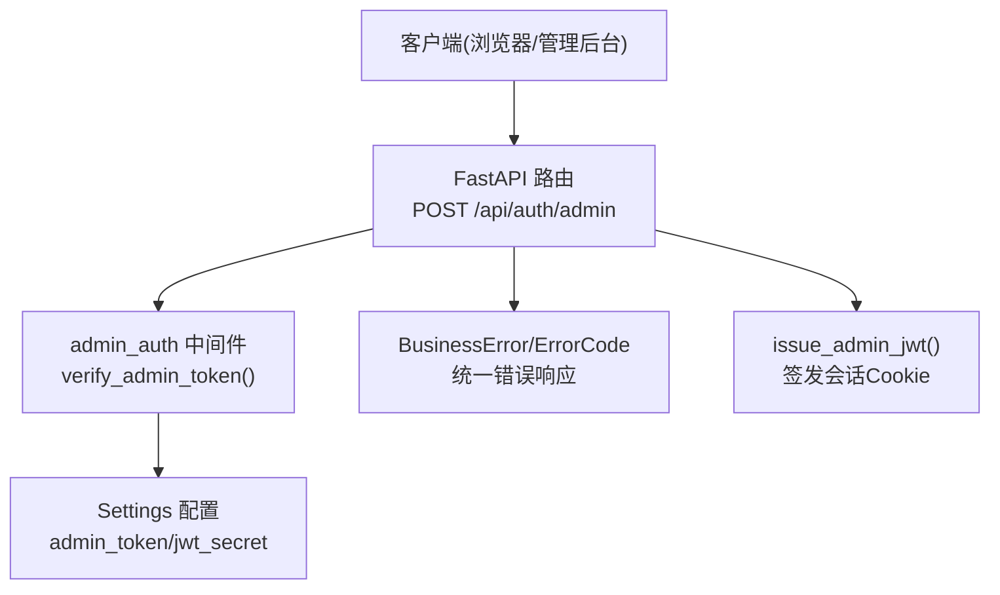
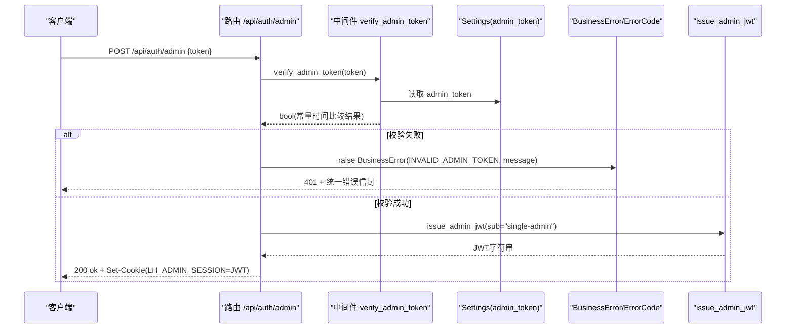
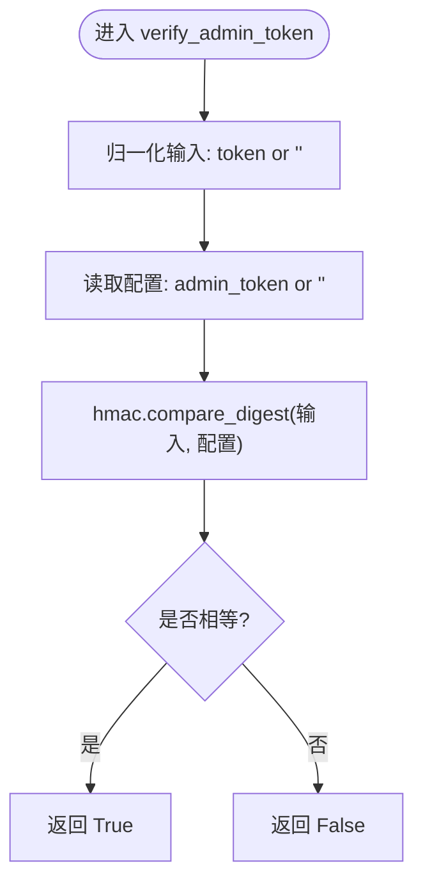
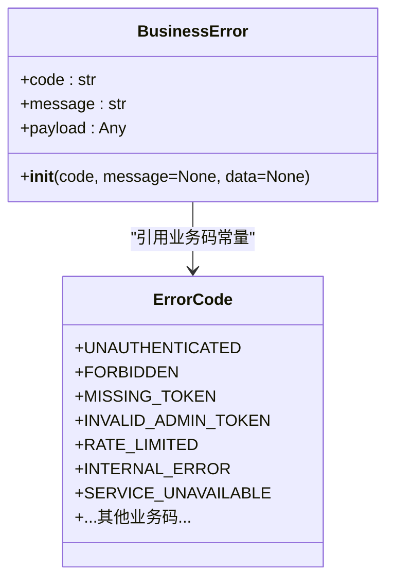
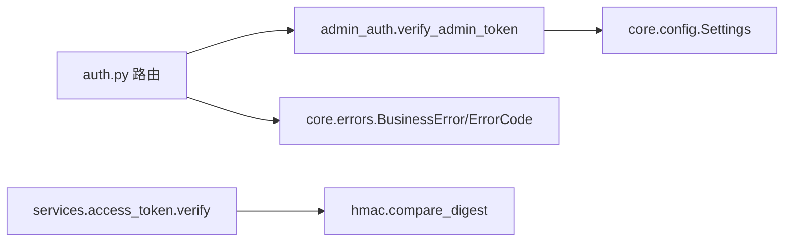

# Token安全验证

<cite>
**本文引用的文件列表**
- [backend/app/middleware/admin_auth.py](file://backend/app/middleware/admin_auth.py)
- [backend/app/api/auth.py](file://backend/app/api/auth.py)
- [backend/app/core/errors.py](file://backend/app/core/errors.py)
- [backend/app/services/access_token.py](file://backend/app/services/access_token.py)
- [backend/app/core/config.py](file://backend/app/core/config.py)
- [doc/spec/10-API设计规范.md](file://doc/spec/10-API设计规范.md)
- [doc/test/test-cases-integration.md](file://doc/test/test-cases-integration.md)
</cite>

## 目录
1. [简介](#简介)
2. [项目结构](#项目结构)
3. [核心组件](#核心组件)
4. [架构总览](#架构总览)
5. [详细组件分析](#详细组件分析)
6. [依赖关系分析](#依赖关系分析)
7. [性能与安全特性](#性能与安全特性)
8. [故障排查指南](#故障排查指南)
9. [结论](#结论)
10. [附录：最佳实践与渗透测试建议](#附录最佳实践与渗透测试建议)

## 简介
本技术文档聚焦 Learning Hub 的 Token 安全验证机制，围绕以下目标展开：
- 深入解析 verify_admin_token 函数的常量时间比较实现，说明其防止时序攻击的安全考虑。
- 详细说明 hmac.compare_digest 的使用场景与安全优势。
- 解释 BusinessError 和 ErrorCode 的统一错误处理机制，包括 HTTP 状态码映射和用户友好的错误消息。
- 提供安全配置的最佳实践，涵盖密钥轮换策略与监控告警设置。
- 给出安全漏洞防护与渗透测试建议。

## 项目结构
与 Token 安全验证相关的后端关键位置如下：
- 管理员登录路由：调用 verify_admin_token 校验明文 Admin Token，成功后签发 JWT 并写入 Cookie。
- 中间件鉴权：提供 get_admin_principal、issue_admin_jwt、verify_admin_token 等能力。
- 统一错误处理：BusinessError + ErrorCode 将业务错误码映射为 HTTP 状态码，并返回统一信封格式。
- 访问令牌服务：对持久化的访问令牌进行哈希比对（同样使用 hmac.compare_digest）。
- 配置中心：集中管理 admin_token、JWT 密钥、算法、TTL 等安全相关配置。

图表来源
- [backend/app/api/auth.py:21-39](file://backend/app/api/auth.py#L21-L39)
- [backend/app/middleware/admin_auth.py:58-62](file://backend/app/middleware/admin_auth.py#L58-L62)
- [backend/app/core/config.py:40-46](file://backend/app/core/config.py#L40-L46)
- [backend/app/core/errors.py:130-141](file://backend/app/core/errors.py#L130-L141)

章节来源
- [backend/app/api/auth.py:1-49](file://backend/app/api/auth.py#L1-L49)
- [backend/app/middleware/admin_auth.py:1-66](file://backend/app/middleware/admin_auth.py#L1-L66)
- [backend/app/core/errors.py:1-144](file://backend/app/core/errors.py#L1-L144)
- [backend/app/core/config.py:1-88](file://backend/app/core/config.py#L1-L88)

## 核心组件
- verify_admin_token：用于登录接口校验明文 Admin Token，采用常量时间比较，避免时序侧信道泄露。
- hmac.compare_digest：标准库提供的恒定时间字符串比较函数，适用于敏感值对比，如 Token、签名等。
- BusinessError 与 ErrorCode：集中定义业务错误码，并通过字典映射到 HTTP 状态码；异常携带 code/message/data，由全局处理器包装成统一信封。
- Settings：集中加载环境变量，包含 admin_token、jwt_secret、jwt_algorithm、jwt_ttl_hours 等安全配置项。

章节来源
- [backend/app/middleware/admin_auth.py:58-62](file://backend/app/middleware/admin_auth.py#L58-L62)
- [backend/app/core/errors.py:9-141](file://backend/app/core/errors.py#L9-L141)
- [backend/app/core/config.py:40-46](file://backend/app/core/config.py#L40-L46)

## 架构总览
下图展示了管理员登录流程中 Token 验证、JWT 签发与错误处理的交互关系。

图表来源
- [backend/app/api/auth.py:21-39](file://backend/app/api/auth.py#L21-L39)
- [backend/app/middleware/admin_auth.py:58-62](file://backend/app/middleware/admin_auth.py#L58-L62)
- [backend/app/middleware/admin_auth.py:45-55](file://backend/app/middleware/admin_auth.py#L45-L55)
- [backend/app/core/errors.py:130-141](file://backend/app/core/errors.py#L130-L141)

## 详细组件分析

### verify_admin_token 与常量时间比较
- 功能定位：在管理员登录入口处，对前端提交的明文 Admin Token 与服务端配置的 admin_token 进行比对。
- 安全要点：
  - 使用 hmac.compare_digest 进行常量时间比较，避免传统“==”或“!=”比较因提前短路而泄露字符匹配信息，从而抵御时序攻击。
  - 当传入 token 为空时，将其归一化为空字符串再比较，确保路径一致且无分支差异。
- 复杂度与开销：
  - 比较时间与输入长度线性相关，不随内容提前命中而缩短，适合固定长度的敏感值比较。
  - 对于短字符串（如 24 位 base36），额外开销可忽略不计。

图表来源
- [backend/app/middleware/admin_auth.py:58-62](file://backend/app/middleware/admin_auth.py#L58-L62)
- [backend/app/core/config.py:40-41](file://backend/app/core/config.py#L40-L41)

章节来源
- [backend/app/middleware/admin_auth.py:58-62](file://backend/app/middleware/admin_auth.py#L58-L62)
- [backend/app/core/config.py:40-41](file://backend/app/core/config.py#L40-L41)

### hmac.compare_digest 的使用场景与安全优势
- 使用场景：
  - 登录接口中的明文 Admin Token 比对。
  - 访问令牌服务中对 value_hash 的比对（见 services/access_token.verify）。
- 安全优势：
  - 恒定时间比较，避免通过请求耗时差异推断匹配进度，有效防御时序攻击。
  - 标准库实现，经过广泛审计与优化，具备跨平台一致性。
- 注意事项：
  - 仅用于敏感值的字节串或字符串比较，不适用于通用业务逻辑判断。
  - 若比较对象长度不一致，仍会消耗相同时间，但不会泄露具体匹配位置。

章节来源
- [backend/app/middleware/admin_auth.py:58-62](file://backend/app/middleware/admin_auth.py#L58-L62)
- [backend/app/services/access_token.py:193-205](file://backend/app/services/access_token.py#L193-L205)

### BusinessError 与 ErrorCode 的统一错误处理
- 设计思路：
  - ErrorCode 集中定义所有业务错误码，覆盖认证、课件、分类、标签、素材、Token、搜索/LLM 等模块。
  - _HTTP_BY_CODE 将业务码映射到 HTTP 状态码，保证对外语义清晰。
  - BusinessError 继承自 HTTPException，构造时将 code、message、data 放入 detail，供全局错误处理器封装为统一信封。
- 典型映射：
  - INVALID_ADMIN_TOKEN → 401
  - UNAUTHENTICATED → 401
  - RATE_LIMITED → 429
  - LAST_TOKEN_REQUIRED → 422
  - TOKEN_REVOKED → 410
- 用户友好消息：
  - 在抛出异常时可附带中文 message，便于前端直接展示给用户。

图表来源
- [backend/app/core/errors.py:9-71](file://backend/app/core/errors.py#L9-L71)
- [backend/app/core/errors.py:73-127](file://backend/app/core/errors.py#L73-L127)
- [backend/app/core/errors.py:130-141](file://backend/app/core/errors.py#L130-L141)

章节来源
- [backend/app/core/errors.py:1-144](file://backend/app/core/errors.py#L1-L144)
- [doc/spec/10-API设计规范.md:285-316](file://doc/spec/10-API设计规范.md#L285-L316)

### 访问令牌服务中的常量时间比对
- 功能定位：根据明文 token 计算哈希后，遍历数据库中的 AccessToken 记录，使用 hmac.compare_digest 与存储的 value_hash 进行比对。
- 安全考量：
  - 即使存在多条记录，也逐一比较，避免提前返回导致时序泄露。
  - 该路径常用于前台解锁受限课件时的校验，需保证高并发下的安全性与稳定性。

章节来源
- [backend/app/services/access_token.py:193-205](file://backend/app/services/access_token.py#L193-L205)

## 依赖关系分析
- 路由层依赖中间件的 verify_admin_token 完成登录校验。
- 中间件依赖 Settings 获取 admin_token、jwt_secret、jwt_algorithm、jwt_ttl_hours 等配置。
- 路由层在失败时抛出 BusinessError，由全局错误处理器统一包装响应。
- 访问令牌服务独立于登录流程，但同样遵循常量时间比较原则。

图表来源
- [backend/app/api/auth.py:21-39](file://backend/app/api/auth.py#L21-L39)
- [backend/app/middleware/admin_auth.py:58-62](file://backend/app/middleware/admin_auth.py#L58-L62)
- [backend/app/core/config.py:40-46](file://backend/app/core/config.py#L40-L46)
- [backend/app/services/access_token.py:193-205](file://backend/app/services/access_token.py#L193-L205)

章节来源
- [backend/app/api/auth.py:1-49](file://backend/app/api/auth.py#L1-L49)
- [backend/app/middleware/admin_auth.py:1-66](file://backend/app/middleware/admin_auth.py#L1-L66)
- [backend/app/core/config.py:1-88](file://backend/app/core/config.py#L1-L88)
- [backend/app/services/access_token.py:185-235](file://backend/app/services/access_token.py#L185-L235)

## 性能与安全特性
- 性能：
  - 常量时间比较的时间开销与输入长度线性相关，对短字符串影响极小。
  - 登录接口主要开销在网络与加密操作（JWT 编解码），整体延迟可控。
- 安全：
  - 使用 hmac.compare_digest 抵御时序攻击。
  - JWT 使用 HS256 算法与强密钥，TTL 默认 8 小时，可通过配置调整。
  - 错误响应统一且不含敏感细节，避免信息泄露。

[本节为通用指导，无需特定文件引用]

## 故障排查指南
- 登录失败 401 invalid_admin_token：
  - 检查 Settings.admin_token 是否与前端提交一致。
  - 确认未启用限流导致 429 rate_limited。
- 会话过期 401 unauthenticated：
  - 检查 JWT TTL 配置 jwt_ttl_hours 与服务器时钟同步。
- 删除最后一个 Token 被拒绝 422 last_token_required：
  - 确认是否存在受限课件绑定该 Token，必要时先解绑或新增 Token。
- 访问令牌失效 410 token_revoked：
  - 重新生成 Token 并更新前端缓存。

章节来源
- [backend/app/core/errors.py:73-127](file://backend/app/core/errors.py#L73-L127)
- [doc/test/test-cases-integration.md:149-167](file://doc/test/test-cases-integration.md#L149-L167)

## 结论
Learning Hub 在 Token 安全验证方面采用了业界推荐的最佳实践：
- 使用 hmac.compare_digest 进行常量时间比较，有效抵御时序攻击。
- 通过 BusinessError 与 ErrorCode 建立统一的错误处理体系，提升可观测性与用户体验。
- 借助 Settings 集中管理安全配置，便于运维与合规审计。
后续可在密钥轮换、限流与监控告警方面进一步完善，以增强生产环境的安全性与可维护性。

[本节为总结，无需特定文件引用]

## 附录：最佳实践与渗透测试建议

### 安全配置最佳实践
- 密钥管理
  - 生产环境必须替换默认 admin_token 与 jwt_secret，建议使用密码学安全的随机源生成。
  - 支持多密钥并行验证以实现平滑轮换：当前活跃密钥与上一代密钥同时允许验证，到期后下线旧密钥。
- 算法与参数
  - JWT 算法建议使用 HS256 或更强算法；TTL 不宜过长，结合刷新机制降低风险。
  - CORS 白名单严格限制，禁止在生产使用通配符。
- 限流与防护
  - 对登录接口实施 IP 级与用户级双重限流，防止暴力破解。
  - 对访问令牌校验接口增加速率限制与异常重试保护。
- 日志与审计
  - 结构化日志记录登录尝试、失败原因与请求标识，便于追踪与取证。
  - 敏感字段脱敏输出，避免泄露 Token 或密钥片段。

章节来源
- [backend/app/core/config.py:40-46](file://backend/app/core/config.py#L40-L46)
- [doc/test/test-cases-integration.md:429-437](file://doc/test/test-cases-integration.md#L429-L437)

### 监控与告警设置
- 指标采集
  - 暴露关键指标：登录成功率、失败率、限流触发次数、JWT 校验失败次数。
- 告警规则
  - 登录失败率突增、429 限流频繁触发、5xx 错误比例超过阈值时发送告警。
- 可视化
  - 使用 Grafana 面板展示趋势与分布，辅助快速定位问题。

章节来源
- [doc/test/test-cases-integration.md:495-525](file://doc/test/test-cases-integration.md#L495-L525)

### 渗透测试建议
- 时序攻击验证
  - 针对登录接口与访问令牌校验接口，测量不同输入下的响应时间分布，验证是否存在可区分差异。
- 暴力破解与枚举
  - 模拟高频错误登录，验证限流与账户锁定策略是否生效。
- 令牌生命周期
  - 验证 Token 撤销后立即失效、重新生成后旧值不可用、localStorage 清理行为符合预期。
- 输入校验与注入
  - 对各类输入进行 XSS、SQL 注入、路径穿越等测试，确保后端有足够防护。
- 传输安全
  - 强制 HTTPS，禁用明文 HTTP；验证 HSTS 与证书有效性。

章节来源
- [doc/test/test-cases-integration.md:387-447](file://doc/test/test-cases-integration.md#L387-L447)