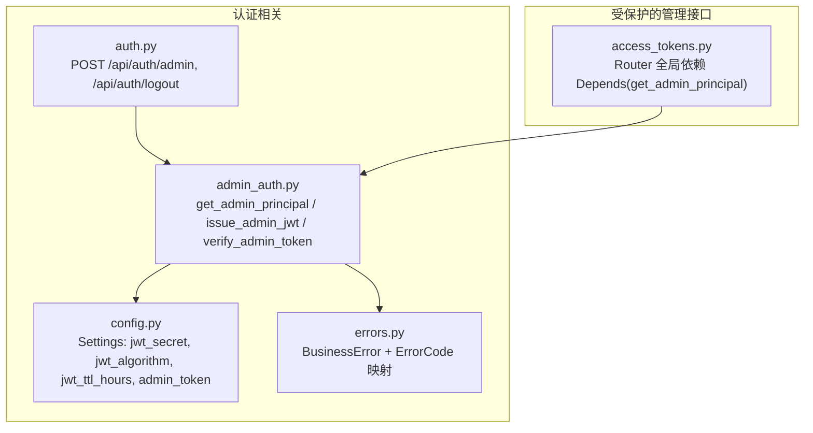
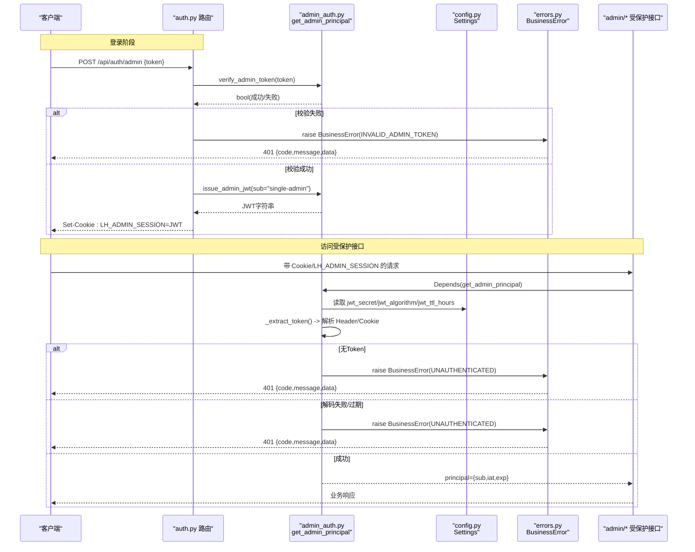
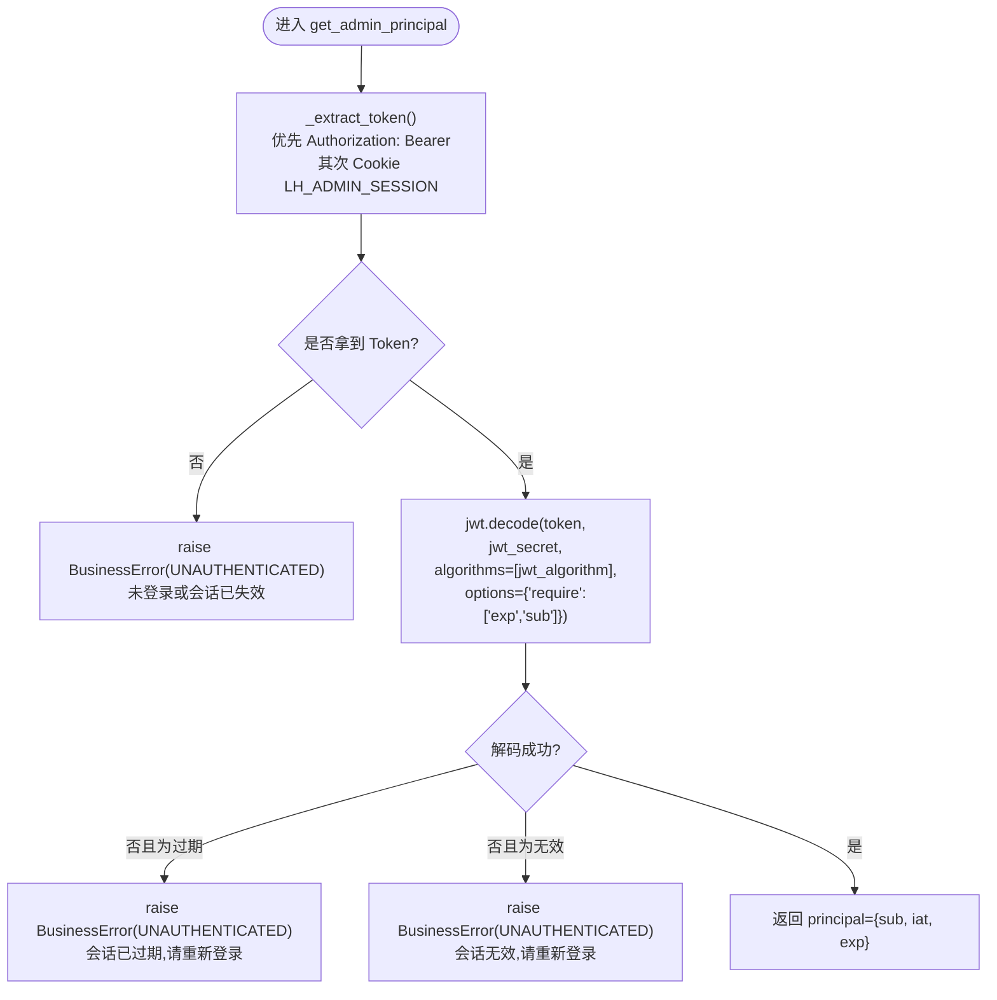
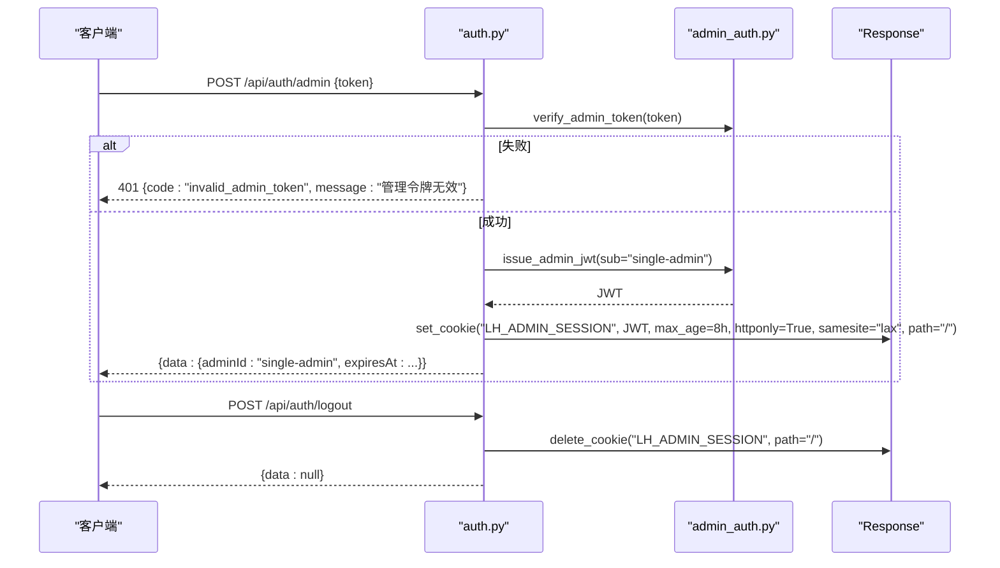
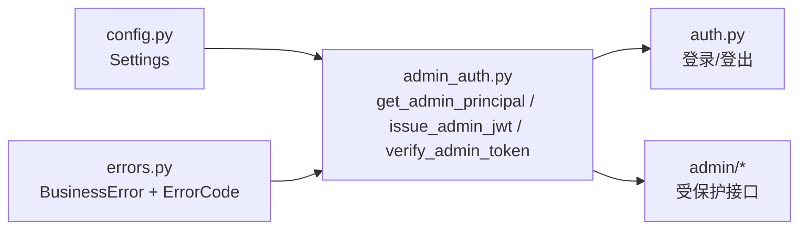

# 管理员会话验证

<cite>
**本文引用的文件**   
- [backend/app/middleware/admin_auth.py](file://backend/app/middleware/admin_auth.py)
- [backend/app/api/auth.py](file://backend/app/api/auth.py)
- [backend/app/core/errors.py](file://backend/app/core/errors.py)
- [backend/app/core/config.py](file://backend/app/core/config.py)
- [backend/app/api/admin/access_tokens.py](file://backend/app/api/admin/access_tokens.py)
</cite>

## 目录
1. [简介](#简介)
2. [项目结构](#项目结构)
3. [核心组件](#核心组件)
4. [架构总览](#架构总览)
5. [详细组件分析](#详细组件分析)
6. [依赖关系分析](#依赖关系分析)
7. [性能与安全性考量](#性能与安全性考量)
8. [故障排查指南](#故障排查指南)
9. [结论](#结论)
10. [附录：扩展与自定义验证](#附录扩展与自定义验证)

## 简介
本技术文档聚焦于 Learning Hub 管理后台的会话验证体系，围绕 get_admin_principal 依赖函数展开，系统阐述其请求上下文获取、Token 提取与校验流程；说明未登录、会话过期、无效 Token 的错误处理路径；解释 FastAPI 依赖注入在认证中的应用（Depends 装饰器）及错误传播机制；并提供会话管理的扩展指南与自定义验证逻辑的实现方法。

## 项目结构
与管理员会话验证相关的后端代码主要分布在以下模块：
- 中间件/依赖：admin_auth.py（定义 get_admin_principal、issue_admin_jwt、verify_admin_token）
- 鉴权路由：auth.py（Admin 登录/登出，签发并写入 Cookie）
- 配置中心：config.py（读取 JWT 密钥、算法、TTL 等）
- 错误模型：errors.py（统一业务异常与 HTTP 状态码映射）
- 受保护的管理 API：admin/access_tokens.py（示例展示全局依赖注入）



图表来源
- [backend/app/middleware/admin_auth.py:1-66](file://backend/app/middleware/admin_auth.py#L1-L66)
- [backend/app/api/auth.py:1-49](file://backend/app/api/auth.py#L1-L49)
- [backend/app/core/config.py:1-88](file://backend/app/core/config.py#L1-L88)
- [backend/app/core/errors.py:1-144](file://backend/app/core/errors.py#L1-L144)
- [backend/app/api/admin/access_tokens.py:1-120](file://backend/app/api/admin/access_tokens.py#L1-L120)

章节来源
- [backend/app/middleware/admin_auth.py:1-66](file://backend/app/middleware/admin_auth.py#L1-L66)
- [backend/app/api/auth.py:1-49](file://backend/app/api/auth.py#L1-L49)
- [backend/app/core/config.py:1-88](file://backend/app/core/config.py#L1-L88)
- [backend/app/core/errors.py:1-144](file://backend/app/core/errors.py#L1-L144)
- [backend/app/api/admin/access_tokens.py:1-120](file://backend/app/api/admin/access_tokens.py#L1-L120)

## 核心组件
- get_admin_principal(request): FastAPI 依赖函数，负责从请求中提取并校验管理员会话令牌，返回包含子标识和时间的主体信息字典。
- _extract_token(request): 内部工具，优先从 Authorization: Bearer 头提取，其次从 LH_ADMIN_SESSION Cookie 提取。
- issue_admin_jwt(sub): 签发管理员 JWT，默认 TTL 由配置控制。
- verify_admin_token(token): 登录接口使用的明文 Admin Token 校验（常量时间比较）。
- BusinessError + ErrorCode: 统一业务异常与 HTTP 状态码映射，用于认证失败时的错误响应。
- Settings: 集中管理 jwt_secret、jwt_algorithm、jwt_ttl_hours、admin_token 等配置项。

章节来源
- [backend/app/middleware/admin_auth.py:16-42](file://backend/app/middleware/admin_auth.py#L16-L42)
- [backend/app/middleware/admin_auth.py:45-62](file://backend/app/middleware/admin_auth.py#L45-L62)
- [backend/app/core/errors.py:9-144](file://backend/app/core/errors.py#L9-L144)
- [backend/app/core/config.py:40-46](file://backend/app/core/config.py#L40-L46)

## 架构总览
管理员会话验证的整体流程如下：
- 客户端通过 POST /api/auth/admin 提交明文 Admin Token，服务端使用 verify_admin_token 校验通过后签发 JWT，并以 HttpOnly Cookie 形式下发。
- 后续访问受保护的管理端点时，FastAPI 在执行路由前调用 get_admin_principal 依赖，自动完成 Token 提取与校验。
- 若未携带 Token、Token 过期或签名无效，则抛出 BusinessError，最终由全局错误处理器转换为统一的 JSON 信封响应。



图表来源
- [backend/app/api/auth.py:21-45](file://backend/app/api/auth.py#L21-L45)
- [backend/app/middleware/admin_auth.py:16-42](file://backend/app/middleware/admin_auth.py#L16-L42)
- [backend/app/middleware/admin_auth.py:45-55](file://backend/app/middleware/admin_auth.py#L45-L55)
- [backend/app/core/errors.py:73-144](file://backend/app/core/errors.py#L73-L144)
- [backend/app/core/config.py:40-46](file://backend/app/core/config.py#L40-L46)

## 详细组件分析

### get_admin_principal 依赖函数实现原理
- 请求上下文获取：接收 FastAPI Request 对象，从中读取请求头与 Cookie。
- Token 提取策略：
  - 优先 Authorization: Bearer <token>
  - 回退到 Cookie LH_ADMIN_SESSION
- 校验流程：
  - 若无 Token，直接抛出未认证错误
  - 使用配置的 jwt_secret 与 jwt_algorithm 解码 JWT，要求必须包含 exp 与 sub
  - 捕获 ExpiredSignatureError 与 InvalidTokenError，分别对应“会话已过期”和“会话无效”
- 返回值：返回包含 sub、iat、exp 的主体字典，供下游路由使用



图表来源
- [backend/app/middleware/admin_auth.py:16-42](file://backend/app/middleware/admin_auth.py#L16-L42)

章节来源
- [backend/app/middleware/admin_auth.py:16-42](file://backend/app/middleware/admin_auth.py#L16-L42)

### 会话状态检查与错误处理
- 未登录：当 _extract_token 无法找到任何 Token 时，立即抛出未认证错误。
- 会话过期：JWT 解码抛出 ExpiredSignatureError，转换为未认证错误，提示“会话已过期”。
- 无效 Token：JWT 解码抛出 InvalidTokenError，转换为未认证错误，提示“会话无效”。
- 错误传播：所有认证错误均通过 BusinessError 抛出，由全局错误处理器统一包装为 {code, message, data, requestId} 信封响应，HTTP 状态码由 ErrorCode 映射决定（例如 UNAUTHENTICATED → 401）。

章节来源
- [backend/app/middleware/admin_auth.py:26-42](file://backend/app/middleware/admin_auth.py#L26-L42)
- [backend/app/core/errors.py:73-144](file://backend/app/core/errors.py#L73-L144)

### FastAPI 依赖注入模式在认证中的应用
- 依赖函数：get_admin_principal 作为依赖函数，被路由或 Router 全局依赖引用。
- 使用方式：
  - 路由级：在单个路由参数中使用 Depends(get_admin_principal)
  - Router 级：在 APIRouter 初始化时使用 dependencies=[Depends(get_admin_principal)]，对全部子路由生效
- 错误传播：依赖函数抛出的 BusinessError 会中断当前请求处理，交由全局错误处理器生成标准响应体，避免在每个路由中重复处理认证失败。

```mermaid
classDiagram
class AdminAuth {
+get_admin_principal(request) dict
+_extract_token(request) Optional[str]
+issue_admin_jwt(sub) str
+verify_admin_token(token) bool
}
class AuthRouter {
+POST "/api/auth/admin"
+POST "/api/auth/logout"
}
class ProtectedRouter {
+GET "/api/admin/access-tokens"
+POST "/api/admin/access-tokens"
+DELETE "/api/admin/access-tokens/{id}"
}
class Settings {
+jwt_secret : str
+jwt_algorithm : str
+jwt_ttl_hours : int
+admin_token : str
}
class BusinessError {
+__init__(code, message, data)
}
AdminAuth --> Settings : "读取配置"
AdminAuth --> BusinessError : "抛出认证错误"
AuthRouter --> AdminAuth : "调用 verify_admin_token / issue_admin_jwt"
ProtectedRouter --> AdminAuth : "全局依赖 Depends(get_admin_principal)"
```

图表来源
- [backend/app/middleware/admin_auth.py:1-66](file://backend/app/middleware/admin_auth.py#L1-L66)
- [backend/app/api/auth.py:1-49](file://backend/app/api/auth.py#L1-L49)
- [backend/app/api/admin/access_tokens.py:21-25](file://backend/app/api/admin/access_tokens.py#L21-L25)
- [backend/app/core/config.py:40-46](file://backend/app/core/config.py#L40-L46)
- [backend/app/core/errors.py:130-144](file://backend/app/core/errors.py#L130-L144)

章节来源
- [backend/app/api/admin/access_tokens.py:21-25](file://backend/app/api/admin/access_tokens.py#L21-L25)
- [backend/app/api/auth.py:21-45](file://backend/app/api/auth.py#L21-L45)
- [backend/app/middleware/admin_auth.py:1-66](file://backend/app/middleware/admin_auth.py#L1-L66)
- [backend/app/core/errors.py:130-144](file://backend/app/core/errors.py#L130-L144)

### 登录与登出流程
- 登录：
  - 客户端提交明文 Admin Token
  - 服务端使用 verify_admin_token 进行常量时间比较校验
  - 校验通过后签发 JWT，并通过 Response.set_cookie 写入 LH_ADMIN_SESSION（HttpOnly、SameSite=Lax、Path=/）
  - 返回包含 adminId 与 expiresAt 的响应
- 登出：
  - 删除 LH_ADMIN_SESSION Cookie，结束会话



图表来源
- [backend/app/api/auth.py:21-45](file://backend/app/api/auth.py#L21-L45)
- [backend/app/middleware/admin_auth.py:45-62](file://backend/app/middleware/admin_auth.py#L45-L62)

章节来源
- [backend/app/api/auth.py:21-45](file://backend/app/api/auth.py#L21-L45)
- [backend/app/middleware/admin_auth.py:45-62](file://backend/app/middleware/admin_auth.py#L45-L62)

## 依赖关系分析
- 模块耦合：
  - admin_auth.py 依赖 config.py（读取 JWT 配置）与 errors.py（抛出业务异常）
  - auth.py 依赖 admin_auth.py（签发/校验）与 errors.py（登录失败）
  - admin/* 路由依赖 admin_auth.py（全局依赖注入）
- 外部依赖：
  - PyJWT（jwt.encode/jwt.decode）
  - hmac（常量时间比较）
  - FastAPI（Request、Depends、Response）



图表来源
- [backend/app/core/config.py:40-46](file://backend/app/core/config.py#L40-L46)
- [backend/app/core/errors.py:73-144](file://backend/app/core/errors.py#L73-L144)
- [backend/app/middleware/admin_auth.py:1-66](file://backend/app/middleware/admin_auth.py#L1-L66)
- [backend/app/api/auth.py:1-49](file://backend/app/api/auth.py#L1-L49)
- [backend/app/api/admin/access_tokens.py:1-120](file://backend/app/api/admin/access_tokens.py#L1-L120)

章节来源
- [backend/app/core/config.py:40-46](file://backend/app/core/config.py#L40-L46)
- [backend/app/core/errors.py:73-144](file://backend/app/core/errors.py#L73-L144)
- [backend/app/middleware/admin_auth.py:1-66](file://backend/app/middleware/admin_auth.py#L1-L66)
- [backend/app/api/auth.py:1-49](file://backend/app/api/auth.py#L1-L49)
- [backend/app/api/admin/access_tokens.py:1-120](file://backend/app/api/admin/access_tokens.py#L1-L120)

## 性能与安全性考量
- 性能
  - 依赖函数仅做轻量级的头部/Cookie 解析与 JWT 解码，开销较小
  - 建议在生产环境启用缓存配置实例（当前已通过 lru_cache 缓存 Settings）
- 安全性
  - Cookie 设置 HttpOnly 与 SameSite=Lax，降低 XSS 与 CSRF 风险
  - 使用 HMAC 常量时间比较防止时序攻击
  - JWT 要求 exp 与 sub，确保最小必要字段
  - 生产环境务必更换 jwt_secret 与合理的 jwt_ttl_hours

[本节为通用指导，不直接分析具体文件]

## 故障排查指南
- 常见错误与定位
  - 401 未认证：检查请求是否携带 Authorization: Bearer 或 LH_ADMIN_SESSION Cookie
  - 401 会话已过期：确认 JWT 的 exp 是否超过当前时间，调整 jwt_ttl_hours 或重新登录
  - 401 会话无效：检查 jwt_secret 与 jwt_algorithm 是否与签发一致，确认 Token 未被篡改
  - 登录失败：确认提交的明文 Admin Token 与配置 admin_token 一致
- 日志与调试
  - 在 get_admin_principal 与登录路由中添加结构化日志，记录请求来源、Token 来源类型、解码结果与异常堆栈
  - 使用测试用例覆盖未登录、过期、无效三种场景，确保错误消息与状态码符合预期

章节来源
- [backend/app/middleware/admin_auth.py:26-42](file://backend/app/middleware/admin_auth.py#L26-L42)
- [backend/app/api/auth.py:21-45](file://backend/app/api/auth.py#L21-L45)
- [backend/app/core/errors.py:73-144](file://backend/app/core/errors.py#L73-L144)

## 结论
get_admin_principal 以 FastAPI 依赖注入为核心，实现了简洁而健壮的管理员会话验证：统一 Token 提取策略、严格的 JWT 解码与错误分类、以及标准化的错误传播。配合登录/登出路由与全局依赖注入，可快速将任意管理接口纳入安全保护范围。通过合理配置与扩展，可进一步支持多角色、细粒度权限与审计追踪。

[本节为总结性内容，不直接分析具体文件]

## 附录：扩展与自定义验证
- 增加额外声明字段
  - 在 issue_admin_jwt 的 payload 中扩展字段（如 role、tenant），并在 get_admin_principal 中返回给下游使用
- 引入黑名单/撤销机制
  - 在 get_admin_principal 解码后查询 Redis/数据库中的黑名单集合，命中则拒绝访问
- 多来源 Token 支持
  - 在 _extract_token 中增加其他来源（如 X-Admin-Token 请求头），保持向后兼容
- 更细粒度的错误语义
  - 新增 ErrorCode 枚举值，区分“未登录”、“过期”、“无效”，便于前端差异化提示
- 全局依赖 vs 路由级依赖
  - 推荐在管理路由组上使用 Router 级 dependencies=[Depends(get_admin_principal)]，减少重复代码
- 最佳实践
  - 生产环境强制 HTTPS，确保 Cookie 传输安全
  - 定期轮换 jwt_secret，缩短 jwt_ttl_hours 并结合刷新机制
  - 对敏感操作增加二次确认或审计日志

[本节为概念性指导，不直接分析具体文件]