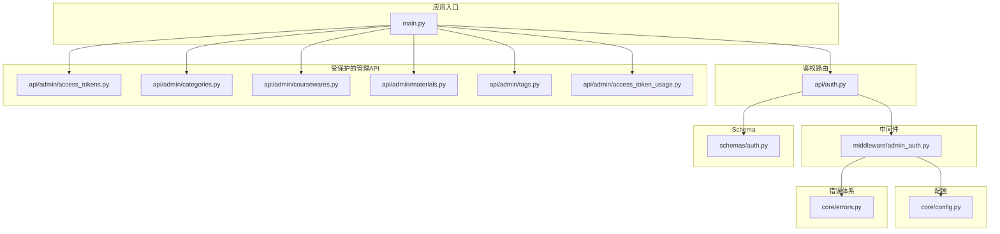
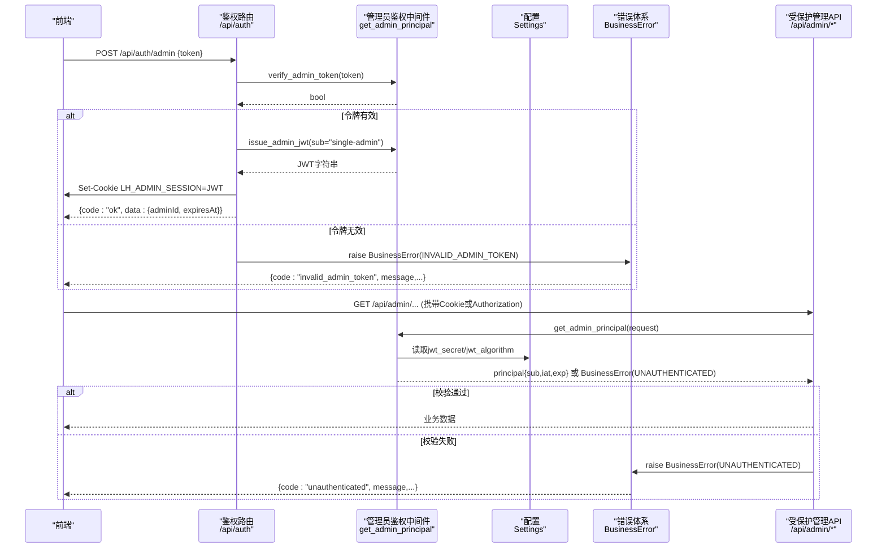
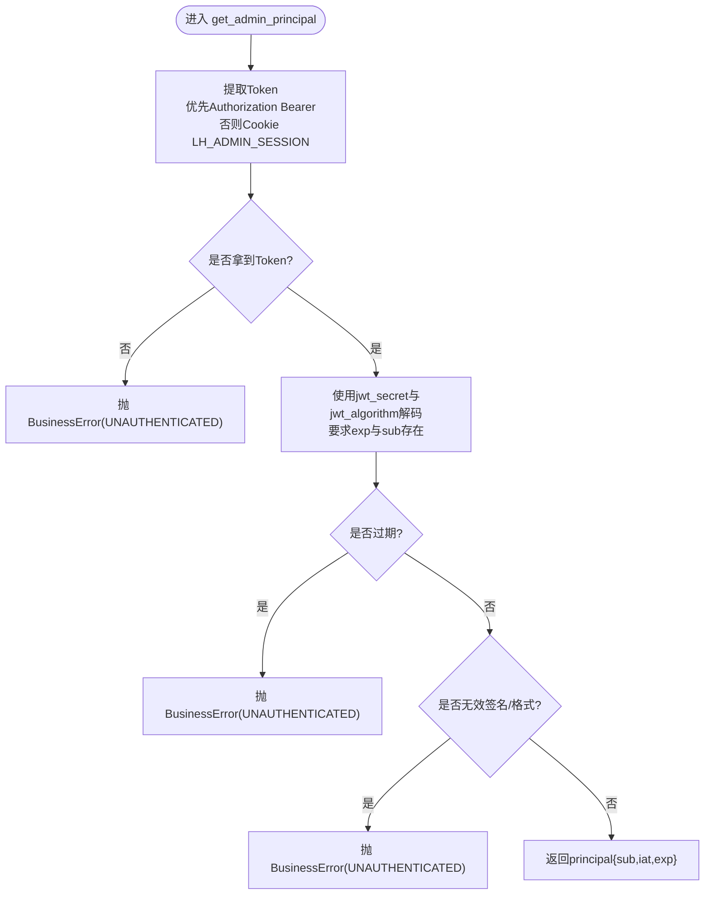
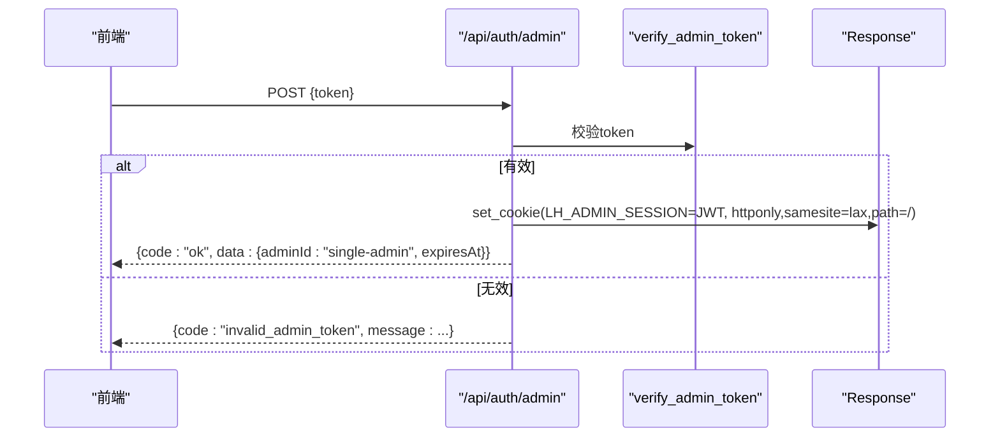
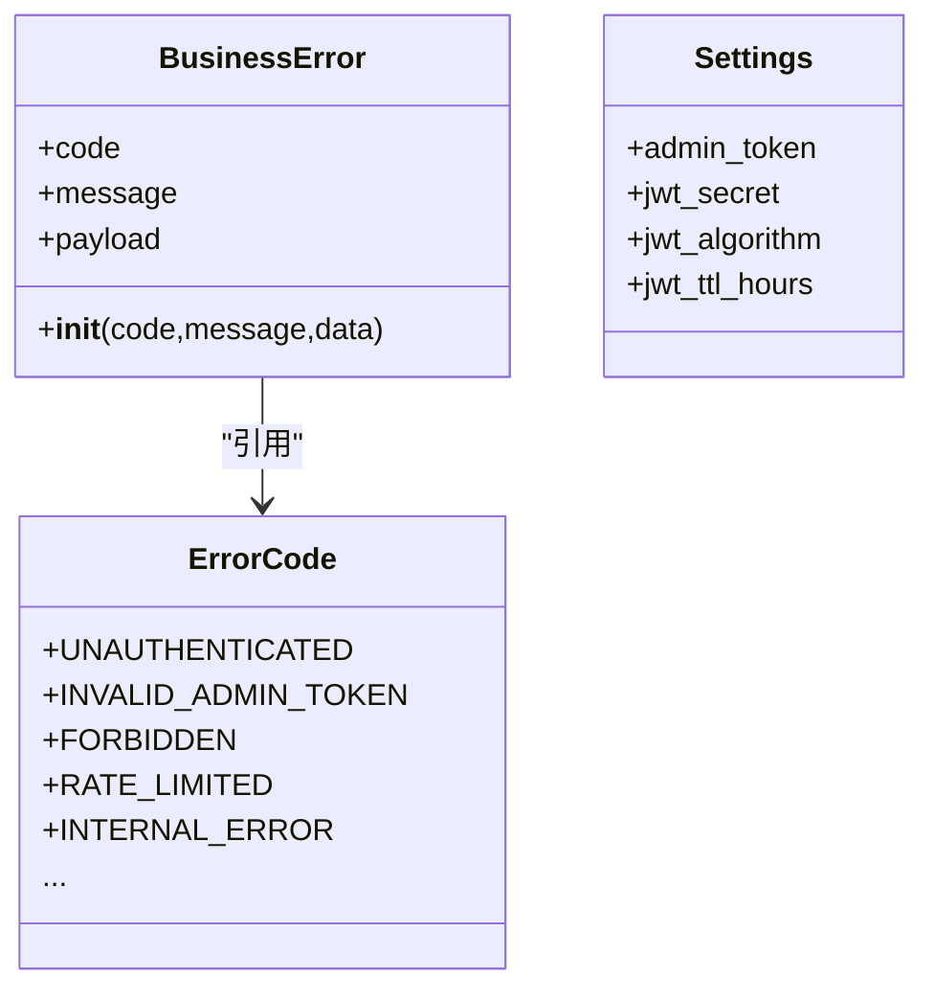
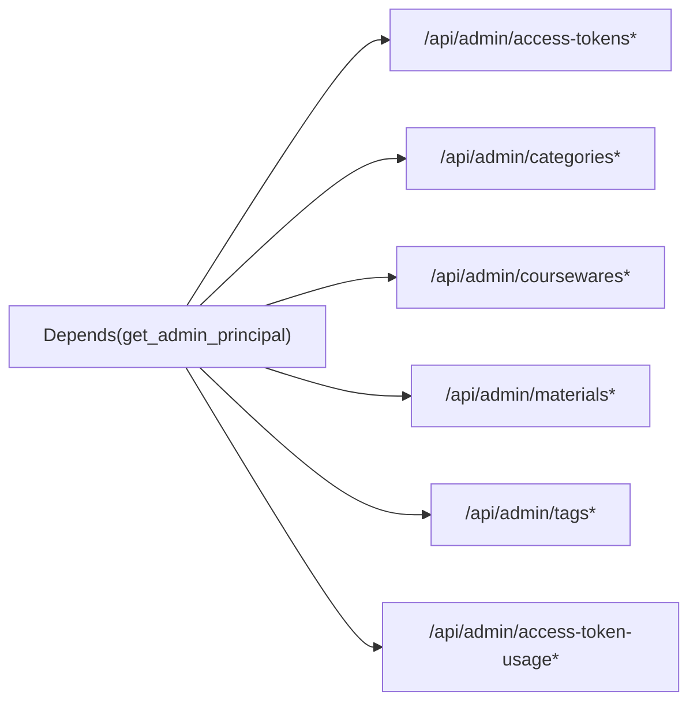
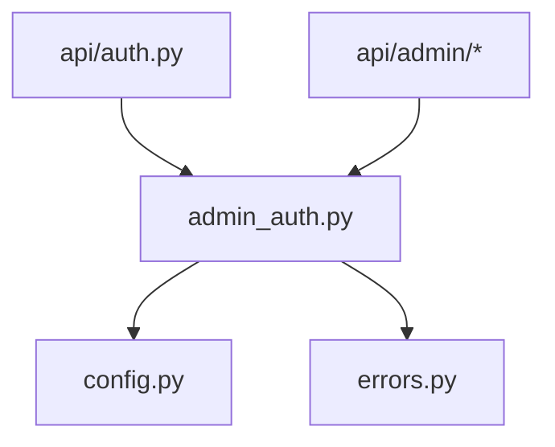

# 管理员认证中间件

<cite>
**本文引用的文件列表**
- [backend/app/middleware/admin_auth.py](file://backend/app/middleware/admin_auth.py)
- [backend/app/api/auth.py](file://backend/app/api/auth.py)
- [backend/app/core/config.py](file://backend/app/core/config.py)
- [backend/app/core/errors.py](file://backend/app/core/errors.py)
- [backend/app/schemas/auth.py](file://backend/app/schemas/auth.py)
- [backend/app/main.py](file://backend/app/main.py)
- [backend/app/api/admin/access_tokens.py](file://backend/app/api/admin/access_tokens.py)
- [backend/app/api/admin/categories.py](file://backend/app/api/admin/categories.py)
- [backend/app/api/admin/coursewares.py](file://backend/app/api/admin/coursewares.py)
- [backend/app/api/admin/materials.py](file://backend/app/api/admin/materials.py)
- [backend/app/api/admin/tags.py](file://backend/app/api/admin/tags.py)
- [backend/app/api/admin/access_token_usage.py](file://backend/app/api/admin/access_token_usage.py)
- [doc/spec/10-API设计规范.md](file://doc/spec/10-API设计规范.md)
</cite>

## 目录
1. [简介](#简介)
2. [项目结构](#项目结构)
3. [核心组件](#核心组件)
4. [架构总览](#架构总览)
5. [详细组件分析](#详细组件分析)
6. [依赖关系分析](#依赖关系分析)
7. [性能考量](#性能考量)
8. [故障排除指南](#故障排除指南)
9. [结论](#结论)
10. [附录](#附录)

## 简介
本技术文档聚焦于 Learning Hub 后台管理系统的“管理员认证中间件”，围绕以下目标展开：
- 深入解析 JWT 认证机制的实现原理，包括 Token 签发、验证与刷新流程。
- 详细说明中间件的执行流程与权限检查逻辑，包括路由装饰器模式与依赖注入机制。
- 解释密码（管理令牌）验证的安全实现，涵盖常量时间比较与防暴力破解策略。
- 提供认证错误的统一处理机制与响应格式规范。
- 给出中间件的性能优化技巧与故障排除指南，并总结安全最佳实践建议。

## 项目结构
与管理员认证相关的后端代码主要分布在以下模块：
- 中间件与依赖：admin_auth.py
- 鉴权路由：auth.py
- 配置中心：config.py
- 错误码与异常：errors.py
- 请求/响应 Schema：schemas/auth.py
- 应用入口与全局错误处理：main.py
- 受保护的管理 API 路由：api/admin/*

图表来源
- [backend/app/main.py:40-112](file://backend/app/main.py#L40-L112)
- [backend/app/api/auth.py:14-48](file://backend/app/api/auth.py#L14-L48)
- [backend/app/middleware/admin_auth.py:1-66](file://backend/app/middleware/admin_auth.py#L1-L66)
- [backend/app/core/config.py:40-47](file://backend/app/core/config.py#L40-L47)
- [backend/app/core/errors.py:9-144](file://backend/app/core/errors.py#L9-L144)
- [backend/app/schemas/auth.py:1-17](file://backend/app/schemas/auth.py#L1-L17)
- [backend/app/api/admin/access_tokens.py:1-30](file://backend/app/api/admin/access_tokens.py#L1-L30)
- [backend/app/api/admin/categories.py:1-25](file://backend/app/api/admin/categories.py#L1-L25)
- [backend/app/api/admin/coursewares.py:1-25](file://backend/app/api/admin/coursewares.py#L1-L25)
- [backend/app/api/admin/materials.py:1-25](file://backend/app/api/admin/materials.py#L1-L25)
- [backend/app/api/admin/tags.py:1-25](file://backend/app/api/admin/tags.py#L1-L25)
- [backend/app/api/admin/access_token_usage.py:1-25](file://backend/app/api/admin/access_token_usage.py#L1-L25)

章节来源
- [backend/app/main.py:40-112](file://backend/app/main.py#L40-L112)
- [backend/app/api/auth.py:14-48](file://backend/app/api/auth.py#L14-L48)
- [backend/app/middleware/admin_auth.py:1-66](file://backend/app/middleware/admin_auth.py#L1-L66)
- [backend/app/core/config.py:40-47](file://backend/app/core/config.py#L40-L47)
- [backend/app/core/errors.py:9-144](file://backend/app/core/errors.py#L9-L144)
- [backend/app/schemas/auth.py:1-17](file://backend/app/schemas/auth.py#L1-L17)

## 核心组件
- 管理员鉴权依赖 get_admin_principal：从请求中提取 Bearer Token 或 Cookie，解码并校验 JWT，失败时抛出业务异常。
- 签发函数 issue_admin_jwt：根据配置生成带过期时间的 JWT。
- 登录令牌校验 verify_admin_token：使用常量时间比较校验明文管理令牌。
- 鉴权路由 auth.py：提供 /api/auth/admin 登录与 /api/auth/logout 登出接口，设置 HttpOnly Cookie。
- 配置项 config.py：集中管理 jwt_secret、jwt_algorithm、jwt_ttl_hours、admin_token 等关键参数。
- 错误体系 errors.py：定义 ErrorCode 与 BusinessError，配合全局异常处理器输出统一信封。
- 受保护路由：所有 /api/admin/* 路由通过 Depends(get_admin_principal) 进行权限拦截。

章节来源
- [backend/app/middleware/admin_auth.py:16-62](file://backend/app/middleware/admin_auth.py#L16-L62)
- [backend/app/api/auth.py:21-45](file://backend/app/api/auth.py#L21-L45)
- [backend/app/core/config.py:40-47](file://backend/app/core/config.py#L40-L47)
- [backend/app/core/errors.py:9-144](file://backend/app/core/errors.py#L9-L144)
- [backend/app/api/admin/access_tokens.py:10-23](file://backend/app/api/admin/access_tokens.py#L10-L23)
- [backend/app/api/admin/categories.py:9-18](file://backend/app/api/admin/categories.py#L9-L18)
- [backend/app/api/admin/coursewares.py:7-19](file://backend/app/api/admin/coursewares.py#L7-L19)
- [backend/app/api/admin/materials.py:11-18](file://backend/app/api/admin/materials.py#L11-L18)
- [backend/app/api/admin/tags.py:7-16](file://backend/app/api/admin/tags.py#L7-L16)
- [backend/app/api/admin/access_token_usage.py:9-21](file://backend/app/api/admin/access_token_usage.py#L9-L21)

## 架构总览
下图展示了管理员认证的端到端流程：前端调用登录接口，服务端校验管理令牌后签发 JWT 并通过 Cookie 下发；后续访问受保护的管理 API 时，中间件自动校验 JWT，成功则放行，失败则返回统一错误信封。

图表来源
- [backend/app/api/auth.py:21-45](file://backend/app/api/auth.py#L21-L45)
- [backend/app/middleware/admin_auth.py:26-62](file://backend/app/middleware/admin_auth.py#L26-L62)
- [backend/app/core/config.py:40-47](file://backend/app/core/config.py#L40-L47)
- [backend/app/core/errors.py:9-144](file://backend/app/core/errors.py#L9-L144)
- [backend/app/api/admin/access_tokens.py:10-23](file://backend/app/api/admin/access_tokens.py#L10-L23)

## 详细组件分析

### 管理员鉴权中间件（Depends）
- 职责
  - 从请求中优先提取 Authorization: Bearer，其次回退到 Cookie LH_ADMIN_SESSION。
  - 使用配置的密钥与算法解码 JWT，要求包含 exp 与 sub 字段。
  - 对过期与无效签名分别抛出统一的未认证错误。
  - 返回包含 sub、iat、exp 的 principal 字典供下游使用。
- 关键点
  - 支持双轨传参：Header 与 Cookie，便于浏览器会话与无状态调用场景。
  - 严格校验必要声明，避免空载荷或篡改。
  - 错误路径映射为 UNAUTHENTICATED，由全局异常处理器包装为统一信封。

图表来源
- [backend/app/middleware/admin_auth.py:16-42](file://backend/app/middleware/admin_auth.py#L16-L42)

章节来源
- [backend/app/middleware/admin_auth.py:16-42](file://backend/app/middleware/admin_auth.py#L16-L42)
- [backend/app/core/errors.py:9-144](file://backend/app/core/errors.py#L9-L144)

### 登录与登出路由
- 登录 /api/auth/admin
  - 校验传入的明文管理令牌，若无效则返回 INVALID_ADMIN_TOKEN。
  - 签发 JWT，写入 HttpOnly Cookie（名称 LH_ADMIN_SESSION），同时返回 expiresAt 用于前端展示。
- 登出 /api/auth/logout
  - 删除 Cookie，结束会话。

图表来源
- [backend/app/api/auth.py:21-45](file://backend/app/api/auth.py#L21-L45)
- [backend/app/middleware/admin_auth.py:58-62](file://backend/app/middleware/admin_auth.py#L58-L62)

章节来源
- [backend/app/api/auth.py:21-45](file://backend/app/api/auth.py#L21-L45)
- [backend/app/schemas/auth.py:7-14](file://backend/app/schemas/auth.py#L7-L14)

### 配置与安全参数
- 关键配置项
  - admin_token：明文管理令牌，用于登录校验。
  - jwt_secret：JWT 对称密钥。
  - jwt_algorithm：签名算法（默认 HS256）。
  - jwt_ttl_hours：JWT 有效期（小时）。
- 说明
  - 生产环境必须覆盖默认值，尤其是 jwt_secret 与 admin_token。
  - 可通过环境变量或 .env 文件注入。

章节来源
- [backend/app/core/config.py:40-47](file://backend/app/core/config.py#L40-L47)

### 错误处理与统一响应
- 错误码
  - UNAUTHENTICATED：未认证或会话失效/过期。
  - INVALID_ADMIN_TOKEN：登录令牌无效。
- 统一信封
  - 所有接口响应遵循规范信封，包含 code、message、data、requestId。
  - 全局异常处理器将 BusinessError 转换为标准 JSON 信封，并附带 requestId。

图表来源
- [backend/app/core/errors.py:9-144](file://backend/app/core/errors.py#L9-L144)
- [backend/app/core/config.py:40-47](file://backend/app/core/config.py#L40-L47)

章节来源
- [backend/app/core/errors.py:9-144](file://backend/app/core/errors.py#L9-L144)
- [backend/app/main.py:78-89](file://backend/app/main.py#L78-L89)
- [doc/spec/10-API设计规范.md:52-78](file://doc/spec/10-API设计规范.md#L52-L78)

### 受保护路由与依赖注入
- 所有 /api/admin/* 路由均通过 dependencies=[Depends(get_admin_principal)] 强制鉴权。
- 典型路由示例：access_tokens、categories、coursewares、materials、tags、access_token_usage。

图表来源
- [backend/app/api/admin/access_tokens.py:10-23](file://backend/app/api/admin/access_tokens.py#L10-L23)
- [backend/app/api/admin/categories.py:9-18](file://backend/app/api/admin/categories.py#L9-L18)
- [backend/app/api/admin/coursewares.py:7-19](file://backend/app/api/admin/coursewares.py#L7-L19)
- [backend/app/api/admin/materials.py:11-18](file://backend/app/api/admin/materials.py#L11-L18)
- [backend/app/api/admin/tags.py:7-16](file://backend/app/api/admin/tags.py#L7-L16)
- [backend/app/api/admin/access_token_usage.py:9-21](file://backend/app/api/admin/access_token_usage.py#L9-L21)

章节来源
- [backend/app/api/admin/access_tokens.py:10-23](file://backend/app/api/admin/access_tokens.py#L10-L23)
- [backend/app/api/admin/categories.py:9-18](file://backend/app/api/admin/categories.py#L9-L18)
- [backend/app/api/admin/coursewares.py:7-19](file://backend/app/api/admin/coursewares.py#L7-L19)
- [backend/app/api/admin/materials.py:11-18](file://backend/app/api/admin/materials.py#L11-L18)
- [backend/app/api/admin/tags.py:7-16](file://backend/app/api/admin/tags.py#L7-L16)
- [backend/app/api/admin/access_token_usage.py:9-21](file://backend/app/api/admin/access_token_usage.py#L9-L21)

## 依赖关系分析
- 中间件依赖
  - 配置：读取 jwt_secret、jwt_algorithm、jwt_ttl_hours、admin_token。
  - 错误体系：抛出 BusinessError 以触发统一响应。
- 路由依赖
  - 鉴权路由依赖中间件的签发与校验函数。
  - 管理 API 依赖中间件的 Depends 进行权限拦截。
- 外部库
  - PyJWT：用于 JWT 编解码。
  - FastAPI：依赖注入、Request/Response、CORS、异常处理。
  - slowapi：限流（与认证无关但影响整体可用性）。

图表来源
- [backend/app/middleware/admin_auth.py:1-66](file://backend/app/middleware/admin_auth.py#L1-L66)
- [backend/app/api/auth.py:1-48](file://backend/app/api/auth.py#L1-L48)
- [backend/app/api/admin/access_tokens.py:1-30](file://backend/app/api/admin/access_tokens.py#L1-L30)

章节来源
- [backend/app/middleware/admin_auth.py:1-66](file://backend/app/middleware/admin_auth.py#L1-L66)
- [backend/app/api/auth.py:1-48](file://backend/app/api/auth.py#L1-L48)
- [backend/app/api/admin/access_tokens.py:1-30](file://backend/app/api/admin/access_tokens.py#L1-L30)

## 性能考量
- JWT 解码开销低，适合高频鉴权路径。
- 依赖注入在路由层按需执行，避免全局中间件带来的额外开销。
- 建议
  - 在生产环境启用连接池与缓存（如 Redis）以实现更细粒度的速率限制与黑名单（当前未实现）。
  - 合理设置 jwt_ttl_hours，平衡安全性与用户体验。
  - 使用 Gzip/压缩与 HTTP/2 提升传输效率。
  - 监控鉴权失败率与延迟，定位异常客户端或攻击行为。

[本节为通用指导，不直接分析具体文件]

## 故障排除指南
- 常见错误
  - 未登录或会话已失效：HTTP 401，code=unauthenticated。
  - 管理令牌无效：HTTP 401，code=invalid_admin_token。
- 排查步骤
  - 确认请求是否携带正确的 Authorization 或 Cookie。
  - 核对服务器配置中的 jwt_secret 与 jwt_algorithm 是否与签发一致。
  - 检查系统时间与服务器时区，确保 exp 校验正常。
  - 查看全局异常处理日志，定位 requestId 对应链路。
- 相关实现位置
  - 错误码与异常封装：errors.py
  - 全局异常处理器：main.py
  - 鉴权逻辑：admin_auth.py

章节来源
- [backend/app/core/errors.py:9-144](file://backend/app/core/errors.py#L9-L144)
- [backend/app/main.py:78-89](file://backend/app/main.py#L78-L89)
- [backend/app/middleware/admin_auth.py:26-42](file://backend/app/middleware/admin_auth.py#L26-L42)

## 结论
管理员认证中间件基于 JWT 与 FastAPI 依赖注入实现了简洁而高效的鉴权方案：
- 登录阶段使用明文管理令牌签发短期有效的 JWT，并通过 HttpOnly Cookie 下发。
- 受保护路由通过 Depends 自动校验 JWT，缺失或失效即返回统一错误信封。
- 配置集中化，便于多环境管理与安全加固。
- 错误处理与响应格式符合 API 设计规范，便于前后端协作与排障。

[本节为总结性内容，不直接分析具体文件]

## 附录

### 安全最佳实践建议
- 密钥与令牌
  - 生产环境务必覆盖 jwt_secret 与 admin_token，禁止使用默认值。
  - 定期轮换 jwt_secret，并在切换期间考虑兼容期策略。
- 传输安全
  - 全站 HTTPS，必要时启用 HSTS。
  - Cookie 设置 HttpOnly、SameSite=Lax/Strict，仅允许同源访问。
- 防爆破与限流
  - 针对登录接口实施严格的速率限制（可结合 slowapi 扩展）。
  - 记录失败尝试并告警，识别异常 IP 或账号。
- 最小权限原则
  - 仅在必要范围暴露管理接口，结合网络白名单与网关策略。
- 审计与追踪
  - 利用 requestId 贯穿全链路，完善审计日志与可观测性。

[本节为通用指导，不直接分析具体文件]