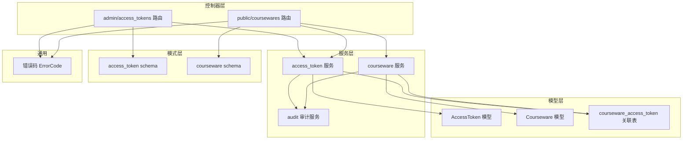
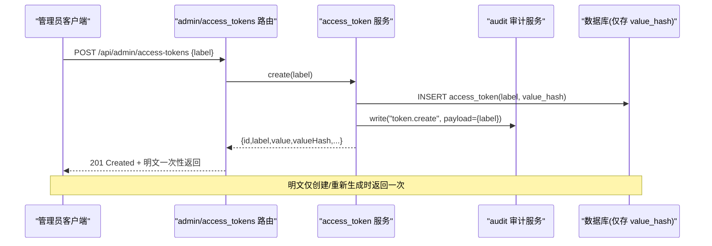
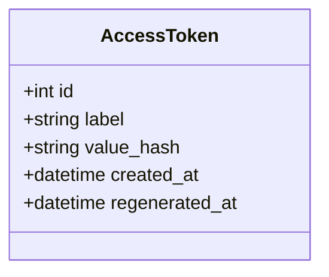
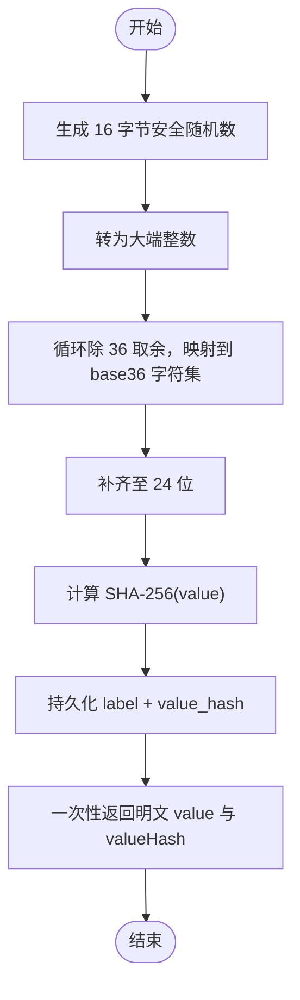
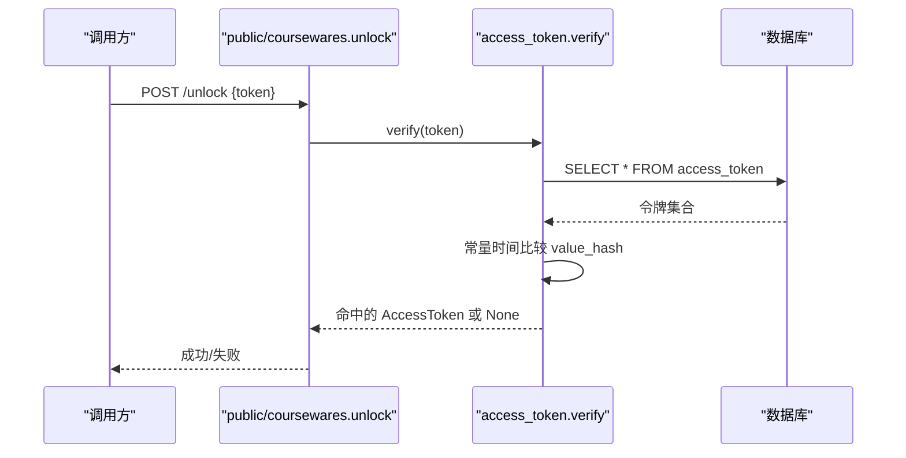
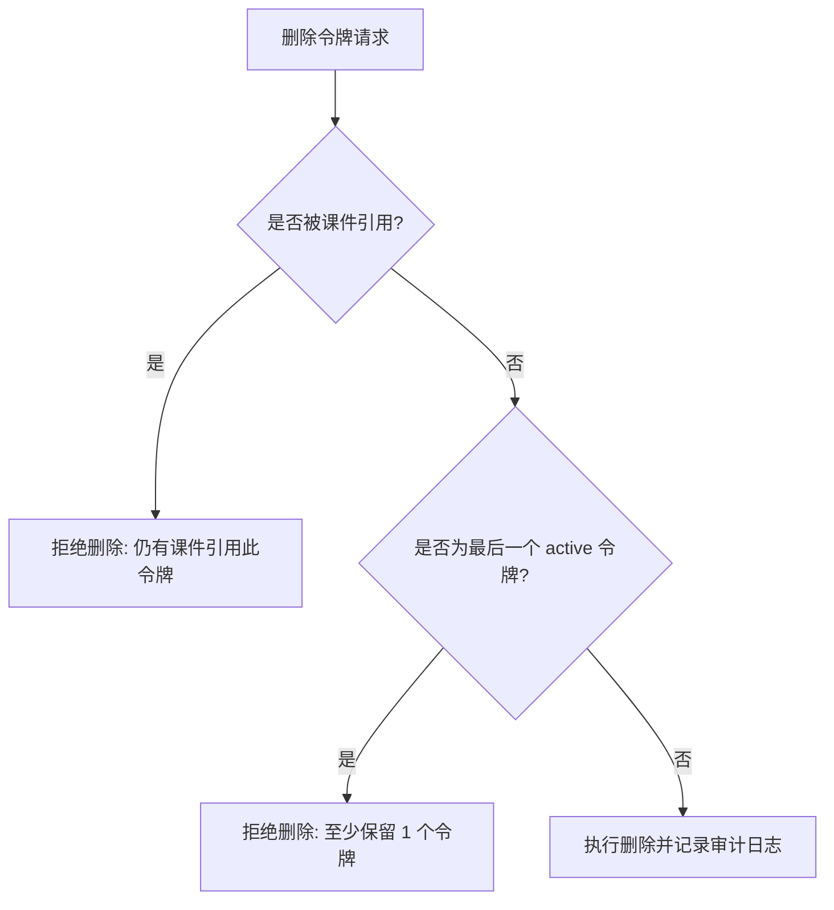
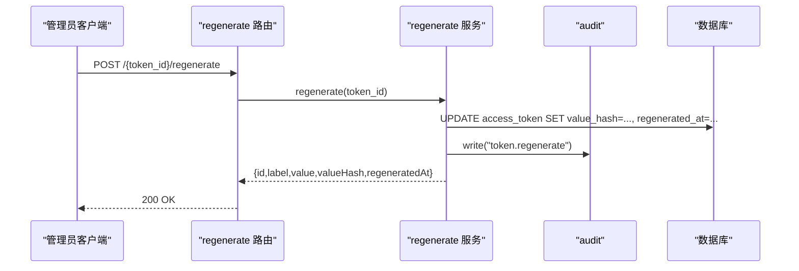
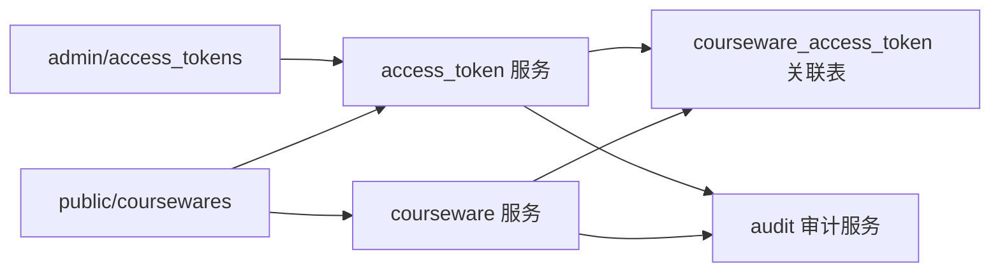

# 访问令牌管理

<cite>
**本文引用的文件**   
- [backend/app/models/access_token.py](file://backend/app/models/access_token.py)
- [backend/app/schemas/access_token.py](file://backend/app/schemas/access_token.py)
- [backend/app/services/access_token.py](file://backend/app/services/access_token.py)
- [backend/app/api/admin/access_tokens.py](file://backend/app/api/admin/access_tokens.py)
- [backend/app/api/public/coursewares.py](file://backend/app/api/public/coursewares.py)
- [backend/app/models/courseware.py](file://backend/app/models/courseware.py)
- [backend/app/models/association.py](file://backend/app/models/association.py)
- [backend/app/services/courseware.py](file://backend/app/services/courseware.py)
- [backend/app/core/errors.py](file://backend/app/core/errors.py)
- [backend/app/schemas/courseware.py](file://backend/app/schemas/courseware.py)
- [backend/app/services/audit.py](file://backend/app/services/audit.py)
</cite>

## 目录
1. [简介](#简介)
2. [项目结构](#项目结构)
3. [核心组件](#核心组件)
4. [架构总览](#架构总览)
5. [详细组件分析](#详细组件分析)
6. [依赖关系分析](#依赖关系分析)
7. [性能与安全考量](#性能与安全考量)
8. [故障排查指南](#故障排查指南)
9. [结论](#结论)
10. [附录：API 规范与示例](#附录api-规范与示例)

## 简介
本技术文档聚焦 Learning Hub 的“访问令牌”子系统，覆盖令牌的完整生命周期管理：从生成算法、哈希存储、安全校验到业务规则（标签全局唯一、受限课件必须关联至少一个令牌、删除保护、降级自动解绑）、重新生成机制与审计日志记录。同时提供管理员侧与前台侧相关 API 的接口规范、错误处理与最佳实践建议，帮助读者快速理解并正确使用该能力。

## 项目结构
围绕访问令牌的核心代码分布在以下模块：
- 数据模型层：定义令牌实体、课件实体及多对多关联表
- 服务层：实现令牌生成、验证、删除、列表等核心业务逻辑
- 模式层：定义请求/响应数据结构与校验
- 控制器层：暴露管理员与前台 API
- 错误码与审计：统一错误码映射与操作审计日志

图表来源
- [backend/app/models/access_token.py:1-34](file://backend/app/models/access_token.py#L1-L34)
- [backend/app/models/courseware.py:1-74](file://backend/app/models/courseware.py#L1-L74)
- [backend/app/models/association.py:1-41](file://backend/app/models/association.py#L1-L41)
- [backend/app/services/access_token.py:1-235](file://backend/app/services/access_token.py#L1-L235)
- [backend/app/services/courseware.py:1-492](file://backend/app/services/courseware.py#L1-L492)
- [backend/app/api/admin/access_tokens.py:1-120](file://backend/app/api/admin/access_tokens.py#L1-L120)
- [backend/app/api/public/coursewares.py:1-133](file://backend/app/api/public/coursewares.py#L1-L133)
- [backend/app/schemas/access_token.py:1-53](file://backend/app/schemas/access_token.py#L1-L53)
- [backend/app/schemas/courseware.py:1-120](file://backend/app/schemas/courseware.py#L1-L120)
- [backend/app/core/errors.py:1-144](file://backend/app/core/errors.py#L1-L144)
- [backend/app/services/audit.py:1-45](file://backend/app/services/audit.py#L1-L45)

章节来源
- [backend/app/models/access_token.py:1-34](file://backend/app/models/access_token.py#L1-L34)
- [backend/app/models/courseware.py:1-74](file://backend/app/models/courseware.py#L1-L74)
- [backend/app/models/association.py:1-41](file://backend/app/models/association.py#L1-L41)
- [backend/app/services/access_token.py:1-235](file://backend/app/services/access_token.py#L1-L235)
- [backend/app/services/courseware.py:1-492](file://backend/app/services/courseware.py#L1-L492)
- [backend/app/api/admin/access_tokens.py:1-120](file://backend/app/api/admin/access_tokens.py#L1-L120)
- [backend/app/api/public/coursewares.py:1-133](file://backend/app/api/public/coursewares.py#L1-L133)
- [backend/app/schemas/access_token.py:1-53](file://backend/app/schemas/access_token.py#L1-L53)
- [backend/app/schemas/courseware.py:1-120](file://backend/app/schemas/courseware.py#L1-L120)
- [backend/app/core/errors.py:1-144](file://backend/app/core/errors.py#L1-L144)
- [backend/app/services/audit.py:1-45](file://backend/app/services/audit.py#L1-L45)

## 核心组件
- 令牌模型 AccessToken：仅持久化 label 与 value_hash；label 全局唯一；value_hash 为 SHA-256 摘要；包含创建时间与重新生成时间戳。
- 课件模型 Courseware：支持 OPEN/RESTRICTED 两种访问模式；RESTRICTED 需绑定至少一个 AccessToken。
- 关联表 courseware_access_token：维护课件与令牌的 M:N 关系。
- 令牌服务 access_token：实现生成、验证、删除、列表、重新生成等核心逻辑，含业务规则校验与审计写入。
- 课件服务 courseware：在创建/更新时执行令牌绑定约束与降级自动解绑。
- 管理员路由 admin/access_tokens：提供令牌的增删改查与重新生成。
- 公共路由 public/coursewares：提供搜索、详情与解锁流程，基于令牌哈希进行鉴权。
- 错误码 ErrorCode：集中定义业务错误码与 HTTP 状态映射。
- 审计服务 audit：以 JSON Lines 格式记录关键操作。

章节来源
- [backend/app/models/access_token.py:1-34](file://backend/app/models/access_token.py#L1-L34)
- [backend/app/models/courseware.py:1-74](file://backend/app/models/courseware.py#L1-L74)
- [backend/app/models/association.py:1-41](file://backend/app/models/association.py#L1-L41)
- [backend/app/services/access_token.py:1-235](file://backend/app/services/access_token.py#L1-L235)
- [backend/app/services/courseware.py:1-492](file://backend/app/services/courseware.py#L1-L492)
- [backend/app/api/admin/access_tokens.py:1-120](file://backend/app/api/admin/access_tokens.py#L1-L120)
- [backend/app/api/public/coursewares.py:1-133](file://backend/app/api/public/coursewares.py#L1-L133)
- [backend/app/core/errors.py:1-144](file://backend/app/core/errors.py#L1-L144)
- [backend/app/services/audit.py:1-45](file://backend/app/services/audit.py#L1-L45)

## 架构总览
下图展示了访问令牌在系统中的整体交互：管理员通过后台 API 管理令牌；前台通过公开 API 使用令牌解锁受限课件；服务层负责业务规则与审计；数据库仅保存令牌哈希值。

图表来源
- [backend/app/api/admin/access_tokens.py:71-77](file://backend/app/api/admin/access_tokens.py#L71-L77)
- [backend/app/services/access_token.py:73-99](file://backend/app/services/access_token.py#L73-L99)
- [backend/app/services/audit.py:21-42](file://backend/app/services/audit.py#L21-L42)
- [backend/app/models/access_token.py:13-31](file://backend/app/models/access_token.py#L13-L31)

## 详细组件分析

### 令牌模型与存储
- 字段说明
  - id：自增主键
  - label：字符串，最大长度 50，全局唯一
  - value_hash：SHA-256 摘要，索引列
  - created_at/regenerated_at：时间戳
- 安全策略
  - 数据库不存储明文，只存 SHA-256 摘要
  - 明文仅在创建或重新生成时一次性返回

图表来源
- [backend/app/models/access_token.py:13-31](file://backend/app/models/access_token.py#L13-L31)

章节来源
- [backend/app/models/access_token.py:1-34](file://backend/app/models/access_token.py#L1-L34)

### 令牌生成算法与哈希存储
- 生成算法
  - 使用密码学安全的随机源生成 16 字节随机数
  - 将随机数转换为 base36 小写字母+数字串，固定长度为 24 位
- 哈希存储
  - 使用 SHA-256 对明文进行摘要，结果以小写十六进制字符串存储
- 常量时间比对
  - 验证时使用 hmac.compare_digest 进行常量时间比较，避免时序攻击

图表来源
- [backend/app/services/access_token.py:45-54](file://backend/app/services/access_token.py#L45-L54)
- [backend/app/services/access_token.py:32-33](file://backend/app/services/access_token.py#L32-L33)
- [backend/app/services/access_token.py:73-99](file://backend/app/services/access_token.py#L73-L99)

章节来源
- [backend/app/services/access_token.py:32-54](file://backend/app/services/access_token.py#L32-L54)
- [backend/app/services/access_token.py:73-99](file://backend/app/services/access_token.py#L73-L99)

### 令牌验证流程
- 输入：前端传入的明文 token
- 步骤
  - 计算目标 hash = SHA-256(token)
  - 遍历所有 active 令牌，使用常量时间比较匹配 value_hash
  - 命中则返回对应 AccessToken，否则返回空
- 注意
  - 当前实现加载全部令牌进行比对，适用于令牌数量较少的场景
  - 若未来令牌规模增长，可考虑按 hash 精确查询优化

图表来源
- [backend/app/api/public/coursewares.py:79-130](file://backend/app/api/public/coursewares.py#L79-L130)
- [backend/app/services/access_token.py:193-205](file://backend/app/services/access_token.py#L193-L205)

章节来源
- [backend/app/api/public/coursewares.py:79-130](file://backend/app/api/public/coursewares.py#L79-L130)
- [backend/app/services/access_token.py:193-205](file://backend/app/services/access_token.py#L193-L205)

### 业务规则与约束
- 标签全局唯一性
  - label 在系统中唯一，创建前检查冲突，数据库层也具备唯一约束
- 受限课件必须关联至少一个令牌
  - 创建或更新 RESTRICTED 课件时，若未绑定任何令牌，抛出业务错误
- 删除保护机制
  - 被课件引用的令牌不可删除
  - 系统至少保留一个 active 令牌，防止全部删除
- 降级自动解绑
  - 当课件从 RESTRICTED 降级为 OPEN 时，自动清空已绑定的令牌

图表来源
- [backend/app/services/access_token.py:122-138](file://backend/app/services/access_token.py#L122-L138)
- [backend/app/models/association.py:28-33](file://backend/app/models/association.py#L28-L33)

章节来源
- [backend/app/services/access_token.py:122-138](file://backend/app/services/access_token.py#L122-L138)
- [backend/app/models/association.py:28-33](file://backend/app/models/association.py#L28-L33)
- [backend/app/services/courseware.py:129-133](file://backend/app/services/courseware.py#L129-L133)
- [backend/app/services/courseware.py:204-207](file://backend/app/services/courseware.py#L204-L207)

### 令牌重新生成机制
- 行为
  - 重新生成后，旧 value_hash 即刻失效，新明文仅在新响应中返回一次
  - 记录 regenerated_at 时间戳，便于追踪
- 审计
  - 每次重新生成均写入审计日志

图表来源
- [backend/app/api/admin/access_tokens.py:105-110](file://backend/app/api/admin/access_tokens.py#L105-L110)
- [backend/app/services/access_token.py:102-119](file://backend/app/services/access_token.py#L102-L119)
- [backend/app/services/audit.py:21-42](file://backend/app/services/audit.py#L21-L42)

章节来源
- [backend/app/api/admin/access_tokens.py:105-110](file://backend/app/api/admin/access_tokens.py#L105-L110)
- [backend/app/services/access_token.py:102-119](file://backend/app/services/access_token.py#L102-L119)
- [backend/app/services/audit.py:1-45](file://backend/app/services/audit.py#L1-L45)

### 审计日志记录
- 触发点
  - 令牌创建、重新生成、删除
  - 课件创建、更新、删除、素材重排
- 格式
  - JSON Lines，每条记录包含时间戳、操作者、动作、资源标识与负载信息
- 可靠性
  - 审计失败不影响主流程

章节来源
- [backend/app/services/audit.py:1-45](file://backend/app/services/audit.py#L1-L45)
- [backend/app/services/access_token.py:92-93](file://backend/app/services/access_token.py#L92-L93)
- [backend/app/services/access_token.py:110-112](file://backend/app/services/access_token.py#L110-L112)
- [backend/app/services/access_token.py:138](file://backend/app/services/access_token.py#L138)
- [backend/app/services/courseware.py:162-166](file://backend/app/services/courseware.py#L162-L166)
- [backend/app/services/courseware.py:273-277](file://backend/app/services/courseware.py#L273-L277)
- [backend/app/services/courseware.py:285](file://backend/app/services/courseware.py#L285)
- [backend/app/services/courseware.py:388-392](file://backend/app/services/courseware.py#L388-L392)

## 依赖关系分析
- 耦合与内聚
  - 令牌服务与课件服务存在双向依赖：课件服务在创建/更新时调用令牌服务获取令牌对象；令牌服务在删除时检查关联引用
  - 控制器层仅依赖服务层与模式层，保持清晰分层
- 外部依赖
  - 数据库：SQLAlchemy ORM 与原生 SQL 混合使用
  - 标准库：hashlib、secrets、hmac
  - FastAPI：路由、依赖注入、请求/响应处理
- 潜在风险
  - 令牌验证当前全量加载令牌，若令牌数量增长可能影响性能
  - 审计写入异常被吞掉，需确保日志路径可用

图表来源
- [backend/app/api/admin/access_tokens.py:1-120](file://backend/app/api/admin/access_tokens.py#L1-L120)
- [backend/app/api/public/coursewares.py:1-133](file://backend/app/api/public/coursewares.py#L1-L133)
- [backend/app/services/access_token.py:1-235](file://backend/app/services/access_token.py#L1-L235)
- [backend/app/services/courseware.py:1-492](file://backend/app/services/courseware.py#L1-L492)
- [backend/app/models/association.py:1-41](file://backend/app/models/association.py#L1-L41)
- [backend/app/services/audit.py:1-45](file://backend/app/services/audit.py#L1-L45)

章节来源
- [backend/app/api/admin/access_tokens.py:1-120](file://backend/app/api/admin/access_tokens.py#L1-L120)
- [backend/app/api/public/coursewares.py:1-133](file://backend/app/api/public/coursewares.py#L1-L133)
- [backend/app/services/access_token.py:1-235](file://backend/app/services/access_token.py#L1-L235)
- [backend/app/services/courseware.py:1-492](file://backend/app/services/courseware.py#L1-L492)
- [backend/app/models/association.py:1-41](file://backend/app/models/association.py#L1-L41)
- [backend/app/services/audit.py:1-45](file://backend/app/services/audit.py#L1-L45)

## 性能与安全考量
- 性能
  - 令牌验证全量加载：适合令牌数量较少场景；若令牌规模增大，建议改为按 value_hash 精确查询
  - 列表分页与计数：令牌列表采用子查询统计总数，避免 N+1
- 安全
  - 明文仅创建/重新生成时返回一次，服务端不持久化明文
  - 使用 SHA-256 摘要与常量时间比较，降低泄露与时序攻击风险
  - Cookie 设置 httponly 与 samesite=lax，减少跨站风险
- 可用性
  - 审计失败不阻塞主流程，但需保证日志目录存在且可写

[本节为通用指导，无需特定文件引用]

## 故障排查指南
- 常见错误码与含义
  - token_not_found：令牌不存在
  - token_label_required/token_label_too_long/token_label_conflict：标签必填、过长或重复
  - invalid_token：令牌无效或无权访问
  - last_token_required：至少保留一个令牌
  - token_referenced：仍有课件引用此令牌，无法删除
  - courseware_acl_locked：课件需要令牌解锁或令牌无效
- 定位方法
  - 查看审计日志文件 audit.jsonl，确认最近的操作记录
  - 检查关联表 courseware_access_token，确认令牌是否被课件引用
  - 核对前端是否正确传递 X-Token-Hash 或 lh_token_hash Cookie

章节来源
- [backend/app/core/errors.py:53-63](file://backend/app/core/errors.py#L53-L63)
- [backend/app/core/errors.py:73-127](file://backend/app/core/errors.py#L73-L127)
- [backend/app/services/audit.py:1-45](file://backend/app/services/audit.py#L1-L45)
- [backend/app/models/association.py:28-33](file://backend/app/models/association.py#L28-L33)
- [backend/app/api/public/coursewares.py:68-76](file://backend/app/api/public/coursewares.py#L68-L76)

## 结论
访问令牌子系统通过严格的业务规则与安全设计，实现了受限课件的精细化访问控制。令牌仅以哈希形式持久化，明文仅在必要时刻一次性返回；结合删除保护与降级自动解绑，保障了系统的健壮性与一致性。配合审计日志与统一的错误码体系，便于运维监控与问题定位。建议在令牌规模增长后进一步优化验证查询路径，以提升性能。

[本节为总结，无需特定文件引用]

## 附录：API 规范与示例

### 管理员令牌管理接口
- 基础路径：/api/admin/access-tokens
- 认证：需要管理员权限（由中间件 get_admin_principal 保障）

| 方法 | 路径 | 描述 | 请求体 | 响应体 | 状态码 |
| --- | --- | --- | --- | --- | --- |
| GET | /api/admin/access-tokens | 分页列出令牌 | 查询参数：keyword, page, size | data: {page,size,total,items[]} | 200 |
| POST | /api/admin/access-tokens | 创建令牌 | {label} | data: {id,label,value,valueHash,createdAt} | 201 |
| GET | /api/admin/access-tokens/{token_id} | 获取令牌详情 | 查询参数：withUsage | data: {id,label,valueHash,coursewareCount,createdAt,regeneratedAt,usageSummary?} | 200 |
| POST | /api/admin/access-tokens/{token_id}/regenerate | 重新生成令牌 | 无 | data: {id,label,value,valueHash,regeneratedAt} | 200 |
| DELETE | /api/admin/access-tokens/{token_id} | 删除令牌 | 无 | data: null | 200 |

- 注意事项
  - 创建/重新生成时返回明文 value，仅一次有效
  - 列表项仅返回 valueHash，不暴露明文
  - withUsage=true 时附加 usageSummary（来自访问会话聚合）

章节来源
- [backend/app/api/admin/access_tokens.py:60-116](file://backend/app/api/admin/access_tokens.py#L60-L116)
- [backend/app/schemas/access_token.py:9-28](file://backend/app/schemas/access_token.py#L9-L28)
- [backend/app/schemas/access_token.py:30-46](file://backend/app/schemas/access_token.py#L30-L46)

### 前台解锁接口
- 基础路径：/api/public/coursewares
- 解锁流程
  - 调用 POST /{courseware_id}/unlock，携带 {token}
  - 成功后返回 {tokenHash, coursewareIds}，并将 lh_token_hash 写入 Cookie（httponly, samesite=lax, 7 天）
  - 后续 GET /{courseware_id} 自动携带 X-Token-Hash 或 Cookie 完成鉴权

| 方法 | 路径 | 描述 | 请求体 | 响应体 | 状态码 |
| --- | --- | --- | --- | --- | --- |
| POST | /api/public/coursewares/{courseware_id}/unlock | 凭明文令牌解锁 | {token} | data: {tokenHash, coursewareIds} | 200 |
| GET | /api/public/coursewares/{courseware_id} | 获取课件详情 | 无 | data: 课件详情 | 200/403 |

- 错误处理
  - 403：课件需要令牌解锁或令牌无效
  - 401：令牌无效或无权访问该课件

章节来源
- [backend/app/api/public/coursewares.py:57-76](file://backend/app/api/public/coursewares.py#L57-L76)
- [backend/app/api/public/coursewares.py:79-130](file://backend/app/api/public/coursewares.py#L79-L130)
- [backend/app/schemas/courseware.py:91-98](file://backend/app/schemas/courseware.py#L91-L98)

### 使用示例（概念性）
- 创建令牌
  - 请求：POST /api/admin/access-tokens {label:"课程A"}
  - 响应：data.value 为本次生成的明文，务必妥善保存
- 解锁课件
  - 请求：POST /api/public/coursewares/123/unlock {token:"..."}
  - 响应：data.tokenHash 用于后续自动鉴权；浏览器会设置 lh_token_hash Cookie
- 访问受限课件
  - 请求：GET /api/public/coursewares/123
  - 鉴权：优先读取 X-Token-Header，其次读取 lh_token_hash Cookie

[本节为概念性示例，无需特定文件引用]

### 最佳实践
- 令牌管理
  - 定期轮换令牌（使用重新生成接口），避免长期复用同一令牌
  - 严格限制 label 命名规范，便于审计与检索
- 前端集成
  - 解锁成功后缓存 tokenHash，并在后续请求中自动携带
  - 使用 httponly Cookie 提升安全性
- 后端优化
  - 评估令牌数量规模，必要时优化 verify 查询路径
  - 确保审计日志目录存在且可写，避免静默失败

[本节为通用指导，无需特定文件引用]