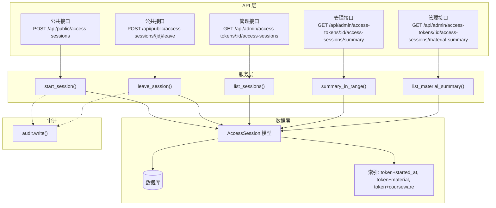
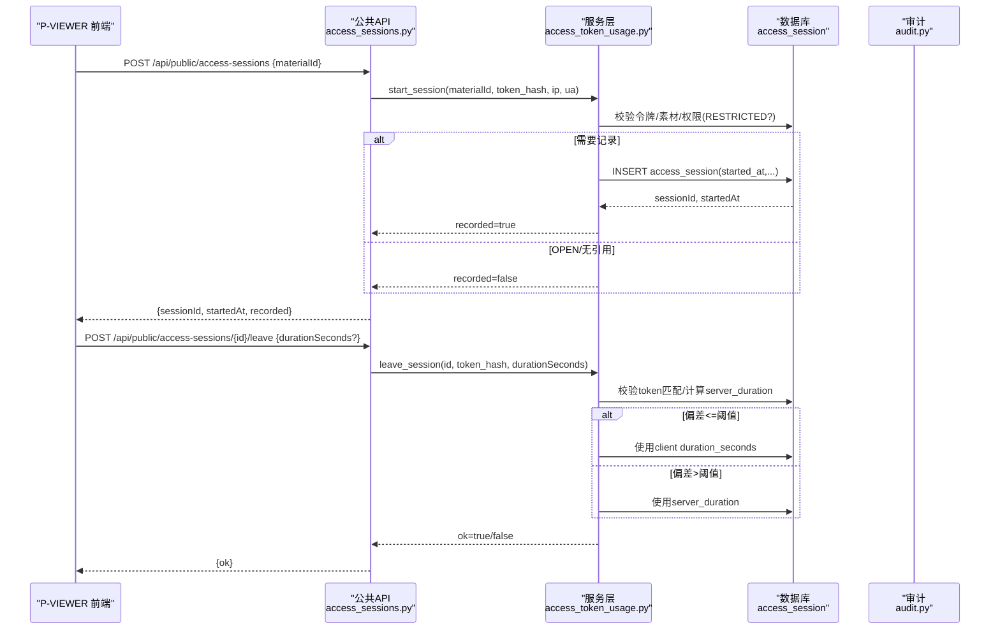
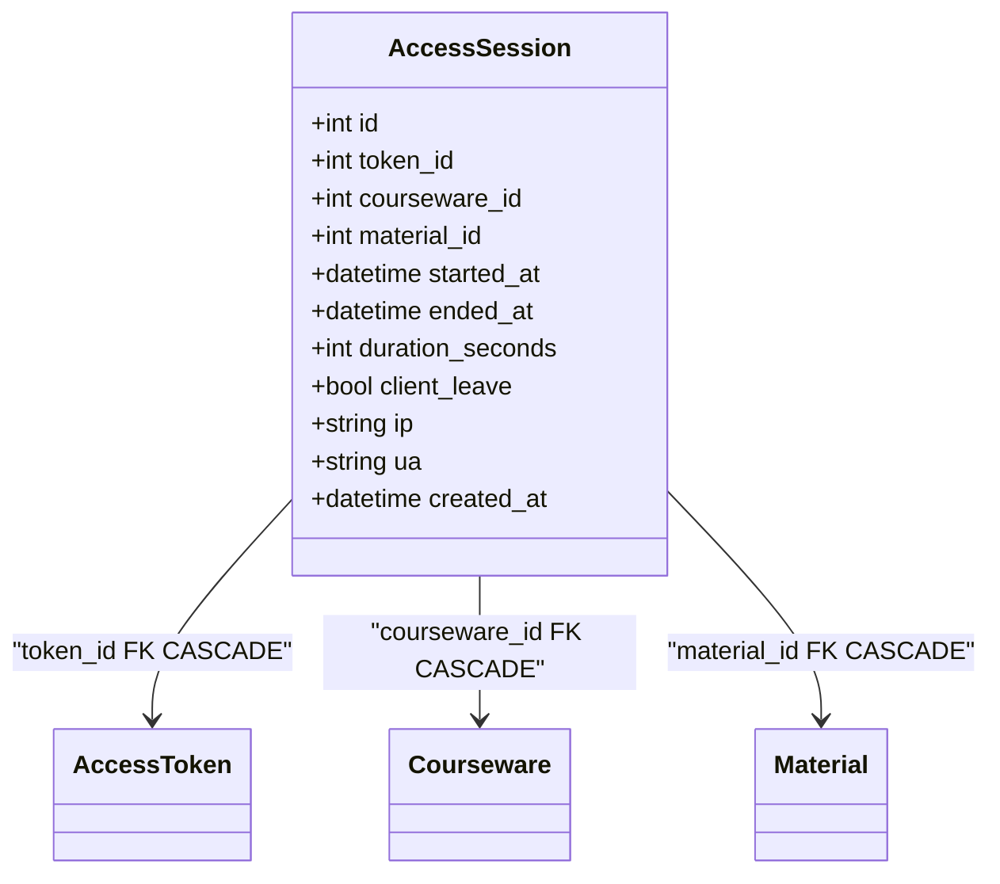
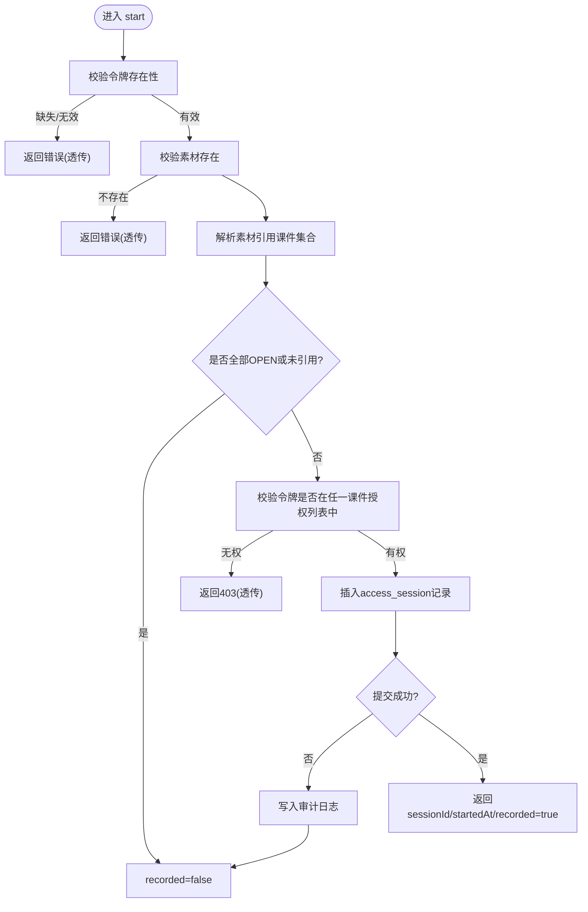
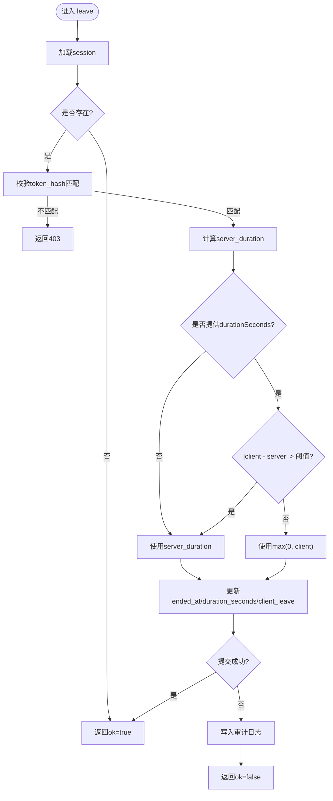
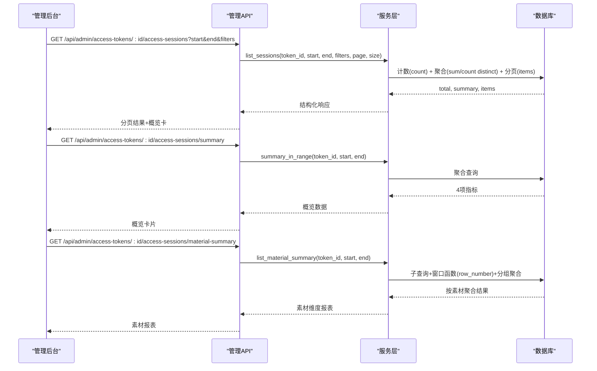
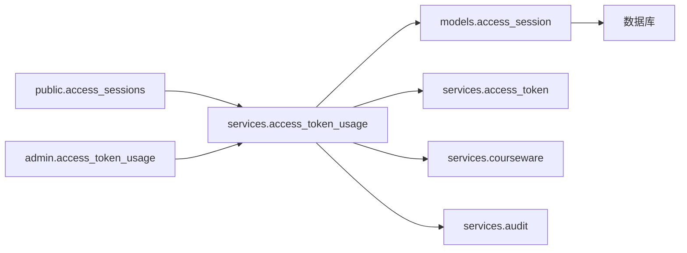

# 访问会话追踪

<cite>
**本文引用的文件**   
- [backend/app/models/access_session.py](file://backend/app/models/access_session.py)
- [backend/alembic/versions/2026_07_10_0930-c1d2e3f4a5b6_add_access_session.py](file://backend/alembic/versions/2026_07_10_0930-c1d2e3f4a5b6_add_access_session.py)
- [backend/app/api/public/access_sessions.py](file://backend/app/api/public/access_sessions.py)
- [backend/app/services/access_token_usage.py](file://backend/app/services/access_token_usage.py)
- [backend/app/api/admin/access_token_usage.py](file://backend/app/api/admin/access_token_usage.py)
- [backend/app/schemas/access_token_usage.py](file://backend/app/schemas/access_token_usage.py)
- [backend/app/services/audit.py](file://backend/app/services/audit.py)
- [backend/tests/test_access_session.py](file://backend/tests/test_access_session.py)
</cite>

## 目录
1. [简介](#简介)
2. [项目结构](#项目结构)
3. [核心组件](#核心组件)
4. [架构总览](#架构总览)
5. [详细组件分析](#详细组件分析)
6. [依赖关系分析](#依赖关系分析)
7. [性能与优化](#性能与优化)
8. [故障排查指南](#故障排查指南)
9. [结论](#结论)
10. [附录](#附录)

## 简介
本技术文档围绕 Learning Hub 的“访问会话追踪”能力，系统性解析访问会话的数据模型、触发时机、持久化策略、查询与聚合、审计与安全、以及清理与性能优化建议。目标是帮助读者快速理解并正确扩展该子系统。

## 项目结构
访问会话追踪涉及以下关键层次：
- 数据模型层：定义访问会话表结构与约束
- API 层：公共接口（P-VIEWER 上报）与管理接口（后台查询）
- 服务层：业务规则校验、时长校正、聚合统计
- 迁移层：数据库表创建与索引
- 审计层：关键失败路径写入审计日志
- 测试层：覆盖鉴权、幂等、聚合、越权等场景

图表来源
- [backend/app/api/public/access_sessions.py:1-137](file://backend/app/api/public/access_sessions.py#L1-L137)
- [backend/app/api/admin/access_token_usage.py:1-101](file://backend/app/api/admin/access_token_usage.py#L1-L101)
- [backend/app/services/access_token_usage.py:1-518](file://backend/app/services/access_token_usage.py#L1-L518)
- [backend/app/models/access_session.py:1-129](file://backend/app/models/access_session.py#L1-L129)
- [backend/app/services/audit.py:1-45](file://backend/app/services/audit.py#L1-L45)

章节来源
- [backend/app/api/public/access_sessions.py:1-137](file://backend/app/api/public/access_sessions.py#L1-L137)
- [backend/app/api/admin/access_token_usage.py:1-101](file://backend/app/api/admin/access_token_usage.py#L1-L101)
- [backend/app/services/access_token_usage.py:1-518](file://backend/app/services/access_token_usage.py#L1-L518)
- [backend/app/models/access_session.py:1-129](file://backend/app/models/access_session.py#L1-L129)
- [backend/app/services/audit.py:1-45](file://backend/app/services/audit.py#L1-L45)

## 核心组件
- 数据模型 AccessSession：记录一次受控课件素材浏览的起止时间、停留秒数、客户端离开标记、IP/UA 等，并通过外键级联保证关联实体删除时自动清理历史。
- 公共 API：提供 start/leave 两个端点，用于 P-VIEWER 在用户解锁课件后上报会话开始与结束。
- 管理服务：实现 B-1/B-2/B-3 等业务规则，包括仅 RESTRICTED 落库、服务端时长校正、令牌重新生成不影响历史归属。
- 管理 API：提供分页明细、区间聚合、按素材聚合等查询能力，支撑后台审计与分析。
- 审计：对关键失败路径进行 JSON Lines 追加写入，便于安全监控与问题定位。

章节来源
- [backend/app/models/access_session.py:1-129](file://backend/app/models/access_session.py#L1-L129)
- [backend/app/services/access_token_usage.py:1-518](file://backend/app/services/access_token_usage.py#L1-L518)
- [backend/app/api/public/access_sessions.py:1-137](file://backend/app/api/public/access_sessions.py#L1-L137)
- [backend/app/api/admin/access_token_usage.py:1-101](file://backend/app/api/admin/access_token_usage.py#L1-L101)
- [backend/app/services/audit.py:1-45](file://backend/app/services/audit.py#L1-L45)

## 架构总览
访问会话追踪的整体流程如下：
- 前端 P-VIEWER 在用户解锁课件后调用公共接口开启会话；
- 服务层校验令牌、素材引用与权限，必要时落库；
- 前端在页面关闭或切换时上报 leave，服务层计算最终停留时长并落库；
- 管理后台通过管理接口查询明细与聚合指标，支持按素材维度分析。

图表来源
- [backend/app/api/public/access_sessions.py:65-133](file://backend/app/api/public/access_sessions.py#L65-L133)
- [backend/app/services/access_token_usage.py:64-171](file://backend/app/services/access_token_usage.py#L64-L171)
- [backend/app/models/access_session.py:56-129](file://backend/app/models/access_session.py#L56-L129)

## 详细组件分析

### 数据模型设计
- 主键 id：自增整数（跨方言适配），唯一标识会话。
- 关联字段：
  - token_id：指向访问令牌，用于审计与权限校验。
  - courseware_id：指向被访问的受限课件，用于统计与溯源。
  - material_id：指向具体素材，用于按素材聚合。
- 时间戳：
  - started_at：会话开始时间（UTC）。
  - ended_at：可选，会话结束时间。
  - duration_seconds：可选，客户端上报的服务端校正后的停留秒数。
- 元信息：
  - client_leave：是否由客户端显式离开触发。
  - ip/ua：请求来源信息，便于安全审计。
  - created_at：记录创建时间。
- 约束与索引：
  - 非负时长检查约束。
  - 多组复合索引以优化按 token 的时间序列查询与按素材/课件聚合。

图表来源
- [backend/app/models/access_session.py:56-129](file://backend/app/models/access_session.py#L56-L129)
- [backend/alembic/versions/2026_07_10_0930-c1d2e3f4a5b6_add_access_session.py:21-102](file://backend/alembic/versions/2026_07_10_0930-c1d2e3f4a5b6_add_access_session.py#L21-L102)

章节来源
- [backend/app/models/access_session.py:1-129](file://backend/app/models/access_session.py#L1-L129)
- [backend/alembic/versions/2026_07_10_0930-c1d2e3f4a5b6_add_access_session.py:1-125](file://backend/alembic/versions/2026_07_10_0930-c1d2e3f4a5b6_add_access_session.py#L1-L125)

### 会话创建时机与触发条件
- 触发入口：P-VIEWER 在用户解锁课件后调用公共 start 接口。
- 触发条件与业务规则：
  - B-1：仅当素材被至少一个 RESTRICTED 课件引用时才允许落库；若全部为 OPEN 或未引用，则不写库且返回 recorded=false。
  - 令牌校验：缺少令牌或令牌无效直接拒绝。
  - 权限校验：令牌必须对目标素材具备访问权限（来自关联课件的授权列表）。
  - IP 限流：进程内滑动窗口限流，命中时降级为不记录但不阻塞前台。
  - 异常降级：数据库异常吞错，返回 recorded=false，确保前台体验不受影响。

图表来源
- [backend/app/api/public/access_sessions.py:65-106](file://backend/app/api/public/access_sessions.py#L65-L106)
- [backend/app/services/access_token_usage.py:64-125](file://backend/app/services/access_token_usage.py#L64-L125)
- [backend/app/services/audit.py:21-42](file://backend/app/services/audit.py#L21-L42)

章节来源
- [backend/app/api/public/access_sessions.py:1-137](file://backend/app/api/public/access_sessions.py#L1-L137)
- [backend/app/services/access_token_usage.py:1-171](file://backend/app/services/access_token_usage.py#L1-L171)

### 会话结束与时长校正
- 幂等性：对不存在的 session 返回 ok=true，避免重复上报导致副作用。
- 令牌匹配：leave 请求的 token_hash 必须与会话所属令牌的 value_hash 一致，否则 403。
- 时长校正（B-2）：
  - 计算 server_duration = now - started_at。
  - 若客户端 duration_seconds 与 server_duration 偏差超过阈值（默认 60s），则以 server_duration 为准；否则采用客户端值（非负）。
- 异常处理：写入失败回滚并记录审计日志，返回 ok=false。

图表来源
- [backend/app/services/access_token_usage.py:128-171](file://backend/app/services/access_token_usage.py#L128-L171)

章节来源
- [backend/app/services/access_token_usage.py:128-171](file://backend/app/services/access_token_usage.py#L128-L171)
- [backend/tests/test_access_session.py:291-328](file://backend/tests/test_access_session.py#L291-L328)

### 会话数据的持久化策略
- 表结构：包含会话关键属性与审计元信息，设置非负时长约束。
- 外键级联：删除 token/courseware/material 时自动清理其历史会话，满足 B-4。
- 索引设计：
  - ix_access_session_token_started：优化按 token 的时间序列查询。
  - ix_access_session_token_material：优化按 token+素材的过滤与排序。
  - ix_access_session_token_courseware：优化按 token+课件的过滤与排序。
  - 单列索引：token_id、material_id、courseware_id，提升常见过滤效率。
- 跨方言兼容：
  - INET 类型在 PostgreSQL 使用原生 INET，SQLite 降级为 VARCHAR(45)。
  - BigInteger PK 在 SQLite 下退化为 INTEGER。

章节来源
- [backend/app/models/access_session.py:33-129](file://backend/app/models/access_session.py#L33-L129)
- [backend/alembic/versions/2026_07_10_0930-c1d2e3f4a5b6_add_access_session.py:21-102](file://backend/alembic/versions/2026_07_10_0930-c1d2e3f4a5b6_add_access_session.py#L21-L102)

### 查询与统计分析
- 分页明细：支持按 token、时间段、素材、课件过滤，返回条目与区间聚合概览。
- 区间聚合：返回总停留时长、会话次数、课件数、素材数四个指标。
- 按素材聚合：返回每个素材的累计停留时长、访问次数、最近访问时间，并按总时长降序排列。
- 全时段聚合：在获取令牌详情时按需返回 usageSummary。

图表来源
- [backend/app/api/admin/access_token_usage.py:32-97](file://backend/app/api/admin/access_token_usage.py#L32-L97)
- [backend/app/services/access_token_usage.py:315-506](file://backend/app/services/access_token_usage.py#L315-L506)

章节来源
- [backend/app/api/admin/access_token_usage.py:1-101](file://backend/app/api/admin/access_token_usage.py#L1-L101)
- [backend/app/services/access_token_usage.py:262-506](file://backend/app/services/access_token_usage.py#L262-L506)

### 审计功能与安全监控
- 审计写入：对 start/leave 写入失败路径追加 JSON Lines 记录，包含时间戳、操作者、资源、错误摘要等。
- 安全校验：
  - start：令牌有效性、素材存在性、ACL 权限控制。
  - leave：严格校验 token_hash 与会话绑定令牌一致，防止越权结束他人会话。
- 限流保护：公共接口进程内滑动窗口限流，降低滥用风险。

章节来源
- [backend/app/services/audit.py:1-45](file://backend/app/services/audit.py#L1-L45)
- [backend/app/api/public/access_sessions.py:29-55](file://backend/app/api/public/access_sessions.py#L29-L55)
- [backend/app/services/access_token_usage.py:64-171](file://backend/app/services/access_token_usage.py#L64-L171)

### 会话数据清理策略
- 当前实现：未内置定时清理任务。
- 现有清理机制：
  - 外键级联：删除 token/courseware/material 时自动清理相关会话。
- 建议策略（供后续扩展）：
  - 基于 created_at 或 started_at 的归档与删除任务（如保留 N 天/月）。
  - 分区表或冷热分层存储，将历史数据迁移至低成本存储。
  - 定期统计与告警，监控未结束会话比例与异常增长。

章节来源
- [backend/app/models/access_session.py:82-102](file://backend/app/models/access_session.py#L82-L102)
- [backend/alembic/versions/2026_07_10_0930-c1d2e3f4a5b6_add_access_session.py:49-66](file://backend/alembic/versions/2026_07_10_0930-c1d2e3f4a5b6_add_access_session.py#L49-L66)

## 依赖关系分析
- 模块耦合：
  - 公共 API 依赖服务层进行业务校验与持久化。
  - 服务层依赖模型与外部服务（令牌服务、课程服务）完成权限与引用解析。
  - 管理 API 复用同一服务层，统一业务逻辑。
- 外部依赖：
  - 数据库：PostgreSQL/SQLite 双方言兼容。
  - 审计：本地 JSON Lines 文件。
- 潜在循环依赖：未发现明显循环导入；服务层与模型之间通过 SQLAlchemy ORM 解耦。

图表来源
- [backend/app/api/public/access_sessions.py:1-137](file://backend/app/api/public/access_sessions.py#L1-L137)
- [backend/app/api/admin/access_token_usage.py:1-101](file://backend/app/api/admin/access_token_usage.py#L1-L101)
- [backend/app/services/access_token_usage.py:1-518](file://backend/app/services/access_token_usage.py#L1-L518)
- [backend/app/models/access_session.py:1-129](file://backend/app/models/access_session.py#L1-L129)
- [backend/app/services/audit.py:1-45](file://backend/app/services/audit.py#L1-L45)

章节来源
- [backend/app/api/public/access_sessions.py:1-137](file://backend/app/api/public/access_sessions.py#L1-L137)
- [backend/app/api/admin/access_token_usage.py:1-101](file://backend/app/api/admin/access_token_usage.py#L1-L101)
- [backend/app/services/access_token_usage.py:1-518](file://backend/app/services/access_token_usage.py#L1-L518)
- [backend/app/models/access_session.py:1-129](file://backend/app/models/access_session.py#L1-L129)
- [backend/app/services/audit.py:1-45](file://backend/app/services/audit.py#L1-L45)

## 性能与优化
- 索引优化：
  - 已针对 token+started_at、token+material、token+courseware 建立复合索引，显著提升常见过滤与排序性能。
  - 单列索引 token_id、material_id、courseware_id 提升基础过滤效率。
- 聚合查询优化：
  - 使用子查询与窗口函数减少多次往返与内存聚合开销。
  - 区间聚合仅返回必要指标，避免拉取全量明细。
- 容错与降级：
  - 公共接口在限流或 DB 异常时降级为不记录，保障前端主流程稳定。
- 建议优化：
  - 引入异步写入队列（如消息队列）缓冲高并发 start/leave 写入，降低主链路延迟。
  - 对大表实施分区或归档策略，结合冷热分离提升查询性能。
  - 对高频聚合查询增加物化视图或预计算表，缩短首屏渲染时间。

[本节为通用性能讨论，无需特定文件来源]

## 故障排查指南
- 常见问题定位：
  - 未记录会话：检查是否命中限流、是否为 OPEN 课件或未引用、令牌是否无效、DB 是否异常。
  - 时长异常：核对客户端与服务端时间差是否超过阈值，确认是否触发了服务端校正。
  - 越权结束：确认 leave 请求携带的 token_hash 是否与 session 绑定令牌一致。
- 审计日志：
  - 查看 audit.jsonl 中 start_failed/leave_failed 记录，定位错误上下文。
- 测试用例参考：
  - 幂等性、越权拦截、regenerate 不影响历史、聚合指标一致性等。

章节来源
- [backend/app/services/audit.py:21-42](file://backend/app/services/audit.py#L21-L42)
- [backend/tests/test_access_session.py:291-328](file://backend/tests/test_access_session.py#L291-L328)
- [backend/tests/test_access_session.py:426-472](file://backend/tests/test_access_session.py#L426-L472)
- [backend/tests/test_access_session.py:510-544](file://backend/tests/test_access_session.py#L510-L544)

## 结论
访问会话追踪系统通过清晰的数据模型、严格的权限校验、稳健的时长校正与完善的审计机制，实现了可观测、可审计、可扩展的访问行为记录能力。配合合理的索引设计与聚合查询，能够满足后台审计与分析需求。建议在后续版本中引入异步写入与数据归档策略，进一步提升高并发下的稳定性与长期运行的可维护性。

[本节为总结性内容，无需特定文件来源]

## 附录
- API 规范参考：
  - 公共接口：start/leave 的行为与错误码见公共 API 实现。
  - 管理接口：分页明细、区间聚合、按素材聚合的管理 API 定义见管理 API 实现。
- Schema 定义：
  - 请求/响应模型见 schemas 文件，便于前后端契约对齐。

章节来源
- [backend/app/api/public/access_sessions.py:1-137](file://backend/app/api/public/access_sessions.py#L1-L137)
- [backend/app/api/admin/access_token_usage.py:1-101](file://backend/app/api/admin/access_token_usage.py#L1-L101)
- [backend/app/schemas/access_token_usage.py:1-91](file://backend/app/schemas/access_token_usage.py#L1-L91)