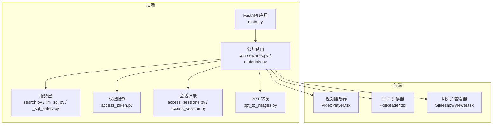
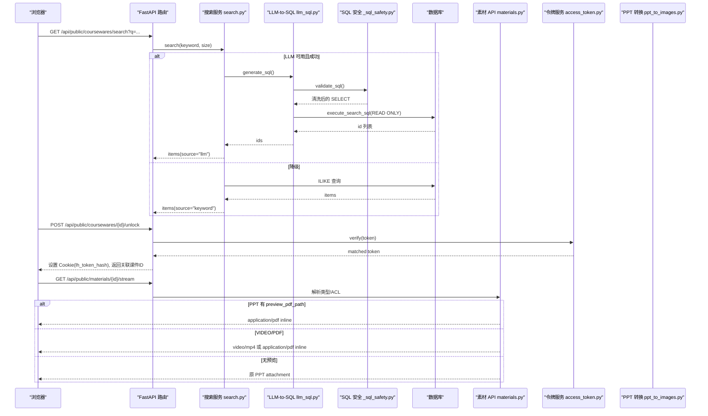
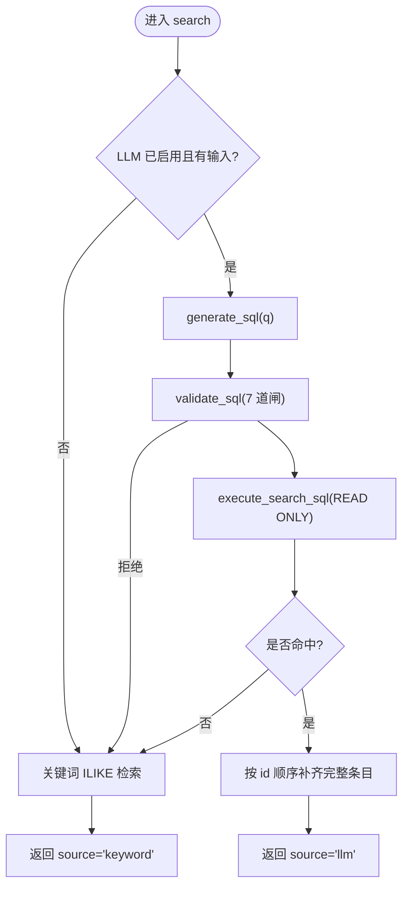
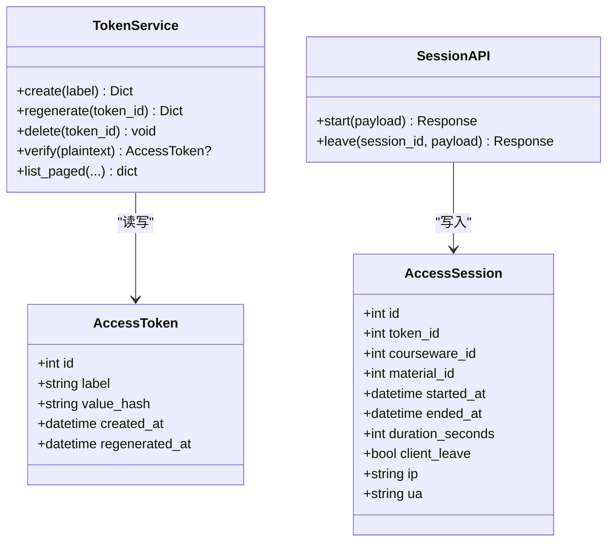
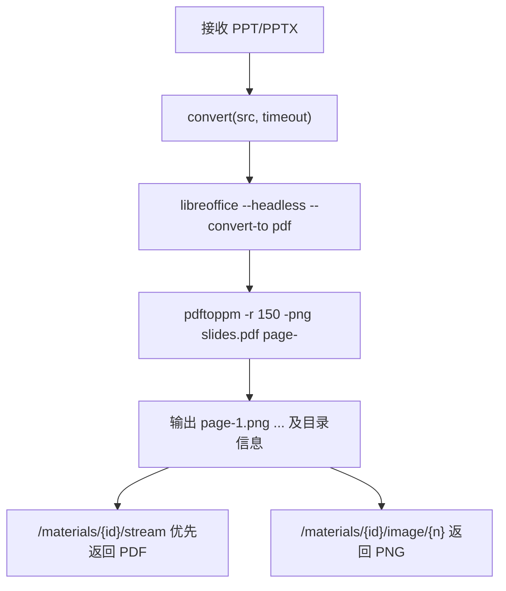
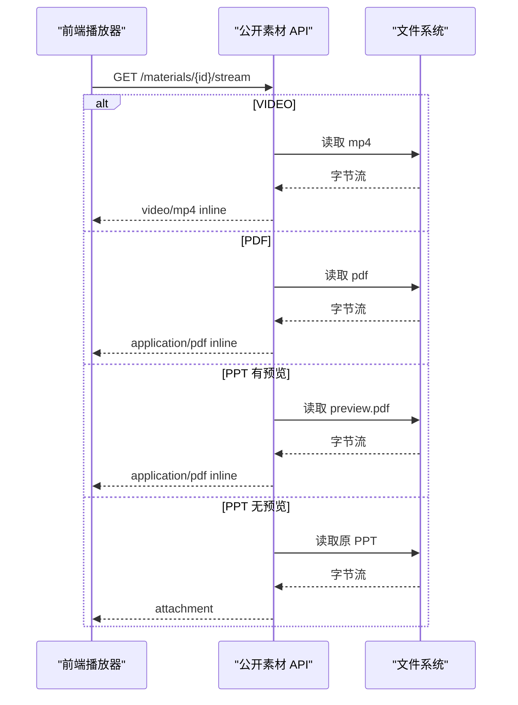
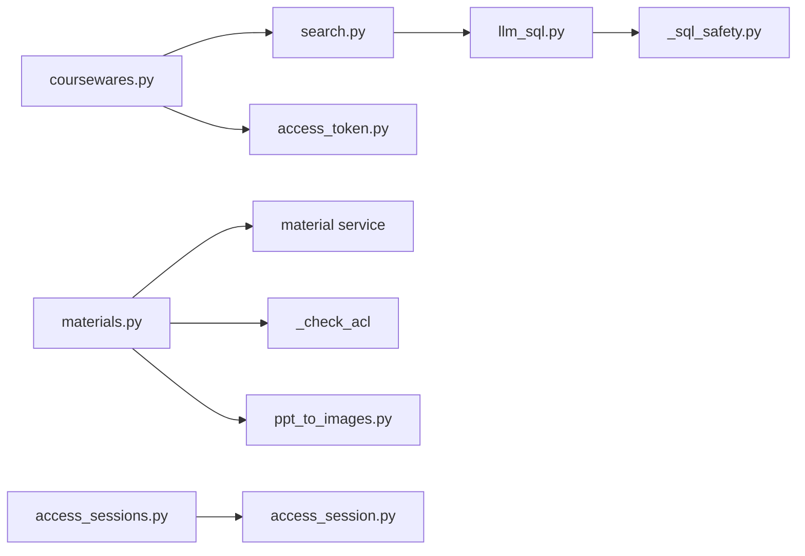

# 核心功能详解

<cite>
**本文引用的文件**
- [backend/app/main.py](file://backend/app/main.py)
- [backend/app/services/search.py](file://backend/app/services/search.py)
- [backend/app/services/llm_sql.py](file://backend/app/services/llm_sql.py)
- [backend/app/services/_sql_safety.py](file://backend/app/services/_sql_safety.py)
- [backend/app/api/public/coursewares.py](file://backend/app/api/public/coursewares.py)
- [backend/app/api/public/materials.py](file://backend/app/api/public/materials.py)
- [backend/app/services/access_token.py](file://backend/app/services/access_token.py)
- [backend/app/api/admin/access_tokens.py](file://backend/app/api/admin/access_tokens.py)
- [backend/app/api/admin/access_token_usage.py](file://backend/app/api/admin/access_token_usage.py)
- [backend/app/models/access_session.py](file://backend/app/models/access_session.py)
- [backend/app/api/public/access_sessions.py](file://backend/app/api/public/access_sessions.py)
- [backend/app/services/ppt_to_images.py](file://backend/app/services/ppt_to_images.py)
- [frontend/src/pages/public/viewer/VideoPlayer.tsx](file://frontend/src/pages/public/viewer/VideoPlayer.tsx)
- [frontend/src/pages/public/viewer/PdfReader.tsx](file://frontend/src/pages/public/viewer/PdfReader.tsx)
- [frontend/src/pages/public/viewer/SlideshowViewer.tsx](file://frontend/src/pages/public/viewer/SlideshowViewer.tsx)
</cite>

## 目录
1. [引言](#引言)
2. [项目结构](#项目结构)
3. [核心组件](#核心组件)
4. [架构总览](#架构总览)
5. [详细组件分析](#详细组件分析)
6. [依赖关系分析](#依赖关系分析)
7. [性能考量](#性能考量)
8. [故障排除指南](#故障排除指南)
9. [结论](#结论)

## 引言
本文件面向 Learning Hub 的核心能力，聚焦以下模块：
- 智能搜索系统：LLM-to-SQL 召回 + 关键词兜底、SQL 安全校验与排序策略
- 权限控制（双轨鉴权）：访问令牌生命周期管理、会话续期与审计日志
- 多媒体处理：上传后格式检测、PPT 转 PDF 与图片提取
- 在线播放器：视频流媒体、PDF 在线阅读、PPT 幻灯片轮播
并提供关键流程的图示、配置项与扩展点建议。

## 项目结构
后端采用 FastAPI 分层组织：入口装配中间件与路由；服务层封装业务逻辑；模型与 Schema 定义数据契约；公共 API 暴露前台能力；管理 API 提供后台管理能力。前端以 React 实现 P-VIEWER 三类渲染器（视频、PDF、幻灯片）。

图表来源
- [backend/app/main.py:40-112](file://backend/app/main.py#L40-L112)
- [backend/app/api/public/coursewares.py:32-54](file://backend/app/api/public/coursewares.py#L32-L54)
- [backend/app/api/public/materials.py:84-146](file://backend/app/api/public/materials.py#L84-L146)
- [backend/app/services/search.py:210-242](file://backend/app/services/search.py#L210-L242)
- [backend/app/services/llm_sql.py:443-478](file://backend/app/services/llm_sql.py#L443-L478)
- [backend/app/services/_sql_safety.py:165-210](file://backend/app/services/_sql_safety.py#L165-L210)
- [backend/app/services/access_token.py:73-99](file://backend/app/services/access_token.py#L73-L99)
- [backend/app/api/public/access_sessions.py:65-106](file://backend/app/api/public/access_sessions.py#L65-L106)
- [backend/app/models/access_session.py:56-128](file://backend/app/models/access_session.py#L56-L128)
- [backend/app/services/ppt_to_images.py:48-181](file://backend/app/services/ppt_to_images.py#L48-L181)
- [frontend/src/pages/public/viewer/VideoPlayer.tsx:34-248](file://frontend/src/pages/public/viewer/VideoPlayer.tsx#L34-L248)
- [frontend/src/pages/public/viewer/PdfReader.tsx:25-268](file://frontend/src/pages/public/viewer/PdfReader.tsx#L25-L268)
- [frontend/src/pages/public/viewer/SlideshowViewer.tsx:18-275](file://frontend/src/pages/public/viewer/SlideshowViewer.tsx#L18-L275)

章节来源
- [backend/app/main.py:40-112](file://backend/app/main.py#L40-L112)

## 核心组件
- 统一搜索服务：优先 LLM-to-SQL 召回，失败或禁用时回退到关键词 ILIKE；返回 source 标识来源与 total 计数。
- SQL 安全网关：7 道闸白名单校验，强制 LIMIT，禁止危险关键字与系统表。
- 访问令牌服务：创建/再生成/删除/验证，明文仅创建时返回，数据库存储哈希。
- 访问会话记录：开始/结束接口，进程内限流，DB 异常降级不阻塞前台。
- PPT 转换服务：LibreOffice → PDF → pdftoppm PNG，超时与错误均记录日志并降级。
- 公开素材 API：下载、流式预览、按页图片获取，RESTRICTED 资源需 token 解锁。
- 公开课件 API：搜索、详情、凭 token 解锁并写入 Cookie。
- 前端播放器：视频 HTML5 流、PDF 分页渲染、PPT 图片轮播。

章节来源
- [backend/app/services/search.py:1-263](file://backend/app/services/search.py#L1-L263)
- [backend/app/services/llm_sql.py:1-490](file://backend/app/services/llm_sql.py#L1-L490)
- [backend/app/services/_sql_safety.py:1-220](file://backend/app/services/_sql_safety.py#L1-L220)
- [backend/app/services/access_token.py:1-235](file://backend/app/services/access_token.py#L1-L235)
- [backend/app/api/public/access_sessions.py:1-137](file://backend/app/api/public/access_sessions.py#L1-L137)
- [backend/app/models/access_session.py:1-129](file://backend/app/models/access_session.py#L1-L129)
- [backend/app/services/ppt_to_images.py:1-185](file://backend/app/services/ppt_to_images.py#L1-L185)
- [backend/app/api/public/materials.py:1-224](file://backend/app/api/public/materials.py#L1-L224)
- [backend/app/api/public/coursewares.py:1-133](file://backend/app/api/public/coursewares.py#L1-L133)
- [frontend/src/pages/public/viewer/VideoPlayer.tsx:1-250](file://frontend/src/pages/public/viewer/VideoPlayer.tsx#L1-L250)
- [frontend/src/pages/public/viewer/PdfReader.tsx:1-270](file://frontend/src/pages/public/viewer/PdfReader.tsx#L1-L270)
- [frontend/src/pages/public/viewer/SlideshowViewer.tsx:1-277](file://frontend/src/pages/public/viewer/SlideshowViewer.tsx#L1-L277)

## 架构总览
下图展示从请求进入 FastAPI 到服务层、数据库与外部工具链的整体交互。

图表来源
- [backend/app/api/public/coursewares.py:32-54](file://backend/app/api/public/coursewares.py#L32-L54)
- [backend/app/services/search.py:210-242](file://backend/app/services/search.py#L210-L242)
- [backend/app/services/llm_sql.py:443-478](file://backend/app/services/llm_sql.py#L443-L478)
- [backend/app/services/_sql_safety.py:165-210](file://backend/app/services/_sql_safety.py#L165-L210)
- [backend/app/api/public/coursewares.py:79-130](file://backend/app/api/public/coursewares.py#L79-L130)
- [backend/app/services/access_token.py:193-205](file://backend/app/services/access_token.py#L193-L205)
- [backend/app/api/public/materials.py:84-146](file://backend/app/api/public/materials.py#L84-L146)

## 详细组件分析

### 智能搜索系统（LLM-to-SQL + 关键词兜底）
- 主流程
  - 若启用 LLM 且输入非空，调用生成 SQL → 安全校验 → read-only 事务执行取 id 列表 → 补齐完整 CoursewareItem。
  - 任一环节失败/超时/结果为空，则回退到关键词 ILIKE 路径，source 标记为 keyword。
- 中文查询清洗
  - 对“帮我找一下”“相关”等口语化表达进行正则裁剪，生成多个候选词用于 OR ILIKE，提升命中率。
- 排序策略
  - LLM 路径：遵循 LLM 生成的 ORDER BY（默认 updated_at DESC），由 _fetch_coursewares 保持顺序。
  - 关键词路径：默认按 updated_at DESC 排序。
- 结果契约
  - 返回 {items, source, total}，source ∈ {"llm", "keyword"}。

图表来源
- [backend/app/services/search.py:210-242](file://backend/app/services/search.py#L210-L242)
- [backend/app/services/llm_sql.py:443-478](file://backend/app/services/llm_sql.py#L443-L478)
- [backend/app/services/_sql_safety.py:165-210](file://backend/app/services/_sql_safety.py#L165-L210)

章节来源
- [backend/app/services/search.py:1-263](file://backend/app/services/search.py#L1-L263)
- [backend/app/services/llm_sql.py:1-490](file://backend/app/services/llm_sql.py#L1-L490)
- [backend/app/services/_sql_safety.py:1-220](file://backend/app/services/_sql_safety.py#L1-L220)

#### 配置与扩展
- 配置项（示例键名）
  - dashscope_api_key：是否启用 LLM 路径
  - llm_search_model：模型名称（如 qwen-plus）
  - llm_sql_timeout_seconds：LLM 调用与整体搜索超时
  - llm_sql_max_rows：最大返回行数（受安全闸上限约束）
- 扩展建议
  - 在 SCHEMA_HINT/SYSTEM_PROMPT 中追加新字段提示，引导 LLM 使用 ILIKE 与合理 JOIN。
  - 通过 invalidate_vocab_cache() 刷新分类/标签词汇缓存，缩短生效延迟。

章节来源
- [backend/app/services/llm_sql.py:267-271](file://backend/app/services/llm_sql.py#L267-L271)
- [backend/app/services/llm_sql.py:107-113](file://backend/app/services/llm_sql.py#L107-L113)

### 权限控制系统（双轨鉴权）
- 双轨机制
  - 显式头：X-Token-Hash
  - Cookie：lh_token_hash（POST unlock 成功后设置，7 天）
- 访问令牌生命周期
  - 创建：返回明文一次，后续仅存哈希；支持再生成与删除（至少保留一个 active）。
  - 验证：常量时间比较哈希，匹配后允许访问 RESTRICTED 资源。
- 会话续期与审计
  - 解锁成功后写 Cookie，后续 GET 自动携带，无需重复提交明文。
  - 管理操作（创建/再生成/删除）写入 JSON Lines 审计日志。

图表来源
- [backend/app/services/access_token.py:73-99](file://backend/app/services/access_token.py#L73-L99)
- [backend/app/services/access_token.py:193-205](file://backend/app/services/access_token.py#L193-L205)
- [backend/app/models/access_session.py:56-128](file://backend/app/models/access_session.py#L56-L128)
- [backend/app/api/public/access_sessions.py:65-106](file://backend/app/api/public/access_sessions.py#L65-L106)

章节来源
- [backend/app/services/access_token.py:1-235](file://backend/app/services/access_token.py#L1-L235)
- [backend/app/api/public/coursewares.py:79-130](file://backend/app/api/public/coursewares.py#L79-L130)
- [backend/app/api/admin/access_tokens.py:60-116](file://backend/app/api/admin/access_tokens.py#L60-L116)
- [backend/app/api/admin/access_token_usage.py:32-97](file://backend/app/api/admin/access_token_usage.py#L32-L97)
- [backend/app/models/access_session.py:1-129](file://backend/app/models/access_session.py#L1-L129)
- [backend/app/api/public/access_sessions.py:1-137](file://backend/app/api/public/access_sessions.py#L1-L137)

#### 配置与扩展
- 配置项（示例键名）
  - storage_path：审计日志存放于其父目录 logs 下
- 扩展建议
  - 在 unlock 成功后可附加短期 refresh token 策略，延长免密浏览窗口。
  - 审计日志可接入集中式日志平台，便于检索与告警。

章节来源
- [backend/app/services/audit.py:21-42](file://backend/app/services/audit.py#L21-L42)

### 多媒体处理系统（上传、格式检测、PPT 转 PDF/图片）
- 上传与格式检测
  - 根据文件名与 MIME 推断类型；流式接口按类型返回 inline 内容。
- PPT 转 PDF 与图片
  - 调用 LibreOffice 将 PPT/PPTX 转为 PDF，再用 pdftoppm 拆分为 page-N.png。
  - 失败/超时仅记录日志，不抛异常，避免阻塞上传流程。
- 预览与下载
  - stream 接口：VIDEO/PDF 直接 inline；PPT 优先返回 preview_pdf_path，否则降级返回原文件 attachment。
  - image/{page_no}：按命名规则读取 PNG 并返回第 N 张。

图表来源
- [backend/app/services/ppt_to_images.py:48-181](file://backend/app/services/ppt_to_images.py#L48-L181)
- [backend/app/api/public/materials.py:84-146](file://backend/app/api/public/materials.py#L84-L146)
- [backend/app/api/public/materials.py:149-180](file://backend/app/api/public/materials.py#L149-L180)

章节来源
- [backend/app/services/ppt_to_images.py:1-185](file://backend/app/services/ppt_to_images.py#L1-L185)
- [backend/app/api/public/materials.py:1-224](file://backend/app/api/public/materials.py#L1-L224)

#### 配置与扩展
- 配置项（示例键名）
  - libreoffice_path / poppler_path：指定二进制路径
  - ppt_convert_timeout：单次转换超时秒数
- 扩展建议
  - 增加异步任务队列（Celery/RQ）执行转换，避免同步阻塞。
  - 引入对象存储（S3/OSS）替代本地磁盘，便于水平扩展。

章节来源
- [backend/app/services/ppt_to_images.py:26-45](file://backend/app/services/ppt_to_images.py#L26-L45)

### 在线播放器（视频、PDF、PPT）
- 视频播放器
  - 使用 HTML5 video 控件，禁用右键与下载；首帧可见前显示占位，最小展示时长防闪烁。
- PDF 阅读器
  - 基于 pdfjs-dist 加载 PDF，逐页渲染到 canvas，支持缩放与双击放大；IntersectionObserver 更新当前页码。
- PPT 幻灯片
  - 后端已生成 PNG 序列，前端预加载下一页，切换时无闪烁；支持键盘导航与全屏。

图表来源
- [backend/app/api/public/materials.py:84-146](file://backend/app/api/public/materials.py#L84-L146)
- [frontend/src/pages/public/viewer/VideoPlayer.tsx:202-215](file://frontend/src/pages/public/viewer/VideoPlayer.tsx#L202-L215)
- [frontend/src/pages/public/viewer/PdfReader.tsx:42-82](file://frontend/src/pages/public/viewer/PdfReader.tsx#L42-L82)
- [frontend/src/pages/public/viewer/SlideshowViewer.tsx:196-218](file://frontend/src/pages/public/viewer/SlideshowViewer.tsx#L196-L218)

章节来源
- [frontend/src/pages/public/viewer/VideoPlayer.tsx:1-250](file://frontend/src/pages/public/viewer/VideoPlayer.tsx#L1-L250)
- [frontend/src/pages/public/viewer/PdfReader.tsx:1-270](file://frontend/src/pages/public/viewer/PdfReader.tsx#L1-L270)
- [frontend/src/pages/public/viewer/SlideshowViewer.tsx:1-277](file://frontend/src/pages/public/viewer/SlideshowViewer.tsx#L1-L277)

## 依赖关系分析
- 路由与服务耦合
  - 公开课程与素材路由依赖 search、access_token、material 等服务。
  - 会话记录接口依赖 access_token_usage 服务与 AccessSession 模型。
- 外部依赖
  - LLM 调用依赖 dashscope SDK（可选，未安装时优雅降级）。
  - PPT 转换依赖系统命令 libreoffice 与 pdftoppm。

图表来源
- [backend/app/api/public/coursewares.py:32-54](file://backend/app/api/public/coursewares.py#L32-L54)
- [backend/app/api/public/materials.py:31-62](file://backend/app/api/public/materials.py#L31-L62)
- [backend/app/services/search.py:210-242](file://backend/app/services/search.py#L210-L242)
- [backend/app/services/llm_sql.py:443-478](file://backend/app/services/llm_sql.py#L443-L478)
- [backend/app/services/_sql_safety.py:165-210](file://backend/app/services/_sql_safety.py#L165-L210)
- [backend/app/api/public/access_sessions.py:65-106](file://backend/app/api/public/access_sessions.py#L65-L106)
- [backend/app/models/access_session.py:56-128](file://backend/app/models/access_session.py#L56-L128)
- [backend/app/services/ppt_to_images.py:48-181](file://backend/app/services/ppt_to_images.py#L48-L181)

章节来源
- [backend/app/api/public/coursewares.py:1-133](file://backend/app/api/public/coursewares.py#L1-L133)
- [backend/app/api/public/materials.py:1-224](file://backend/app/api/public/materials.py#L1-L224)
- [backend/app/services/search.py:1-263](file://backend/app/services/search.py#L1-L263)
- [backend/app/services/llm_sql.py:1-490](file://backend/app/services/llm_sql.py#L1-L490)
- [backend/app/services/_sql_safety.py:1-220](file://backend/app/services/_sql_safety.py#L1-L220)
- [backend/app/api/public/access_sessions.py:1-137](file://backend/app/api/public/access_sessions.py#L1-L137)
- [backend/app/models/access_session.py:1-129](file://backend/app/models/access_session.py#L1-L129)
- [backend/app/services/ppt_to_images.py:1-185](file://backend/app/services/ppt_to_images.py#L1-L185)

## 性能考量
- 搜索
  - LLM 调用设置超时，失败快速回退；read-only 事务降低锁竞争；只取 id 再批量补齐，减少 JOIN 复杂度。
  - 词汇缓存（分类/标签名）TTL 60s，降低频繁查询开销。
- 多媒体
  - PPT 转换独立进程调用，超时保护；失败不抛错，避免阻塞上传链路。
  - 流式接口直接 FileResponse，减少内存占用。
- 会话记录
  - 进程内滑动窗口限流，DB 异常吞错降级，确保前台体验稳定。

[本节为通用指导，不直接分析具体文件]

## 故障排除指南
- 智能搜索
  - 现象：始终返回 keyword 源
    - 排查：检查 dashscope_api_key 是否配置；查看 LLM 调用日志与安全校验拒绝原因；确认 SQL 是否被截断或无结果。
  - 现象：结果排序不符合预期
    - 排查：确认 LLM 生成的 ORDER BY 是否符合需求；关键词路径默认按 updated_at DESC。
- 权限控制
  - 现象：解锁失败或无效
    - 排查：核对 X-Token-Hash/lh_token_hash 是否正确；确认 token 是否绑定该课件；检查令牌是否被再生成或删除。
  - 现象：审计日志缺失
    - 排查：检查 storage_path 及其父目录 logs 是否存在与可写。
- 多媒体
  - 现象：PPT 无法预览
    - 排查：确认 libreoffice 与 pdftoppm 是否安装并可执行；查看转换日志；检查 preview_pdf_path 与图片目录是否存在。
  - 现象：视频/PDF 无法播放
    - 排查：检查 CORS 与跨域配置；确认文件存在与 MIME 正确；查看浏览器控制台错误（如 401/403）。
- 会话记录
  - 现象：访问记录未落库
    - 排查：检查 IP 限流是否命中；确认 token_hash 有效；观察 DB 异常降级行为。

章节来源
- [backend/app/services/llm_sql.py:267-271](file://backend/app/services/llm_sql.py#L267-L271)
- [backend/app/services/_sql_safety.py:165-210](file://backend/app/services/_sql_safety.py#L165-L210)
- [backend/app/services/access_token.py:193-205](file://backend/app/services/access_token.py#L193-L205)
- [backend/app/services/audit.py:21-42](file://backend/app/services/audit.py#L21-L42)
- [backend/app/services/ppt_to_images.py:48-181](file://backend/app/services/ppt_to_images.py#L48-L181)
- [backend/app/api/public/materials.py:84-146](file://backend/app/api/public/materials.py#L84-L146)
- [backend/app/api/public/access_sessions.py:29-54](file://backend/app/api/public/access_sessions.py#L29-L54)

## 结论
Learning Hub 的核心能力围绕“智能搜索 + 双轨鉴权 + 多媒体处理 + 在线播放”构建。通过 LLM-to-SQL 与关键词兜底的组合，兼顾准确性与鲁棒性；访问令牌与访问会话形成闭环，保障受限资源的安全与可观测性；PPT 转换与流式预览提升用户体验；前端播放器针对三种媒体形态做了针对性优化。建议在部署环境完善外部依赖与监控告警，并在高并发场景引入异步任务与对象存储以提升可扩展性与稳定性。