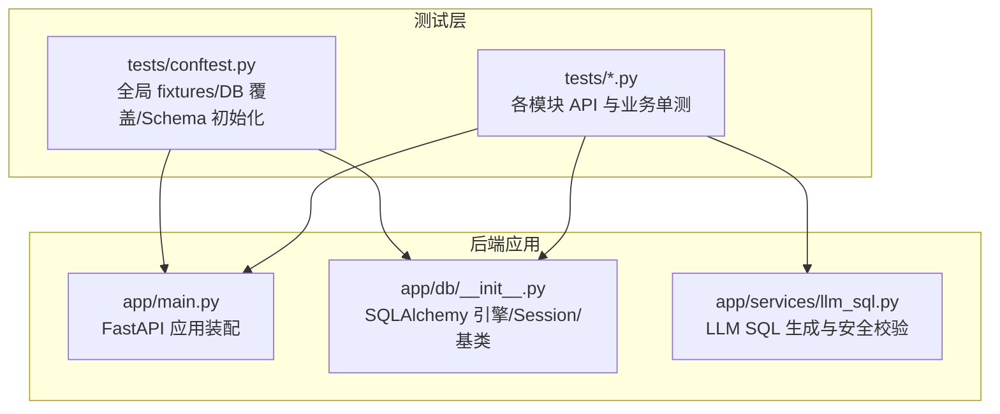
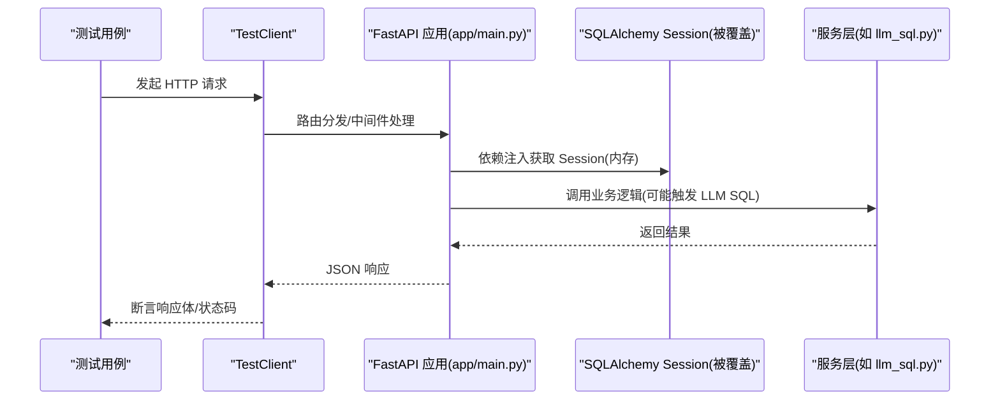
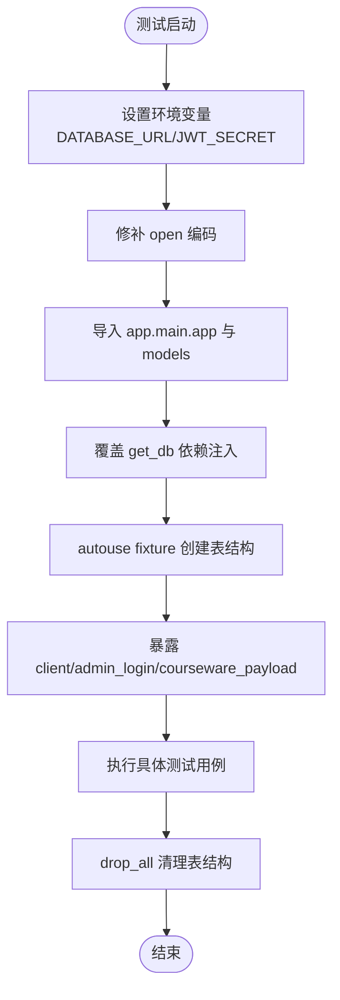
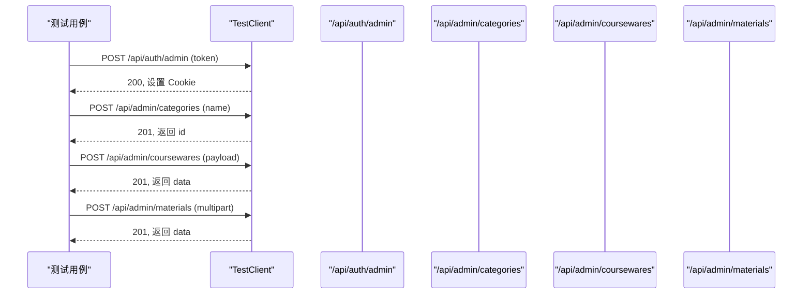
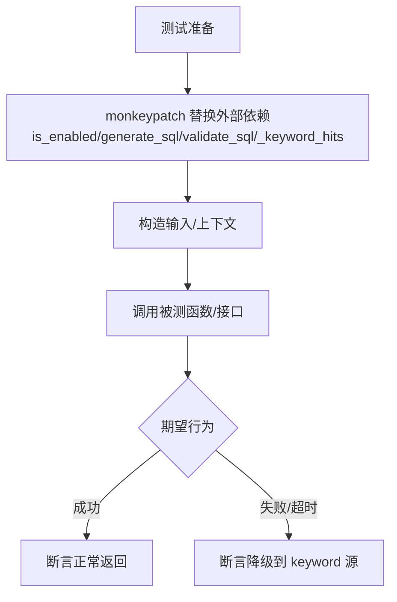
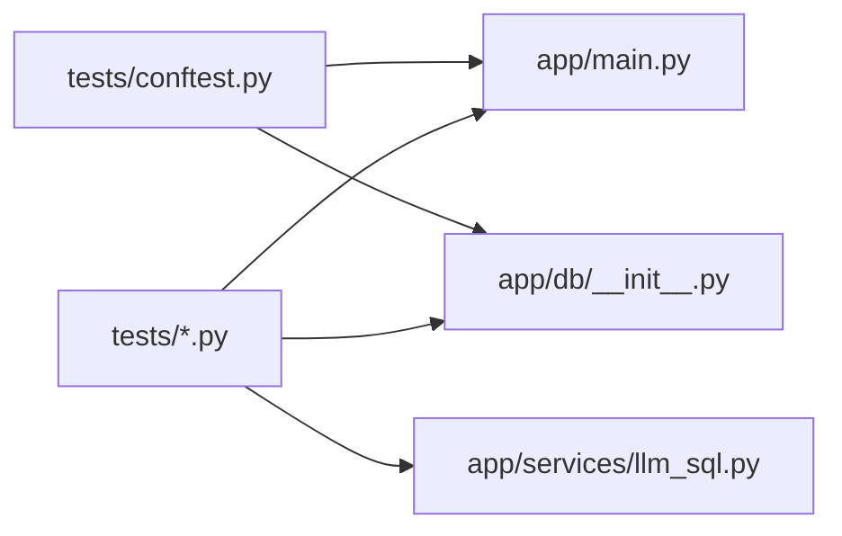

# 单元测试

<cite>
**本文引用的文件**
- [backend/tests/conftest.py](file://backend/tests/conftest.py)
- [backend/pyproject.toml](file://backend/pyproject.toml)
- [backend/app/main.py](file://backend/app/main.py)
- [backend/app/db/__init__.py](file://backend/app/db/__init__.py)
- [backend/tests/test_auth.py](file://backend/tests/test_auth.py)
- [backend/tests/test_courseware.py](file://backend/tests/test_courseware.py)
- [backend/tests/test_materials.py](file://backend/tests/test_materials.py)
- [backend/tests/test_access_tokens.py](file://backend/tests/test_access_tokens.py)
- [backend/tests/test_categories.py](file://backend/tests/test_categories.py)
- [backend/tests/test_tags.py](file://backend/tests/test_tags.py)
- [backend/tests/test_llm_sql.py](file://backend/tests/test_llm_sql.py)
- [backend/tests/test_search_llm.py](file://backend/tests/test_search_llm.py)
- [backend/app/services/llm_sql.py](file://backend/app/services/llm_sql.py)
</cite>

## 目录
1. [简介](#简介)
2. [项目结构](#项目结构)
3. [核心组件](#核心组件)
4. [架构总览](#架构总览)
5. [详细组件分析](#详细组件分析)
6. [依赖关系分析](#依赖关系分析)
7. [性能与稳定性考虑](#性能与稳定性考虑)
8. [故障排查指南](#故障排查指南)
9. [结论](#结论)
10. [附录](#附录)

## 简介
本文件面向 Learning Hub 后端单元测试，系统性说明 Pytest 配置、全局 fixtures 设计模式、测试数据库（SQLite 内存）初始化与清理策略、API 接口测试方法（TestClient）、Mock 与 monkeypatch 使用、测试数据工厂模式、异步测试与错误测试技巧，以及覆盖率统计与持续集成最佳实践。文档以仓库现有实现为依据，提供可追溯的源码路径与图示，帮助读者快速上手并高质量编写与维护测试。

## 项目结构
后端测试位于 backend/tests 目录，采用“按功能域组织”的测试文件划分方式；全局夹具与测试环境配置集中在 conftest.py；Pytest 运行参数在 pyproject.toml 中声明。

图表来源
- [backend/app/main.py:40-116](file://backend/app/main.py#L40-L116)
- [backend/app/db/__init__.py:15-51](file://backend/app/db/__init__.py#L15-L51)
- [backend/tests/conftest.py:41-76](file://backend/tests/conftest.py#L41-L76)

章节来源
- [backend/pyproject.toml:44-47](file://backend/pyproject.toml#L44-L47)
- [backend/tests/conftest.py:1-31](file://backend/tests/conftest.py#L1-L31)

## 核心组件
- Pytest 配置与运行模式
  - 自动启用 asyncio 支持，测试路径为 tests。
  - 可选依赖包含 pytest-asyncio、pytest-cov 等。
- 全局夹具与测试环境
  - 强制 SQLite 内存数据库，覆盖 get_db 依赖注入。
  - 每个测试前创建表结构，结束后清理；重置限流桶状态。
  - 提供 TestClient、管理员登录、课件 payload 工厂等常用夹具。
- 应用入口与中间件
  - FastAPI 应用装配路由、CORS、限流异常处理、请求 ID 透传等。
- 数据库连接与模型注册
  - SQLAlchemy 同步引擎、SessionLocal、Base 基类；测试时通过 StaticPool 与 check_same_thread=False 适配多线程访问。

章节来源
- [backend/pyproject.toml:27-47](file://backend/pyproject.toml#L27-L47)
- [backend/tests/conftest.py:23-76](file://backend/tests/conftest.py#L23-L76)
- [backend/app/main.py:40-116](file://backend/app/main.py#L40-L116)
- [backend/app/db/__init__.py:15-51](file://backend/app/db/__init__.py#L15-L51)

## 架构总览
下图展示测试执行时的关键交互：conftest 注入内存 DB 与 TestClient，测试用例通过 TestClient 调用 FastAPI 路由，路由经中间件与依赖注入进入服务层，必要时访问 LLM SQL 能力。

图表来源
- [backend/tests/conftest.py:49-76](file://backend/tests/conftest.py#L49-L76)
- [backend/app/main.py:40-116](file://backend/app/main.py#L40-L116)
- [backend/app/services/llm_sql.py:443-479](file://backend/app/services/llm_sql.py#L443-L479)

## 详细组件分析

### Pytest 配置与运行
- 配置文件位置：backend/pyproject.toml
- 关键项
  - asyncio_mode = "auto"：自动识别 async def 测试函数。
  - testpaths = ["tests"]：指定测试目录。
  - dev 可选依赖包含 pytest-asyncio、pytest-cov 等。

章节来源
- [backend/pyproject.toml:44-47](file://backend/pyproject.toml#L44-L47)
- [backend/pyproject.toml:27-34](file://backend/pyproject.toml#L27-L34)

### 全局 fixtures 设计模式（conftest.py）
- 环境变量与编码修复
  - 在导入 app.* 之前设置 DATABASE_URL 与 JWT_SECRET，确保测试使用内存 SQLite。
  - 修补 builtins.open 默认编码，避免 Windows 下 .env 读取失败。
- 数据库覆盖与 Schema 管理
  - 创建独立 _test_engine（SQLite 内存 + StaticPool），并通过 dependency_overrides 替换 get_db。
  - autouse fixture 在每个测试前后 create_all/drop_all，保证隔离。
  - 重置访问会话限流桶，避免跨测试累积影响。
- 客户端与鉴权
  - client 夹具封装 TestClient(app)。
  - admin_login 夹具完成管理员登录，后续测试可直接复用。
- 测试数据工厂
  - courseware_payload 工厂函数，统一构造课件创建载荷，支持覆盖 access_mode、token_ids、tag_ids、material_ids 等字段。

图表来源
- [backend/tests/conftest.py:8-31](file://backend/tests/conftest.py#L8-L31)
- [backend/tests/conftest.py:41-76](file://backend/tests/conftest.py#L41-L76)

章节来源
- [backend/tests/conftest.py:8-31](file://backend/tests/conftest.py#L8-L31)
- [backend/tests/conftest.py:41-76](file://backend/tests/conftest.py#L41-L76)

### 测试数据库设置（SQLite 内存）
- 引擎与池化
  - 生产环境根据 URL 选择连接池参数；SQLite 内存需 check_same_thread=False 并使用 StaticPool。
- 会话工厂
  - SessionLocal 绑定 engine，autoflush=False、expire_on_commit=False。
- 测试覆盖
  - conftest 创建 _test_engine 并覆盖 get_db，使所有路由共享同一内存库实例。
- 生命周期
  - 每个测试前 create_all，结束后 drop_all，确保幂等与隔离。

章节来源
- [backend/app/db/__init__.py:15-51](file://backend/app/db/__init__.py#L15-L51)
- [backend/tests/conftest.py:41-76](file://backend/tests/conftest.py#L41-L76)

### API 接口单元测试（TestClient）
- 健康检查与信封格式
  - 验证 /api/public/health 返回 code/data 结构。
- 管理员鉴权流程
  - 登录 /api/auth/admin，检查 Cookie 是否设置；未登录访问 /api/admin/* 应返回 401。
- 分类管理
  - 三级树构建、重命名、删除叶子节点、子节点存在阻止删除等。
- 标签管理
  - 创建、冲突、列表、重命名、删除全链路。
- 素材上传
  - PDF/PPT/视频上传、白名单校验、大小字段校验；PPT 转换不阻塞上传。
- 课件与 ACL
  - OPEN/RESTRICTED 创建、搜索、详情访问控制、解锁流程、降级清空 tokenIds。
- 访问令牌
  - 创建/列表/再生成/删除（引用保护）、label 必填与长度限制、重复冲突。

图表来源
- [backend/tests/test_auth.py:15-35](file://backend/tests/test_auth.py#L15-L35)
- [backend/tests/test_categories.py:21-83](file://backend/tests/test_categories.py#L21-L83)
- [backend/tests/test_courseware.py:17-166](file://backend/tests/test_courseware.py#L17-L166)
- [backend/tests/test_materials.py:11-91](file://backend/tests/test_materials.py#L11-L91)
- [backend/tests/test_access_tokens.py:7-111](file://backend/tests/test_access_tokens.py#L7-L111)

章节来源
- [backend/tests/test_auth.py:7-35](file://backend/tests/test_auth.py#L7-L35)
- [backend/tests/test_categories.py:21-83](file://backend/tests/test_categories.py#L21-L83)
- [backend/tests/test_tags.py:9-52](file://backend/tests/test_tags.py#L9-L52)
- [backend/tests/test_materials.py:11-91](file://backend/tests/test_materials.py#L11-L91)
- [backend/tests/test_courseware.py:17-166](file://backend/tests/test_courseware.py#L17-L166)
- [backend/tests/test_access_tokens.py:7-111](file://backend/tests/test_access_tokens.py#L7-L111)

### Mock 对象与 monkeypatch 使用
- 外部服务调用模拟
  - 针对 LLM SQL 生成与校验，使用 monkeypatch 替换 is_enabled/generate_sql/validate_sql 等行为，验证安全闸与降级路径。
- 文件操作模拟
  - 使用 BytesIO 构造虚拟文件内容，模拟 PDF/PPT/视频上传，无需真实磁盘 I/O。
- 数据库查询模拟
  - 通过直接访问被覆盖的 get_db 依赖注入器，获取测试 Session 进行断言或辅助构造数据。

图表来源
- [backend/tests/test_search_llm.py:102-175](file://backend/tests/test_search_llm.py#L102-L175)
- [backend/tests/test_materials.py:11-52](file://backend/tests/test_materials.py#L11-L52)
- [backend/tests/test_materials.py:22-38](file://backend/tests/test_materials.py#L22-L38)

章节来源
- [backend/tests/test_search_llm.py:102-175](file://backend/tests/test_search_llm.py#L102-L175)
- [backend/tests/test_materials.py:22-38](file://backend/tests/test_materials.py#L22-L38)

### 测试数据工厂模式
- courseware_payload 工厂
  - 提供统一的课件创建载荷构造，支持覆盖标题、分类、访问模式、关联 token/tag/material 等。
  - 内部计数器自动生成唯一标题，减少重复键冲突。
- 使用示例
  - 在课件创建、ACL 解锁、降级清空 tokenIds 等场景中广泛使用。

章节来源
- [backend/tests/conftest.py:86-112](file://backend/tests/conftest.py#L86-L112)
- [backend/tests/test_courseware.py:17-166](file://backend/tests/test_courseware.py#L17-L166)

### 异步测试与错误测试
- 异步测试
  - 通过 pytest-asyncio 的 auto 模式，可直接编写 async def 测试函数（当前测试以同步为主，但框架已就绪）。
- 错误测试
  - 鉴权失败：无效 token、未登录访问管理接口。
  - 业务错误码：分类名称冲突、最大层级、标签名冲突、令牌 label 冲突、最后令牌保护、课件 ACL 锁定等。
  - 限流与网络异常：通过中间件与异常处理器返回标准信封与状态码。

章节来源
- [backend/tests/test_auth.py:15-35](file://backend/tests/test_auth.py#L15-L35)
- [backend/tests/test_categories.py:35-83](file://backend/tests/test_categories.py#L35-L83)
- [backend/tests/test_tags.py:43-52](file://backend/tests/test_tags.py#L43-L52)
- [backend/tests/test_access_tokens.py:29-111](file://backend/tests/test_access_tokens.py#L29-L111)
- [backend/tests/test_courseware.py:99-166](file://backend/tests/test_courseware.py#L99-L166)

### LLM SQL 安全校验单测
- 覆盖七道闸：去 markdown fence、单语句、无注释、首词 SELECT、黑名单关键字、白名单表、强制 LIMIT。
- 边界与大小写不敏感、空输入拒绝、JOIN 合法组合等。

章节来源
- [backend/tests/test_llm_sql.py:19-193](file://backend/tests/test_llm_sql.py#L19-L193)
- [backend/app/services/llm_sql.py:350-355](file://backend/app/services/llm_sql.py#L350-L355)

## 依赖关系分析
- 测试对应用的依赖
  - conftest 依赖 app.main.app、app.db.Base/get_db、app.models 注册。
  - 测试用例依赖 TestClient、admin_login、courseware_payload 等夹具。
- 应用内部依赖
  - main.py 装配路由、中间件、异常处理；db/__init__.py 提供引擎与会话；services/llm_sql.py 提供 NL2SQL 能力。

图表来源
- [backend/tests/conftest.py:27-31](file://backend/tests/conftest.py#L27-L31)
- [backend/app/main.py:40-116](file://backend/app/main.py#L40-L116)
- [backend/app/db/__init__.py:15-51](file://backend/app/db/__init__.py#L15-L51)
- [backend/app/services/llm_sql.py:443-479](file://backend/app/services/llm_sql.py#L443-L479)

章节来源
- [backend/tests/conftest.py:27-31](file://backend/tests/conftest.py#L27-L31)
- [backend/app/main.py:40-116](file://backend/app/main.py#L40-L116)
- [backend/app/db/__init__.py:15-51](file://backend/app/db/__init__.py#L15-L51)
- [backend/app/services/llm_sql.py:443-479](file://backend/app/services/llm_sql.py#L443-L479)

## 性能与稳定性考虑
- 内存数据库与静态池
  - SQLite 内存 + StaticPool 提升并发访问稳定性，避免线程间锁问题。
- 限流桶重置
  - 每次测试前清空访问会话限流桶，防止跨测试累积导致误判。
- 最小化外部依赖
  - 通过 monkeypatch 与 BytesIO 避免真实网络与磁盘 I/O，提高测试速度与确定性。

[本节为通用指导，不直接分析具体文件]

## 故障排查指南
- 常见环境问题
  - Windows 下 .env 编码问题：已通过修补 builtins.open 解决。
  - 数据库连接异常：确认 conftest 已覆盖 get_db 且 Base.metadata.create_all 执行成功。
- 鉴权失败
  - 检查 admin_token 是否与 admin_login 夹具一致；确认 Cookie 是否正确传递。
- 限流误报
  - 确认 _rate_buckets 已在 _init_schema 中清空。
- LLM 相关
  - 若未配置 API Key，search 将回退到 keyword 源；可通过 monkeypatch 验证降级路径。

章节来源
- [backend/tests/conftest.py:8-15](file://backend/tests/conftest.py#L8-L15)
- [backend/tests/conftest.py:60-70](file://backend/tests/conftest.py#L60-L70)
- [backend/tests/test_search_llm.py:181-192](file://backend/tests/test_search_llm.py#L181-L192)

## 结论
本测试体系以 SQLite 内存数据库为核心，结合 FastAPI TestClient 与完善的 fixtures，实现了高内聚、低耦合的单元与集成测试。通过数据工厂与 monkeypatch，有效隔离外部依赖，保障测试的可重复性与稳定性。建议在生产 CI 中引入覆盖率统计与并行执行，进一步提升质量与效率。

[本节为总结性内容，不直接分析具体文件]

## 附录

### 覆盖率统计与持续集成最佳实践
- 覆盖率统计
  - 安装 pytest-cov，运行命令示例：python -m pytest --cov=app --cov-report=term-missing tests
  - 在 pyproject.toml 中扩展 tool.pytest.ini_options 可添加默认参数。
- 并行执行
  - 使用 pytest-xdist 提升速度：pip install pytest-xdist；运行：python -m pytest -n auto
- CI 集成
  - 在 GitHub Actions/GitLab CI 中安装依赖后执行 pytest，输出覆盖率报告与失败日志。
  - 缓存 Python 包与 Poetry 环境，缩短构建时间。
- 代码质量
  - 结合 ruff/mypy 在 CI 中执行静态检查，确保风格与类型一致性。

[本节为通用指导，不直接分析具体文件]