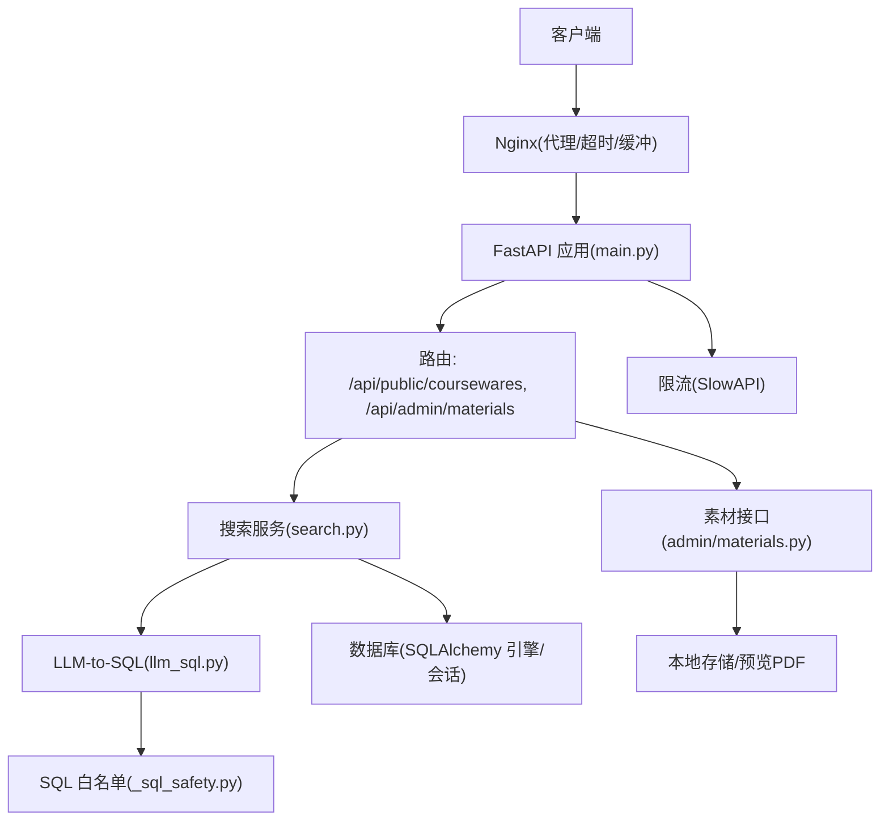
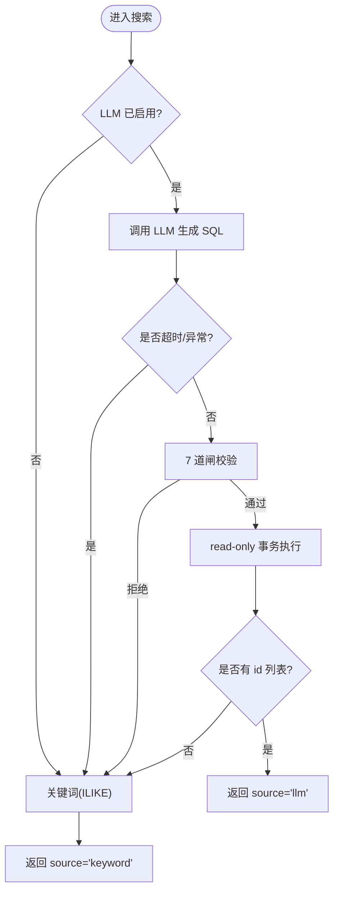
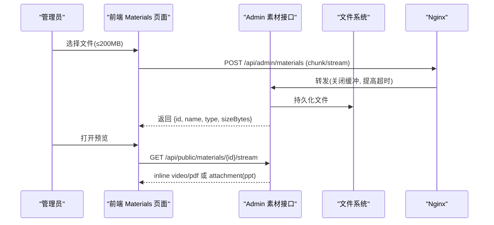
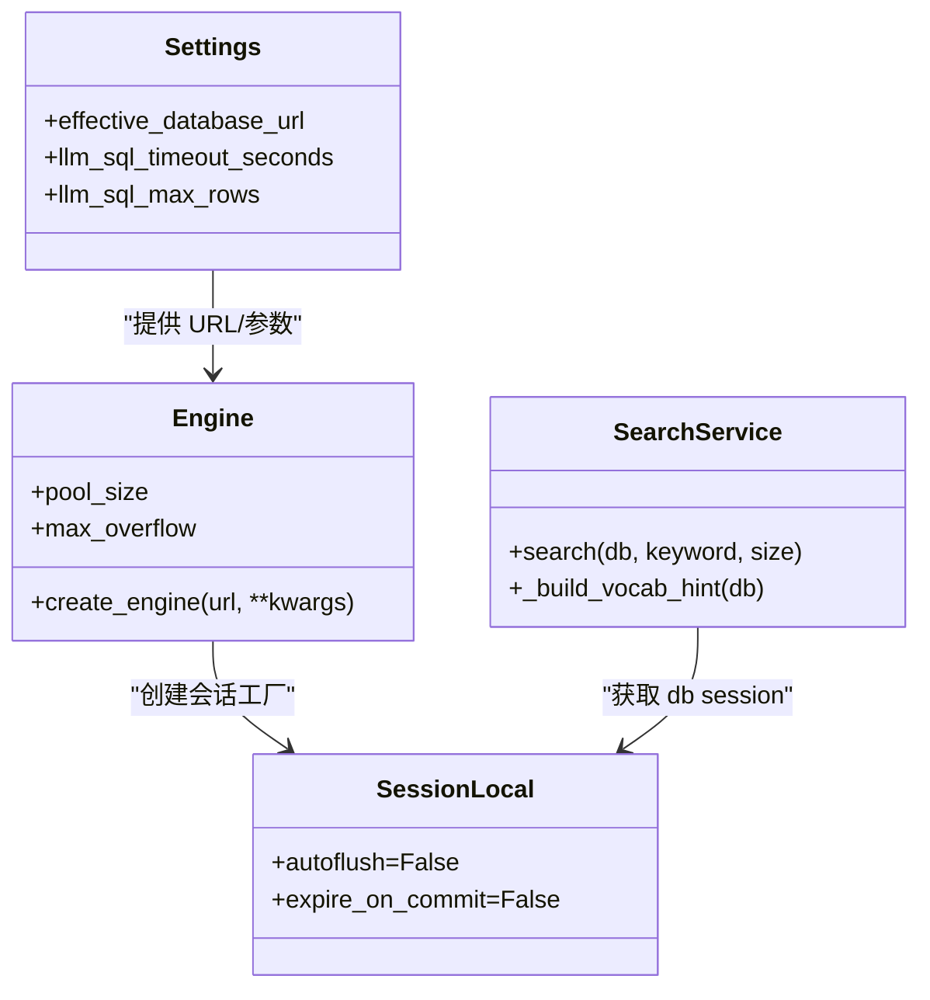
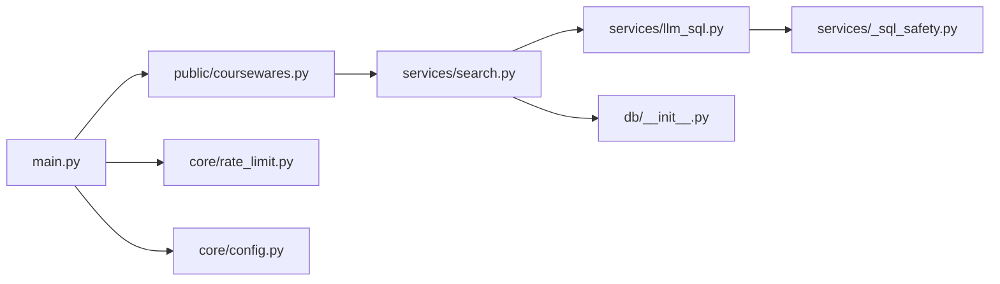

# 性能测试

<cite>
**本文引用的文件**   
- [backend/app/main.py](file://backend/app/main.py)
- [backend/app/core/config.py](file://backend/app/core/config.py)
- [backend/app/api/public/coursewares.py](file://backend/app/api/public/coursewares.py)
- [backend/app/services/search.py](file://backend/app/services/search.py)
- [backend/app/services/llm_sql.py](file://backend/app/services/llm_sql.py)
- [backend/app/services/_sql_safety.py](file://backend/app/services/_sql_safety.py)
- [backend/app/db/__init__.py](file://backend/app/db/__init__.py)
- [backend/app/core/rate_limit.py](file://backend/app/core/rate_limit.py)
- [backend/app/api/admin/materials.py](file://backend/app/api/admin/materials.py)
- [deploy/ecs/patch-lh-upload.py](file://deploy/ecs/patch-lh-upload.py)
- [doc/spec/06-非功能需求.md](file://doc/spec/06-非功能需求.md)
- [doc/test/test-cases-front.md](file://doc/test/test-cases-front.md)
- [frontend/e2e/front-search-llm.spec.ts](file://frontend/e2e/front-search-llm.spec.ts)
- [backend/tests/test_search_llm.py](file://backend/tests/test_search_llm.py)
- [backend/tests/test_materials_stream.py](file://backend/tests/test_materials_stream.py)
- [deploy/local/tests/test_stream.py](file://deploy/local/tests/test_stream.py)
</cite>

## 目录
1. [引言](#引言)
2. [项目结构](#项目结构)
3. [核心组件](#核心组件)
4. [架构总览](#架构总览)
5. [详细组件分析](#详细组件分析)
6. [依赖分析](#依赖分析)
7. [性能考虑](#性能考虑)
8. [故障排查指南](#故障排查指南)
9. [结论](#结论)
10. [附录](#附录)

## 引言
本文件面向 Learning Hub 的性能测试，覆盖目标与指标、负载与压力场景设计、智能搜索（LLM-to-SQL + ILIKE 兜底）性能调优、文件处理（上传/下载/预览/转换）性能评估、数据库查询与连接池优化、监控与日志分析，以及自动化与持续性能监控最佳实践。文档中的指标基线、降级策略与安全护栏均来源于仓库内规范与实现。

## 项目结构
后端采用 FastAPI 分层：入口装配中间件与路由；公共 API 暴露搜索、健康检查等；服务层封装 LLM-to-SQL 与关键词兜底；数据访问通过 SQLAlchemy 引擎与会话工厂；配置集中管理环境变量；限流基于 SlowAPI；Nginx 侧对大文件上传进行超时与缓冲调整。



图表来源
- [backend/app/main.py:40-112](file://backend/app/main.py#L40-L112)
- [backend/app/api/public/coursewares.py:32-54](file://backend/app/api/public/coursewares.py#L32-L54)
- [backend/app/services/search.py:210-242](file://backend/app/services/search.py#L210-L242)
- [backend/app/services/llm_sql.py:443-478](file://backend/app/services/llm_sql.py#L443-L478)
- [backend/app/services/_sql_safety.py:165-210](file://backend/app/services/_sql_safety.py#L165-L210)
- [backend/app/db/__init__.py:15-32](file://backend/app/db/__init__.py#L15-L32)
- [backend/app/core/rate_limit.py:40-51](file://backend/app/core/rate_limit.py#L40-L51)
- [backend/app/api/admin/materials.py:35-70](file://backend/app/api/admin/materials.py#L35-L70)
- [deploy/ecs/patch-lh-upload.py:74-97](file://deploy/ecs/patch-lh-upload.py#L74-L97)

章节来源
- [backend/app/main.py:40-112](file://backend/app/main.py#L40-L112)
- [backend/app/core/config.py:9-88](file://backend/app/core/config.py#L9-L88)
- [backend/app/db/__init__.py:15-32](file://backend/app/db/__init__.py#L15-L32)
- [backend/app/core/rate_limit.py:40-51](file://backend/app/core/rate_limit.py#L40-L51)
- [deploy/ecs/patch-lh-upload.py:74-97](file://deploy/ecs/patch-lh-upload.py#L74-L97)

## 核心组件
- 统一搜索服务：优先 LLM-to-SQL(qwen-plus)，失败或禁用时回退到 ILIKE 关键词检索，返回 source 字段区分路径。
- LLM-to-SQL 安全执行：生成 SQL → 7 道闸校验 → read-only 事务执行 → 仅取 id 列表 → 二次补齐详情。
- 素材上传/下载/流式浏览：支持 MP4/PDF/PPT，PPT 可转 PDF 预览，未转换则降级为附件下载。
- 限流与健康检查：SlowAPI 限流，健康探针用于负载均衡与监控。
- 配置与连接池：集中环境变量，Postgres 连接池大小与溢出参数可调。

章节来源
- [backend/app/services/search.py:1-262](file://backend/app/services/search.py#L1-L262)
- [backend/app/services/llm_sql.py:1-490](file://backend/app/services/llm_sql.py#L1-L490)
- [backend/app/services/_sql_safety.py:1-220](file://backend/app/services/_sql_safety.py#L1-L220)
- [backend/app/api/admin/materials.py:1-74](file://backend/app/api/admin/materials.py#L1-74)
- [backend/app/core/rate_limit.py:1-55](file://backend/app/core/rate_limit.py#L1-55)
- [backend/app/core/config.py:1-88](file://backend/app/core/config.py#L1-88)

## 架构总览
下图展示一次“智能搜索”请求的端到端流程，包括 LLM 调用、安全校验、只读事务执行与关键词兜底。

```mermaid
sequenceDiagram
participant C as "客户端"
participant F as "FastAPI 路由(/search)"
participant S as "搜索服务(search.py)"
participant L as "LLM-to-SQL(llm_sql.py)"
participant V as "SQL 白名单(_sql_safety.py)"
participant D as "数据库(SQLAlchemy)"
C->>F : GET /api/public/coursewares/search?q=...
F->>S : search(keyword, size)
alt LLM 可用且关键词非空
S->>L : generate_sql(query)
L-->>S : raw SQL 或 None
alt 有 SQL
S->>V : validate_sql(raw)
V-->>S : 清洗后 SQL 或 None
alt 通过校验
S->>D : SET TRANSACTION READ ONLY; SELECT ... LIMIT
D-->>S : id 列表
S-->>F : items(source="llm")
else 校验拒绝
S->>S : 降级关键词
end
else 无 SQL
S->>S : 降级关键词
end
else LLM 不可用/超时/异常
S->>S : 降级关键词
end
S->>D : ILIKE 关键词检索
D-->>S : 结果集
S-->>F : items(source="keyword")
F-->>C : {items, source, total}
```

图表来源
- [backend/app/api/public/coursewares.py:32-54](file://backend/app/api/public/coursewares.py#L32-L54)
- [backend/app/services/search.py:210-242](file://backend/app/services/search.py#L210-L242)
- [backend/app/services/llm_sql.py:276-344](file://backend/app/services/llm_sql.py#L276-L344)
- [backend/app/services/_sql_safety.py:165-210](file://backend/app/services/_sql_safety.py#L165-L210)
- [backend/app/services/llm_sql.py:385-437](file://backend/app/services/llm_sql.py#L385-L437)

## 详细组件分析

### 智能搜索性能测试
- 目标与指标
  - 响应时间：搜索接口 P95 ≤ 2s（含 LLM 调用与降级）。
  - LLM 调用耗时：P95 ≤ 1.5s（含超时触发）。
  - 超时率：LLM 超时比例 ≤ 5%（5 分钟滑动窗口）。
  - 关键词路径：在 LLM 不可用时稳定命中，source="keyword"。
- 关键实现要点
  - 超时控制：search() 使用 wait_for 包裹 LLM 同步包装，超过 llm_sql_timeout_seconds 即降级。
  - 词汇缓存：_build_vocab_hint 进程级缓存分类/标签名，TTL 60s，降低提示词构建开销。
  - 安全执行：7 道闸校验 + read-only 事务，避免危险语句并限制 LIMIT。
- 测试场景
  - 长句自然语言：期望走 LLM 路径，source="llm"。
  - 无 API Key/外部不可用：强制走 keyword 路径，source="keyword"。
  - 短关键词：ILIKE 命中集合与 LLM 路径一致。
  - 高并发：模拟多用户同时搜索，观察 P95、错误率与降级率。
- 基准与回归
  - 使用 e2e 用例验证 source 字段与徽标文案一致性。
  - 单元测试覆盖 LLM 禁用、超时、校验拒绝、空关键词等分支。



图表来源
- [backend/app/services/search.py:210-242](file://backend/app/services/search.py#L210-L242)
- [backend/app/services/llm_sql.py:443-478](file://backend/app/services/llm_sql.py#L443-L478)
- [backend/app/services/_sql_safety.py:165-210](file://backend/app/services/_sql_safety.py#L165-L210)

章节来源
- [backend/app/services/search.py:1-262](file://backend/app/services/search.py#L1-L262)
- [backend/app/services/llm_sql.py:1-490](file://backend/app/services/llm_sql.py#L1-L490)
- [backend/app/services/_sql_safety.py:1-220](file://backend/app/services/_sql_safety.py#L1-L220)
- [doc/spec/06-非功能需求.md:125-136](file://doc/spec/06-非功能需求.md#L125-L136)
- [doc/test/test-cases-front.md:73-111](file://doc/test/test-cases-front.md#L73-L111)
- [frontend/e2e/front-search-llm.spec.ts:1-31](file://frontend/e2e/front-search-llm.spec.ts#L1-L31)
- [backend/tests/test_search_llm.py:1-168](file://backend/tests/test_search_llm.py#L1-L168)

### 文件处理性能测试（上传/下载/预览/转换）
- 目标与指标
  - 上传：P95 ≤ 60s（200MB 文件，含网络）。
  - 下载/流式：Content-Type 正确，inline disposition 用于浏览器预览。
  - PPT→PDF 转换：超时可控（默认 60s），失败不阻塞主流程。
- 关键实现要点
  - Nginx 大文件上传：client_max_body_size、proxy_send/read_timeout、proxy_request_buffering off。
  - 素材接口：admin/upload 写入存储，stream 返回 inline 或 fallback attachment。
  - 前端上传上限与友好错误提示对齐后端与 Nginx 配置。
- 测试场景
  - 大文件上传：200MB 视频/PDF，断点重试与超时边界。
  - 流式预览：MP4/PDF inline 返回，PPT 无预览时降级为附件。
  - 并发下载：多用户同时拉取大文件，关注带宽与 CPU。



图表来源
- [deploy/ecs/patch-lh-upload.py:74-97](file://deploy/ecs/patch-lh-upload.py#L74-L97)
- [backend/app/api/admin/materials.py:35-70](file://backend/app/api/admin/materials.py#L35-L70)
- [backend/tests/test_materials_stream.py:39-232](file://backend/tests/test_materials_stream.py#L39-L232)
- [deploy/local/tests/test_stream.py:36-68](file://deploy/local/tests/test_stream.py#L36-L68)

章节来源
- [backend/app/api/admin/materials.py:1-74](file://backend/app/api/admin/materials.py#L1-74)
- [backend/tests/test_materials_stream.py:39-232](file://backend/tests/test_materials_stream.py#L39-L232)
- [deploy/local/tests/test_stream.py:36-68](file://deploy/local/tests/test_stream.py#L36-L68)
- [deploy/ecs/patch-lh-upload.py:74-97](file://deploy/ecs/patch-lh-upload.py#L74-L97)
- [doc/spec/06-非功能需求.md:125-136](file://doc/spec/06-非功能需求.md#L125-L136)

### 数据库查询性能测试（慢查询/索引/连接池）
- 目标与指标
  - 单条查询 P95 ≤ 50ms。
  - 搜索接口整体 P95 ≤ 2s（含 LLM 与关键词路径）。
- 关键实现要点
  - 连接池：Postgres 下 pool_size=10, max_overflow=20；SQLite 使用 StaticPool。
  - 只读事务：LLM 生成的 SQL 在 read-only 事务中执行，减少锁竞争风险。
  - 词汇缓存：分类/标签名缓存 TTL 60s，降低提示词构建时的额外查询。
- 测试场景
  - 热点查询：高频搜索与课件详情，观察连接池等待与队列长度。
  - 慢查询定位：结合 EXPLAIN/慢查询日志，确认 ILIKE 命中范围与索引有效性。
  - 峰值压测：提升并发，观察连接池耗尽与超时情况。



图表来源
- [backend/app/core/config.py:28-38](file://backend/app/core/config.py#L28-L38)
- [backend/app/db/__init__.py:15-32](file://backend/app/db/__init__.py#L15-L32)
- [backend/app/services/search.py:44-104](file://backend/app/services/search.py#L44-L104)

章节来源
- [backend/app/db/__init__.py:15-32](file://backend/app/db/__init__.py#L15-L32)
- [backend/app/core/config.py:1-88](file://backend/app/core/config.py#L1-88)
- [backend/app/services/search.py:44-104](file://backend/app/services/search.py#L44-L104)
- [backend/app/services/llm_sql.py:385-437](file://backend/app/services/llm_sql.py#L385-L437)
- [doc/spec/06-非功能需求.md:125-136](file://doc/spec/06-非功能需求.md#L125-L136)

### 限流与稳定性
- 目标与指标
  - 防止滥用：按 IP/会话维度限流，避免资源耗尽。
  - 错误率：5xx ≤ 0.5%。
- 关键实现要点
  - SlowAPI Limiter 支持 Redis 或内存模式；key_func 支持 ip/session。
  - 全局异常处理器返回标准化信封与 requestId。
- 测试场景
  - 高频重复请求：验证 429 返回与冷却时间。
  - 混合流量：搜索+上传+详情，观察限流对不同接口的影响。

章节来源
- [backend/app/core/rate_limit.py:1-55](file://backend/app/core/rate_limit.py#L1-55)
- [backend/app/main.py:67-90](file://backend/app/main.py#L67-L90)
- [doc/spec/06-非功能需求.md:125-136](file://doc/spec/06-非功能需求.md#L125-L136)

## 依赖分析
- 模块耦合
  - 路由层依赖服务层；服务层依赖 LLM 与数据库；LLM 依赖安全校验与配置。
  - 配置集中注入，便于在不同环境切换 LLM 开关与超时阈值。
- 外部依赖
  - dashscope SDK（可选，未安装时优雅降级）。
  - Nginx 代理与大文件上传参数。
- 潜在循环依赖
  - 当前未发现直接循环导入；服务间通过函数调用解耦。



图表来源
- [backend/app/main.py:40-112](file://backend/app/main.py#L40-L112)
- [backend/app/api/public/coursewares.py:32-54](file://backend/app/api/public/coursewares.py#L32-L54)
- [backend/app/services/search.py:210-242](file://backend/app/services/search.py#L210-L242)
- [backend/app/services/llm_sql.py:443-478](file://backend/app/services/llm_sql.py#L443-L478)
- [backend/app/services/_sql_safety.py:165-210](file://backend/app/services/_sql_safety.py#L165-L210)
- [backend/app/db/__init__.py:15-32](file://backend/app/db/__init__.py#L15-L32)
- [backend/app/core/rate_limit.py:40-51](file://backend/app/core/rate_limit.py#L40-L51)
- [backend/app/core/config.py:9-88](file://backend/app/core/config.py#L9-L88)

章节来源
- [backend/app/main.py:40-112](file://backend/app/main.py#L40-L112)
- [backend/app/api/public/coursewares.py:32-54](file://backend/app/api/public/coursewares.py#L32-L54)
- [backend/app/services/search.py:210-242](file://backend/app/services/search.py#L210-L242)
- [backend/app/services/llm_sql.py:443-478](file://backend/app/services/llm_sql.py#L443-L478)
- [backend/app/services/_sql_safety.py:165-210](file://backend/app/services/_sql_safety.py#L165-L210)
- [backend/app/db/__init__.py:15-32](file://backend/app/db/__init__.py#L15-L32)
- [backend/app/core/rate_limit.py:40-51](file://backend/app/core/rate_limit.py#L40-L51)
- [backend/app/core/config.py:9-88](file://backend/app/core/config.py#L9-L88)

## 性能考虑
- 搜索路径优化
  - 合理设置 LLM_SQL_TIMEOUT_SECONDS，平衡用户体验与稳定性；默认 8s 超时触发降级。
  - 利用词汇缓存减少提示词构建开销；必要时缩短 TTL 以更快反映分类/标签变更。
  - 关键词路径确保 ILIKE 命中范围可控，避免全表扫描。
- 文件处理优化
  - Nginx 关闭请求体缓冲，边收边转发，适合大文件上传。
  - 调整 proxy_send/read_timeout 以匹配带宽与文件大小。
  - PPT 转换失败不阻塞主流程，前端降级为附件下载。
- 数据库优化
  - 连接池大小与溢出参数根据并发与延迟目标调优。
  - 针对 ILIKE 热点字段建立合适索引（如 title/description/tag.name），并结合 EXPLAIN 验证。
- 限流与弹性
  - 在高并发下启用 Redis-backed 限流，避免内存模式瓶颈。
  - 监控 5xx 错误率与超时率，设定告警阈值。

[本节为通用指导，无需具体文件引用]

## 故障排查指南
- 搜索链路
  - 若 source="keyword" 且预期为 LLM 路径，检查 DASHSCOPE_API_KEY 是否配置、LLM 调用是否超时、SQL 是否被白名单拒绝。
  - 查看 WARNING 日志定位超时或异常原因。
- 文件处理
  - 上传失败：检查 Nginx client_max_body_size 与超时参数；确认前端上传上限与后端一致。
  - 预览异常：确认 PPT 是否成功转换为 PDF；若无预览，应降级为附件下载。
- 数据库
  - 连接池耗尽：观察 pool_size/max_overflow 与并发量；增加池大小或引入异步任务队列。
  - 慢查询：使用 EXPLAIN 分析 ILIKE 条件与 JOIN，补充必要索引。
- 限流
  - 频繁 429：检查 key_func 与限流规格；必要时放宽或引入更细粒度限流策略。

章节来源
- [backend/app/services/search.py:210-242](file://backend/app/services/search.py#L210-L242)
- [backend/app/services/llm_sql.py:276-344](file://backend/app/services/llm_sql.py#L276-L344)
- [backend/app/services/_sql_safety.py:165-210](file://backend/app/services/_sql_safety.py#L165-L210)
- [deploy/ecs/patch-lh-upload.py:74-97](file://deploy/ecs/patch-lh-upload.py#L74-L97)
- [backend/app/db/__init__.py:15-32](file://backend/app/db/__init__.py#L15-L32)
- [backend/app/core/rate_limit.py:40-51](file://backend/app/core/rate_limit.py#L40-L51)

## 结论
Learning Hub 的性能测试围绕搜索（LLM-to-SQL + ILIKE）、文件处理（上传/下载/预览/转换）、数据库查询与连接池、限流与稳定性展开。通过明确的指标基线与降级策略，系统在外部依赖不稳定时仍能保持可用性。建议在生产环境中持续采集 APM 指标与结构化日志，结合自动化压测与回归，保障性能基线不被退化。

[本节为总结性内容，无需具体文件引用]

## 附录
- 指标基线参考
  - 后台 CRUD P95 ≤ 300ms；搜索 P95 ≤ 2s；DB 查询 P95 ≤ 50ms；LLM 调用 P95 ≤ 1.5s；上传 P95 ≤ 60s（200MB）；5xx ≤ 0.5%。
- 自动化与持续监控
  - 将 e2e 与单元用例纳入 CI，定期执行搜索与文件处理场景。
  - 接入 Prometheus/Grafana 采集 http_server_requests_seconds_* 等指标，设置告警规则。
  - 结构化日志包含 requestId，便于跨服务对位与问题追踪。

章节来源
- [doc/spec/06-非功能需求.md:125-136](file://doc/spec/06-非功能需求.md#L125-L136)
- [doc/test/test-cases-integration.md:495-552](file://doc/test/test-cases-integration.md#L495-L552)