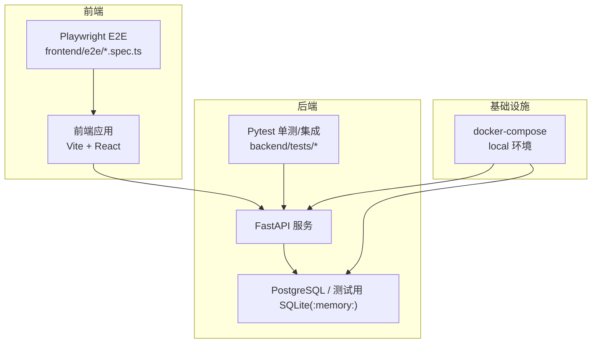
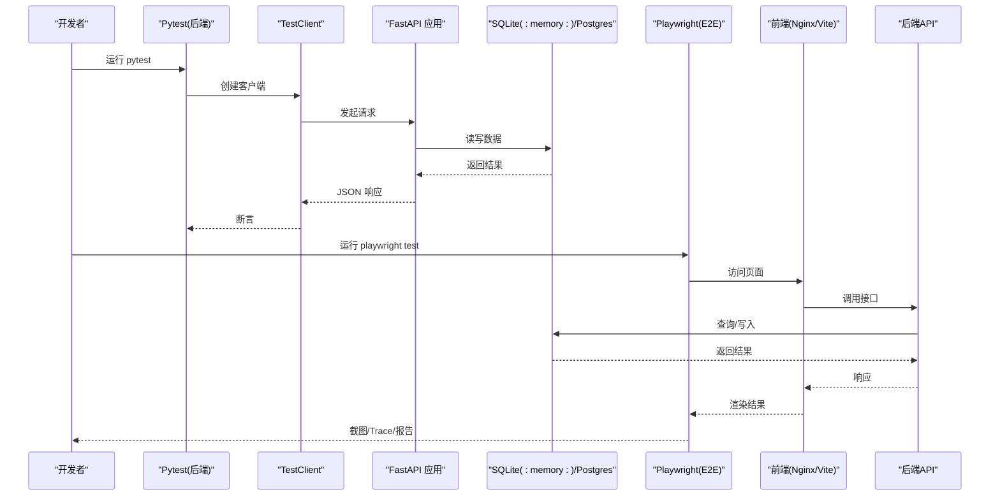
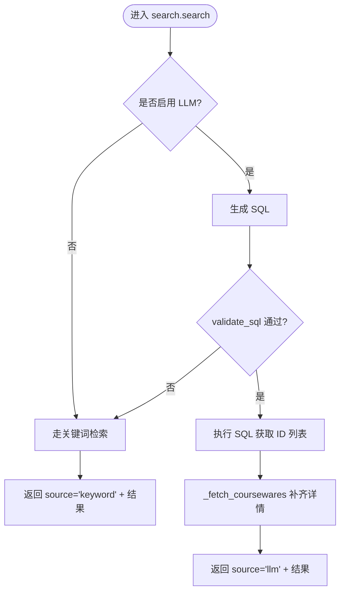
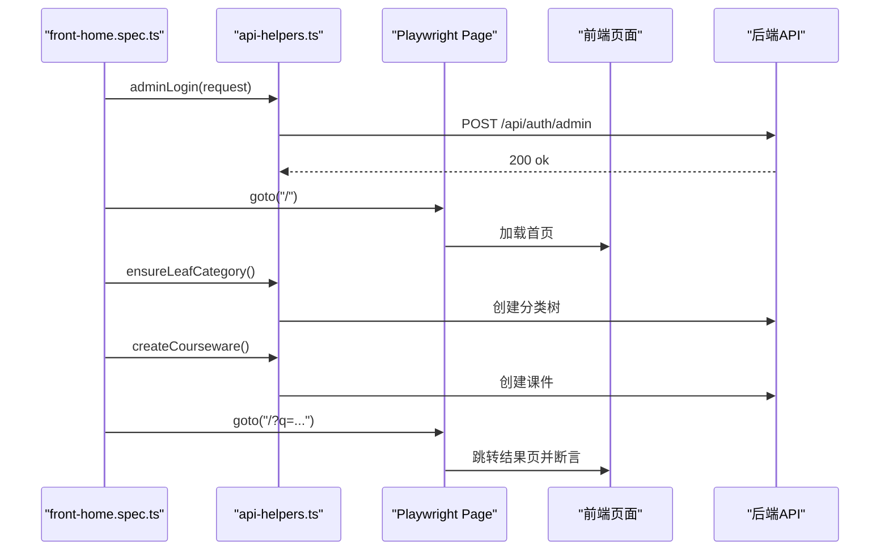
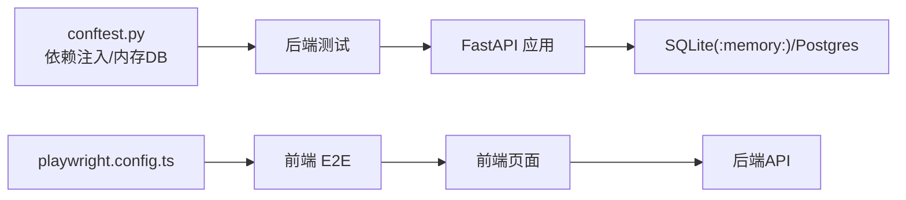

# 测试策略

<cite>
**本文引用的文件**   
- [backend/pyproject.toml](file://backend/pyproject.toml)
- [frontend/package.json](file://frontend/package.json)
- [doc/test/README.md](file://doc/test/README.md)
- [doc/test/selectors.md](file://doc/test/selectors.md)
- [doc/test/test-data.md](file://doc/test/test-data.md)
- [doc/test/setup-teardown.md](file://doc/test/setup-teardown.md)
- [frontend/playwright.config.ts](file://frontend/playwright.config.ts)
- [deploy/local/docker-compose.yml](file://deploy/local/docker-compose.yml)
- [backend/tests/conftest.py](file://backend/tests/conftest.py)
- [backend/tests/test_auth.py](file://backend/tests/test_auth.py)
- [backend/tests/test_courseware.py](file://backend/tests/test_courseware.py)
- [backend/tests/test_llm_sql.py](file://backend/tests/test_llm_sql.py)
- [backend/tests/test_search_llm.py](file://backend/tests/test_search_llm.py)
- [frontend/e2e/api-helpers.ts](file://frontend/e2e/api-helpers.ts)
- [frontend/e2e/front-home.spec.ts](file://frontend/e2e/front-home.spec.ts)
- [frontend/e2e/admin-auth.spec.ts](file://frontend/e2e/admin-auth.spec.ts)
</cite>

## 目录
1. [引言](#引言)
2. [项目结构](#项目结构)
3. [核心组件](#核心组件)
4. [架构总览](#架构总览)
5. [详细组件分析](#详细组件分析)
6. [依赖分析](#依赖分析)
7. [性能考虑](#性能考虑)
8. [故障排查指南](#故障排查指南)
9. [结论](#结论)
10. [附录](#附录)

## 引言
本测试策略面向 Learning Hub 的全栈工程，覆盖后端与前端的多层次测试体系：单元测试、集成测试与端到端（E2E）测试。文档明确各层职责、执行策略与自动化流程，提供后端 Pytest 编写指南、前端 Playwright E2E 实现方法、CI/CD 集成与报告、覆盖率统计、性能与负载测试方案、测试数据管理与隔离机制，以及调试技巧与常见问题解决方案。

## 项目结构
Learning Hub 采用前后端分离的仓库结构：
- 后端：FastAPI + SQLAlchemy + Alembic，使用 pytest 进行单测与集成测试；通过 conftest 注入内存 SQLite 与 TestClient。
- 前端：React + Vite + Tailwind，E2E 使用 Playwright；选择器规范在 doc/test/selectors.md 中定义。
- 部署：本地 docker-compose 编排 Postgres、后端与前端，便于联调与 E2E 运行。
- 测试文档：doc/test 下包含用例组织、选择器约定、测试数据与 Setup/Teardown 步骤。

图表来源
- [frontend/playwright.config.ts:1-34](file://frontend/playwright.config.ts#L1-L34)
- [deploy/local/docker-compose.yml:1-74](file://deploy/local/docker-compose.yml#L1-L74)
- [backend/tests/conftest.py:1-121](file://backend/tests/conftest.py#L1-L121)

章节来源
- [frontend/package.json:1-40](file://frontend/package.json#L1-L40)
- [backend/pyproject.toml:1-47](file://backend/pyproject.toml#L1-L47)
- [deploy/local/docker-compose.yml:1-74](file://deploy/local/docker-compose.yml#L1-L74)

## 核心组件
- 后端测试框架与配置
  - pytest 自动异步模式、测试路径、可选依赖（pytest-asyncio、pytest-cov）。
  - conftest 全局 fixtures：内存数据库、TestClient、管理员登录、课件载荷工厂。
- 前端 E2E 配置与辅助
  - Playwright 配置：浏览器、重试、截图/trace、超时等。
  - api-helpers：绕过 UI 直接调用后端 API，加速 E2E 准备。
- 测试文档与数据
  - selectors 选择器规范、test-data 种子数据、setup-teardown 步骤化准备与还原。

章节来源
- [backend/pyproject.toml:27-47](file://backend/pyproject.toml#L27-L47)
- [backend/tests/conftest.py:1-121](file://backend/tests/conftest.py#L1-L121)
- [frontend/playwright.config.ts:1-34](file://frontend/playwright.config.ts#L1-L34)
- [frontend/e2e/api-helpers.ts:1-111](file://frontend/e2e/api-helpers.ts#L1-L111)
- [doc/test/selectors.md:1-293](file://doc/test/selectors.md#L1-L293)
- [doc/test/test-data.md:1-232](file://doc/test/test-data.md#L1-L232)
- [doc/test/setup-teardown.md:1-281](file://doc/test/setup-teardown.md#L1-L281)

## 架构总览
多层次测试体系与执行流如下：

图表来源
- [backend/tests/conftest.py:1-121](file://backend/tests/conftest.py#L1-L121)
- [frontend/playwright.config.ts:1-34](file://frontend/playwright.config.ts#L1-L34)
- [deploy/local/docker-compose.yml:1-74](file://deploy/local/docker-compose.yml#L1-L74)

## 详细组件分析

### 后端单元测试与集成测试（Pytest）
- 目标与范围
  - 单元层：纯函数校验与安全策略（如 SQL 安全校验）。
  - 集成层：HTTP 接口契约、鉴权、业务规则（课件 ACL、搜索降级）。
- 关键实践
  - 使用内存 SQLite 与静态连接池，避免外部依赖。
  - 通过 dependency_overrides 注入测试数据库会话。
  - 使用 TestClient 模拟 HTTP 请求，断言状态码与响应信封。
  - 使用 monkeypatch 替换 LLM 相关能力以验证降级路径。
- 示例路径
  - 健康检查与鉴权：[backend/tests/test_auth.py:1-35](file://backend/tests/test_auth.py#L1-L35)
  - 课件创建/ACL/解锁/搜索：[backend/tests/test_courseware.py:1-166](file://backend/tests/test_courseware.py#L1-L166)
  - SQL 安全校验（7 道闸）：[backend/tests/test_llm_sql.py:1-193](file://backend/tests/test_llm_sql.py#L1-L193)
  - LLM-to-SQL 主流程与降级：[backend/tests/test_search_llm.py:1-224](file://backend/tests/test_search_llm.py#L1-L224)

图表来源
- [backend/tests/test_search_llm.py:1-224](file://backend/tests/test_search_llm.py#L1-L224)
- [backend/tests/test_llm_sql.py:1-193](file://backend/tests/test_llm_sql.py#L1-L193)

章节来源
- [backend/tests/conftest.py:1-121](file://backend/tests/conftest.py#L1-L121)
- [backend/tests/test_auth.py:1-35](file://backend/tests/test_auth.py#L1-L35)
- [backend/tests/test_courseware.py:1-166](file://backend/tests/test_courseware.py#L1-L166)
- [backend/tests/test_llm_sql.py:1-193](file://backend/tests/test_llm_sql.py#L1-L193)
- [backend/tests/test_search_llm.py:1-224](file://backend/tests/test_search_llm.py#L1-L224)

### 前端 E2E 测试（Playwright）
- 目标与范围
  - 前台门户首页、搜索结果、受限课件解锁、管理后台登录与导航等。
- 关键实践
  - 使用 data-testid 选择器规范，确保稳定性。
  - 通过 api-helpers 快速准备分类、Token、课件，减少 UI 操作。
  - 串行套件保证前置条件稳定；失败时保留截图与 Trace。
- 示例路径
  - 首页与搜索：[frontend/e2e/front-home.spec.ts:1-46](file://frontend/e2e/front-home.spec.ts#L1-L46)
  - 后台登录与导航：[frontend/e2e/admin-auth.spec.ts:1-60](file://frontend/e2e/admin-auth.spec.ts#L1-L60)
  - 选择器规范：[doc/test/selectors.md:1-293](file://doc/test/selectors.md#L1-L293)
  - E2E 辅助 API：[frontend/e2e/api-helpers.ts:1-111](file://frontend/e2e/api-helpers.ts#L1-L111)

图表来源
- [frontend/e2e/front-home.spec.ts:1-46](file://frontend/e2e/front-home.spec.ts#L1-L46)
- [frontend/e2e/api-helpers.ts:1-111](file://frontend/e2e/api-helpers.ts#L1-L111)

章节来源
- [frontend/playwright.config.ts:1-34](file://frontend/playwright.config.ts#L1-L34)
- [frontend/e2e/front-home.spec.ts:1-46](file://frontend/e2e/front-home.spec.ts#L1-L46)
- [frontend/e2e/admin-auth.spec.ts:1-60](file://frontend/e2e/admin-auth.spec.ts#L1-L60)
- [frontend/e2e/api-helpers.ts:1-111](file://frontend/e2e/api-helpers.ts#L1-L111)
- [doc/test/selectors.md:1-293](file://doc/test/selectors.md#L1-L293)

### 测试数据与隔离机制
- 数据原则
  - 固定种子数据由 Setup 阶段创建，Teardown 反向清理，保证幂等与可重复性。
  - 所有 ID 在 Setup 中按递增顺序创建；Teardown 按反向顺序删除。
- 数据清单
  - 账号凭据、分类、标签、素材、Token、课件种子及 localStorage 初始状态。
- 隔离机制
  - 后端：内存 SQLite + 每次测试前建表、结束后删表；限流桶重置。
  - 前端：localStorage 清空、Cookie 清除、上下文隔离。

章节来源
- [doc/test/test-data.md:1-232](file://doc/test/test-data.md#L1-L232)
- [doc/test/setup-teardown.md:1-281](file://doc/test/setup-teardown.md#L1-L281)
- [backend/tests/conftest.py:1-121](file://backend/tests/conftest.py#L1-L121)

### 测试自动化与 CI/CD 集成
- 脚本入口
  - 前端：`npm run test:e2e` 触发 Playwright。
  - 后端：pytest 自动发现 tests 目录，支持异步与覆盖率插件。
- 环境与依赖
  - docker-compose 编排 Postgres、后端、前端，提供健康检查与端口映射。
- 报告与产物
  - Playwright：失败截图、Trace；可接入 CI 收集 artifacts。
  - Pytest：结合 pytest-cov 输出覆盖率；建议将报告持久化到制品库。

章节来源
- [frontend/package.json:1-40](file://frontend/package.json#L1-L40)
- [backend/pyproject.toml:27-47](file://backend/pyproject.toml#L27-L47)
- [deploy/local/docker-compose.yml:1-74](file://deploy/local/docker-compose.yml#L1-L74)

## 依赖分析
- 组件耦合
  - 后端测试强依赖 FastAPI TestClient 与 conftest 提供的依赖注入。
  - 前端 E2E 依赖选择器规范与 api-helpers 以减少 UI 耦合。
- 外部依赖
  - 数据库：生产为 PostgreSQL，测试为 SQLite(:memory:)。
  - 浏览器：Chrome（Playwright 内置或系统 Chrome）。
  - 第三方：LibreOffice（PPT 转 PDF）、PDF.js worker。

图表来源
- [backend/tests/conftest.py:1-121](file://backend/tests/conftest.py#L1-L121)
- [frontend/playwright.config.ts:1-34](file://frontend/playwright.config.ts#L1-L34)

章节来源
- [backend/tests/conftest.py:1-121](file://backend/tests/conftest.py#L1-L121)
- [frontend/playwright.config.ts:1-34](file://frontend/playwright.config.ts#L1-L34)

## 性能考虑
- 基准与压力
  - 基于非功能需求设定基线：首页首屏 ≤ 1s、AI 搜索 P95 ≤ 2s、后台列表 P95 ≤ 1.5s、保存 P95 ≤ 1s。
  - 推荐工具：k6 对解锁/搜索接口做压测；Playwright 录制网络时序用于前端性能回归。
- 监控指标
  - 服务端指标：请求耗时、LLM 调用耗时与超时率、上传耗时、错误率等。
- 优化建议
  - 搜索链路增加缓存（Redis）与分页优化；大文件上传分片与进度反馈；PPT 转换异步队列与超时降级。

章节来源
- [doc/spec/06-非功能需求.md:1-136](file://doc/spec/06-非功能需求.md#L1-L136)

## 故障排查指南
- 常见失败定位
  - 后端：查看 TestClient 响应体与状态码；确认 conftest 中数据库初始化与依赖注入生效。
  - 前端：查看 Playwright 截图与 Trace；核对 data-testid 是否存在且未被重构移除。
- 环境问题
  - LibreOffice 未安装或版本过低导致 PPT 预览异常；PDF.js worker 缺失导致 PDF 无法渲染。
  - Docker 容器内存储权限不足导致素材上传失败。
- 数据问题
  - Setup 重复执行因重名冲突失败；需先完成 Teardown 再重新 Setup。
  - Token 明文仅一次性返回，需在 Setup 阶段保存到测试上下文。

章节来源
- [doc/test/setup-teardown.md:1-281](file://doc/test/setup-teardown.md#L1-L281)
- [doc/test/test-data.md:1-232](file://doc/test/test-data.md#L1-L232)
- [frontend/playwright.config.ts:1-34](file://frontend/playwright.config.ts#L1-L34)

## 结论
本测试策略明确了 Learning Hub 的后端与前端测试分层、执行与自动化流程，提供了从数据准备、选择器规范到性能与监控的完整闭环。遵循该策略可显著提升回归质量、缩短排障时间，并为持续交付提供可靠保障。

## 附录
- 快速执行
  - 后端：在 backend 目录下运行 pytest，自动发现 tests 并使用内存数据库。
  - 前端：在 frontend 目录下运行 npm run test:e2e，默认 headless 模式。
- 参考文档
  - 测试用例总览与命名规范：[doc/test/README.md:1-206](file://doc/test/README.md#L1-L206)
  - 选择器与元素命名规范：[doc/test/selectors.md:1-293](file://doc/test/selectors.md#L1-L293)
  - 测试数据与种子：[doc/test/test-data.md:1-232](file://doc/test/test-data.md#L1-L232)
  - Setup/Teardown 步骤：[doc/test/setup-teardown.md:1-281](file://doc/test/setup-teardown.md#L1-L281)