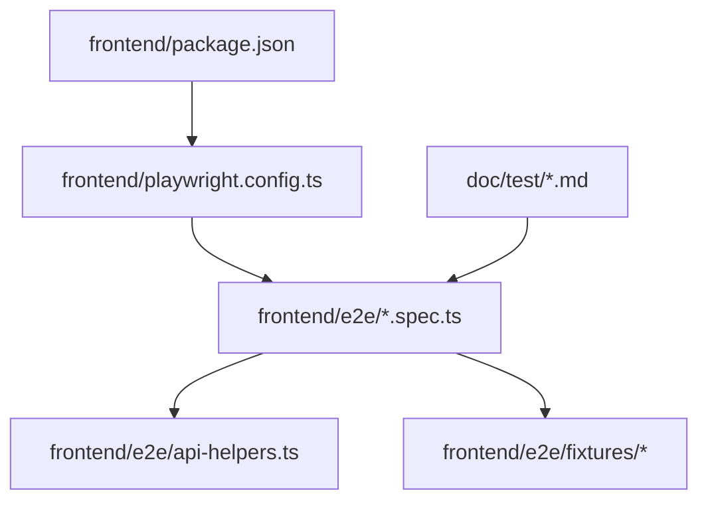
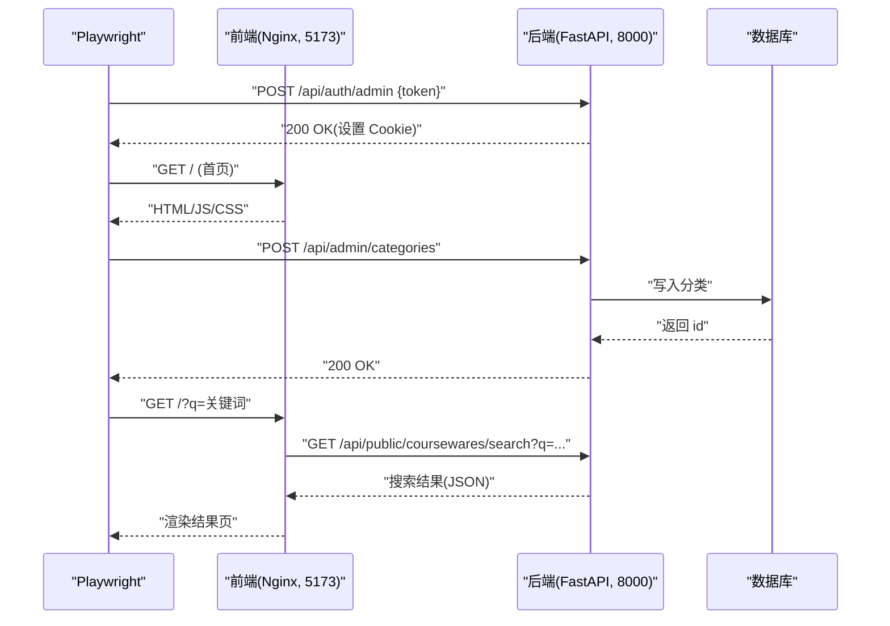
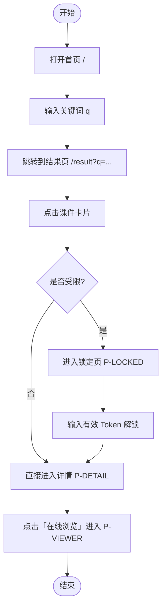
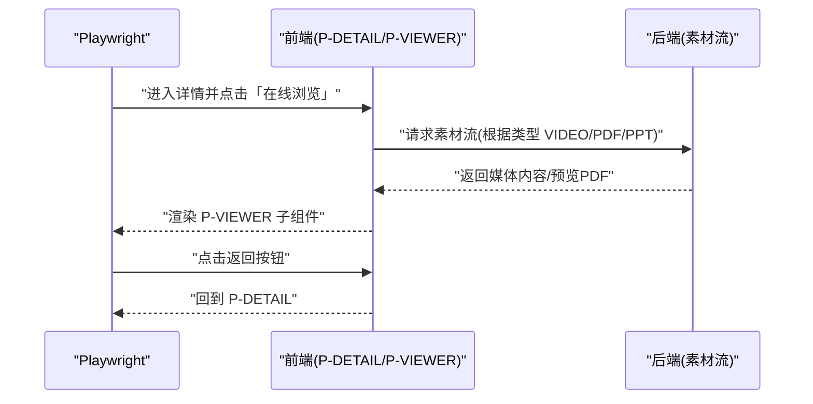
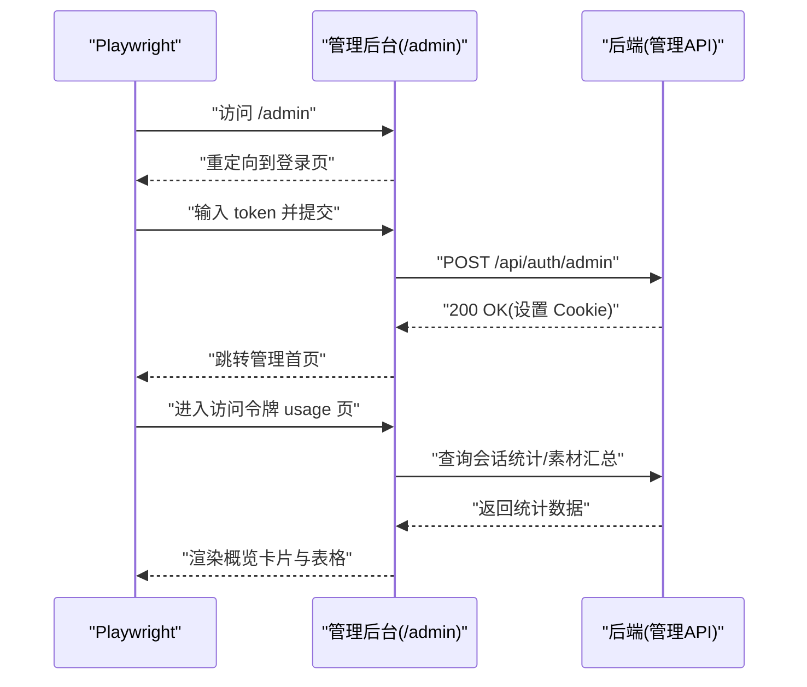
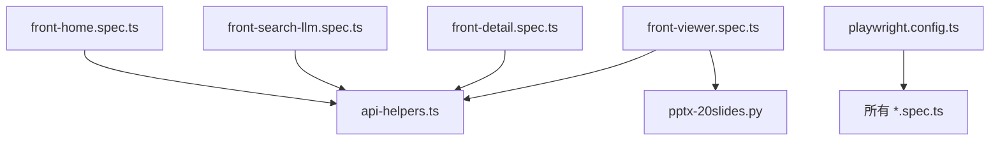

# 端到端测试

<cite>
**本文引用的文件**   
- [frontend/playwright.config.ts](file://frontend/playwright.config.ts)
- [frontend/package.json](file://frontend/package.json)
- [frontend/e2e/README.md](file://frontend/e2e/README.md)
- [frontend/e2e/api-helpers.ts](file://frontend/e2e/api-helpers.ts)
- [frontend/e2e/front-home.spec.ts](file://frontend/e2e/front-home.spec.ts)
- [frontend/e2e/front-search-llm.spec.ts](file://frontend/e2e/front-search-llm.spec.ts)
- [frontend/e2e/front-detail.spec.ts](file://frontend/e2e/front-detail.spec.ts)
- [frontend/e2e/front-viewer.spec.ts](file://frontend/e2e/front-viewer.spec.ts)
- [frontend/e2e/admin-auth.spec.ts](file://frontend/e2e/admin-auth.spec.ts)
- [frontend/e2e/admin-access-session.spec.ts](file://frontend/e2e/admin-access-session.spec.ts)
- [frontend/e2e/admin-courseware-order.spec.ts](file://frontend/e2e/admin-courseware-order.spec.ts)
- [frontend/e2e/fixtures/pptx-20slides.py](file://frontend/e2e/fixtures/pptx-20slides.py)
- [doc/test/README.md](file://doc/test/README.md)
- [doc/test/test-cases-front.md](file://doc/test/test-cases-front.md)
- [doc/test/test-cases-admin.md](file://doc/test/test-cases-admin.md)
</cite>

## 目录
1. [简介](#简介)
2. [项目结构](#项目结构)
3. [核心组件](#核心组件)
4. [架构总览](#架构总览)
5. [详细组件分析](#详细组件分析)
6. [依赖分析](#依赖分析)
7. [性能考虑](#性能考虑)
8. [故障排查指南](#故障排查指南)
9. [结论](#结论)
10. [附录](#附录)

## 简介
本文件面向 Learning Hub 前端端到端（E2E）测试，聚焦 Playwright 框架的配置与使用、前台用户流程与管理后台流程的测试实现、API 辅助工具与测试数据准备、截图对比与视觉回归策略、多浏览器兼容性与并行执行优化、报告生成与失败重试机制，以及移动端适配与设备模拟最佳实践。文档以仓库现有实现为依据，提供可操作的指导与可视化图示，帮助读者快速上手并持续维护 E2E 套件。

## 项目结构
前端 E2E 测试位于 frontend/e2e 目录，采用 Playwright TypeScript 编写，配合共享 API 辅助函数进行数据准备与鉴权前置。配置文件集中于 playwright.config.ts，脚本入口通过 package.json 的 test:e2e 命令触发。



图表来源
- [frontend/playwright.config.ts:1-34](file://frontend/playwright.config.ts#L1-L34)
- [frontend/package.json:1-40](file://frontend/package.json#L1-L40)
- [frontend/e2e/README.md:1-51](file://frontend/e2e/README.md#L1-L51)

章节来源
- [frontend/playwright.config.ts:1-34](file://frontend/playwright.config.ts#L1-L34)
- [frontend/package.json:1-40](file://frontend/package.json#L1-L40)
- [frontend/e2e/README.md:1-51](file://frontend/e2e/README.md#L1-L51)

## 核心组件
- 配置中心：playwright.config.ts 定义测试目录、基地址、超时、截图/追踪策略、浏览器项目与期望断言超时等。
- 测试套件：按功能域拆分为前台首页、搜索、详情、在线播放器、管理后台登录、访问令牌使用记录、课件素材排序等用例集。
- API 辅助：api-helpers.ts 封装了管理员登录、分类创建、访问令牌创建、课件创建等幂等化接口调用，减少 UI 操作耗时。
- 测试数据：fixtures 下提供 PPTX 生成脚本，用于 PPT 预览相关用例。

章节来源
- [frontend/playwright.config.ts:1-34](file://frontend/playwright.config.ts#L1-L34)
- [frontend/e2e/api-helpers.ts:1-111](file://frontend/e2e/api-helpers.ts#L1-L111)
- [frontend/e2e/fixtures/pptx-20slides.py:1-99](file://frontend/e2e/fixtures/pptx-20slides.py#L1-L99)

## 架构总览
E2E 测试运行在已部署的前后端服务之上：前端 Nginx 暴露 SPA 静态资源（默认 5173），后端 FastAPI 提供 REST API（默认 8000）。Playwright 驱动 Chromium（或系统 Chrome）访问前端页面，通过 APIRequestContext 直接调用后端接口完成数据准备与鉴权前置。



图表来源
- [frontend/playwright.config.ts:10-23](file://frontend/playwright.config.ts#L10-L23)
- [frontend/e2e/admin-auth.spec.ts:1-60](file://frontend/e2e/admin-auth.spec.ts#L1-L60)
- [frontend/e2e/front-home.spec.ts:1-46](file://frontend/e2e/front-home.spec.ts#L1-L46)
- [frontend/e2e/front-search-llm.spec.ts:1-92](file://frontend/e2e/front-search-llm.spec.ts#L1-L92)

## 详细组件分析

### Playwright 配置与执行策略
- 测试目录与入口：testDir 指向 e2e；npm 脚本 test:e2e 触发 playwright test。
- 基地址与网络：baseURL 支持环境变量覆盖，默认 http://localhost:5173。
- 浏览器与环境：headless 模式，trace 仅保留失败时截图/追踪；video 关闭以减少体积。
- 项目与兼容性：projects 定义 chromium 项目，channel 为 chrome 以复用系统浏览器。
- 超时与重试：全局 expect timeout 与用例级 timeout 分离；CI 环境启用一次重试。
- 报告输出：CI 使用 line 行式报告，本地使用 list 列表式报告。

章节来源
- [frontend/playwright.config.ts:1-34](file://frontend/playwright.config.ts#L1-L34)
- [frontend/package.json:1-40](file://frontend/package.json#L1-L40)

### 前台用户流程 E2E 测试
- 首页加载与搜索跳转：验证搜索框可见、标题文案、URL 参数 ?q= 同步到结果页、空态提示。
- AI 智能搜索：自然语言长句命中（LLM 路径）、无密钥降级为关键词兜底、短关键词 ILIKE 命中一致性。
- 受限课件锁定与解锁：进入受限课件显示锁定页，输入错误 token 提示，输入正确 token 后解锁并展示详情。
- 详情页与“在线浏览”：素材按钮文案为“在线浏览”，不提供下载入口；点击后进入 P-VIEWER。



图表来源
- [frontend/e2e/front-home.spec.ts:1-46](file://frontend/e2e/front-home.spec.ts#L1-L46)
- [frontend/e2e/front-search-llm.spec.ts:1-92](file://frontend/e2e/front-search-llm.spec.ts#L1-L92)
- [frontend/e2e/front-detail.spec.ts:1-106](file://frontend/e2e/front-detail.spec.ts#L1-L106)

章节来源
- [frontend/e2e/front-home.spec.ts:1-46](file://frontend/e2e/front-home.spec.ts#L1-L46)
- [frontend/e2e/front-search-llm.spec.ts:1-92](file://frontend/e2e/front-search-llm.spec.ts#L1-L92)
- [frontend/e2e/front-detail.spec.ts:1-106](file://frontend/e2e/front-detail.spec.ts#L1-L106)

### 在线播放器（P-VIEWER）E2E 测试
- 视频行内播放：验证 video 容器与信息面板可见，文件名与类型信息正确，且不存在下载入口。
- PDF 阅读：验证 PDF 容器、工具条、页码指示器可见，缩放控件可用，且不存在下载入口。
- 返回详情：从 P-VIEWER 返回 P-DETAIL，URL 状态正确。
- 下载入口禁用：三种样式均断言不存在 p-viewer-download-link 及任何“下载到本地”链接。
- PPT 幻灯片：F-050/F-053 需要 LibreOffice 转换，默认跳过；可通过 fixtures 生成真实 PPTX 并在 CI 中启用。



图表来源
- [frontend/e2e/front-viewer.spec.ts:1-341](file://frontend/e2e/front-viewer.spec.ts#L1-L341)

章节来源
- [frontend/e2e/front-viewer.spec.ts:1-341](file://frontend/e2e/front-viewer.spec.ts#L1-L341)

### 管理后台操作流程 E2E 测试
- 鉴权登录：未登录重定向至登录页；错误 token 提示；正确 token 登录后进入管理首页；导航模块可见性。
- 访问令牌使用记录：列表页“访问记录”链接、usage 页概览卡片与素材汇总、时间段筛选与快捷按钮、台账 Tab 切换。
- 课件素材顺序编辑：前台按 sortOrder 升序展示 + 提示文案；拖拽改序保存；键盘可达性；API 直连校验错误返回。



图表来源
- [frontend/e2e/admin-auth.spec.ts:1-60](file://frontend/e2e/admin-auth.spec.ts#L1-L60)
- [frontend/e2e/admin-access-session.spec.ts:1-215](file://frontend/e2e/admin-access-session.spec.ts#L1-L215)

章节来源
- [frontend/e2e/admin-auth.spec.ts:1-60](file://frontend/e2e/admin-auth.spec.ts#L1-L60)
- [frontend/e2e/admin-access-session.spec.ts:1-215](file://frontend/e2e/admin-access-session.spec.ts#L1-L215)
- [frontend/e2e/admin-courseware-order.spec.ts:1-178](file://frontend/e2e/admin-courseware-order.spec.ts#L1-L178)

### API 辅助工具与测试数据准备
- adminLogin：绕过 UI 直接调用后端鉴权接口，减少登录等待时间。
- ensureLeafCategory：幂等创建三级分类，冲突时回退查询复用，避免重复数据。
- ensureAccessToken：创建访问令牌并返回 id 与 value，供受限课件解锁场景使用。
- createCourseware：创建开放或受限课件，支持关联 token/tag/material。
- 上传素材：front-viewer.spec.ts 中封装 uploadMaterial，支持 multipart 上传 mp4/pdf/pptx。
- PPT fixture：fixtures/pptx-20slides.py 生成 20 张幻灯片、单张幻灯片与损坏 PPTX，用于 PPT 预览与降级场景。

```mermaid
classDiagram
class ApiHelpers {
+adminLogin(request, token)
+ensureLeafCategory(request, prefix) number
+ensureAccessToken(request, label) {id,value}
+createCourseware(request, args) {id,title}
}
class ViewerSpec {
+uploadMaterial(request, filename, bytes, mimeType) number
}
class FixtureScript {
+build_20_slides_pptx(out)
+build_1_slide_pptx(out)
+build_corrupt_pptx(out)
}
ApiHelpers <.. ViewerSpec : "被用例调用"
FixtureScript <.. ViewerSpec : "生成 PPT 素材"
```

图表来源
- [frontend/e2e/api-helpers.ts:1-111](file://frontend/e2e/api-helpers.ts#L1-L111)
- [frontend/e2e/front-viewer.spec.ts:1-341](file://frontend/e2e/front-viewer.spec.ts#L1-L341)
- [frontend/e2e/fixtures/pptx-20slides.py:1-99](file://frontend/e2e/fixtures/pptx-20slides.py#L1-L99)

章节来源
- [frontend/e2e/api-helpers.ts:1-111](file://frontend/e2e/api-helpers.ts#L1-L111)
- [frontend/e2e/front-viewer.spec.ts:1-341](file://frontend/e2e/front-viewer.spec.ts#L1-L341)
- [frontend/e2e/fixtures/pptx-20slides.py:1-99](file://frontend/e2e/fixtures/pptx-20slides.py#L1-L99)

### 截图对比与视觉回归测试
- 当前配置：screenshot 设置为 only-on-failure，仅在失败时捕获截图；trace 设置为 retain-on-failure，便于失败回溯。
- 建议扩展：如需视觉回归，可在项目中引入 @playwright/test 的 screenshot 对比能力（如基于基准图比对），或在 CI 中收集失败截图进行人工复核。
- 注意：当前仓库未启用自动视觉回归比对，可按需扩展配置与基准库。

章节来源
- [frontend/playwright.config.ts:17-23](file://frontend/playwright.config.ts#L17-L23)

### 多浏览器兼容性与执行策略
- 浏览器项目：projects 定义 chromium 项目，channel 为 chrome 以复用系统浏览器，降低首次安装成本。
- 并行与稳定性：fullyParallel 设为 false，workers 为 1，确保用例间数据隔离与稳定性；CI 环境 retries=1。
- 扩展建议：如需多浏览器矩阵，可在 projects 中添加 firefox/webkit 项目，并结合 --project 过滤执行。

章节来源
- [frontend/playwright.config.ts:24-34](file://frontend/playwright.config.ts#L24-L34)

### 测试报告、失败重试与并行优化
- 报告：CI 使用 line 行式报告，本地使用 list 列表式报告；失败截图与 trace 保留便于定位问题。
- 重试：CI 环境启用一次重试，提高稳定性。
- 并行优化：当前串行执行保证数据幂等；若需并行，应确保每个用例使用唯一前缀/时间戳的数据名，避免共享状态冲突。

章节来源
- [frontend/playwright.config.ts:10-23](file://frontend/playwright.config.ts#L10-L23)

### 移动端适配与设备模拟最佳实践
- 视口模拟：可在用例中使用 page.setViewportSize 模拟移动端尺寸，验证响应式布局与交互。
- 选择器稳健性：优先使用 data-testid 与文本匹配，减少对 CSS 类名的强依赖，提升跨设备稳定性。
- 参考规范：doc/test 中的 selectors 与用例文档提供了 data-testid 约定与选择器命名规范，建议在新增用例中遵循。

章节来源
- [doc/test/test-cases-front.md:1-672](file://doc/test/test-cases-front.md#L1-L672)
- [doc/test/README.md:1-206](file://doc/test/README.md#L1-L206)

## 依赖分析
- 外部依赖：Playwright 测试框架与 Chromium/Chrome 浏览器；前端构建产物由 Vite 生成并由 Nginx 提供服务；后端 FastAPI 提供 REST API。
- 内部依赖：各 spec 文件依赖 api-helpers.ts 提供的幂等数据准备；viewer 用例依赖 fixtures 生成的 PPTX 素材。
- 潜在循环依赖：当前结构清晰，未见循环导入；用例与辅助函数之间为单向依赖。



图表来源
- [frontend/e2e/front-home.spec.ts:1-46](file://frontend/e2e/front-home.spec.ts#L1-L46)
- [frontend/e2e/front-search-llm.spec.ts:1-92](file://frontend/e2e/front-search-llm.spec.ts#L1-L92)
- [frontend/e2e/front-detail.spec.ts:1-106](file://frontend/e2e/front-detail.spec.ts#L1-L106)
- [frontend/e2e/front-viewer.spec.ts:1-341](file://frontend/e2e/front-viewer.spec.ts#L1-L341)
- [frontend/e2e/api-helpers.ts:1-111](file://frontend/e2e/api-helpers.ts#L1-L111)
- [frontend/e2e/fixtures/pptx-20slides.py:1-99](file://frontend/e2e/fixtures/pptx-20slides.py#L1-L99)
- [frontend/playwright.config.ts:1-34](file://frontend/playwright.config.ts#L1-L34)

章节来源
- [frontend/e2e/front-home.spec.ts:1-46](file://frontend/e2e/front-home.spec.ts#L1-L46)
- [frontend/e2e/front-search-llm.spec.ts:1-92](file://frontend/e2e/front-search-llm.spec.ts#L1-L92)
- [frontend/e2e/front-detail.spec.ts:1-106](file://frontend/e2e/front-detail.spec.ts#L1-L106)
- [frontend/e2e/front-viewer.spec.ts:1-341](file://frontend/e2e/front-viewer.spec.ts#L1-L341)
- [frontend/e2e/api-helpers.ts:1-111](file://frontend/e2e/api-helpers.ts#L1-L111)
- [frontend/e2e/fixtures/pptx-20slides.py:1-99](file://frontend/e2e/fixtures/pptx-20slides.py#L1-L99)
- [frontend/playwright.config.ts:1-34](file://frontend/playwright.config.ts#L1-L34)

## 性能考虑
- 减少 UI 操作：通过 API 辅助函数进行数据准备，显著缩短用例执行时间。
- 控制截图与视频：仅失败时截图，关闭视频录制，降低磁盘 I/O 与存储压力。
- 合理超时：针对复杂渲染（如 PDF 加载）适当延长 expect timeout，避免误报。
- 串行执行：当前串行执行有利于数据隔离与稳定性；若改为并行，需确保数据幂等与唯一前缀。

[本节为通用指导，不直接分析具体文件]

## 故障排查指南
- 登录失败：检查 adminLogin 是否正确调用后端鉴权接口，确认 Cookie 是否生效。
- 搜索无结果：确认 ensureLeafCategory 与 createCourseware 是否成功创建数据；检查 URL 参数 ?q= 是否正确编码。
- 解锁失败：核对 ensureAccessToken 返回的 token value 是否与输入一致；确认受限课件的 accessMode 与 tokenIds 绑定正确。
- PPT 预览失败：确认 fixtures 已生成 PPTX，后端已安装 LibreOffice 并完成转换；必要时查看后端日志。
- 失败截图与追踪：利用 retain-on-failure 的 trace 与截图定位问题根因。

章节来源
- [frontend/e2e/admin-auth.spec.ts:1-60](file://frontend/e2e/admin-auth.spec.ts#L1-L60)
- [frontend/e2e/front-home.spec.ts:1-46](file://frontend/e2e/front-home.spec.ts#L1-L46)
- [frontend/e2e/front-detail.spec.ts:1-106](file://frontend/e2e/front-detail.spec.ts#L1-L106)
- [frontend/e2e/front-viewer.spec.ts:1-341](file://frontend/e2e/front-viewer.spec.ts#L1-L341)
- [frontend/playwright.config.ts:17-23](file://frontend/playwright.config.ts#L17-L23)

## 结论
Learning Hub 前端 E2E 测试以 Playwright 为核心，结合 API 辅助函数与幂等数据准备，覆盖了前台搜索、详情、在线播放器与管理后台关键流程。当前配置注重稳定性与可追溯性，适合在 CI 环境中稳定运行。后续可根据需求扩展多浏览器矩阵、视觉回归与并行执行策略，进一步提升覆盖率与效率。

[本节为总结，不直接分析具体文件]

## 附录
- 快速执行：参考 frontend/e2e/README.md 的一键运行步骤与依赖说明。
- 用例规范：参考 doc/test 下的 selectors、test-data、setup-teardown 与各功能域用例文档，遵循 data-testid 命名与选择器约定。

章节来源
- [frontend/e2e/README.md:1-51](file://frontend/e2e/README.md#L1-L51)
- [doc/test/README.md:1-206](file://doc/test/README.md#L1-L206)
- [doc/test/test-cases-front.md:1-672](file://doc/test/test-cases-front.md#L1-L672)
- [doc/test/test-cases-admin.md:1-581](file://doc/test/test-cases-admin.md#L1-L581)