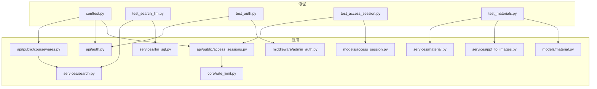
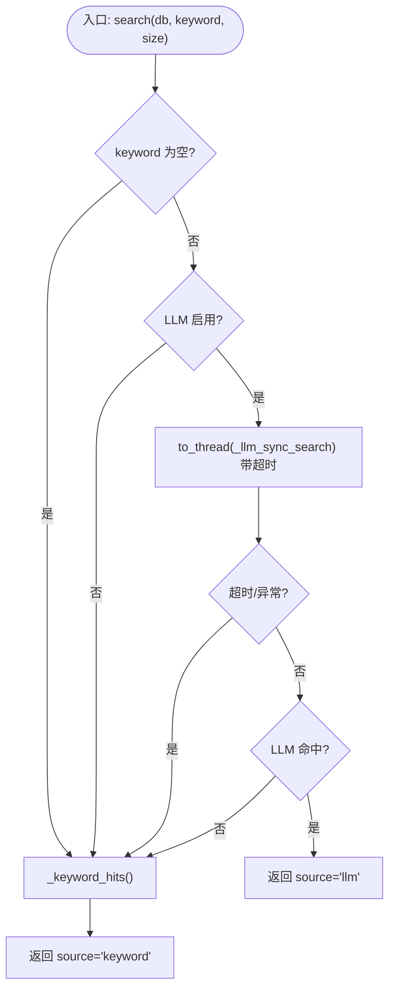
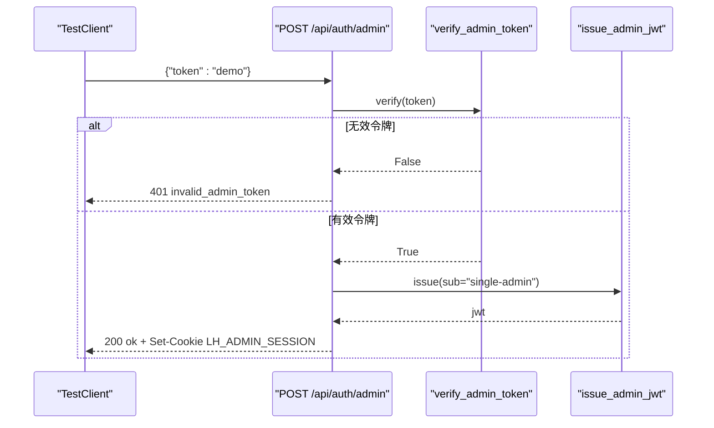
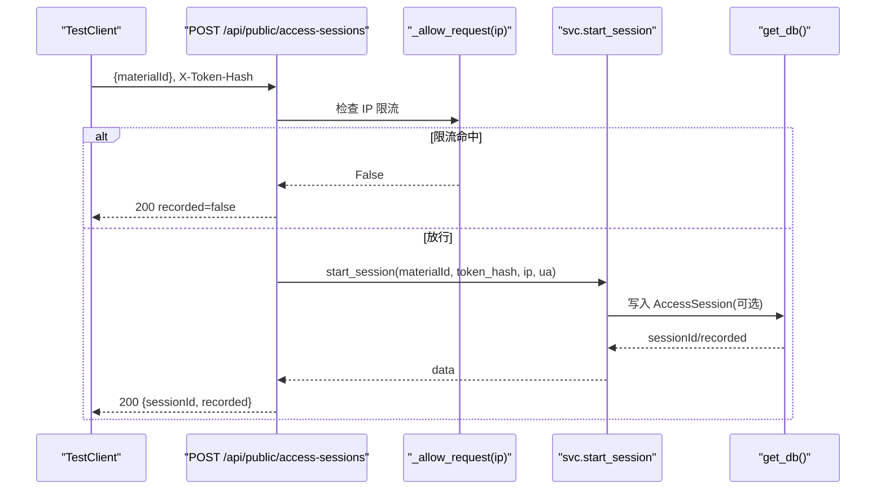
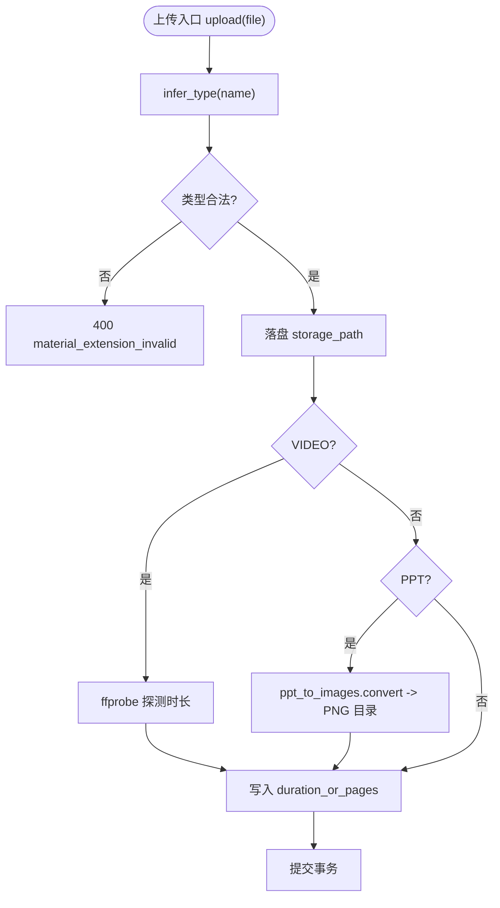
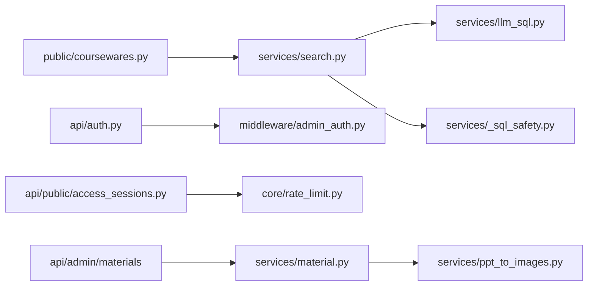

# 集成测试

<cite>
**本文引用的文件**   
- [backend/tests/conftest.py](file://backend/tests/conftest.py)
- [backend/tests/test_search_llm.py](file://backend/tests/test_search_llm.py)
- [backend/tests/test_auth.py](file://backend/tests/test_auth.py)
- [backend/tests/test_access_session.py](file://backend/tests/test_access_session.py)
- [backend/tests/test_materials.py](file://backend/tests/test_materials.py)
- [backend/app/services/search.py](file://backend/app/services/search.py)
- [backend/app/services/llm_sql.py](file://backend/app/services/llm_sql.py)
- [backend/app/api/public/coursewares.py](file://backend/app/api/public/coursewares.py)
- [backend/app/api/auth.py](file://backend/app/api/auth.py)
- [backend/app/middleware/admin_auth.py](file://backend/app/middleware/admin_auth.py)
- [backend/app/core/rate_limit.py](file://backend/app/core/rate_limit.py)
- [backend/app/api/public/access_sessions.py](file://backend/app/api/public/access_sessions.py)
- [backend/app/models/access_session.py](file://backend/app/models/access_session.py)
- [backend/app/services/material.py](file://backend/app/services/material.py)
- [backend/app/services/ppt_to_images.py](file://backend/app/services/ppt_to_images.py)
- [backend/app/models/material.py](file://backend/app/models/material.py)
</cite>

## 目录
1. [简介](#简介)
2. [项目结构](#项目结构)
3. [核心组件](#核心组件)
4. [架构总览](#架构总览)
5. [详细组件分析](#详细组件分析)
6. [依赖分析](#依赖分析)
7. [性能考虑](#性能考虑)
8. [故障排查指南](#故障排查指南)
9. [结论](#结论)
10. [附录](#附录)

## 简介
本文件面向 Learning Hub 的集成测试，聚焦跨模块交互与外部服务集成的验证策略。内容覆盖：
- LLM 搜索（阿里云百炼 qwen-plus）的集成测试设计与 Mock 策略
- 认证授权流程（JWT、会话 Cookie、权限控制）的端到端验证
- 访问会话追踪（限流、并发、幂等、时间校正）的测试方法
- 文件处理（PPT 转图片、PDF 上传、视频时长探测）的集成验证
- 外部依赖（数据库、Redis、对象存储）的测试策略与环境隔离最佳实践

## 项目结构
后端测试位于 backend/tests，使用 pytest + FastAPI TestClient；业务代码位于 backend/app，包含 API、服务层、模型与配置。



图表来源
- [backend/tests/conftest.py:1-121](file://backend/tests/conftest.py#L1-L121)
- [backend/tests/test_search_llm.py:1-224](file://backend/tests/test_search_llm.py#L1-L224)
- [backend/tests/test_auth.py:1-35](file://backend/tests/test_auth.py#L1-L35)
- [backend/tests/test_access_session.py:1-640](file://backend/tests/test_access_session.py#L1-L640)
- [backend/tests/test_materials.py:1-91](file://backend/tests/test_materials.py#L1-L91)
- [backend/app/api/public/coursewares.py:1-133](file://backend/app/api/public/coursewares.py#L1-L133)
- [backend/app/api/auth.py:1-49](file://backend/app/api/auth.py#L1-L49)
- [backend/app/api/public/access_sessions.py:1-137](file://backend/app/api/public/access_sessions.py#L1-L137)
- [backend/app/services/search.py:1-263](file://backend/app/services/search.py#L1-L263)
- [backend/app/services/llm_sql.py:1-490](file://backend/app/services/llm_sql.py#L1-L490)
- [backend/app/services/material.py:1-234](file://backend/app/services/material.py#L1-L234)
- [backend/app/services/ppt_to_images.py:1-185](file://backend/app/services/ppt_to_images.py#L1-L185)
- [backend/app/models/access_session.py:1-129](file://backend/app/models/access_session.py#L1-L129)
- [backend/app/models/material.py:1-69](file://backend/app/models/material.py#L1-L69)
- [backend/app/core/rate_limit.py:1-55](file://backend/app/core/rate_limit.py#L1-L55)
- [backend/app/middleware/admin_auth.py:1-66](file://backend/app/middleware/admin_auth.py#L1-L66)

章节来源
- [backend/tests/conftest.py:1-121](file://backend/tests/conftest.py#L1-L121)

## 核心组件
- 测试基础设施
  - 内存 SQLite 数据库与全局 schema 初始化/清理
  - FastAPI TestClient 注入
  - 管理员登录 fixture 与统一响应信封断言
- 功能域
  - LLM 搜索：LLM-to-SQL 优先，关键词 ILIKE 兜底
  - 认证授权：Admin Token → JWT → Cookie 鉴权
  - 访问会话：start/leave、限流、时间校正、幂等
  - 素材处理：PDF/PPT/VIDEO 上传、转换与校验

章节来源
- [backend/tests/conftest.py:1-121](file://backend/tests/conftest.py#L1-L121)
- [backend/tests/test_auth.py:1-35](file://backend/tests/test_auth.py#L1-L35)
- [backend/tests/test_search_llm.py:1-224](file://backend/tests/test_search_llm.py#L1-L224)
- [backend/tests/test_access_session.py:1-640](file://backend/tests/test_access_session.py#L1-L640)
- [backend/tests/test_materials.py:1-91](file://backend/tests/test_materials.py#L1-L91)

## 架构总览
下图展示“前台自然语言搜索”在集成测试中的调用链与降级路径。

```mermaid
sequenceDiagram
participant Client as "TestClient"
participant API as "public/coursewares.search"
participant Search as "services/search.search"
participant LLM as "services/llm_sql.search"
participant DB as "SQLAlchemy Session"
Client->>API : GET /api/public/coursewares/search?q=...
API->>Search : search(db, keyword, size)
alt LLM 可用且未超时
Search->>LLM : generate_sql + validate_sql + execute_search_sql
LLM->>DB : SET TRANSACTION READ ONLY; SELECT ... LIMIT
DB-->>LLM : id 列表
LLM-->>Search : ids, source="llm"
Search->>Search : _fetch_coursewares(ids)
Search-->>API : SearchResult(source="llm")
else LLM 不可用/失败/超时/无结果
Search->>Search : _keyword_hits(keyword)
Search-->>API : SearchResult(source="keyword")
end
API-->>Client : {code : "ok", data : {items,total,page,size,source}}
```

图表来源
- [backend/app/api/public/coursewares.py:32-54](file://backend/app/api/public/coursewares.py#L32-L54)
- [backend/app/services/search.py:210-242](file://backend/app/services/search.py#L210-L242)
- [backend/app/services/llm_sql.py:443-478](file://backend/app/services/llm_sql.py#L443-L478)

## 详细组件分析

### LLM 搜索集成测试
职责范围
- 验证 LLM-to-SQL 主路径与关键词兜底的正确性
- 覆盖禁用、生成失败、校验拒绝、超时、空关键词等边界
- 通过 HTTP 接口验证返回信封与 source 字段

设计要点
- 使用 monkeypatch 替换 llm_sql.is_enabled/generate_sql/validate_sql/execute_search_sql 以及 search._fetch_coursewares/_keyword_hits
- 构造最小 FakeDB 以绕过真实数据库
- 通过 asyncio.run 调用异步入口，模拟事件循环环境

关键实现路径
- 服务层主流程：[search.search:210-242](file://backend/app/services/search.py#L210-L242)
- LLM 入口与执行：[llm_sql.search:443-478](file://backend/app/services/llm_sql.py#L443-L478)、[execute_search_sql:385-437](file://backend/app/services/llm_sql.py#L385-L437)
- SQL 安全校验：[validate_sql:165-210](file://backend/app/services/_sql_safety.py#L165-L210)
- HTTP 路由封装：[coursewares.search:32-54](file://backend/app/api/public/coursewares.py#L32-L54)
- 测试用例集合：[test_search_llm.py:1-224](file://backend/tests/test_search_llm.py#L1-L224)



图表来源
- [backend/app/services/search.py:210-242](file://backend/app/services/search.py#L210-L242)
- [backend/app/services/llm_sql.py:443-478](file://backend/app/services/llm_sql.py#L443-L478)

章节来源
- [backend/tests/test_search_llm.py:1-224](file://backend/tests/test_search_llm.py#L1-L224)
- [backend/app/services/search.py:1-263](file://backend/app/services/search.py#L1-L263)
- [backend/app/services/llm_sql.py:1-490](file://backend/app/services/llm_sql.py#L1-L490)
- [backend/app/api/public/coursewares.py:1-133](file://backend/app/api/public/coursewares.py#L1-L133)

### 认证授权集成测试
职责范围
- Admin Token 校验、JWT 签发与 Cookie 写入
- 登出与未登录访问受保护资源的 401 行为
- 统一响应信封格式

关键实现路径
- 登录/登出路由：[auth.admin_login/logout:21-45](file://backend/app/api/auth.py#L21-L45)
- JWT 签发与校验：[admin_auth.issue_admin_jwt/get_admin_principal:45-66](file://backend/app/middleware/admin_auth.py#L45-L66)
- 测试用例：[test_auth.py:1-35](file://backend/tests/test_auth.py#L1-L35)



图表来源
- [backend/app/api/auth.py:21-45](file://backend/app/api/auth.py#L21-L45)
- [backend/app/middleware/admin_auth.py:45-66](file://backend/app/middleware/admin_auth.py#L45-L66)

章节来源
- [backend/tests/test_auth.py:1-35](file://backend/tests/test_auth.py#L1-L35)
- [backend/app/api/auth.py:1-49](file://backend/app/api/auth.py#L1-L49)
- [backend/app/middleware/admin_auth.py:1-66](file://backend/app/middleware/admin_auth.py#L1-L66)

### 访问会话追踪集成测试
职责范围
- start/leave 完整流程：记录/不记录、时间校正、幂等、跨 token 校验
- 限流机制：进程内滑动窗口 60/分钟，超限降级 recorded=False
- 管理侧聚合：明细分页与概览统计

关键实现路径
- 公共接口：[access_sessions.start/leave:65-133](file://backend/app/api/public/access_sessions.py#L65-L133)
- 限流逻辑：[进程内限流:29-55](file://backend/app/api/public/access_sessions.py#L29-L55)
- 数据模型：[AccessSession:56-129](file://backend/app/models/access_session.py#L56-L129)
- 测试用例：[test_access_session.py:1-640](file://backend/tests/test_access_session.py#L1-L640)



图表来源
- [backend/app/api/public/access_sessions.py:65-106](file://backend/app/api/public/access_sessions.py#L65-L106)
- [backend/app/models/access_session.py:56-129](file://backend/app/models/access_session.py#L56-L129)

章节来源
- [backend/tests/test_access_session.py:1-640](file://backend/tests/test_access_session.py#L1-L640)
- [backend/app/api/public/access_sessions.py:1-137](file://backend/app/api/public/access_sessions.py#L1-L137)
- [backend/app/models/access_session.py:1-129](file://backend/app/models/access_session.py#L1-L129)

### 文件处理集成测试
职责范围
- PDF 上传：类型识别、大小限制、preview_pdf_path 为 NULL
- PPT 上传：触发 PPT→PNG 转换（LibreOffice + pdftoppm），失败不阻断
- VIDEO 上传：ffprobe 探测时长并格式化
- 未知扩展名拒绝

关键实现路径
- 素材上传服务：[material.upload:129-202](file://backend/app/services/material.py#L129-L202)
- PPT 转图片：[ppt_to_images.convert:48-181](file://backend/app/services/ppt_to_images.py#L48-L181)
- 素材模型：[Material:44-69](file://backend/app/models/material.py#L44-L69)
- 测试用例：[test_materials.py:1-91](file://backend/tests/test_materials.py#L1-L91)



图表来源
- [backend/app/services/material.py:129-202](file://backend/app/services/material.py#L129-L202)
- [backend/app/services/ppt_to_images.py:48-181](file://backend/app/services/ppt_to_images.py#L48-L181)
- [backend/app/models/material.py:44-69](file://backend/app/models/material.py#L44-L69)

章节来源
- [backend/tests/test_materials.py:1-91](file://backend/tests/test_materials.py#L1-L91)
- [backend/app/services/material.py:1-234](file://backend/app/services/material.py#L1-L234)
- [backend/app/services/ppt_to_images.py:1-185](file://backend/app/services/ppt_to_images.py#L1-L185)
- [backend/app/models/material.py:1-69](file://backend/app/models/material.py#L1-L69)

### 外部依赖服务的测试策略
- 数据库连接
  - 使用内存 SQLite 替代容器 Postgres，确保测试快速、可重复
  - 每个测试自动建表/删表，避免状态污染
  - 参考：[conftest 初始化与覆盖 get_db:41-70](file://backend/tests/conftest.py#L41-L70)
- Redis 缓存
  - 限流器支持 Redis 存储 URI；测试默认 memory://，无需启动 Redis
  - 参考：[rate_limit.get_limiter:40-46](file://backend/app/core/rate_limit.py#L40-L46)
- 对象存储
  - 当前实现基于本地文件系统路径；测试无需额外对象存储
  - 参考：[material._storage_root:29-33](file://backend/app/services/material.py#L29-L33)

章节来源
- [backend/tests/conftest.py:41-70](file://backend/tests/conftest.py#L41-L70)
- [backend/app/core/rate_limit.py:40-46](file://backend/app/core/rate_limit.py#L40-L46)
- [backend/app/services/material.py:29-33](file://backend/app/services/material.py#L29-L33)

## 依赖分析
- 模块耦合
  - API 层依赖服务层（search、material、access_token_usage）
  - 服务层依赖配置与模型，LLM 路径依赖外部 SDK（dashscope）
  - 测试通过 monkeypatch 与服务层解耦，降低对外部依赖的强耦合
- 外部依赖
  - dashscope SDK：仅在 LLM 启用时导入，测试可通过 monkeypatch 禁用
  - LibreOffice/pdftoppm/ffprobe：可选工具，失败不阻断主流程



图表来源
- [backend/app/api/public/coursewares.py:1-133](file://backend/app/api/public/coursewares.py#L1-L133)
- [backend/app/services/search.py:1-263](file://backend/app/services/search.py#L1-L263)
- [backend/app/services/llm_sql.py:1-490](file://backend/app/services/llm_sql.py#L1-L490)
- [backend/app/api/auth.py:1-49](file://backend/app/api/auth.py#L1-L49)
- [backend/app/middleware/admin_auth.py:1-66](file://backend/app/middleware/admin_auth.py#L1-L66)
- [backend/app/api/public/access_sessions.py:1-137](file://backend/app/api/public/access_sessions.py#L1-L137)
- [backend/app/core/rate_limit.py:1-55](file://backend/app/core/rate_limit.py#L1-L55)
- [backend/app/services/material.py:1-234](file://backend/app/services/material.py#L1-L234)
- [backend/app/services/ppt_to_images.py:1-185](file://backend/app/services/ppt_to_images.py#L1-L185)

章节来源
- [backend/app/api/public/coursewares.py:1-133](file://backend/app/api/public/coursewares.py#L1-L133)
- [backend/app/services/search.py:1-263](file://backend/app/services/search.py#L1-L263)
- [backend/app/services/llm_sql.py:1-490](file://backend/app/services/llm_sql.py#L1-L490)
- [backend/app/api/auth.py:1-49](file://backend/app/api/auth.py#L1-L49)
- [backend/app/middleware/admin_auth.py:1-66](file://backend/app/middleware/admin_auth.py#L1-L66)
- [backend/app/api/public/access_sessions.py:1-137](file://backend/app/api/public/access_sessions.py#L1-L137)
- [backend/app/core/rate_limit.py:1-55](file://backend/app/core/rate_limit.py#L1-L55)
- [backend/app/services/material.py:1-234](file://backend/app/services/material.py#L1-L234)
- [backend/app/services/ppt_to_images.py:1-185](file://backend/app/services/ppt_to_images.py#L1-L185)

## 性能考虑
- LLM 搜索
  - 设置合理超时（默认 8s），避免阻塞请求；失败快速回退到关键词路径
  - 词汇缓存（分类/标签名）TTL 60s，减少频繁查询
- 访问会话
  - 进程内限流采用滑动窗口，O(1) 操作；多进程部署建议结合网关级限流
- 文件处理
  - 外部工具调用均带超时与异常捕获，失败不阻断主流程

## 故障排查指南
- LLM 搜索无结果或始终降级
  - 检查 DASHSCOPE_API_KEY 是否配置；确认 is_enabled 返回预期
  - 查看 generate_sql/validate_sql 日志，确认 SQL 被白名单拒绝
  - 参考：[llm_sql.generate_sql:276-344](file://backend/app/services/llm_sql.py#L276-L344)、[validate_sql:165-210](file://backend/app/services/_sql_safety.py#L165-L210)
- 认证失败 401
  - 核对 admin_token 与 JWT secret；确认 Cookie 名称与过期时间
  - 参考：[admin_auth.verify_admin_token:58-66](file://backend/app/middleware/admin_auth.py#L58-L66)
- 访问会话未记录
  - 检查 token_hash 是否正确、课件是否为 RESTRICTED 且绑定该 token
  - 关注限流命中导致 recorded=false
  - 参考：[access_sessions.start:65-106](file://backend/app/api/public/access_sessions.py#L65-L106)
- PPT 转换失败
  - 确认 LibreOffice/pdftoppm 安装路径与可执行权限
  - 参考：[ppt_to_images.convert:48-181](file://backend/app/services/ppt_to_images.py#L48-L181)

章节来源
- [backend/app/services/llm_sql.py:276-344](file://backend/app/services/llm_sql.py#L276-L344)
- [backend/app/services/_sql_safety.py:165-210](file://backend/app/services/_sql_safety.py#L165-L210)
- [backend/app/middleware/admin_auth.py:58-66](file://backend/app/middleware/admin_auth.py#L58-L66)
- [backend/app/api/public/access_sessions.py:65-106](file://backend/app/api/public/access_sessions.py#L65-L106)
- [backend/app/services/ppt_to_images.py:48-181](file://backend/app/services/ppt_to_images.py#L48-L181)

## 结论
本集成测试体系围绕“跨模块交互 + 外部服务降级”展开，通过内存数据库、monkeypatch 与健壮的错误处理，确保在不稳定外部依赖下仍可稳定验证核心流程。建议在 CI 中保持测试环境隔离，按需启用 LLM 与外部工具，保证测试的可重复性与稳定性。

## 附录
- 测试环境隔离与数据清理最佳实践
  - 使用内存 SQLite 与 autouse fixture 自动建表/删表，避免跨用例污染
  - 重置访问会话限流桶，防止跨用例累积
  - 通过环境变量覆盖敏感配置（如 JWT_SECRET、ADMIN_TOKEN）
  - 参考：[conftest 初始化与重置:60-70](file://backend/tests/conftest.py#L60-L70)

章节来源
- [backend/tests/conftest.py:60-70](file://backend/tests/conftest.py#L60-L70)