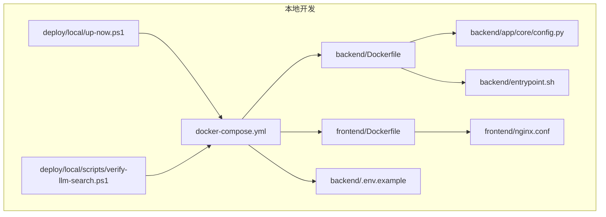
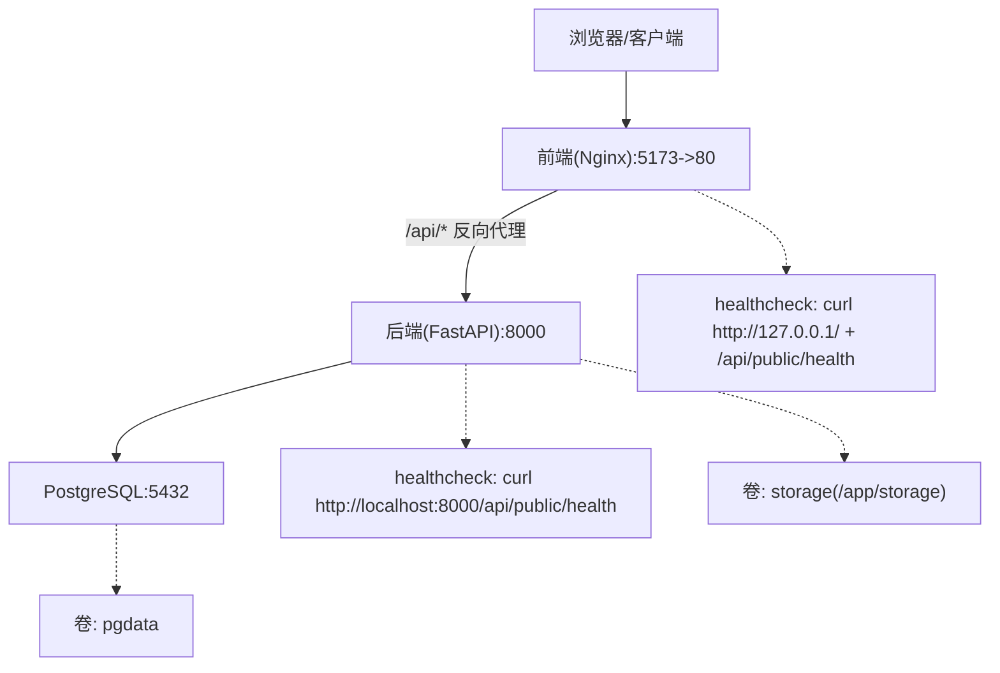
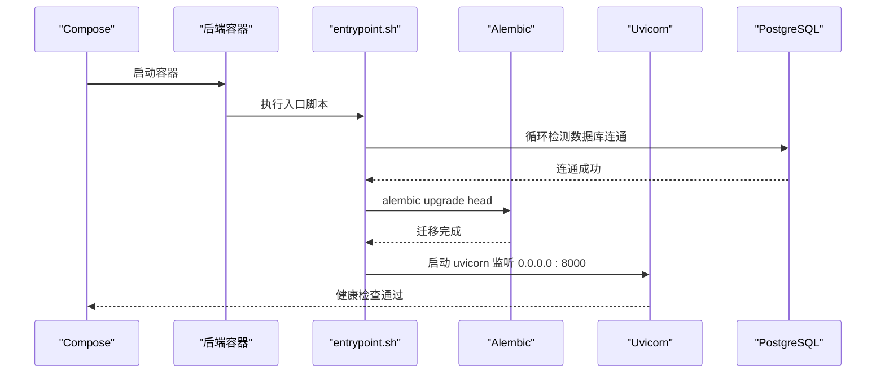
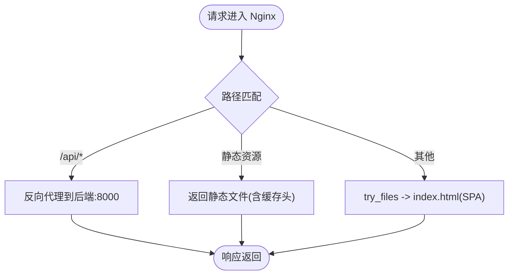
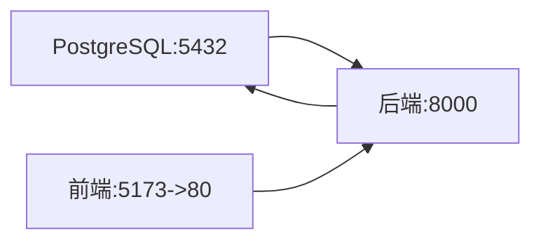

# 本地开发环境

<cite>
**本文引用的文件列表**
- [docker-compose.yml](file://deploy/local/docker-compose.yml)
- [README.md](file://deploy/local/README.md)
- [Dockerfile（后端）](file://backend/Dockerfile)
- [Dockerfile（前端）](file://frontend/Dockerfile)
- [nginx.conf](file://frontend/nginx.conf)
- [config.py](file://backend/app/core/config.py)
- [.env.example](file://backend/.env.example)
- [entrypoint.sh](file://backend/entrypoint.sh)
- [up-now.ps1](file://deploy/local/up-now.ps1)
- [verify-llm-search.ps1](file://deploy/local/scripts/verify-llm-search.ps1)
</cite>

## 目录
1. [简介](#简介)
2. [项目结构](#项目结构)
3. [核心组件](#核心组件)
4. [架构总览](#架构总览)
5. [详细组件分析](#详细组件分析)
6. [依赖关系分析](#依赖关系分析)
7. [性能与可观测性](#性能与可观测性)
8. [故障排查指南](#故障排查指南)
9. [结论](#结论)
10. [附录：环境变量清单](#附录环境变量清单)

## 简介
本指南面向在本地快速搭建 Learning Hub 开发环境的工程师，覆盖使用 Docker Compose 一键启动 PostgreSQL、后端 FastAPI、前端 Nginx 的完整流程；详细说明关键环境变量（数据库连接、管理员令牌、JWT 密钥等）；提供 Windows 与 Linux 平台的启动脚本用法；说明数据持久化卷挂载；并给出常见问题的排查方法与开发效率提升建议（热重载、调试模式、日志查看）。

## 项目结构
本地开发相关的关键目录与文件如下：
- deploy/local：本地编排与说明文档、PowerShell 辅助脚本
- backend：FastAPI 后端源码、Dockerfile、Alembic 迁移、入口脚本
- frontend：Vite + React 前端源码、Nginx 配置、构建用 Dockerfile

图表来源
- [docker-compose.yml:1-74](file://deploy/local/docker-compose.yml#L1-L74)
- [Dockerfile（后端）:1-85](file://backend/Dockerfile#L1-L85)
- [Dockerfile（前端）:1-23](file://frontend/Dockerfile#L1-L23)
- [nginx.conf:1-56](file://frontend/nginx.conf#L1-L56)
- [.env.example:1-51](file://backend/.env.example#L1-L51)
- [config.py:1-88](file://backend/app/core/config.py#L1-L88)
- [entrypoint.sh:1-23](file://backend/entrypoint.sh#L1-L23)
- [up-now.ps1:1-4](file://deploy/local/up-now.ps1#L1-L4)
- [verify-llm-search.ps1:1-201](file://deploy/local/scripts/verify-llm-search.ps1#L1-L201)

章节来源
- [README.md:1-344](file://deploy/local/README.md#L1-L344)

## 核心组件
- 数据库服务：PostgreSQL 16，端口 5432，数据通过命名卷 pgdata 持久化。
- 后端服务：FastAPI + Uvicorn，端口 8000，依赖 PostgreSQL，运行 Alembic 迁移，暴露 /api/public/* 接口。
- 前端服务：Nginx 静态站点 + 反向代理 /api 到后端，宿主端口 5173 映射容器 80。
- 环境变量：由 docker-compose.yml 注入，或读取 backend/.env（通过 env_file）。
- 健康检查：后端与前端均定义 healthcheck，compose 中设置 depends_on 条件等待。

章节来源
- [docker-compose.yml:1-74](file://deploy/local/docker-compose.yml#L1-L74)
- [Dockerfile（后端）:1-85](file://backend/Dockerfile#L1-L85)
- [Dockerfile（前端）:1-23](file://frontend/Dockerfile#L1-L23)
- [nginx.conf:1-56](file://frontend/nginx.conf#L1-L56)
- [.env.example:1-51](file://backend/.env.example#L1-L51)
- [config.py:1-88](file://backend/app/core/config.py#L1-L88)

## 架构总览
下图展示了本地开发时三容器之间的交互关系、端口映射与健康检查路径。

图表来源
- [docker-compose.yml:1-74](file://deploy/local/docker-compose.yml#L1-L74)
- [nginx.conf:1-56](file://frontend/nginx.conf#L1-L56)
- [Dockerfile（后端）:1-85](file://backend/Dockerfile#L1-L85)
- [Dockerfile（前端）:1-23](file://frontend/Dockerfile#L1-L23)

## 详细组件分析

### 容器编排与服务启动
- 服务定义：postgres、backend、frontend 三个服务，分别声明镜像/构建上下文、端口映射、健康检查、依赖关系与卷挂载。
- 启动顺序：backend 依赖 postgres 健康；frontend 依赖 backend 启动完成。
- 健康检查：
  - 前端：强制 IPv4 访问根路径与后端 health 端点，避免 Alpine wget 默认 IPv6 导致 unhealthy。
  - 后端：直接探测 /api/public/health。
- 数据持久化：pgdata 用于数据库文件；storage 用于后端上传素材与日志。

章节来源
- [docker-compose.yml:1-74](file://deploy/local/docker-compose.yml#L1-L74)

### 后端服务（FastAPI）
- 构建镜像：安装系统依赖（LibreOffice、poppler、ffmpeg、字体）、Python 依赖（FastAPI、SQLAlchemy、Alembic、psycopg2、PyJWT、dashscope 等），暴露 8000 端口。
- 启动流程：entrypoint.sh 等待数据库可达 → 执行 alembic upgrade head → 启动 uvicorn。
- 配置加载：Settings 从环境变量读取，支持 DATABASE_URL 优先，其余字段拼接；包含 admin_token、jwt_secret、CORS、存储路径、LLM 开关等。
- 健康检查：HEALTHCHECK 调用 /api/public/health。

图表来源
- [entrypoint.sh:1-23](file://backend/entrypoint.sh#L1-L23)
- [Dockerfile（后端）:1-85](file://backend/Dockerfile#L1-L85)

章节来源
- [Dockerfile（后端）:1-85](file://backend/Dockerfile#L1-L85)
- [entrypoint.sh:1-23](file://backend/entrypoint.sh#L1-L23)
- [config.py:1-88](file://backend/app/core/config.py#L1-L88)

### 前端服务（Nginx + SPA）
- 构建镜像：Node 20 构建产物 dist，拷贝 pdf.worker.min.mjs，最终由 nginx 提供静态资源。
- 反向代理：/api 转发至后端服务名（本地 compose 下为 backend），同时保留 /admin 路径一致性。
- 大文件上传：client_max_body_size 与超时参数对齐后端限制。
- 健康检查：compose 覆盖为 curl 强制 IPv4 访问根与后端 health。

图表来源
- [nginx.conf:1-56](file://frontend/nginx.conf#L1-L56)
- [docker-compose.yml:1-74](file://deploy/local/docker-compose.yml#L1-L74)

章节来源
- [Dockerfile（前端）:1-23](file://frontend/Dockerfile#L1-L23)
- [nginx.conf:1-56](file://frontend/nginx.conf#L1-L56)
- [docker-compose.yml:1-74](file://deploy/local/docker-compose.yml#L1-L74)

### 环境变量与配置
- 数据库连接：DATABASE_HOST/PORT/USER/PASSWORD/NAME 或 DATABASE_URL（后者优先）。
- 管理员令牌：ADMIN_TOKEN（用于管理后台鉴权）。
- JWT：JWT_SECRET/JWT_ALGORITHM/JWT_TTL_HOURS。
- CORS：CORS_ALLOW_ORIGINS（开发允许 *，生产需收紧）。
- 存储：STORAGE_PATH（默认 /app/storage/documents）。
- PPT 转图片：LIBREOFFICE_PATH、POPPLER_PATH、PPT_CONVERT_TIMEOUT。
- LLM（可选）：DASHSCOPE_API_KEY 为空则禁用，搜索降级关键词；非空启用 qwen-plus NL2SQL。
- 日志：LOG_LEVEL。

章节来源
- [.env.example:1-51](file://backend/.env.example#L1-L51)
- [config.py:1-88](file://backend/app/core/config.py#L1-L88)
- [docker-compose.yml:1-74](file://deploy/local/docker-compose.yml#L1-L74)

### 数据持久化
- 数据库卷：pgdata 挂载到 /var/lib/postgresql/data，容器销毁不丢数据。
- 应用存储卷：storage 挂载到 /app/storage，保存上传素材与日志。

章节来源
- [docker-compose.yml:1-74](file://deploy/local/docker-compose.yml#L1-L74)

### 平台启动脚本
- Windows PowerShell：
  - up-now.ps1：定位到 deploy 目录，以指定 project name 和 compose 文件启动 backend 与 frontend。
  - verify-llm-search.ps1：端到端验证脚本，支持步骤选择（env/test/smoke/e2e/all），自动检查 .env、启动容器、curl 验证、Playwright e2e。
- Linux/macOS：
  - 在 deploy 目录执行 docker compose up -d --build。
  - 健康检查：curl http://localhost:8000/api/public/health 与 http://localhost:5173/。

章节来源
- [up-now.ps1:1-4](file://deploy/local/up-now.ps1#L1-L4)
- [verify-llm-search.ps1:1-201](file://deploy/local/scripts/verify-llm-search.ps1#L1-L201)
- [README.md:1-344](file://deploy/local/README.md#L1-L344)

## 依赖关系分析
- 服务间依赖：backend 依赖 postgres 健康；frontend 依赖 backend 可用。
- 外部依赖：
  - LibreOffice/poppler/ffmpeg：后端容器内安装，用于 PPT→PDF→PNG 预览。
  - dashscope SDK：可选，用于 LLM-to-SQL 智能搜索。
- 网络与端口：
  - 宿主机 5173 → 前端 80（Nginx）
  - 宿主机 8000 → 后端 8000（FastAPI）
  - 宿主机 5432 → 数据库 5432（PostgreSQL）

图表来源
- [docker-compose.yml:1-74](file://deploy/local/docker-compose.yml#L1-L74)

章节来源
- [docker-compose.yml:1-74](file://deploy/local/docker-compose.yml#L1-L74)

## 性能与可观测性
- 大文件上传优化：Nginx 关闭 request body 缓冲，边收边转发，避免磁盘中转；提高 client_body_timeout/proxy_send/read_timeout 以适配大文件。
- 静态资源缓存：对 js/css/svg 等添加长期缓存头；pdf.worker.min.mjs 单独设置 MIME 与缓存策略。
- 健康检查：前后端均定义 healthcheck，便于编排工具判断就绪状态。
- 日志级别：可通过 LOG_LEVEL 调整后端日志输出粒度。

章节来源
- [nginx.conf:1-56](file://frontend/nginx.conf#L1-L56)
- [Dockerfile（后端）:1-85](file://backend/Dockerfile#L1-L85)
- [docker-compose.yml:1-74](file://deploy/local/docker-compose.yml#L1-L74)

## 故障排查指南
- 端口冲突
  - 现象：启动失败或无法访问 5173/8000/5432。
  - 处理：修改 docker-compose.yml 中的端口映射，确保宿主机端口未被占用。
- 网络连通性
  - 现象：后端无法连接数据库或前端无法访问后端。
  - 处理：确认 compose 网络互通；后端 DATABASE_HOST 应为 postgres；前端 /api 反向代理目标为 learning-hub_backend（部署场景）或 backend（本地 compose）。
- 权限问题
  - 现象：写入 /app/storage 失败。
  - 处理：确认 storage 卷已挂载且容器有写权限；必要时调整宿主目录权限。
- 健康检查异常
  - 现象：frontend unhealthy。
  - 处理：compose 已覆盖为 curl 强制 IPv4；若仍失败，检查 nginx 是否监听 80 以及 /api/public/health 是否可达。
- 大文件上传中断
  - 现象：上传超过一定大小被断开。
  - 处理：核对 Nginx client_max_body_size 与超时参数；确保后端也接受相应大小。
- LLM 搜索不可用
  - 现象：搜索始终走关键词降级。
  - 处理：确认 backend/.env 中 DASHSCOPE_API_KEY 已配置；参考 verify-llm-search.ps1 的步骤进行端到端验证。

章节来源
- [docker-compose.yml:1-74](file://deploy/local/docker-compose.yml#L1-L74)
- [nginx.conf:1-56](file://frontend/nginx.conf#L1-L56)
- [verify-llm-search.ps1:1-201](file://deploy/local/scripts/verify-llm-search.ps1#L1-L201)

## 结论
通过 Docker Compose 可将 Learning Hub 的数据库、后端与前端一次性拉起，配合环境变量与卷挂载实现可复现的开发体验。建议在本地开发中充分利用健康检查、日志级别与端到端验证脚本，快速定位问题并提升迭代效率。

## 附录：环境变量清单
以下为常用环境变量及其作用与默认值（来自配置类与环境模板）：
- 数据库
  - DATABASE_HOST、DATABASE_PORT、DATABASE_USER、DATABASE_PASSWORD、DATABASE_NAME、DATABASE_URL（优先）
- 管理员
  - ADMIN_TOKEN
- JWT
  - JWT_SECRET、JWT_ALGORITHM、JWT_TTL_HOURS
- CORS
  - CORS_ALLOW_ORIGINS
- 时区
  - TIMEZONE
- 存储
  - STORAGE_PATH
- PPT 转图片
  - LIBREOFFICE_PATH、POPPLER_PATH、PPT_CONVERT_TIMEOUT
- 限流/Redis（可选）
  - STORAGE_REDIS_URL
- LLM（可选）
  - DASHSCOPE_API_KEY、LLM_SEARCH_MODEL、LLM_SQL_TIMEOUT_SECONDS、LLM_SQL_MAX_ROWS
- 日志
  - LOG_LEVEL

章节来源
- [.env.example:1-51](file://backend/.env.example#L1-L51)
- [config.py:1-88](file://backend/app/core/config.py#L1-L88)