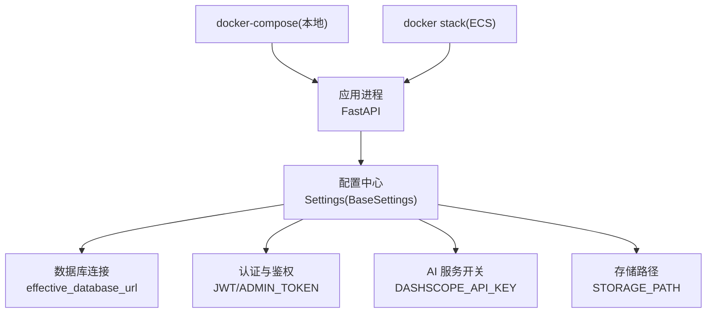
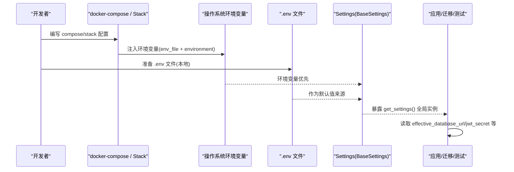
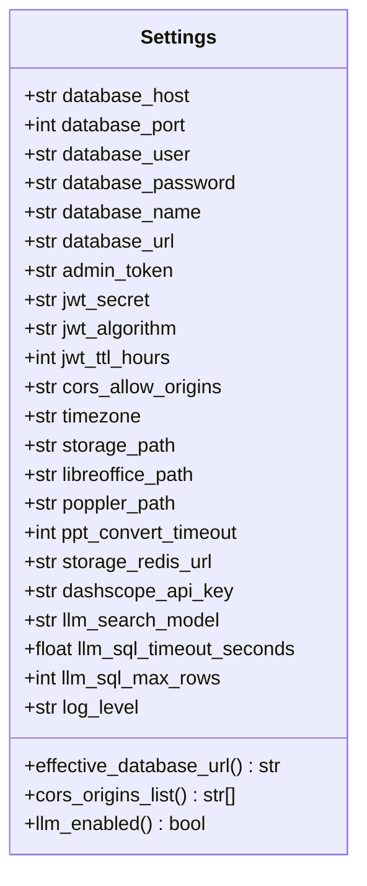
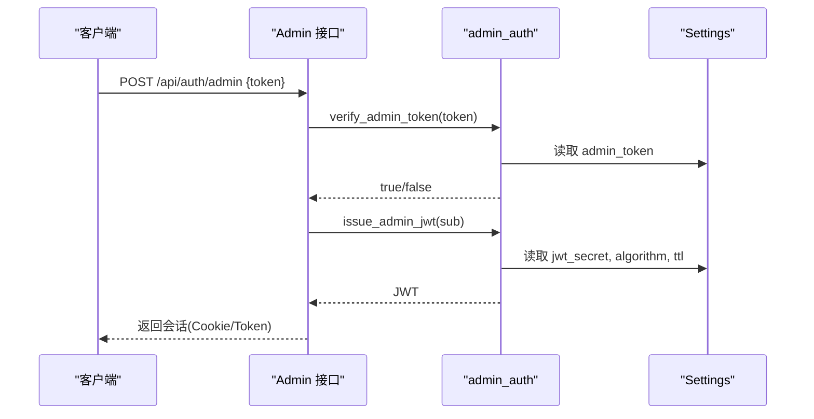
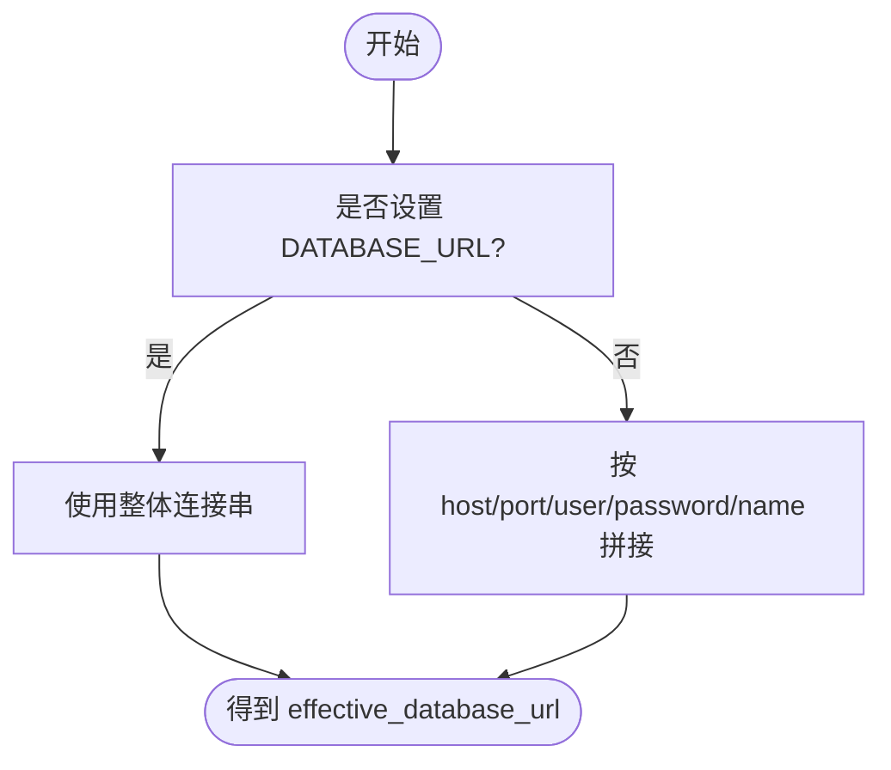
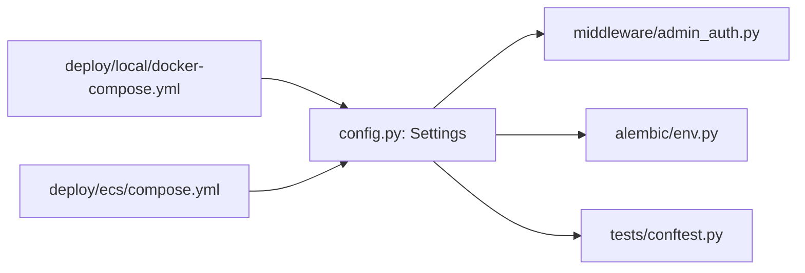

# 环境配置管理

<cite>
**本文引用的文件**
- [backend/app/core/config.py](file://backend/app/core/config.py)
- [backend/app/middleware/admin_auth.py](file://backend/app/middleware/admin_auth.py)
- [backend/alembic/env.py](file://backend/alembic/env.py)
- [backend/tests/conftest.py](file://backend/tests/conftest.py)
- [deploy/local/docker-compose.yml](file://deploy/local/docker-compose.yml)
- [deploy/ecs/compose.yml](file://deploy/ecs/compose.yml)
- [backend/pyproject.toml](file://backend/pyproject.toml)
- [.gitignore](file://.gitignore)
</cite>

## 目录
1. [简介](#简介)
2. [项目结构](#项目结构)
3. [核心组件](#核心组件)
4. [架构总览](#架构总览)
5. [详细组件分析](#详细组件分析)
6. [依赖关系分析](#依赖关系分析)
7. [性能与稳定性考虑](#性能与稳定性考虑)
8. [故障排查指南](#故障排查指南)
9. [结论](#结论)
10. [附录：环境变量清单与环境模板](#附录环境变量清单与环境模板)

## 简介
本指南聚焦 Learning Hub 的环境配置管理，覆盖以下目标：
- 说明所有环境变量的作用、默认值与使用场景（数据库连接、认证、AI 服务、存储等）
- 提供不同环境的配置模板（开发、测试、预发布、生产）
- 解释配置加载优先级与覆盖机制（环境变量、配置文件、默认值）
- 给出敏感信息安全管理最佳实践（密钥轮换、配置加密、访问控制）
- 介绍配置验证与错误处理机制，确保正确性与稳定性
- 提供配置变更管理与环境迁移的最佳实践

## 项目结构
后端通过集中式配置类从环境变量加载配置，并在应用启动时缓存。部署层面，本地与 ECS 分别通过 docker-compose 注入环境变量或 env_file。

图示来源
- [backend/app/core/config.py:9-88](file://backend/app/core/config.py#L9-L88)
- [deploy/local/docker-compose.yml:23-49](file://deploy/local/docker-compose.yml#L23-L49)
- [deploy/ecs/compose.yml:27-51](file://deploy/ecs/compose.yml#L27-L51)

章节来源
- [backend/app/core/config.py:9-88](file://backend/app/core/config.py#L9-L88)
- [deploy/local/docker-compose.yml:1-74](file://deploy/local/docker-compose.yml#L1-L74)
- [deploy/ecs/compose.yml:1-79](file://deploy/ecs/compose.yml#L1-L79)

## 核心组件
- 配置中心 Settings：基于 pydantic-settings 的 BaseSettings，统一声明字段、默认值与计算字段；支持 .env 文件与环境变量覆盖；提供 lru_cache 的全局实例。
- 数据库 URL 生成：当未显式设置整体连接串时，自动拼接 host/port/user/password/name。
- 认证模块：读取 JWT 相关配置与管理员令牌，用于签发与校验。
- Alembic 迁移：在迁移环境中复用同一配置源，保证运行期与迁移期一致。
- 测试夹具：在测试前强制覆盖关键配置，确保隔离与可重复性。

章节来源
- [backend/app/core/config.py:9-88](file://backend/app/core/config.py#L9-L88)
- [backend/app/middleware/admin_auth.py:1-66](file://backend/app/middleware/admin_auth.py#L1-L66)
- [backend/alembic/env.py:1-63](file://backend/alembic/env.py#L1-L63)
- [backend/tests/conftest.py:1-121](file://backend/tests/conftest.py#L1-L121)

## 架构总览
下图展示配置在不同阶段的加载与生效路径：

图示来源
- [backend/app/core/config.py:12-17](file://backend/app/core/config.py#L12-L17)
- [backend/app/core/config.py:28-38](file://backend/app/core/config.py#L28-L38)
- [deploy/local/docker-compose.yml:32-45](file://deploy/local/docker-compose.yml#L32-L45)
- [deploy/ecs/compose.yml:30-36](file://deploy/ecs/compose.yml#L30-L36)

## 详细组件分析

### 配置中心 Settings
- 加载策略
  - 默认读取当前工作目录下的 .env 文件（UTF-8），忽略未知字段，大小写不敏感。
  - 运行时可通过环境变量覆盖 .env 中的同名键。
- 数据库连接
  - 若设置了整体连接串，则直接使用该连接串；否则由 host/port/user/password/name 自动拼接。
- 认证与权限
  - 管理员登录采用“明文令牌”对比（常量时间比较），同时签发并校验 JWT。
- AI 服务
  - 通过 API Key 开关 LLM 能力；为空时搜索自动降级为关键词匹配。
- 其他
  - CORS 允许来源、时区、本地存储路径、PPT 转换工具路径、限流 Redis 地址、日志级别等。

图示来源
- [backend/app/core/config.py:9-88](file://backend/app/core/config.py#L9-L88)

章节来源
- [backend/app/core/config.py:9-88](file://backend/app/core/config.py#L9-L88)

### 认证与鉴权
- 管理员令牌校验：使用配置的明文令牌进行常量时间比较，避免时序攻击。
- JWT 签发与校验：依据算法、密钥与 TTL 生成/解析令牌，失败返回未认证错误。

图示来源
- [backend/app/middleware/admin_auth.py:1-66](file://backend/app/middleware/admin_auth.py#L1-L66)
- [backend/app/core/config.py:40-55](file://backend/app/core/config.py#L40-L55)

章节来源
- [backend/app/middleware/admin_auth.py:1-66](file://backend/app/middleware/admin_auth.py#L1-L66)

### 数据库连接与迁移
- 运行期：应用通过 effective_database_url 获取最终连接串。
- 迁移期：Alembic 在 env.py 中复用同一配置源，确保迁移与运行期一致。

图示来源
- [backend/app/core/config.py:28-38](file://backend/app/core/config.py#L28-L38)
- [backend/alembic/env.py:23-24](file://backend/alembic/env.py#L23-L24)

章节来源
- [backend/alembic/env.py:1-63](file://backend/alembic/env.py#L1-L63)

### 测试环境配置
- 在导入应用之前强制覆盖 DATABASE_URL 与 JWT_SECRET，确保测试使用内存 SQLite 与固定密钥。
- 运行时再次覆盖 settings 实例中的 database_url 与 admin_token，保证与历史用例兼容。

章节来源
- [backend/tests/conftest.py:22-39](file://backend/tests/conftest.py#L22-L39)

## 依赖关系分析
- 配置中心被以下模块引用：
  - 中间件（认证）
  - Alembic 迁移
  - 测试夹具
- 部署层通过 docker-compose 或 Stack 注入环境变量或 env_file，影响 Settings 的加载结果。

图示来源
- [backend/app/core/config.py:9-88](file://backend/app/core/config.py#L9-L88)
- [backend/app/middleware/admin_auth.py:1-66](file://backend/app/middleware/admin_auth.py#L1-L66)
- [backend/alembic/env.py:1-63](file://backend/alembic/env.py#L1-L63)
- [backend/tests/conftest.py:1-121](file://backend/tests/conftest.py#L1-L121)
- [deploy/local/docker-compose.yml:1-74](file://deploy/local/docker-compose.yml#L1-L74)
- [deploy/ecs/compose.yml:1-79](file://deploy/ecs/compose.yml#L1-L79)

章节来源
- [backend/pyproject.toml:1-47](file://backend/pyproject.toml#L1-L47)

## 性能与稳定性考虑
- 配置加载仅一次并缓存，避免重复 IO 与解析开销。
- 数据库连接串优先使用整体 URL，减少拼接逻辑分支，便于外部系统统一管理。
- LLM 功能可按需关闭，避免不必要的网络调用与超时风险。
- 建议在生产环境开启更严格的 CORS 与时区设置，降低跨域与时间不一致问题。

[本节为通用指导，无需特定文件来源]

## 故障排查指南
- 无法连接数据库
  - 检查 effective_database_url 是否正确生成或是否被覆盖。
  - 确认容器内 DNS 解析与端口映射。
- 管理员登录失败
  - 核对 ADMIN_TOKEN 与请求 token 是否一致。
  - 检查 JWT_SECRET、ALGORITHM、TTL 是否与签发端一致。
- LLM 搜索不可用
  - 确认 DASHSCOPE_API_KEY 已设置且非空。
- 前端健康检查失败
  - 检查反向代理与健康检查命令是否指向正确的 IPv4 地址。

章节来源
- [backend/app/core/config.py:28-38](file://backend/app/core/config.py#L28-L38)
- [backend/app/middleware/admin_auth.py:26-62](file://backend/app/middleware/admin_auth.py#L26-L62)
- [deploy/local/docker-compose.yml:61-68](file://deploy/local/docker-compose.yml#L61-L68)

## 结论
Learning Hub 的配置体系以 Settings 为中心，结合环境变量与 .env 文件实现灵活、安全的配置管理。通过统一的 effective_database_url、按需启用的 LLM、以及严格的认证策略，系统在开发与生产环境均具备良好的可维护性与稳定性。配合完善的测试覆盖与部署脚本，可实现从开发到生产的平滑迁移。

[本节为总结，无需特定文件来源]

## 附录：环境变量清单与环境模板

### 环境变量清单与默认值
- 数据库
  - DATABASE_HOST：默认 postgres
  - DATABASE_PORT：默认 5432
  - DATABASE_USER：默认 lh
  - DATABASE_PASSWORD：默认 lh
  - DATABASE_NAME：默认 learning_hub
  - DATABASE_URL：留空时自动拼接；非空时优先使用
- 认证
  - ADMIN_TOKEN：默认 shleeyuan
  - JWT_SECRET：默认请更换为强随机值
  - JWT_ALGORITHM：默认 HS256
  - JWT_TTL_HOURS：默认 8
- 跨域
  - CORS_ALLOW_ORIGINS：默认 *
- 时区
  - TIMEZONE：默认 Asia/Shanghai
- 存储
  - STORAGE_PATH：默认 /app/storage/documents
- PPT 转图片
  - LIBREOFFICE_PATH：默认 /usr/bin/libreoffice
  - POPPLER_PATH：默认 /usr/bin/pdftoppm
  - PPT_CONVERT_TIMEOUT：默认 60
- 限流/Redis
  - STORAGE_REDIS_URL：留空表示未启用
- AI 服务（阿里云百炼 qwen-plus）
  - DASHSCOPE_API_KEY：留空禁用 LLM
  - LLM_SEARCH_MODEL：默认 qwen-plus
  - LLM_SQL_TIMEOUT_SECONDS：默认 8.0
  - LLM_SQL_MAX_ROWS：默认 20
- 日志
  - LOG_LEVEL：默认 INFO

章节来源
- [backend/app/core/config.py:19-82](file://backend/app/core/config.py#L19-L82)

### 配置加载优先级与覆盖机制
- 优先级顺序（从高到低）
  1. 运行时环境变量（操作系统注入）
  2. .env 文件（当前工作目录）
  3. Settings 字段默认值
- 注意
  - 大小写不敏感
  - 未知字段会被忽略
  - 整体连接串 DATABASE_URL 优先于独立字段拼接

章节来源
- [backend/app/core/config.py:12-17](file://backend/app/core/config.py#L12-L17)
- [backend/app/core/config.py:28-38](file://backend/app/core/config.py#L28-L38)

### 不同环境配置模板

- 开发环境（本地 docker-compose）
  - 使用 env_file 引入 backend/.env（含真实凭据，不入仓）
  - 通过 environment 注入数据库主机、端口、用户、密码、库名、管理员令牌、JWT 密钥、时区
  - 前端健康检查使用 curl 强制 IPv4 探测 / 与 /api/public/health
  - 参考路径：[deploy/local/docker-compose.yml](file://deploy/local/docker-compose.yml)

- 测试环境（pytest）
  - 在导入应用前强制覆盖 DATABASE_URL 为内存 SQLite，并设置固定 JWT_SECRET
  - 运行时再次覆盖 settings.database_url 与 settings.admin_token，保证与历史用例一致
  - 参考路径：[backend/tests/conftest.py](file://backend/tests/conftest.py)

- 预发布/生产环境（ECS Swarm）
  - 通过 env_file 注入主要字段，并在 environment 中补全网络与服务名
  - 使用外部 overlay 网络与命名卷，持久化素材文件
  - 参考路径：[deploy/ecs/compose.yml](file://deploy/ecs/compose.yml)

章节来源
- [deploy/local/docker-compose.yml:23-49](file://deploy/local/docker-compose.yml#L23-L49)
- [deploy/local/docker-compose.yml:61-68](file://deploy/local/docker-compose.yml#L61-L68)
- [backend/tests/conftest.py:22-39](file://backend/tests/conftest.py#L22-L39)
- [deploy/ecs/compose.yml:27-51](file://deploy/ecs/compose.yml#L27-L51)

### 敏感信息安全管理最佳实践
- 绝不将 .env 提交至版本库
  - 根级与后端目录的 .env 均在 .gitignore 中排除
- 密钥轮换
  - 定期更新 JWT_SECRET 与 ADMIN_TOKEN
  - 更新后重新签发会话或要求重新登录
- 配置加密与访问控制
  - 在 CI/CD 或编排平台中使用受控的密钥注入方式（如 Secret Manager）
  - 限制对 .env 文件的读取权限，最小化可见范围
- 最小权限原则
  - 数据库账号仅授予必要权限
  - 对外网暴露的服务严格限制 CORS 与域名白名单

章节来源
- [.gitignore:21-26](file://.gitignore#L21-L26)
- [backend/app/middleware/admin_auth.py:57-62](file://backend/app/middleware/admin_auth.py#L57-L62)

### 配置验证与错误处理
- 类型与格式校验
  - 基于 pydantic 的类型约束与默认值，非法输入会在初始化阶段报错
- 业务错误码
  - 认证失败返回明确的未认证错误，便于前端提示与重试
- 迁移一致性
  - Alembic 复用同一配置源，避免运行期与迁移期不一致导致的异常

章节来源
- [backend/app/core/config.py:9-17](file://backend/app/core/config.py#L9-L17)
- [backend/app/middleware/admin_auth.py:26-42](file://backend/app/middleware/admin_auth.py#L26-L42)
- [backend/alembic/env.py:23-24](file://backend/alembic/env.py#L23-L24)

### 配置变更管理与环境迁移流程
- 变更评审
  - 新增或修改环境变量需在 PR 中说明用途、默认值与影响面
- 本地验证
  - 使用本地 docker-compose 快速验证新配置
- 测试覆盖
  - 针对关键路径补充或更新测试用例，确保行为稳定
- 灰度与回滚
  - 预发布环境先行验证，必要时保留旧版镜像与配置快照以便回滚
- 文档同步
  - 更新本指南的环境变量清单与环境模板

[本节为流程建议，无需特定文件来源]