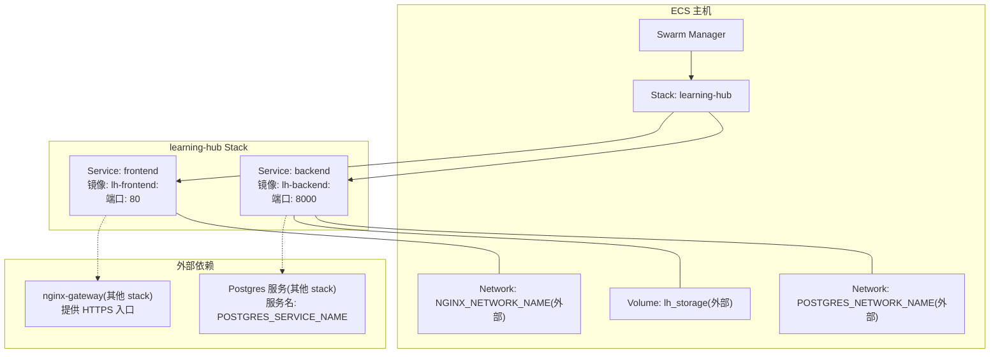
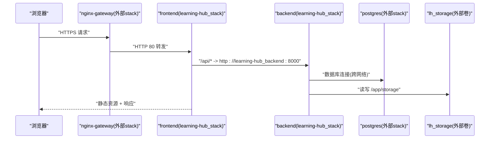
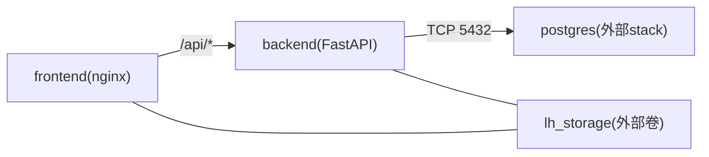

# ECS容器编排

<cite>
**本文引用的文件**
- [deploy/ecs/compose.yml](file://deploy/ecs/compose.yml)
- [deploy/ecs/publish.ps1](file://deploy/ecs/publish.ps1)
- [deploy/ecs/.env.example](file://deploy/ecs/.env.example)
- [deploy/ecs/remote-setup.sh](file://deploy/ecs/remote-setup.sh)
- [deploy/ecs/db-init.sh](file://deploy/ecs/db-init.sh)
- [backend/Dockerfile](file://backend/Dockerfile)
- [frontend/Dockerfile](file://frontend/Dockerfile)
- [frontend/nginx.conf](file://frontend/nginx.conf)
- [backend/app/core/config.py](file://backend/app/core/config.py)
</cite>

## 更新摘要
**变更内容**
- 新增 `-SkipForceUpdate` 参数，支持跳过 Swarm task 强制刷新
- 改进 Docker buildx builder 管理的智能回退逻辑
- 增强对非标准 Docker 配置的错误处理能力
- 优化跨编译环境的构建流程

## 目录
1. [简介](#简介)
2. [项目结构](#项目结构)
3. [核心组件](#核心组件)
4. [架构总览](#架构总览)
5. [详细组件分析](#详细组件分析)
6. [依赖关系分析](#依赖关系分析)
7. [性能与容量](#性能与容量)
8. [故障排查指南](#故障排查指南)
9. [结论](#结论)
10. [附录：publish.ps1 使用手册](#附录publishps1-使用手册)

## 简介
本文件面向在阿里云 ECS（ARM64）上基于 Docker Swarm v3.8 部署 Learning Hub 的运维与发布流程。文档重点说明：
- Stack 配置：服务定义、网络拓扑、卷挂载与部署策略
- 外部网络复用机制：POSTGRES_NETWORK_NAME 与 NGINX_NETWORK_NAME
- 命名卷 lh_storage 的配置与用途
- backend 与 frontend 服务的约束、副本数、重启策略与健康检查
- publish.ps1 脚本的使用方法与参数，涵盖镜像构建、推送（本地打包）、远程加载与部署全流程
- 环境变量管理、服务间通信与故障恢复机制

## 项目结构
ECS 相关编排与发布脚本位于 deploy/ecs 目录；后端与前端镜像分别由 backend/Dockerfile 与 frontend/Dockerfile 构建；Nginx 反代规则位于 frontend/nginx.conf；应用配置读取自环境变量，定义于 backend/app/core/config.py。

图表来源
- [deploy/ecs/compose.yml:12-78](file://deploy/ecs/compose.yml#L12-L78)
- [deploy/ecs/.env.example:14-21](file://deploy/ecs/.env.example#L14-L21)

章节来源
- [deploy/ecs/compose.yml:1-78](file://deploy/ecs/compose.yml#L1-L78)
- [deploy/ecs/.env.example:1-41](file://deploy/ecs/.env.example#L1-L41)

## 核心组件
- Stack 定义：compose.yml 声明两个外部 overlay 网络与一个外部命名卷，并定义 backend 与 frontend 两个服务。
- 镜像构建：backend 与 frontend 各自拥有独立 Dockerfile，支持多阶段构建与健康检查。
- 发布脚本：publish.ps1 负责本地构建、保存镜像 tar、上传到 ECS、远程初始化资源、加载镜像、部署 stack 并轮询健康状态。
- 反向代理：frontend 容器内 Nginx 将 /api/ 请求转发至同 stack 内的 backend 服务（Swarm DNS）。
- 配置注入：backend 通过 pydantic-settings 从 .env 与环境变量加载配置，包括数据库连接、JWT、CORS、存储路径等。

章节来源
- [deploy/ecs/compose.yml:27-78](file://deploy/ecs/compose.yml#L27-L78)
- [backend/Dockerfile:1-85](file://backend/Dockerfile#L1-L85)
- [frontend/Dockerfile:1-23](file://frontend/Dockerfile#L1-L23)
- [frontend/nginx.conf:25-42](file://frontend/nginx.conf#L25-L42)
- [backend/app/core/config.py:1-88](file://backend/app/core/config.py#L1-L88)

## 架构总览
下图展示了学习平台在 Swarm 中的运行拓扑：frontend 通过 nginx 暴露静态页面与 API 反代；backend 通过外部网络访问 Postgres；两者均挂载共享存储卷以持久化素材。

图表来源
- [deploy/ecs/compose.yml:14-25](file://deploy/ecs/compose.yml#L14-L25)
- [frontend/nginx.conf:25-42](file://frontend/nginx.conf#L25-L42)
- [deploy/ecs/.env.example:14-21](file://deploy/ecs/.env.example#L14-L21)

## 详细组件分析

### Stack 配置与服务定义
- 版本与网络
  - version: "3.8"
  - postgres_net：external，名称来自 POSTGRES_NETWORK_NAME
  - nginx_net：external，名称来自 NGINX_NETWORK_NAME
- 卷
  - lh_storage：external，名称固定为 lh_storage，用于 /app/storage 持久化
- 服务
  - backend
    - 镜像：lh-backend:${IMAGE_TAG}
    - 环境变量：通过 env_file: .env 注入；同时显式设置 DATABASE_HOST、DATABASE_PORT、TZ
    - 网络：default + postgres_net
    - 卷挂载：lh_storage:/app/storage
    - 部署策略：replicas=1；restart_policy on-failure(delay=5s, max_attempts=5)；placement constraints node.role == manager
    - 健康检查：由 Dockerfile 内置 HEALTHCHECK（/api/public/health），compose 层不重复声明
  - frontend
    - 镜像：lh-frontend:${IMAGE_TAG}
    - 网络：default + nginx_net
    - 部署策略：replicas=1；restart_policy on-failure(delay=5s, max_attempts=5)；placement constraints node.role == manager
    - 健康检查：compose 层声明 wget 探测 http://127.0.0.1/

章节来源
- [deploy/ecs/compose.yml:12-78](file://deploy/ecs/compose.yml#L12-L78)
- [backend/Dockerfile:80-84](file://backend/Dockerfile#L80-L84)
- [frontend/Dockerfile:20-22](file://frontend/Dockerfile#L20-L22)

### 外部网络复用机制
- POSTGRES_NETWORK_NAME
  - 指向已有 postgres stack 所在的 overlay 网络
  - backend 接入该网络后，可通过 POSTGRES_SERVICE_NAME 解析到数据库服务
- NGINX_NETWORK_NAME
  - 指向 nginx-gateway 容器所在网络
  - frontend 接入该网络后，可被上游 vhost 正确解析与路由
- 注意
  - 这两个网络均为 external，不在本 stack 中创建，需确保在 ECS 上已存在
  - compose.yml 通过 ${POSTGRES_NETWORK_NAME} 与 ${NGINX_NETWORK_NAME} 引用

章节来源
- [deploy/ecs/compose.yml:14-20](file://deploy/ecs/compose.yml#L14-L20)
- [deploy/ecs/.env.example:14-21](file://deploy/ecs/.env.example#L14-L21)

### 命名卷 lh_storage 配置
- 类型：external named volume
- 名称：lh_storage
- 用途：backend 的 /app/storage 目录持久化（含 documents、logs 等）
- 生命周期：由 remote-setup.sh 幂等创建（若不存在则创建）

章节来源
- [deploy/ecs/compose.yml:22-25](file://deploy/ecs/compose.yml#L22-L25)
- [deploy/ecs/remote-setup.sh:7-12](file://deploy/ecs/remote-setup.sh#L7-L12)

### 服务间通信与域名解析
- frontend 内部 Nginx 将 /api/ 请求转发至 http://learning-hub_backend:8000
- 该 host 由 Swarm 同 stack 的 service DNS 解析
- publish.ps1 在构建 frontend 前会替换 nginx.conf 中的后端地址，使其适配 swarm 的服务名

章节来源
- [frontend/nginx.conf:25-42](file://frontend/nginx.conf#L25-L42)
- [deploy/ecs/publish.ps1:147-158](file://deploy/ecs/publish.ps1#L147-L158)

### 部署策略与约束
- 副本数：backend 与 frontend 均为 1
- 重启策略：on-failure，延迟 5s，最多尝试 5 次
- 节点约束：仅调度到 manager 节点（node.role == manager）
- 健康检查
  - backend：Dockerfile 内置 curl 探测 /api/public/health
  - frontend：compose 层 wget 探测 http://127.0.0.1/

章节来源
- [deploy/ecs/compose.yml:42-78](file://deploy/ecs/compose.yml#L42-L78)
- [backend/Dockerfile:80-84](file://backend/Dockerfile#L80-L84)
- [frontend/Dockerfile:20-22](file://frontend/Dockerfile#L20-L22)

### 环境变量管理与配置加载
- .env 模板包含 SSH 连接、镜像 tag、外部网络名、数据库凭据、JWT、CORS、LLM 密钥、域名等
- backend 通过 pydantic-settings 从 .env 与环境变量加载配置，字段名与 .env 一致（大小写不敏感）
- 关键配置项
  - 数据库：database_host/port/user/password/name/url
  - 认证：admin_token、jwt_secret、jwt_algorithm、jwt_ttl_hours
  - CORS：cors_allow_origins
  - 时区：timezone
  - 存储：storage_path
  - LLM：dashscope_api_key、llm_search_model、超时与行数限制
  - 日志：log_level

章节来源
- [deploy/ecs/.env.example:1-41](file://deploy/ecs/.env.example#L1-L41)
- [backend/app/core/config.py:1-88](file://backend/app/core/config.py#L1-L88)

### 故障恢复机制
- 自动重启：on-failure 策略配合 delay 与 max_attempts，避免频繁抖动
- 健康检查：backend 与 frontend 均有健康检查，失败将被标记并触发重建
- 数据持久化：lh_storage 保证素材不随容器销毁丢失
- 外部依赖隔离：通过外部网络复用，避免 stack 间耦合过深

章节来源
- [deploy/ecs/compose.yml:42-78](file://deploy/ecs/compose.yml#L42-L78)
- [deploy/ecs/compose.yml:22-25](file://deploy/ecs/compose.yml#L22-L25)

## 依赖关系分析
- 运行时依赖
  - backend 依赖 Postgres（通过 POSTGRES_SERVICE_NAME 解析）
  - frontend 依赖 backend（通过 Swarm DNS 解析 learning-hub_backend）
  - 两者共享 lh_storage 卷
- 构建期依赖
  - backend 依赖系统库（LibreOffice、ffmpeg、poppler-utils 等）
  - frontend 依赖 Node 构建产物与 Nginx 运行时

图表来源
- [frontend/nginx.conf:25-42](file://frontend/nginx.conf#L25-L42)
- [deploy/ecs/compose.yml:22-25](file://deploy/ecs/compose.yml#L22-L25)

章节来源
- [deploy/ecs/compose.yml:27-78](file://deploy/ecs/compose.yml#L27-L78)
- [frontend/nginx.conf:25-42](file://frontend/nginx.conf#L25-L42)

## 性能与容量
- 大文件上传
  - frontend Nginx 调整 client_max_body_size、client_body_timeout、proxy_send/read_timeout 以支持最大 500MB 上传
- 静态资源缓存
  - 对 js/css/svg/png/jpg/woff2 等开启长期缓存
- 并发与副本
  - 当前副本数为 1，适合单节点或低负载场景；如需水平扩展，可在 compose 中调整 replicas 并确保无状态设计
- 存储
  - lh_storage 建议对接高性能磁盘或对象存储后端以提升吞吐

章节来源
- [frontend/nginx.conf:10-14](file://frontend/nginx.conf#L10-L14)
- [frontend/nginx.conf:44-48](file://frontend/nginx.conf#L44-L48)
- [deploy/ecs/compose.yml:42-78](file://deploy/ecs/compose.yml#L42-L78)

## 故障排查指南
- 网络错误
  - 确认 POSTGRES_NETWORK_NAME 与 NGINX_NETWORK_NAME 是真实存在的 overlay 网络
- 数据库不可达
  - 确认 POSTGRES_SERVICE_NAME 对应容器正在运行且端口可达
- 镜像架构不匹配
  - publish.ps1 会校验本地镜像架构是否为 arm64；如不一致需重新构建
- 服务未 Running
  - 使用 docker stack ps learning-hub 查看状态；必要时查看服务日志
- 证书与 vhost
  - 首次部署需执行 phase1 与 phase2 完成证书签发与 443 server block 插入
- **新增** Task 未刷新问题
  - 如果服务未显示最新镜像内容，可使用 -SkipForceUpdate 参数跳过强制刷新，或手动执行 `docker service update --force <service>`

章节来源
- [deploy/ecs/compose.yml:14-20](file://deploy/ecs/compose.yml#L14-L20)
- [deploy/ecs/publish.ps1:239-268](file://deploy/ecs/publish.ps1#L239-L268)
- [deploy/ecs/publish.ps1:270-302](file://deploy/ecs/publish.ps1#L270-L302)
- [deploy/ecs/publish.ps1:240-253](file://deploy/ecs/publish.ps1#L240-L253)

## 结论
本编排方案通过外部网络复用与外部卷持久化，实现了 learning-hub 与现有 postgres 与 nginx-gateway 的松耦合集成。publish.ps1 提供了端到端的自动化发布能力，覆盖构建、传输、初始化、部署与健康检查。结合合理的健康检查与重启策略，系统在单节点环境下具备基本的可用性与可恢复性。

## 附录：publish.ps1 使用手册

### 前置条件
- PowerShell 5.1+、Docker、scp、ssh 已在 PATH
- 准备 .env 文件（复制 .env.example 并填写真实值）
- 目标 ECS 主机已存在所需的外部网络与 ssh 免密登录

### 参数说明
- SkipBuild：跳过本地构建与镜像保存，直接复用本地已有镜像
- SkipNginx：跳过 nginx-gateway 证书与 vhost 变更（仅在需要重新部署应用时使用）
- **新增** SkipForceUpdate：跳过 Swarm task 强制刷新，避免不必要的任务重建
- WaitHealthyTimeout：等待服务 Running 的超时秒数（默认 300）

### 典型用法
- 完整发布（构建、上传、部署、证书与 vhost 处理）
  - PS> .\publish.ps1
- 快速重部署（复用本地镜像）
  - PS> .\publish.ps1 -SkipBuild
- 仅更新应用（不改动 nginx-gateway）
  - PS> .\publish.ps1 -SkipNginx
- **新增** 跳过强制刷新（适用于镜像标签不变但需要重新部署的场景）
  - PS> .\publish.ps1 -SkipForceUpdate

### 主要流程
- 加载 .env 并校验必填键
- 测试 SSH 连通性
- 构建镜像（默认 linux/arm64，必要时切换 buildx builder）
- 保存镜像为 tar 并 scp 到 ECS
- 远程初始化工作目录与持久卷
- 远程初始化数据库（幂等）
- 远程加载镜像并执行 docker stack deploy
- **新增** 可选：强制刷新 Swarm tasks 以重新解析镜像标签
- 轮询服务状态直至 Running
- 可选：申请证书、注入 vhost、重载 nginx

### Docker Buildx Builder 管理改进
- **智能回退逻辑**：当找不到 'lhxbuild' builder 时，自动尝试使用 'default' builder
- **跨编译环境支持**：在非标准 Docker 配置下提供更好的兼容性
- **错误处理增强**：提供更详细的错误信息和回退策略

章节来源
- [deploy/ecs/publish.ps1:1-338](file://deploy/ecs/publish.ps1#L1-L338)
- [deploy/ecs/.env.example:1-41](file://deploy/ecs/.env.example#L1-L41)
- [deploy/ecs/remote-setup.sh:1-19](file://deploy/ecs/remote-setup.sh#L1-L19)
- [deploy/ecs/db-init.sh:1-37](file://deploy/ecs/db-init.sh#L1-L37)
- [deploy/ecs/publish.ps1:105-141](file://deploy/ecs/publish.ps1#L105-L141)
- [deploy/ecs/publish.ps1:240-253](file://deploy/ecs/publish.ps1#L240-L253)