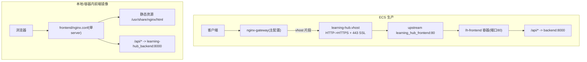
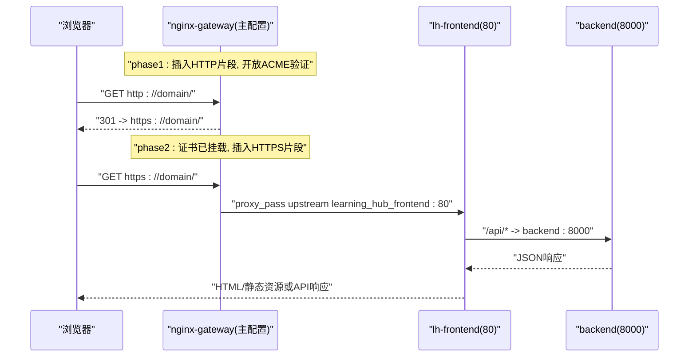
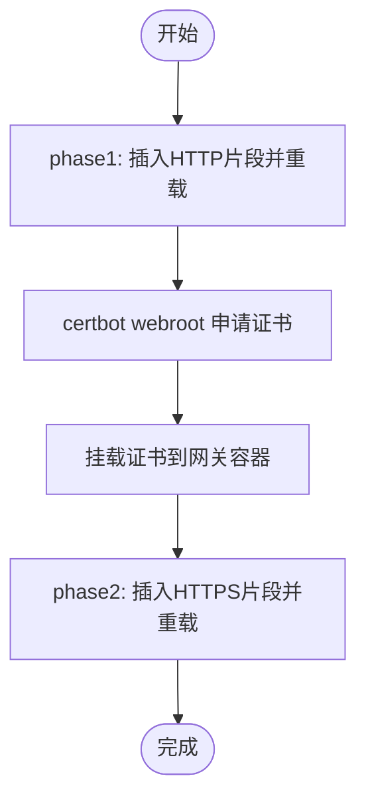
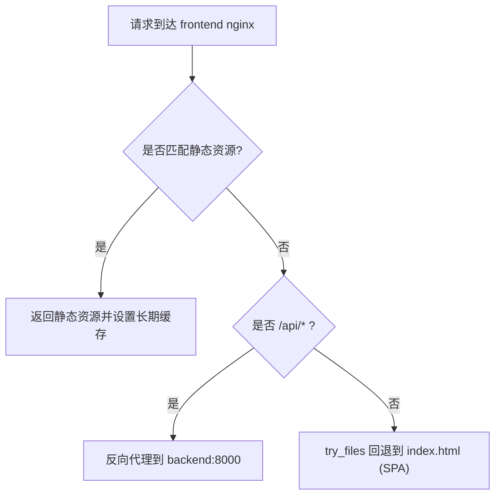
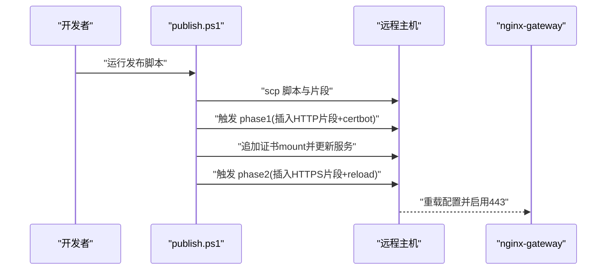
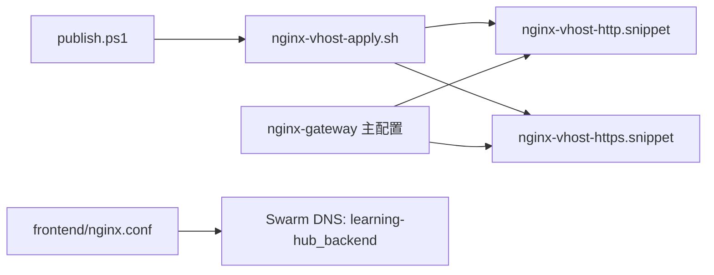

# Nginx反向代理

<cite>
**本文引用的文件列表**
- [deploy/ecs/nginx-vhost.snippet](file://deploy/ecs/nginx-vhost.snippet)
- [deploy/ecs/nginx-vhost-http.snippet](file://deploy/ecs/nginx-vhost-http.snippet)
- [deploy/ecs/nginx-vhost-https.snippet](file://deploy/ecs/nginx-vhost-https.snippet)
- [deploy/ecs/nginx-vhost-apply.sh](file://deploy/ecs/nginx-vhost-apply.sh)
- [frontend/nginx.conf](file://frontend/nginx.conf)
- [deploy/ecs/publish.ps1](file://deploy/ecs/publish.ps1)
- [deploy/ecs/compose.yml](file://deploy/ecs/compose.yml)
</cite>

## 目录
1. [简介](#简介)
2. [项目结构](#项目结构)
3. [核心组件](#核心组件)
4. [架构总览](#架构总览)
5. [详细组件分析](#详细组件分析)
6. [依赖关系分析](#依赖关系分析)
7. [性能与优化](#性能与优化)
8. [故障排查指南](#故障排查指南)
9. [结论](#结论)

## 简介
本文件面向生产环境下的 Nginx 反向代理配置，围绕以下目标展开：
- HTTP 到 HTTPS 的强制重定向与 ACME 证书续期路径保留
- SSL 终止处理与安全头设置
- 静态资源缓存策略（含 SPA 回退与 PDF.js worker）
- vhost 片段文件的结构与作用域（主配置、HTTP 片段、HTTPS 片段）
- Gzip 压缩、请求大小限制、超时控制等性能优化
- 与后端服务的负载均衡与健康检查集成
- 访问日志格式定制与错误页面自定义建议
- 安全头与最小化暴露面

## 项目结构
本项目在两套部署形态下使用不同的 Nginx 配置：
- ECS 生产环境：由 nginx-gateway 统一入口，通过脚本将 vhost 片段插入到主配置文件，并分阶段签发 Let's Encrypt 证书。
- 本地/容器内前端镜像：内置一个轻量 Nginx，用于提供静态资源并将 /api/* 反向代理到同栈内的后端服务。

图示来源
- [deploy/ecs/nginx-vhost.snippet:1-56](file://deploy/ecs/nginx-vhost.snippet#L1-L56)
- [deploy/ecs/nginx-vhost-http.snippet:1-12](file://deploy/ecs/nginx-vhost-http.snippet#L1-L12)
- [deploy/ecs/nginx-vhost-https.snippet:1-42](file://deploy/ecs/nginx-vhost-https.snippet#L1-L42)
- [frontend/nginx.conf:1-56](file://frontend/nginx.conf#L1-L56)

章节来源
- [deploy/ecs/nginx-vhost.snippet:1-56](file://deploy/ecs/nginx-vhost.snippet#L1-L56)
- [deploy/ecs/nginx-vhost-http.snippet:1-12](file://deploy/ecs/nginx-vhost-http.snippet#L1-L12)
- [deploy/ecs/nginx-vhost-https.snippet:1-42](file://deploy/ecs/nginx-vhost-https.snippet#L1-L42)
- [frontend/nginx.conf:1-56](file://frontend/nginx.conf#L1-L56)

## 核心组件
- ECS 生产入口（nginx-gateway）
  - 通过脚本将 HTTP 与 HTTPS 两个 vhost 片段分别插入到主配置的 http{} 块末尾，实现“先 80 后 443”的两阶段生效。
  - 包含 ACME 验证路径 /.well-known/acme-challenge/ 的放行，确保证书自动续期不受影响。
  - 443 server 启用 http2，加载证书，设置通用安全头，定义 upstream 指向 frontend 服务。
- 前端镜像内 Nginx（frontend/nginx.conf）
  - 提供静态资源与 SPA 路由回退。
  - 将 /api/* 反向代理到同 stack 的后端服务。
  - 针对大文件上传调整 body 大小与超时；对静态资源设置长期缓存；为 PDF.js worker 指定 MIME 类型。

章节来源
- [deploy/ecs/nginx-vhost-apply.sh:1-123](file://deploy/ecs/nginx-vhost-apply.sh#L1-L123)
- [deploy/ecs/nginx-vhost.snippet:1-56](file://deploy/ecs/nginx-vhost.snippet#L1-L56)
- [deploy/ecs/nginx-vhost-http.snippet:1-12](file://deploy/ecs/nginx-vhost-http.snippet#L1-L12)
- [deploy/ecs/nginx-vhost-https.snippet:1-42](file://deploy/ecs/nginx-vhost-https.snippet#L1-L42)
- [frontend/nginx.conf:1-56](file://frontend/nginx.conf#L1-L56)

## 架构总览
下图展示了从浏览器到后端 API 的完整链路，包括证书申请与挂载、vhost 注入、以及前后端通信。

图示来源
- [deploy/ecs/nginx-vhost-apply.sh:82-113](file://deploy/ecs/nginx-vhost-apply.sh#L82-L113)
- [deploy/ecs/nginx-vhost-http.snippet:5-11](file://deploy/ecs/nginx-vhost-http.snippet#L5-L11)
- [deploy/ecs/nginx-vhost-https.snippet:5-41](file://deploy/ecs/nginx-vhost-https.snippet#L5-L41)
- [frontend/nginx.conf:25-42](file://frontend/nginx.conf#L25-L42)

## 详细组件分析

### 组件一：ECS 生产 vhost 片段与两阶段应用流程
- 作用域与职责
  - nginx-vhost-http.snippet：仅包含 80 server，负责 HTTP->HTTPS 重定向与 ACME 验证路径。
  - nginx-vhost-https.snippet：包含 upstream 与 443 server，负责 SSL 终止、安全头、反代至 frontend。
  - nginx-vhost.snippet：合并版（同时包含 80 与 443），便于一次性查看完整行为。
- 关键特性
  - 强制 HTTPS：所有非 ACME 验证路径返回 301 重定向。
  - SSL 终止：http2 on，加载证书与私钥。
  - 安全头：X-Content-Type-Options、X-Frame-Options、X-XSS-Protection。
  - 反代参数：保持 Host、转发真实 IP、协议、连接复用。
  - 上传优化：关闭请求体缓冲，增大发送/读取超时，避免大文件中断。
- 两阶段应用
  - phase1：插入 HTTP 片段，reload，执行 certbot webroot 申请证书。
  - phase2：校验容器内证书存在后，插入 HTTPS 片段，reload。

图示来源
- [deploy/ecs/nginx-vhost-apply.sh:82-113](file://deploy/ecs/nginx-vhost-apply.sh#L82-L113)
- [deploy/ecs/nginx-vhost-http.snippet:5-11](file://deploy/ecs/nginx-vhost-http.snippet#L5-L11)
- [deploy/ecs/nginx-vhost-https.snippet:5-41](file://deploy/ecs/nginx-vhost-https.snippet#L5-L41)

章节来源
- [deploy/ecs/nginx-vhost-apply.sh:1-123](file://deploy/ecs/nginx-vhost-apply.sh#L1-L123)
- [deploy/ecs/nginx-vhost-http.snippet:1-12](file://deploy/ecs/nginx-vhost-http.snippet#L1-L12)
- [deploy/ecs/nginx-vhost-https.snippet:1-42](file://deploy/ecs/nginx-vhost-https.snippet#L1-L42)
- [deploy/ecs/nginx-vhost.snippet:1-56](file://deploy/ecs/nginx-vhost.snippet#L1-L56)

### 组件二：前端镜像内 Nginx（静态资源与 API 反代）
- 静态资源与 SPA
  - root 指向构建产物目录，index.html 作为默认入口。
  - location / 使用 try_files 实现 SPA 回退。
- API 反代
  - /api/* 转发到同 stack 的 backend 服务（Swarm DNS 解析）。
  - 传递 Host、X-Real-IP、X-Forwarded-For、X-Forwarded-Proto、X-Request-Id。
  - 关闭请求体缓冲，边收边转，适合大文件上传。
- 静态资源缓存
  - 对 js/css/svg/图片/字体等设置长期缓存与 immutable。
  - 为 pdf.worker.min.mjs 显式声明 JavaScript MIME 类型，并设置合理缓存。
- 大文件上传
  - 提高 client_max_body_size、client_body_timeout、proxy_send/read_timeout，匹配后端最大上传限制。

图示来源
- [frontend/nginx.conf:1-56](file://frontend/nginx.conf#L1-L56)

章节来源
- [frontend/nginx.conf:1-56](file://frontend/nginx.conf#L1-L56)

### 组件三：发布与证书挂载自动化
- 构建与替换
  - 构建前端镜像前，将 nginx.conf 中的后端地址替换为 Swarm 服务名，保证同栈内可解析。
- 证书挂载
  - 在 phase1 完成后，向网关服务动态追加证书 bind mount，再进入 phase2 使 443 生效。
  - 持久化 compose 变更，以便后续 stack deploy 保持一致。

图示来源
- [deploy/ecs/publish.ps1:270-302](file://deploy/ecs/publish.ps1#L270-L302)
- [deploy/ecs/nginx-vhost-apply.sh:82-113](file://deploy/ecs/nginx-vhost-apply.sh#L82-L113)

章节来源
- [deploy/ecs/publish.ps1:147-158](file://deploy/ecs/publish.ps1#L147-L158)
- [deploy/ecs/publish.ps1:270-302](file://deploy/ecs/publish.ps1#L270-L302)
- [deploy/ecs/nginx-vhost-apply.sh:1-123](file://deploy/ecs/nginx-vhost-apply.sh#L1-L123)

## 依赖关系分析
- 组件耦合
  - ECS 入口依赖 vhost 片段与 apply 脚本；片段之间职责清晰，互不嵌套。
  - 前端镜像内 Nginx 依赖 Swarm DNS 解析后端服务名。
- 外部依赖
  - Let’s Encrypt 证书颁发与续期（webroot 模式）。
  - Docker Swarm 网络与服务发现。
- 潜在风险
  - 若未正确挂载证书，phase2 会失败；需确保 compose 中已绑定 fullchain.pem 与 privkey.pem。
  - 若后端服务名解析失败，/api/* 反代将不可用。

图示来源
- [deploy/ecs/nginx-vhost-apply.sh:1-123](file://deploy/ecs/nginx-vhost-apply.sh#L1-L123)
- [deploy/ecs/publish.ps1:270-302](file://deploy/ecs/publish.ps1#L270-L302)
- [frontend/nginx.conf:25-42](file://frontend/nginx.conf#L25-L42)

章节来源
- [deploy/ecs/compose.yml:53-78](file://deploy/ecs/compose.yml#L53-L78)
- [frontend/nginx.conf:25-42](file://frontend/nginx.conf#L25-L42)

## 性能与优化
- Gzip 压缩
  - 在前端镜像内开启 gzip，覆盖文本、JSON、JS、CSS 等常见类型，减少带宽占用。
- 静态资源缓存
  - 对静态资源设置长期缓存与 immutable，提升二次访问速度。
  - 对 PDF.js worker 单独设置 MIME 与缓存，避免浏览器拒绝加载。
- 请求大小与超时
  - 提高 client_max_body_size 与相关超时，适配大文件上传场景，避免默认 60s 切断。
  - 关闭 proxy_request_buffering，边收边转，降低磁盘 I/O。
- 连接与协议
  - 启用 http2，提升多路复用能力。
  - 设置合理的连接、读取、发送超时，平衡用户体验与资源占用。

章节来源
- [frontend/nginx.conf:16-18](file://frontend/nginx.conf#L16-L18)
- [frontend/nginx.conf:44-54](file://frontend/nginx.conf#L44-L54)
- [frontend/nginx.conf:10-14](file://frontend/nginx.conf#L10-L14)
- [deploy/ecs/nginx-vhost-https.snippet:22-40](file://deploy/ecs/nginx-vhost-https.snippet#L22-L40)
- [deploy/ecs/nginx-vhost.snippet:27-54](file://deploy/ecs/nginx-vhost.snippet#L27-L54)

## 故障排查指南
- 证书问题
  - 现象：443 无法启动或报证书缺失。
  - 排查：确认容器内证书路径存在；检查 publish 脚本是否成功追加 mount；确认 ACME 验证路径未被拦截。
- 反代不可用
  - 现象：/api/* 返回 502/504。
  - 排查：确认 Swarm DNS 能解析后端服务名；检查后端健康检查与端口监听；核对 proxy_set_header 是否正确传递 Host 与协议。
- 大文件上传失败
  - 现象：上传中断或报错。
  - 排查：检查 client_max_body_size、client_body_timeout、proxy_send/read_timeout 是否足够；确认 proxy_request_buffering 关闭。
- 静态资源未命中缓存
  - 现象：重复请求仍下载。
  - 排查：确认静态资源匹配规则与 Cache-Control 头；检查浏览器缓存策略与 CDN 层配置。

章节来源
- [deploy/ecs/nginx-vhost-apply.sh:103-113](file://deploy/ecs/nginx-vhost-apply.sh#L103-L113)
- [deploy/ecs/publish.ps1:280-299](file://deploy/ecs/publish.ps1#L280-L299)
- [frontend/nginx.conf:25-42](file://frontend/nginx.conf#L25-L42)
- [frontend/nginx.conf:10-14](file://frontend/nginx.conf#L10-L14)

## 结论
本方案通过“片段化 vhost + 两阶段应用”的方式，实现了证书签发与 443 上线的安全解耦；在生产入口与前端镜像内分别承担 SSL 终止与静态资源服务职责，并通过合理的缓存、Gzip、超时与缓冲策略保障性能。结合健康检查与自动化发布脚本，整体具备高可用与易维护性。