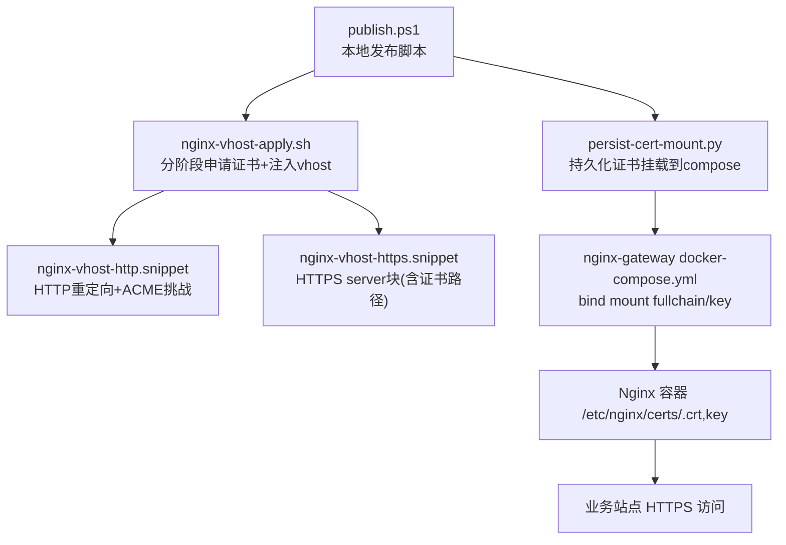
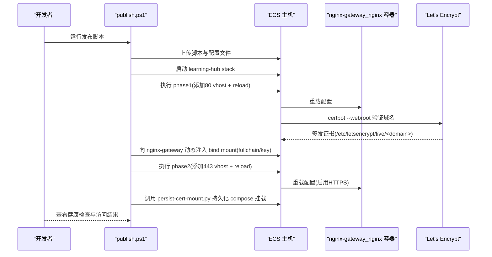
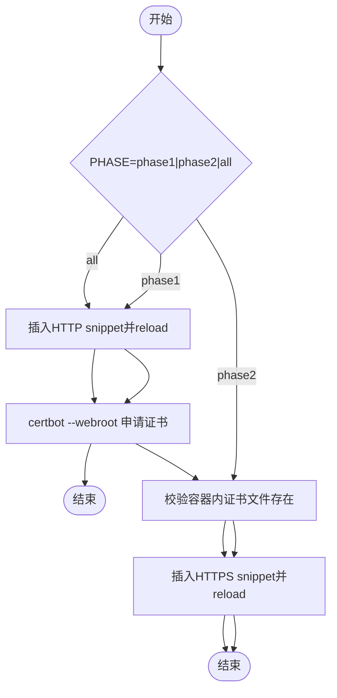
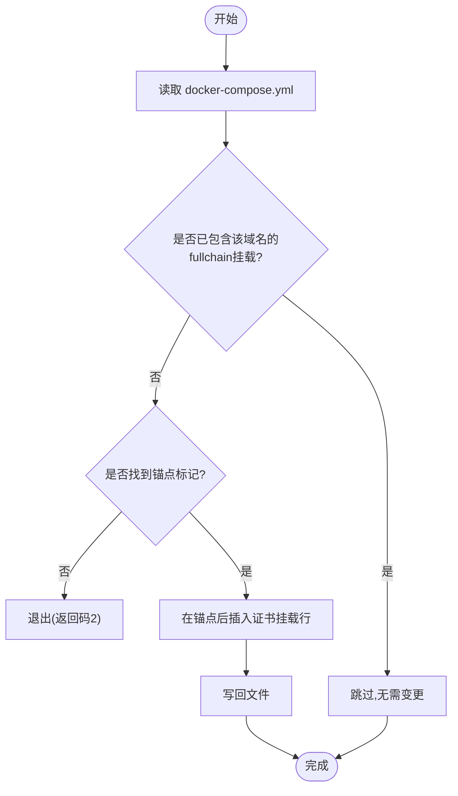
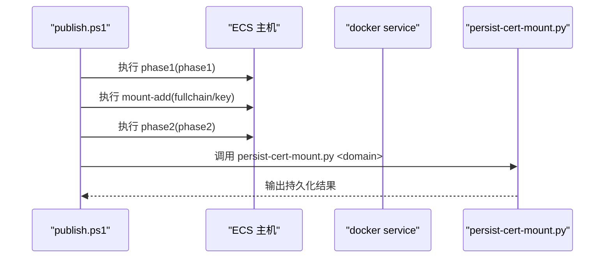
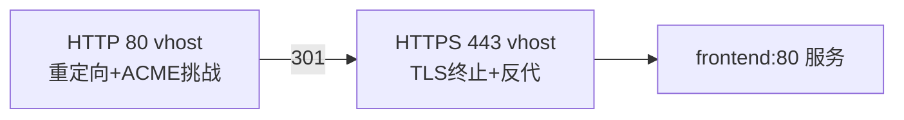
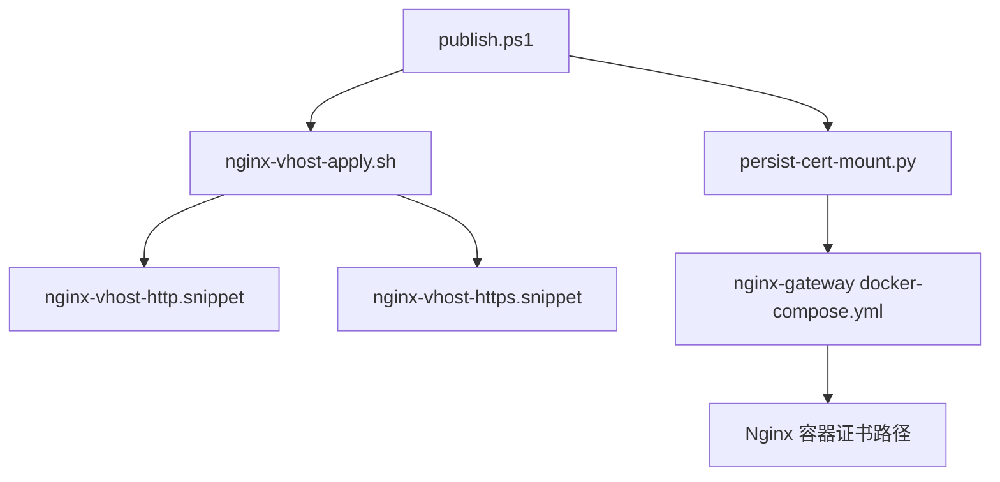

# SSL证书管理

<cite>
**本文引用的文件**
- [deploy/ecs/persist-cert-mount.py](file://deploy/ecs/persist-cert-mount.py)
- [deploy/ecs/nginx-vhost-apply.sh](file://deploy/ecs/nginx-vhost-apply.sh)
- [deploy/ecs/nginx-vhost-http.snippet](file://deploy/ecs/nginx-vhost-http.snippet)
- [deploy/ecs/nginx-vhost-https.snippet](file://deploy/ecs/nginx-vhost-https.snippet)
- [deploy/ecs/nginx-vhost.snippet](file://deploy/ecs/nginx-vhost.snippet)
- [deploy/ecs/compose.yml](file://deploy/ecs/compose.yml)
- [deploy/ecs/publish.ps1](file://deploy/ecs/publish.ps1)
- [deploy/ecs/remote-setup.sh](file://deploy/ecs/remote-setup.sh)
- [frontend/nginx.conf](file://frontend/nginx.conf)
</cite>

## 目录
1. [简介](#简介)
2. [项目结构](#项目结构)
3. [核心组件](#核心组件)
4. [架构总览](#架构总览)
5. [详细组件分析](#详细组件分析)
6. [依赖关系分析](#依赖关系分析)
7. [性能与可靠性考虑](#性能与可靠性考虑)
8. [故障排查指南](#故障排查指南)
9. [结论](#结论)
10. [附录](#附录)

## 简介
本方案围绕 Let's Encrypt 证书的自动化申请、续期与持久化，结合现有部署脚本与 Nginx 网关配置，形成一套可复用的 SSL 证书管理流程。重点包括：
- 自动申请：通过 certbot webroot 模式在 HTTP 阶段完成域名验证并签发证书。
- 自动续期：基于系统 cron 定时任务调用 certbot renew，并通过钩子触发 Nginx 重载。
- 持久化存储：将证书文件以只读方式挂载到 Nginx 容器内指定路径，确保服务可用且安全。
- 幂等注入：使用 persist-cert-mount.py 将证书挂载条目写入 nginx-gateway 的 docker-compose.yml，保证后续重新部署时仍生效。
- 监控告警：提供证书到期检测与告警建议，避免过期导致的服务中断。
- 多域名与通配符：说明如何扩展至多域名与通配符证书的申请与配置。
- 故障排查与应急：给出常见问题定位方法与手动续期的应急流程。

## 项目结构
与 SSL 证书相关的核心文件位于 deploy/ecs 目录，涵盖证书申请、Nginx vhost 片段、Compose 编排、发布脚本以及证书挂载持久化脚本。前端镜像内的 Nginx 仅负责反向代理，HTTPS 由外部 nginx-gateway 统一处理。

图示来源
- [deploy/ecs/publish.ps1:270-302](file://deploy/ecs/publish.ps1#L270-L302)
- [deploy/ecs/nginx-vhost-apply.sh:82-113](file://deploy/ecs/nginx-vhost-apply.sh#L82-L113)
- [deploy/ecs/nginx-vhost-http.snippet:1-12](file://deploy/ecs/nginx-vhost-http.snippet#L1-L12)
- [deploy/ecs/nginx-vhost-https.snippet:1-42](file://deploy/ecs/nginx-vhost-https.snippet#L1-L42)
- [deploy/ecs/persist-cert-mount.py:1-28](file://deploy/ecs/persist-cert-mount.py#L1-L28)

章节来源
- [deploy/ecs/publish.ps1:270-302](file://deploy/ecs/publish.ps1#L270-L302)
- [deploy/ecs/nginx-vhost-apply.sh:82-113](file://deploy/ecs/nginx-vhost-apply.sh#L82-L113)
- [deploy/ecs/nginx-vhost-http.snippet:1-12](file://deploy/ecs/nginx-vhost-http.snippet#L1-L12)
- [deploy/ecs/nginx-vhost-https.snippet:1-42](file://deploy/ecs/nginx-vhost-https.snippet#L1-L42)
- [deploy/ecs/persist-cert-mount.py:1-28](file://deploy/ecs/persist-cert-mount.py#L1-L28)

## 核心组件
- 证书申请与 vhost 注入：nginx-vhost-apply.sh 分为两个阶段，先注入 80 端口并重载 Nginx，再使用 certbot webroot 申请证书；随后注入 443 端口 server 块并重载。
- 证书挂载持久化：persist-cert-mount.py 检查目标 compose 文件中是否已存在对应域名的证书挂载，若不存在则插入，实现幂等持久化。
- 发布编排：publish.ps1 协调构建镜像、远程部署 stack、执行证书申请与 vhost 注入、注入 bind mount 并持久化到 compose。
- 运行时配置：nginx-vhost-http.snippet 与 nginx-vhost-https.snippet 分别定义 HTTP 重定向与 HTTPS server 块，包含 ACME 挑战路径与安全头。
- 前端 Nginx：frontend/nginx.conf 仅监听 80 并反代后端，不参与 TLS 终止。

章节来源
- [deploy/ecs/nginx-vhost-apply.sh:1-123](file://deploy/ecs/nginx-vhost-apply.sh#L1-L123)
- [deploy/ecs/persist-cert-mount.py:1-28](file://deploy/ecs/persist-cert-mount.py#L1-L28)
- [deploy/ecs/publish.ps1:270-302](file://deploy/ecs/publish.ps1#L270-L302)
- [deploy/ecs/nginx-vhost-http.snippet:1-12](file://deploy/ecs/nginx-vhost-http.snippet#L1-L12)
- [deploy/ecs/nginx-vhost-https.snippet:1-42](file://deploy/ecs/nginx-vhost-https.snippet#L1-L42)
- [frontend/nginx.conf:1-56](file://frontend/nginx.conf#L1-L56)

## 架构总览
下图展示了从本地发布到证书签发、挂载与 Nginx 生效的完整流程。

图示来源
- [deploy/ecs/publish.ps1:270-302](file://deploy/ecs/publish.ps1#L270-L302)
- [deploy/ecs/nginx-vhost-apply.sh:82-113](file://deploy/ecs/nginx-vhost-apply.sh#L82-L113)
- [deploy/ecs/nginx-vhost-http.snippet:1-12](file://deploy/ecs/nginx-vhost-http.snippet#L1-L12)
- [deploy/ecs/nginx-vhost-https.snippet:1-42](file://deploy/ecs/nginx-vhost-https.snippet#L1-L42)
- [deploy/ecs/persist-cert-mount.py:1-28](file://deploy/ecs/persist-cert-mount.py#L1-L28)

## 详细组件分析

### 证书申请与 vhost 注入（nginx-vhost-apply.sh）
- 两阶段设计：
  - Phase1：注入 HTTP server 块（含 /.well-known/acme-challenge 根目录），reload Nginx，然后使用 certbot webroot 申请证书。
  - Phase2：校验容器内证书文件存在后，注入 HTTPS server 块，reload Nginx 使 443 生效。
- 幂等性：通过 marker 判断是否已注入 snippet，避免重复插入。
- 备份策略：每次修改 nginx.conf 前生成带时间戳的 .bak 备份。
- 关键变量：LH_DOMAIN、NGINX_STACK_DIR、STACK_NAME、CERTBOT_WEBROOT、ACME_EMAIL。

图示来源
- [deploy/ecs/nginx-vhost-apply.sh:41-79](file://deploy/ecs/nginx-vhost-apply.sh#L41-L79)
- [deploy/ecs/nginx-vhost-apply.sh:82-113](file://deploy/ecs/nginx-vhost-apply.sh#L82-L113)

章节来源
- [deploy/ecs/nginx-vhost-apply.sh:1-123](file://deploy/ecs/nginx-vhost-apply.sh#L1-L123)

### 证书挂载持久化（persist-cert-mount.py）
- 功能：读取目标 docker-compose.yml，检测是否已存在指定域名的证书挂载条目；若未存在且找到锚点标记，则在锚点后追加 fullchain.pem 与 privkey.pem 的只读绑定挂载。
- 幂等性：若已存在对应域名的挂载，直接返回不修改。
- 适用场景：用于将运行时动态注入的 bind mount 持久化到 compose 文件，确保下次 stack deploy 时仍然生效。

图示来源
- [deploy/ecs/persist-cert-mount.py:1-28](file://deploy/ecs/persist-cert-mount.py#L1-L28)

章节来源
- [deploy/ecs/persist-cert-mount.py:1-28](file://deploy/ecs/persist-cert-mount.py#L1-L28)

### 发布编排与动态挂载（publish.ps1）
- 职责：
  - 构建并保存镜像，scp 到远端，执行 remote-setup.sh 与 db-init.sh。
  - 启动 learning-hub stack。
  - 执行 nginx-vhost-apply.sh 的 phase1 与 phase2。
  - 通过 docker service update --mount-add 动态为 nginx-gateway_nginx 注入证书文件的只读绑定挂载。
  - 调用 persist-cert-mount.py 将挂载信息持久化到 nginx-gateway 的 docker-compose.yml。
- 环境变量：LH_DOMAIN、ACME_EMAIL、NGINX_STACK_DIR、STACK_NAME、CERTBOT_WEBROOT、REMOTE_DIR 等。

图示来源
- [deploy/ecs/publish.ps1:270-302](file://deploy/ecs/publish.ps1#L270-L302)
- [deploy/ecs/persist-cert-mount.py:1-28](file://deploy/ecs/persist-cert-mount.py#L1-L28)

章节来源
- [deploy/ecs/publish.ps1:270-302](file://deploy/ecs/publish.ps1#L270-L302)

### Nginx vhost 片段（HTTP/HTTPS）
- HTTP 片段（nginx-vhost-http.snippet）：
  - 监听 80，server_name 为目标域名。
  - 提供 /.well-known/acme-challenge 静态根目录供 ACME 验证。
  - 其他请求 301 重定向到 https。
- HTTPS 片段（nginx-vhost-https.snippet）：
  - 监听 443 ssl，http2 on。
  - 设置 ssl_certificate 与 ssl_certificate_key 指向容器内 /etc/nginx/certs/<domain>.crt 与 .key。
  - 设置通用安全头与大文件上传超时参数。
  - 反代 upstream 到 frontend 服务。

图示来源
- [deploy/ecs/nginx-vhost-http.snippet:1-12](file://deploy/ecs/nginx-vhost-http.snippet#L1-L12)
- [deploy/ecs/nginx-vhost-https.snippet:1-42](file://deploy/ecs/nginx-vhost-https.snippet#L1-L42)

章节来源
- [deploy/ecs/nginx-vhost-http.snippet:1-12](file://deploy/ecs/nginx-vhost-http.snippet#L1-L12)
- [deploy/ecs/nginx-vhost-https.snippet:1-42](file://deploy/ecs/nginx-vhost-https.snippet#L1-L42)

### 前端 Nginx 配置（frontend/nginx.conf）
- 仅监听 80，作为内部服务入口。
- 提供 SPA fallback、静态资源缓存、PDF.js worker MIME 类型修正。
- 将 /api/ 反代到 backend 服务，注意 swarm 下服务名为 learning-hub_backend。

章节来源
- [frontend/nginx.conf:1-56](file://frontend/nginx.conf#L1-L56)

## 依赖关系分析
- publish.ps1 依赖：
  - nginx-vhost-apply.sh（证书申请与 vhost 注入）
  - persist-cert-mount.py（持久化 compose 挂载）
  - docker service update（动态注入 bind mount）
- nginx-vhost-apply.sh 依赖：
  - certbot（webroot 模式）
  - nginx 容器（reload）
  - nginx-vhost-http.snippet 与 nginx-vhost-https.snippet（vhost 片段）
- 运行时依赖：
  - nginx-gateway 容器需具备 /etc/letsencrypt/live/<domain> 的只读挂载映射到 /etc/nginx/certs/<domain>.crt/.key。

图示来源
- [deploy/ecs/publish.ps1:270-302](file://deploy/ecs/publish.ps1#L270-L302)
- [deploy/ecs/nginx-vhost-apply.sh:1-123](file://deploy/ecs/nginx-vhost-apply.sh#L1-L123)
- [deploy/ecs/persist-cert-mount.py:1-28](file://deploy/ecs/persist-cert-mount.py#L1-L28)

章节来源
- [deploy/ecs/publish.ps1:270-302](file://deploy/ecs/publish.ps1#L270-L302)
- [deploy/ecs/nginx-vhost-apply.sh:1-123](file://deploy/ecs/nginx-vhost-apply.sh#L1-L123)
- [deploy/ecs/persist-cert-mount.py:1-28](file://deploy/ecs/persist-cert-mount.py#L1-L28)

## 性能与可靠性考虑
- 大文件上传：HTTP/HTTPS 片段中设置了较大的 client_max_body_size 与较长的 proxy_send_timeout/proxy_read_timeout，避免上传中断。
- 只读挂载：证书文件以只读方式挂载，降低误改风险。
- 幂等性与备份：vhost 注入与 compose 持久化均具备幂等逻辑，修改前生成备份，便于回滚。
- 健康检查：learning-hub stack 的 frontend 服务内置健康检查，便于快速发现异常。

[本节为通用指导，不涉及具体文件分析]

## 故障排查指南
- 证书未生效或 443 无法访问：
  - 确认 nginx-vhost-apply.sh phase2 已成功执行，且容器内 /etc/nginx/certs/<domain>.crt 与 .key 存在。
  - 检查 nginx-gateway 是否已通过 --mount-add 注入证书文件，并确认 persist-cert-mount.py 已将挂载写入 compose。
- ACME 验证失败：
  - 确认 HTTP 片段已注入，且 /.well-known/acme-challenge 路径可达。
  - 检查 CERTBOT_WEBROOT 目录是否正确，网络连通性与 DNS 解析是否正常。
- 证书过期：
  - 检查系统 cron 是否配置了 certbot renew 定时任务，并在 renew 成功后触发 Nginx 重载。
  - 使用证书到期检测脚本或外部监控平台进行告警。
- 手动续期应急：
  - 在 ECS 上执行 certbot renew --force-renewal，随后 reload nginx 容器。
  - 若容器内证书路径不可见，重新执行 publish.ps1 的证书注入步骤或手动执行 --mount-add。

章节来源
- [deploy/ecs/nginx-vhost-apply.sh:82-113](file://deploy/ecs/nginx-vhost-apply.sh#L82-L113)
- [deploy/ecs/publish.ps1:270-302](file://deploy/ecs/publish.ps1#L270-L302)

## 结论
本方案通过分阶段证书申请、动态挂载与持久化注入，实现了 Let's Encrypt 证书在 Swarm 环境下的自动化管理与高可用性。配合合理的超时与安全头配置、幂等性与备份机制，可有效降低运维复杂度与风险。建议在生产环境中补充证书到期监控与告警，并完善多域名与通配符证书的配置流程。

[本节为总结，不涉及具体文件分析]

## 附录

### 自动续期与监控告警建议
- 自动续期：
  - 在 ECS 主机上配置 cron 定时任务，定期执行 certbot renew。
  - 在 renew 成功钩子中执行 nginx -s reload 或 docker exec <nginx_container> nginx -s reload，确保证书热更新。
- 监控告警：
  - 使用 curl 或专用证书监控工具检查证书剩余天数，低于阈值（如 30 天）发送告警。
  - 对 Nginx 健康状态与 HTTPS 访问成功率进行监控，异常时即时通知。

[本节为通用指导，不涉及具体文件分析]

### 多域名证书与通配符证书
- 多域名证书：
  - 在 nginx-vhost-apply.sh 中扩展 LH_DOMAIN 为多个域名列表，并使用 certbot 的 -d 参数依次声明。
  - 在 nginx-vhost-https.snippet 中为每个域名配置独立的 server_name 与证书路径，或通过 SNI 支持同一证书覆盖多个域名。
- 通配符证书：
  - 使用 certbot 的 DNS 验证方式申请 *.example.com 通配符证书。
  - 在 nginx-vhost-https.snippet 中使用通配符 server_name 与对应的证书路径。
  - 注意 DNS 提供商 API 权限与密钥管理，确保安全。

[本节为通用指导，不涉及具体文件分析]

### 证书目录挂载、权限与备份策略
- 挂载方式：
  - 通过 docker service update --mount-add 将 /etc/letsencrypt/live/<domain>/fullchain.pem 与 privkey.pem 以只读方式挂载到 /etc/nginx/certs/<domain>.crt 与 .key。
- 权限设置：
  - 证书文件保持只读，避免容器内误改。
  - 宿主机上的 /etc/letsencrypt 目录应限制访问权限，仅允许必要用户读写。
- 备份策略：
  - 定期备份 /etc/letsencrypt/live 目录，保留历史版本以便回滚。
  - 对 nginx.conf 与 docker-compose.yml 的变更保留 .bak 与版本控制记录。

章节来源
- [deploy/ecs/publish.ps1:280-286](file://deploy/ecs/publish.ps1#L280-L286)
- [deploy/ecs/nginx-vhost-apply.sh:41-79](file://deploy/ecs/nginx-vhost-apply.sh#L41-L79)
- [deploy/ecs/persist-cert-mount.py:1-28](file://deploy/ecs/persist-cert-mount.py#L1-L28)