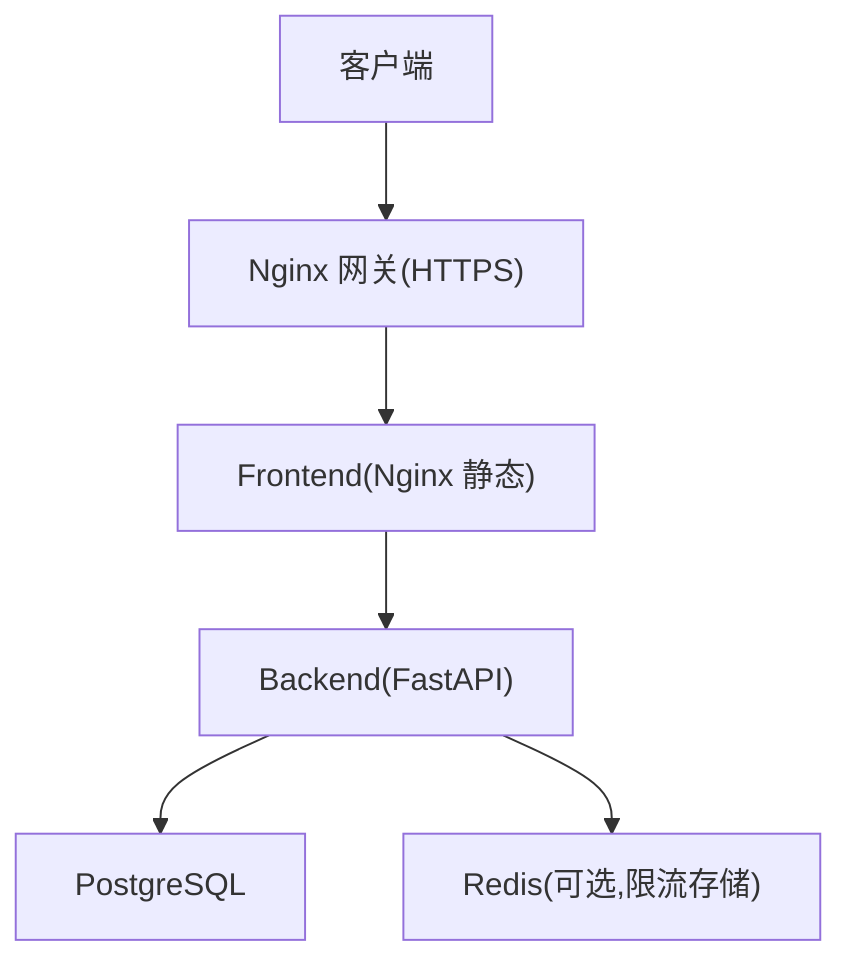
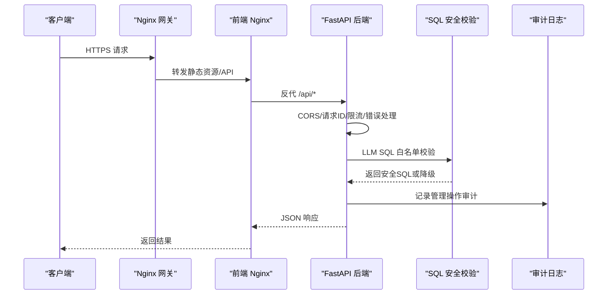
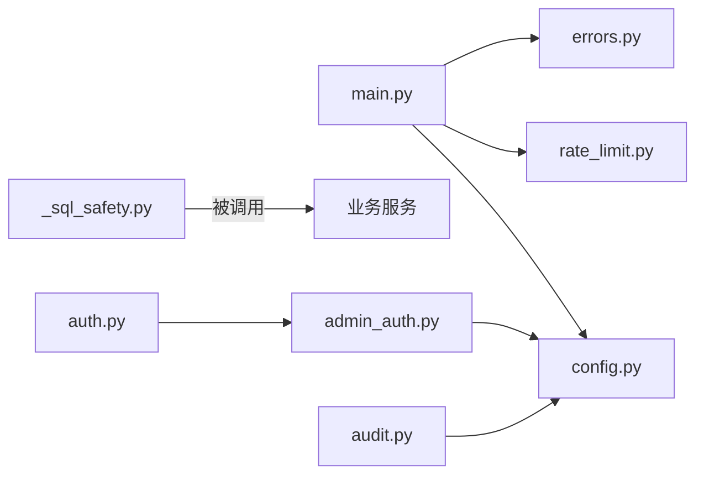

# 安全加固

<cite>
**本文引用的文件**   
- [backend/app/main.py](file://backend/app/main.py)
- [backend/app/core/config.py](file://backend/app/core/config.py)
- [backend/app/core/rate_limit.py](file://backend/app/core/rate_limit.py)
- [backend/app/middleware/admin_auth.py](file://backend/app/middleware/admin_auth.py)
- [backend/app/api/auth.py](file://backend/app/api/auth.py)
- [backend/app/services/_sql_safety.py](file://backend/app/services/_sql_safety.py)
- [backend/app/core/errors.py](file://backend/app/core/errors.py)
- [backend/app/api/public/health.py](file://backend/app/api/public/health.py)
- [backend/app/services/audit.py](file://backend/app/services/audit.py)
- [deploy/ecs/compose.yml](file://deploy/ecs/compose.yml)
- [deploy/ecs/nginx-vhost.snippet](file://deploy/ecs/nginx-vhost.snippet)
- [deploy/ecs/nginx-vhost-https.snippet](file://deploy/ecs/nginx-vhost-https.snippet)
- [deploy/ecs/nginx-vhost-http.snippet](file://deploy/ecs/nginx-vhost-http.snippet)
- [frontend/nginx.conf](file://frontend/nginx.conf)
- [backend/Dockerfile](file://backend/Dockerfile)
- [frontend/Dockerfile](file://frontend/Dockerfile)
</cite>

## 目录
1. [引言](#引言)
2. [项目结构](#项目结构)
3. [核心组件](#核心组件)
4. [架构总览](#架构总览)
5. [详细组件分析](#详细组件分析)
6. [依赖分析](#依赖分析)
7. [性能考虑](#性能考虑)
8. [故障排查指南](#故障排查指南)
9. [结论](#结论)
10. [附录](#附录)

## 引言
本指南面向生产环境，围绕防火墙与网络、容器镜像与运行时、TLS 与网关、应用层输入与访问控制、审计与漏洞扫描等维度，提供可落地的安全加固方案。内容基于仓库现有实现进行提炼与扩展建议，确保在不破坏既有功能的前提下提升整体安全性。

## 项目结构
后端采用 FastAPI 应用，通过中间件与全局异常处理器统一处理跨域、限流、错误响应；前端使用 Nginx 静态服务并反向代理 API；部署以 Docker Compose/Swarm 编排，外部由 Nginx vhost 提供 HTTPS 入口与安全头。

图示来源
- [deploy/ecs/nginx-vhost.snippet:1-56](file://deploy/ecs/nginx-vhost.snippet#L1-L56)
- [deploy/ecs/nginx-vhost-https.snippet:1-42](file://deploy/ecs/nginx-vhost-https.snippet#L1-L42)
- [frontend/nginx.conf:1-56](file://frontend/nginx.conf#L1-L56)
- [backend/app/main.py:40-116](file://backend/app/main.py#L40-L116)
- [deploy/ecs/compose.yml:27-79](file://deploy/ecs/compose.yml#L27-L79)

章节来源
- [backend/app/main.py:40-116](file://backend/app/main.py#L40-L116)
- [deploy/ecs/compose.yml:27-79](file://deploy/ecs/compose.yml#L27-L79)

## 核心组件
- 应用装配与中间件：CORS、请求 ID、限流、统一错误封装
- 认证与会话：Admin JWT 签发与校验、Cookie 安全属性
- 限流策略：SlowAPI + IP/会话键，支持 Redis 持久化
- SQL 安全：LLM 生成 SQL 的七道闸白名单校验
- 健康检查：对外暴露 /api/public/health
- 审计日志：关键管理操作 JSON Lines 记录

章节来源
- [backend/app/main.py:57-102](file://backend/app/main.py#L57-L102)
- [backend/app/middleware/admin_auth.py:16-62](file://backend/app/middleware/admin_auth.py#L16-L62)
- [backend/app/api/auth.py:21-45](file://backend/app/api/auth.py#L21-L45)
- [backend/app/core/rate_limit.py:18-55](file://backend/app/core/rate_limit.py#L18-L55)
- [backend/app/services/_sql_safety.py:165-211](file://backend/app/services/_sql_safety.py#L165-L211)
- [backend/app/api/public/health.py:16-25](file://backend/app/api/public/health.py#L16-L25)
- [backend/app/services/audit.py:21-42](file://backend/app/services/audit.py#L21-L42)

## 架构总览
从外到内，流量经 Nginx 网关（强制 HTTPS、安全头、上传超时）进入前端静态站点，再反代至后端 API。后端在应用层完成鉴权、限流、SQL 安全校验与审计日志写入。

图示来源
- [deploy/ecs/nginx-vhost.snippet:17-55](file://deploy/ecs/nginx-vhost.snippet#L17-L55)
- [frontend/nginx.conf:25-42](file://frontend/nginx.conf#L25-L42)
- [backend/app/main.py:57-102](file://backend/app/main.py#L57-L102)
- [backend/app/services/_sql_safety.py:165-211](file://backend/app/services/_sql_safety.py#L165-L211)
- [backend/app/services/audit.py:21-42](file://backend/app/services/audit.py#L21-L42)

## 详细组件分析

### 防火墙与网络安全（端口开放与IP白名单）
- 仅暴露 80/443 给公网，数据库与内部服务不直接暴露
- 通过 Nginx vhost 将 HTTP 重定向到 HTTPS，并在 HTTPS server 块中启用 http2 与安全头
- 建议在云厂商安全组/主机 iptables 层面限制源 IP 白名单（如运维跳板机、监控探针），对 80/443 放行，其余端口拒绝

章节来源
- [deploy/ecs/nginx-vhost.snippet:17-55](file://deploy/ecs/nginx-vhost.snippet#L17-L55)
- [deploy/ecs/nginx-vhost-https.snippet:8-41](file://deploy/ecs/nginx-vhost-https.snippet#L8-L41)
- [deploy/ecs/nginx-vhost-http.snippet:6-11](file://deploy/ecs/nginx-vhost-http.snippet#L6-L11)

### TLS 加密与证书管理
- 网关层配置 SSL 证书路径与 key，开启 http2
- 所有 HTTP 请求 301 重定向至 HTTPS，避免明文传输
- 建议定期轮换证书，确保证书链完整且域名匹配

章节来源
- [deploy/ecs/nginx-vhost.snippet:27-37](file://deploy/ecs/nginx-vhost.snippet#L27-L37)
- [deploy/ecs/nginx-vhost-https.snippet:8-18](file://deploy/ecs/nginx-vhost-https.snippet#L8-L18)

### 请求限流与 DDoS 防护
- 应用层使用 SlowAPI 实现按 IP 或会话维度的限流，默认内存存储，可通过环境变量切换为 Redis 持久化
- 网关层设置合理的 client_max_body_size、client_body_timeout、proxy_*_timeout，防止大体积请求拖垮上游
- 建议结合云 WAF/CDN 做速率限制与连接数限制，屏蔽恶意 IP 段

章节来源
- [backend/app/core/rate_limit.py:40-55](file://backend/app/core/rate_limit.py#L40-L55)
- [deploy/ecs/nginx-vhost.snippet:41-54](file://deploy/ecs/nginx-vhost.snippet#L41-L54)
- [deploy/ecs/nginx-vhost-https.snippet:22-39](file://deploy/ecs/nginx-vhost-https.snippet#L22-L39)

### 应用层鉴权与会话安全
- Admin 登录接口校验令牌后签发 JWT，并以 HttpOnly、SameSite=Lax 的 Cookie 下发
- 后续请求通过 Depends 解析 Authorization 或 Cookie 中的 Token，校验 exp/sub 字段
- 建议在生产环境中：
  - 使用强随机且独立的 jwt_secret
  - 缩短 TTL，配合刷新机制
  - 增加签名算法白名单与密钥轮换流程

章节来源
- [backend/app/api/auth.py:21-45](file://backend/app/api/auth.py#L21-L45)
- [backend/app/middleware/admin_auth.py:16-62](file://backend/app/middleware/admin_auth.py#L16-L62)
- [backend/app/core/config.py:44-46](file://backend/app/core/config.py#L44-L46)

### 输入验证与 SQL 注入防护
- LLM 生成的 SQL 必须通过“七道闸”校验：去 fence、单语句、无注释、首词 SELECT、黑名单关键字、表白名单、强制 LIMIT
- 失败则回退到关键词搜索，避免执行不安全 SQL
- 建议：
  - 严格限制表名与列名白名单
  - 对查询结果行数与大小做上限控制
  - 对敏感字段输出做脱敏

章节来源
- [backend/app/services/_sql_safety.py:165-211](file://backend/app/services/_sql_safety.py#L165-L211)
- [backend/app/services/_sql_safety.py:23-88](file://backend/app/services/_sql_safety.py#L23-L88)

### XSS 防护与通用安全头
- 网关层添加 X-Content-Type-Options、X-Frame-Options、X-XSS-Protection 等安全头
- 建议：
  - 引入 Content-Security-Policy（CSP）
  - 对富文本输出进行白名单过滤与转义
  - 前端渲染时避免 innerHTML 直写用户输入

章节来源
- [deploy/ecs/nginx-vhost.snippet:35-37](file://deploy/ecs/nginx-vhost.snippet#L35-L37)
- [deploy/ecs/nginx-vhost-https.snippet:16-18](file://deploy/ecs/nginx-vhost-https.snippet#L16-L18)

### 审计与可观测性
- 关键管理操作写入 audit.jsonl，包含时间戳、操作者、动作、资源与载荷摘要
- 建议：
  - 将审计日志挂载到独立卷并集中采集
  - 对敏感字段做脱敏
  - 结合告警规则检测异常行为

章节来源
- [backend/app/services/audit.py:21-42](file://backend/app/services/audit.py#L21-L42)

### 健康检查与可用性
- 暴露 /api/public/health 作为存活探针，供负载均衡与健康检查使用
- 建议：
  - 探针只返回轻量状态，避免依赖外部系统
  - 结合就绪探针区分依赖不可用时的摘除

章节来源
- [backend/app/api/public/health.py:16-25](file://backend/app/api/public/health.py#L16-L25)

### 容器镜像与运行时安全
- 多阶段构建，运行态使用精简基础镜像
- 安装必要系统依赖，关闭不必要的包管理器缓存
- 建议：
  - 启用镜像签名与漏洞扫描（CI 流水线集成）
  - 以非 root 用户运行容器
  - 最小权限原则：只挂载必要卷，禁用特权模式
  - 定期更新基础镜像与依赖

章节来源
- [backend/Dockerfile:1-85](file://backend/Dockerfile#L1-L85)
- [frontend/Dockerfile:1-23](file://frontend/Dockerfile#L1-L23)

### 配置与密钥管理
- 通过环境变量加载配置，包括数据库连接串、JWT 参数、CORS 允许来源、限流存储等
- 建议：
  - 生产环境使用密钥管理服务注入敏感项
  - 禁止在镜像中硬编码密钥
  - 对 CORS 使用精确白名单而非通配符

章节来源
- [backend/app/core/config.py:9-88](file://backend/app/core/config.py#L9-L88)
- [deploy/ecs/compose.yml:31-36](file://deploy/ecs/compose.yml#L31-L36)

## 依赖分析
- 应用入口 main.py 注册路由、中间件与异常处理器，依赖配置、限流器、业务错误码
- 认证模块依赖配置中的 JWT 参数与管理员令牌
- 限流模块依赖配置中的 Redis URL，支持内存/Redis 两种存储
- SQL 安全模块为纯函数，不依赖外部系统，便于测试与回归
- 审计模块依赖存储路径配置，写入 JSON Lines 文件

图示来源
- [backend/app/main.py:40-116](file://backend/app/main.py#L40-L116)
- [backend/app/core/config.py:9-88](file://backend/app/core/config.py#L9-L88)
- [backend/app/core/rate_limit.py:18-55](file://backend/app/core/rate_limit.py#L18-L55)
- [backend/app/core/errors.py:130-144](file://backend/app/core/errors.py#L130-L144)
- [backend/app/api/auth.py:21-45](file://backend/app/api/auth.py#L21-L45)
- [backend/app/middleware/admin_auth.py:16-62](file://backend/app/middleware/admin_auth.py#L16-L62)
- [backend/app/services/_sql_safety.py:165-211](file://backend/app/services/_sql_safety.py#L165-L211)
- [backend/app/services/audit.py:21-42](file://backend/app/services/audit.py#L21-L42)

## 性能考虑
- 网关层调整上传相关超时与缓冲，避免大文件上传中断
- 后端健康检查端点保持轻量，避免阻塞
- 限流存储建议使用 Redis，避免单机内存限流在多副本场景下失效
- 静态资源启用长期缓存，减少重复下载

章节来源
- [frontend/nginx.conf:10-14](file://frontend/nginx.conf#L10-L14)
- [deploy/ecs/nginx-vhost-https.snippet:22-39](file://deploy/ecs/nginx-vhost-https.snippet#L22-L39)
- [backend/app/api/public/health.py:16-25](file://backend/app/api/public/health.py#L16-L25)
- [backend/app/core/rate_limit.py:40-46](file://backend/app/core/rate_limit.py#L40-L46)

## 故障排查指南
- 认证失败：检查 Authorization/Cookie 是否携带有效 Token，确认 jwt_secret 与算法一致
- 限流触发：查看限流键（IP/会话）与阈值，必要时调整策略或扩容
- SQL 校验失败：核对 LLM 输出是否命中黑名单或访问了未授权表，检查 LIMIT 是否生效
- 健康检查失败：确认 /api/public/health 可达，检查依赖服务（DB/Redis）状态
- 审计日志缺失：检查存储路径权限与磁盘空间

章节来源
- [backend/app/middleware/admin_auth.py:26-42](file://backend/app/middleware/admin_auth.py#L26-L42)
- [backend/app/core/rate_limit.py:18-37](file://backend/app/core/rate_limit.py#L18-L37)
- [backend/app/services/_sql_safety.py:165-211](file://backend/app/services/_sql_safety.py#L165-L211)
- [backend/app/api/public/health.py:16-25](file://backend/app/api/public/health.py#L16-L25)
- [backend/app/services/audit.py:21-42](file://backend/app/services/audit.py#L21-L42)

## 结论
通过在网关层实施 HTTPS 与安全头、在应用层强化鉴权与限流、对 LLM 生成的 SQL 执行严格的白名单校验，并结合审计与可观测性措施，可在现有架构基础上显著提升生产环境的安全性。建议持续完善镜像签名与漏洞扫描、最小权限与密钥管理等实践，形成闭环的安全运营体系。

## 附录

### 安全加固清单（建议）
- 防火墙与安全组
  - 仅开放 80/443，限制源 IP 白名单
  - 数据库与内部服务不暴露公网
- 容器与镜像
  - 多阶段构建与非 root 运行
  - 镜像签名与漏洞扫描纳入 CI
  - 定期更新基础镜像与依赖
- 网络与 TLS
  - 强制 HTTPS 与 HSTS（视业务需求）
  - 证书自动续期与到期告警
- 应用层
  - CORS 精确白名单
  - 限流策略按 IP/会话粒度
  - 输入校验与输出转义
  - SQL 白名单与 LIMIT 强制
  - 审计日志集中采集与脱敏
- 运维与合规
  - 密钥管理与轮换
  - 变更审批与发布门禁
  - 安全事件演练与复盘