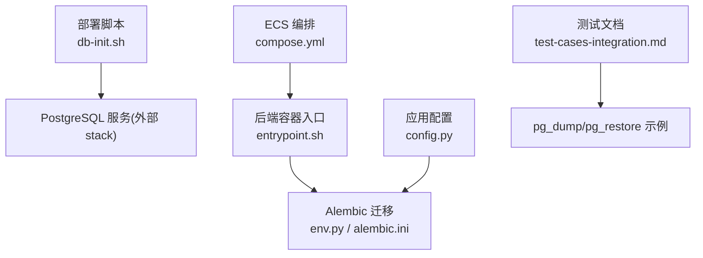
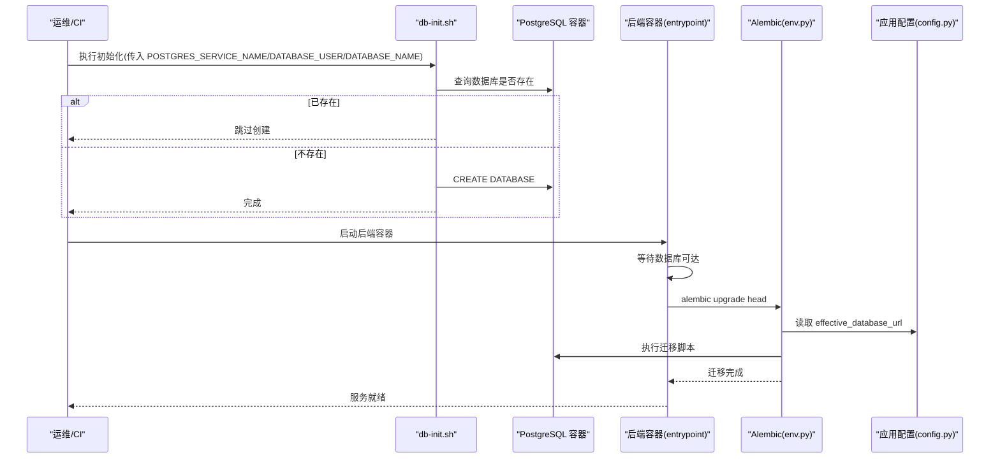
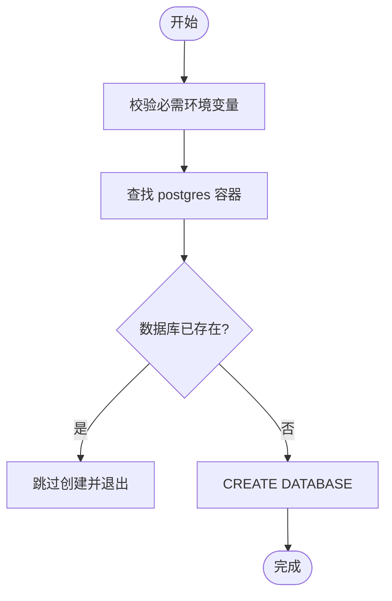
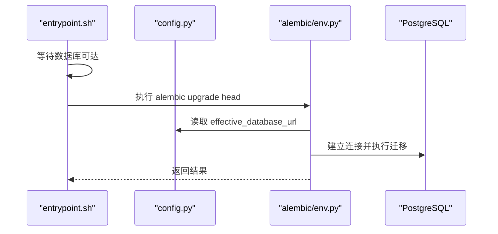
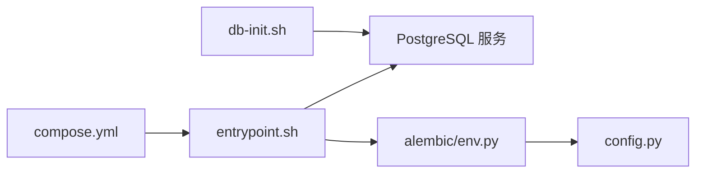

# 数据库初始化

<cite>
**本文引用的文件**   
- [deploy/ecs/db-init.sh](file://deploy/ecs/db-init.sh)
- [backend/app/core/config.py](file://backend/app/core/config.py)
- [backend/alembic/env.py](file://backend/alembic/env.py)
- [backend/entrypoint.sh](file://backend/entrypoint.sh)
- [deploy/ecs/compose.yml](file://deploy/ecs/compose.yml)
- [backend/alembic.ini](file://backend/alembic.ini)
- [doc/test/test-cases-integration.md](file://doc/test/test-cases-integration.md)
</cite>

## 目录
1. [简介](#简介)
2. [项目结构](#项目结构)
3. [核心组件](#核心组件)
4. [架构总览](#架构总览)
5. [详细组件分析](#详细组件分析)
6. [依赖关系分析](#依赖关系分析)
7. [性能考虑](#性能考虑)
8. [故障排查指南](#故障排查指南)
9. [结论](#结论)
10. [附录](#附录)

## 简介
本文件聚焦于“数据库初始化与安全配置”，围绕以下目标展开：
- 说明 db-init.sh 脚本的功能与执行时机，包括数据库创建、用户复用与权限策略。
- 提供 PostgreSQL 安全加固建议（密码策略、连接限制、网络访问控制）。
- 给出备份与恢复流程（全量与增量）及注意事项。
- 列出可参考的性能调优参数与监控指标。
- 说明迁移管理与版本升级注意事项。

## 项目结构
与数据库初始化相关的关键位置如下：
- 部署侧初始化脚本：deploy/ecs/db-init.sh
- 后端容器入口与迁移触发：backend/entrypoint.sh
- Alembic 迁移环境：backend/alembic/env.py、backend/alembic.ini
- 应用配置（含数据库连接串生成）：backend/app/core/config.py
- ECS 编排（Swarm）：deploy/ecs/compose.yml
- 测试用例中关于备份恢复的示例步骤：doc/test/test-cases-integration.md

图表来源
- [deploy/ecs/db-init.sh:1-37](file://deploy/ecs/db-init.sh#L1-L37)
- [backend/entrypoint.sh:1-22](file://backend/entrypoint.sh#L1-L22)
- [backend/alembic/env.py:1-63](file://backend/alembic/env.py#L1-L63)
- [backend/alembic.ini:1-40](file://backend/alembic.ini#L1-L40)
- [backend/app/core/config.py:1-88](file://backend/app/core/config.py#L1-L88)
- [deploy/ecs/compose.yml:1-79](file://deploy/ecs/compose.yml#L1-L79)
- [doc/test/test-cases-integration.md:534-535](file://doc/test/test-cases-integration.md#L534-L535)

章节来源
- [deploy/ecs/db-init.sh:1-37](file://deploy/ecs/db-init.sh#L1-L37)
- [backend/entrypoint.sh:1-22](file://backend/entrypoint.sh#L1-L22)
- [backend/alembic/env.py:1-63](file://backend/alembic/env.py#L1-L63)
- [backend/alembic.ini:1-40](file://backend/alembic.ini#L1-L40)
- [backend/app/core/config.py:1-88](file://backend/app/core/config.py#L1-L88)
- [deploy/ecs/compose.yml:1-79](file://deploy/ecs/compose.yml#L1-L79)
- [doc/test/test-cases-integration.md:534-535](file://doc/test/test-cases-integration.md#L534-L535)

## 核心组件
- 数据库初始化脚本（幂等创建数据库）
  - 通过环境变量定位并进入外部 postgres 容器，检查目标库是否存在，不存在则创建。
  - 不创建数据库用户，复用已有用户，避免跨 stack 授权改动。
- 后端启动与迁移
  - 容器启动时等待数据库可达，随后执行 alembic upgrade head 进行在线迁移。
- 迁移环境
  - env.py 从应用配置读取 effective_database_url，并注入到 alembic 配置；支持离线/在线模式。
  - alembic.ini 提供默认连接串与日志级别。
- 应用配置
  - config.py 负责拼接数据库连接串，优先使用 DATABASE_URL，否则由 host/port/user/password/name 组合生成。
- 编排与环境
  - compose.yml 将 backend 接入外部 postgres_net 网络，并通过环境变量指向外部 postgres 服务名。
- 备份恢复参考
  - 测试文档中包含 pg_dump 与 psql 导入的示例步骤，可作为运维实践参考。

章节来源
- [deploy/ecs/db-init.sh:1-37](file://deploy/ecs/db-init.sh#L1-L37)
- [backend/entrypoint.sh:1-22](file://backend/entrypoint.sh#L1-L22)
- [backend/alembic/env.py:1-63](file://backend/alembic/env.py#L1-L63)
- [backend/alembic.ini:1-40](file://backend/alembic.ini#L1-L40)
- [backend/app/core/config.py:1-88](file://backend/app/core/config.py#L1-L88)
- [deploy/ecs/compose.yml:1-79](file://deploy/ecs/compose.yml#L1-L79)
- [doc/test/test-cases-integration.md:534-535](file://doc/test/test-cases-integration.md#L534-L535)

## 架构总览
下图展示了“部署 → 初始化 → 迁移 → 运行”的整体流程，以及各组件之间的依赖关系。

图表来源
- [deploy/ecs/db-init.sh:1-37](file://deploy/ecs/db-init.sh#L1-L37)
- [backend/entrypoint.sh:1-22](file://backend/entrypoint.sh#L1-L22)
- [backend/alembic/env.py:1-63](file://backend/alembic/env.py#L1-L63)
- [backend/app/core/config.py:1-88](file://backend/app/core/config.py#L1-L88)

## 详细组件分析

### 组件一：db-init.sh 初始化脚本
- 功能要点
  - 幂等性：若目标数据库已存在则直接退出，不会重复创建。
  - 用户策略：复用外部 postgres stack 的现有用户，不新建账号，避免跨 stack 授权变更。
  - 执行方式：通过 docker exec 进入指定 postgres 容器，调用 psql 执行 SQL。
- 关键变量
  - POSTGRES_SERVICE_NAME：外部 postgres 服务名（Swarm DNS 解析）。
  - DATABASE_USER：用于登录 postgres 容器的用户。
  - DATABASE_NAME：目标业务数据库名。
- 执行时机
  - 建议在首次部署或重建 stack 前执行，确保数据库存在后再启动后端。
- 权限说明
  - 当前脚本仅创建数据库，未显式授予额外权限；实际权限取决于外部 postgres stack 的用户与角色策略。

图表来源
- [deploy/ecs/db-init.sh:1-37](file://deploy/ecs/db-init.sh#L1-L37)

章节来源
- [deploy/ecs/db-init.sh:1-37](file://deploy/ecs/db-init.sh#L1-L37)

### 组件二：后端启动与迁移（entrypoint + alembic）
- 启动流程
  - 等待数据库可达（最多重试若干次），失败则退出。
  - 执行 alembic upgrade head，将数据库结构升级到最新版本。
- 迁移环境
  - env.py 从应用配置加载 effective_database_url，并设置到 alembic 配置项。
  - 支持 offline/online 两种模式；生产通常使用 online 模式。
- 默认连接串
  - alembic.ini 包含默认连接串，但运行时会被 env.py 覆盖为 effective_database_url。

图表来源
- [backend/entrypoint.sh:1-22](file://backend/entrypoint.sh#L1-L22)
- [backend/alembic/env.py:1-63](file://backend/alembic/env.py#L1-L63)
- [backend/app/core/config.py:1-88](file://backend/app/core/config.py#L1-L88)

章节来源
- [backend/entrypoint.sh:1-22](file://backend/entrypoint.sh#L1-L22)
- [backend/alembic/env.py:1-63](file://backend/alembic/env.py#L1-L63)
- [backend/alembic.ini:1-40](file://backend/alembic.ini#L1-L40)
- [backend/app/core/config.py:1-88](file://backend/app/core/config.py#L1-L88)

### 组件三：应用配置与连接串
- 连接串优先级
  - 若设置 DATABASE_URL，则直接使用。
  - 否则根据 database_host、database_port、database_user、database_password、database_name 自动拼接。
- 作用域
  - 该配置同时被后端服务与 Alembic 迁移使用，保证一致性与可替换性。

章节来源
- [backend/app/core/config.py:1-88](file://backend/app/core/config.py#L1-L88)
- [backend/alembic/env.py:1-63](file://backend/alembic/env.py#L1-L63)

### 组件四：编排与环境隔离
- 网络
  - backend 服务加入外部 postgres_net 网络，通过 Swarm DNS 解析到外部 postgres 服务名。
- 卷
  - lh_storage 用于持久化素材文件，与数据库无关，但影响整体可用性。
- 健康检查
  - frontend 定义了健康检查；backend 的健康检查内置在镜像中。

章节来源
- [deploy/ecs/compose.yml:1-79](file://deploy/ecs/compose.yml#L1-L79)

## 依赖关系分析
- 初始化阶段
  - db-init.sh 依赖外部 postgres stack 的网络与服务名。
- 启动阶段
  - entrypoint.sh 依赖数据库可达与应用配置。
  - Alembic 依赖有效连接串与迁移脚本集合。
- 配置耦合
  - config.py 与 env.py 共同决定最终连接串，需保持环境变量一致性。

图表来源
- [deploy/ecs/db-init.sh:1-37](file://deploy/ecs/db-init.sh#L1-L37)
- [backend/entrypoint.sh:1-22](file://backend/entrypoint.sh#L1-L22)
- [backend/alembic/env.py:1-63](file://backend/alembic/env.py#L1-L63)
- [backend/app/core/config.py:1-88](file://backend/app/core/config.py#L1-L88)
- [deploy/ecs/compose.yml:1-79](file://deploy/ecs/compose.yml#L1-L79)

## 性能考虑
- 连接池与超时
  - 建议在生产环境中合理设置连接池大小与超时时间，避免连接耗尽或长事务阻塞。
- 查询限流与保护
  - LLM-to-SQL 路径对输出 SQL 进行白名单与 LIMIT 强制，防止大结果集拖垮数据库。
- 监控指标
  - 非功能需求文档中定义了 HTTP、数据库、LLM 等关键指标的基线，可用于容量规划与告警阈值设定。

章节来源
- [backend/app/services/_sql_safety.py:1-220](file://backend/app/services/_sql_safety.py#L1-L220)
- [doc/spec/06-非功能需求.md:125-136](file://doc/spec/06-非功能需求.md#L125-L136)

## 故障排查指南
- 数据库不可达
  - 检查环境变量是否指向正确的服务名与端口；确认外部 postgres stack 已部署且网络互通。
- 迁移失败
  - 查看 alembic 日志；确认 effective_database_url 正确；必要时回滚到上一版本再重试。
- 权限问题
  - 当前脚本不创建用户，请确认外部 postgres 用户的权限足以创建/访问目标数据库。
- 备份恢复验证
  - 参考测试文档中的 pg_dump 与 psql 导入步骤，验证备份可用性与恢复流程。

章节来源
- [backend/entrypoint.sh:1-22](file://backend/entrypoint.sh#L1-L22)
- [backend/alembic/env.py:1-63](file://backend/alembic/env.py#L1-L63)
- [doc/test/test-cases-integration.md:534-535](file://doc/test/test-cases-integration.md#L534-L535)

## 结论
- 初始化采用“最小权限、幂等创建”的策略，简化了跨 stack 授权复杂度。
- 迁移与运行解耦，entrypoint 负责等待与升级，env.py 统一连接串来源。
- 安全方面，SQL 白名单与 LIMIT 强制降低了风险面；数据库层的安全加固建议见下文附录。
- 备份恢复有测试用例作为参考，建议结合生产环境制定更完善的周期与演练计划。

## 附录

### A. PostgreSQL 安全加固建议（通用指导）
- 密码策略
  - 启用强密码策略与定期轮换；避免使用默认口令。
- 连接限制
  - 设置最大连接数、单用户并发上限；按需调整超时时序。
- 网络访问控制
  - 仅允许受信任网段访问；对外暴露需经反向代理与 TLS 终止。
- 审计与日志
  - 开启必要日志记录（连接、DDL、错误），集中收集与分析。
- 最小权限原则
  - 应用账户仅授予必要 schema 的只读/读写权限；禁止超级用户直连。

[本节为通用建议，不直接分析具体代码文件]

### B. 备份与恢复流程（基于仓库内参考）
- 全量备份
  - 使用 pg_dump 导出目标数据库至文件。
- 恢复流程
  - 使用 psql 将备份文件导入目标数据库，然后重启服务以验证状态。
- 增量备份
  - 可结合 WAL 归档与时间点恢复（PITR）实现增量能力；需在生产环境评估与演练。

章节来源
- [doc/test/test-cases-integration.md:534-535](file://doc/test/test-cases-integration.md#L534-L535)

### C. 迁移管理与版本升级注意事项
- 迁移顺序
  - 始终先执行 alembic upgrade head，确保结构与数据模型一致。
- 回滚策略
  - 保留最近若干版本的迁移脚本；回滚前评估数据兼容性与锁表影响。
- 多实例部署
  - 确保只有一个实例执行迁移，或使用分布式锁机制避免并发冲突。
- 连接串一致性
  - 所有实例共享同一 effective_database_url，避免不同步导致迁移异常。

章节来源
- [backend/entrypoint.sh:1-22](file://backend/entrypoint.sh#L1-L22)
- [backend/alembic/env.py:1-63](file://backend/alembic/env.py#L1-L63)
- [backend/alembic.ini:1-40](file://backend/alembic.ini#L1-L40)
- [backend/app/core/config.py:1-88](file://backend/app/core/config.py#L1-L88)