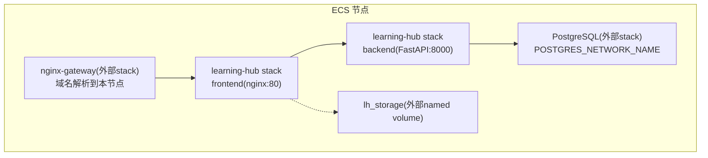
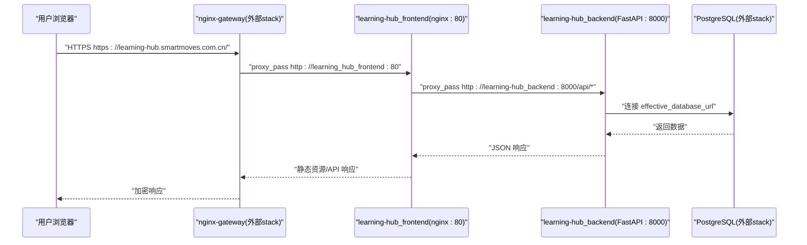
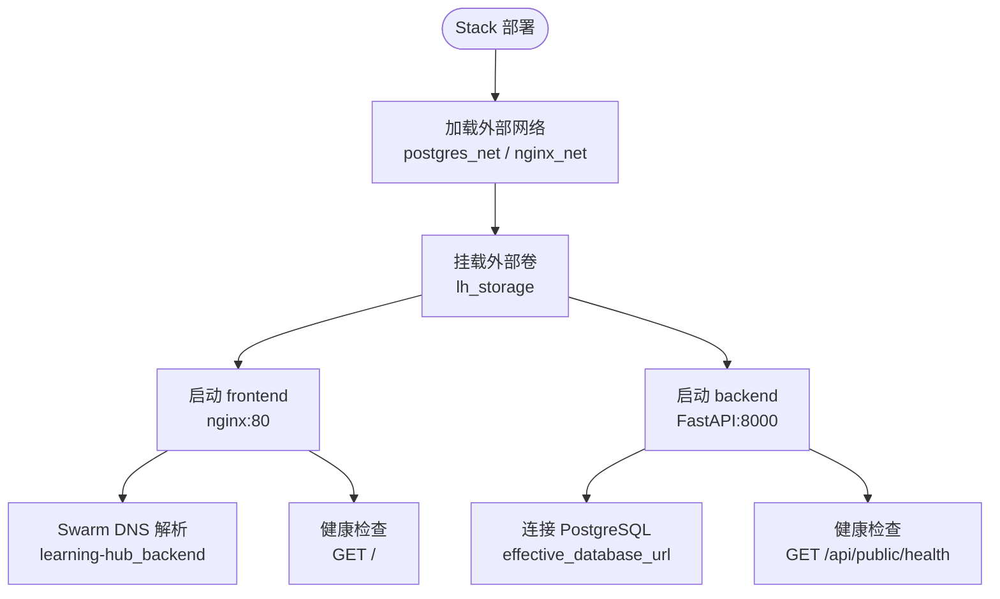
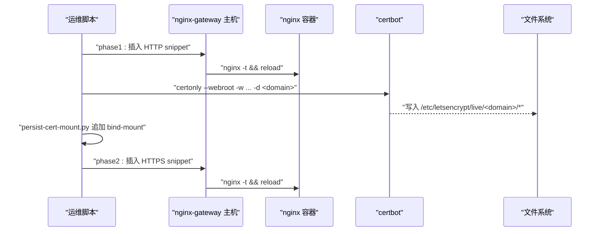
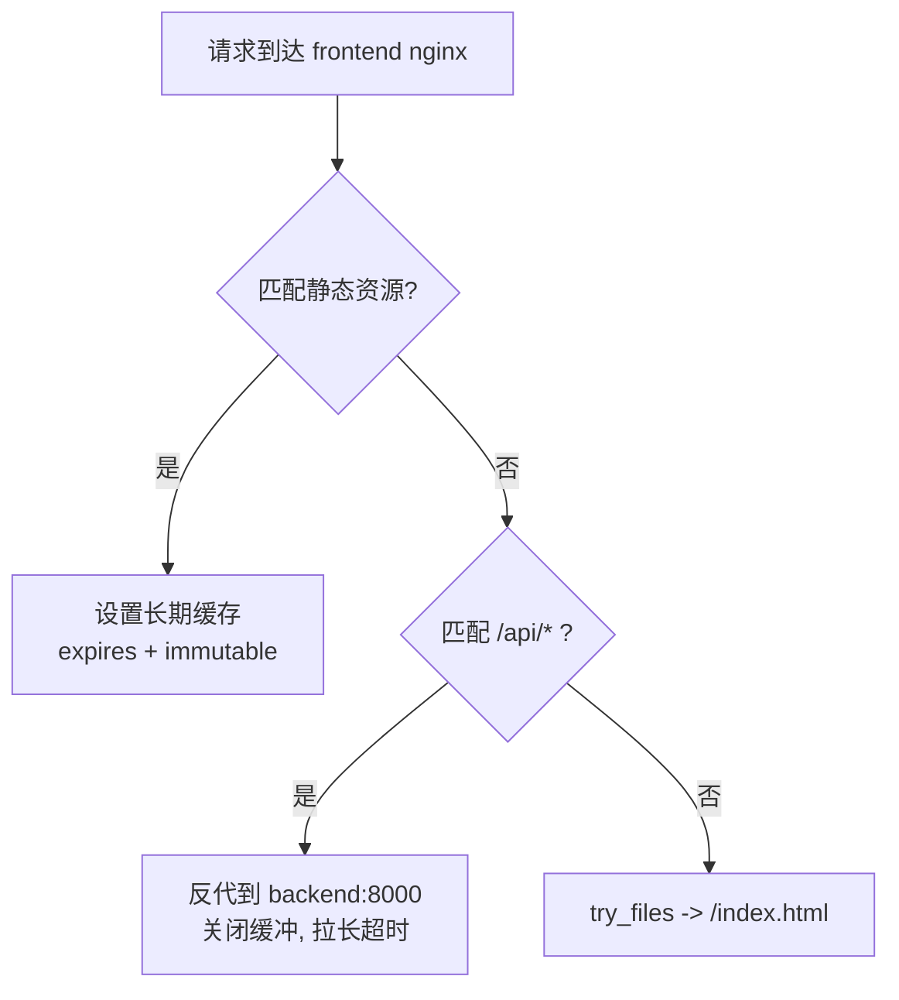
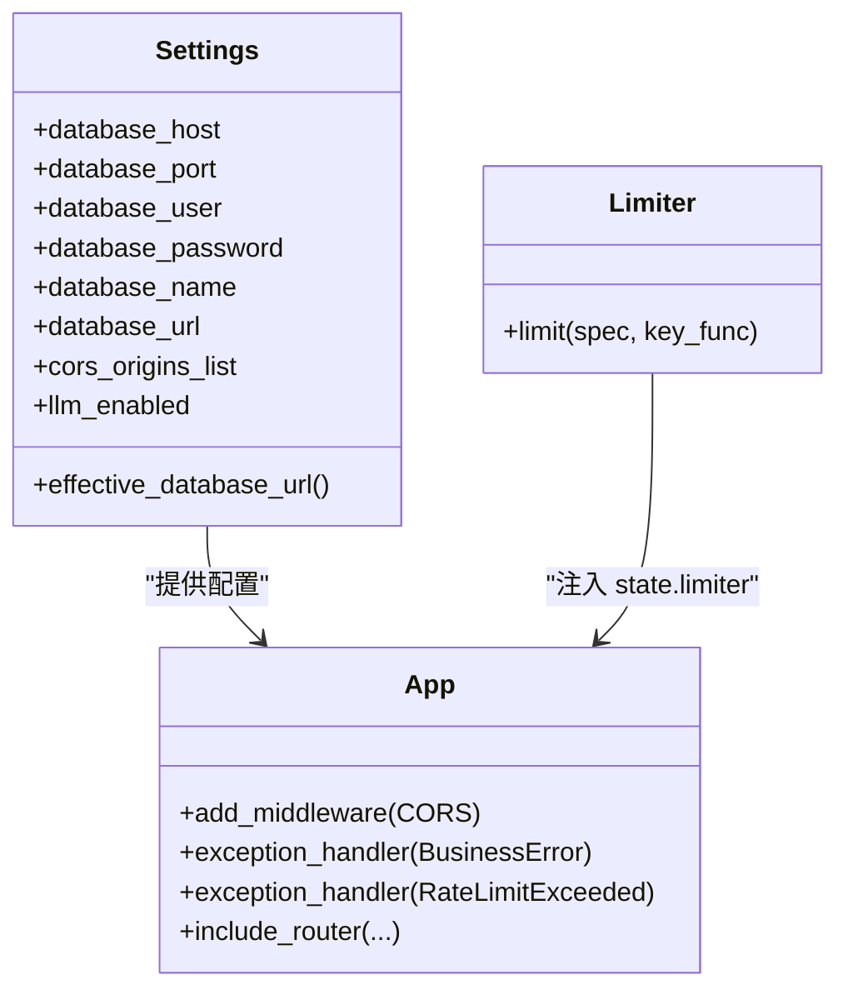
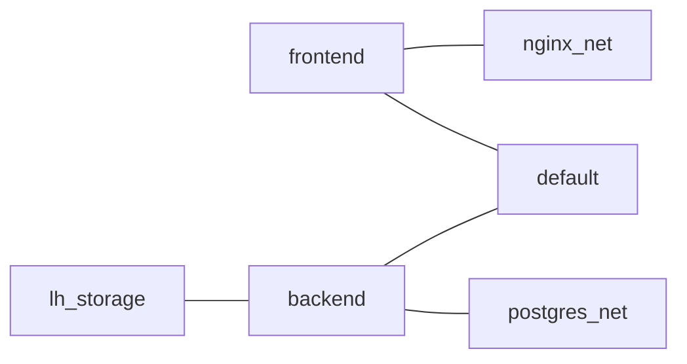

# 生产环境部署

<cite>
**本文引用的文件**   
- [deploy/ecs/compose.yml](file://deploy/ecs/compose.yml)
- [deploy/ecs/nginx-vhost.snippet](file://deploy/ecs/nginx-vhost.snippet)
- [deploy/ecs/nginx-vhost-http.snippet](file://deploy/ecs/nginx-vhost-http.snippet)
- [deploy/ecs/nginx-vhost-https.snippet](file://deploy/ecs/nginx-vhost-https.snippet)
- [deploy/ecs/nginx-vhost-apply.sh](file://deploy/ecs/nginx-vhost-apply.sh)
- [deploy/ecs/persist-cert-mount.py](file://deploy/ecs/persist-cert-mount.py)
- [deploy/ecs/db-init.sh](file://deploy/ecs/db-init.sh)
- [backend/Dockerfile](file://backend/Dockerfile)
- [frontend/Dockerfile](file://frontend/Dockerfile)
- [frontend/nginx.conf](file://frontend/nginx.conf)
- [backend/app/main.py](file://backend/app/main.py)
- [backend/app/core/config.py](file://backend/app/core/config.py)
- [backend/app/core/rate_limit.py](file://backend/app/core/rate_limit.py)
- [backend/entrypoint.sh](file://backend/entrypoint.sh)
- [deploy/ecs/check.sh](file://deploy/ecs/check.sh)
- [deploy/ecs/verify.sh](file://deploy/ecs/verify.sh)
</cite>

## 目录
1. [简介](#简介)
2. [项目结构](#项目结构)
3. [核心组件](#核心组件)
4. [架构总览](#架构总览)
5. [详细组件分析](#详细组件分析)
6. [依赖关系分析](#依赖关系分析)
7. [性能考虑](#性能考虑)
8. [故障排查指南](#故障排查指南)
9. [结论](#结论)
10. [附录](#附录)

## 简介
本方案面向 Learning Hub 的生产环境，基于阿里云 ECS 与 Docker Swarm v3.8 实现容器化多服务编排。整体采用“Nginx 反向代理 + 前端静态站点 + FastAPI 后端”的分层架构，通过外部 overlay 网络复用既有数据库与网关服务，结合 Let's Encrypt 自动证书签发与持久化挂载，提供高可用、可观测、可扩展的部署形态。文档覆盖：
- 多服务编排与负载均衡（Swarm）
- Nginx 反向代理与安全头、大文件上传优化
- HTTP→HTTPS 重定向与 ACME 验证路径保留
- SSL 证书自动续期与持久化
- 数据库初始化与迁移策略
- 安全加固（限流、CORS、最小权限）
- 监控与健康检查、日志收集建议

## 项目结构
生产相关脚本与配置集中在 deploy/ecs 目录；前后端各自包含独立 Dockerfile；后端应用入口、配置与限流逻辑位于 backend/app 下。

图示来源
- [deploy/ecs/compose.yml:1-79](file://deploy/ecs/compose.yml#L1-L79)
- [backend/Dockerfile:1-85](file://backend/Dockerfile#L1-L85)
- [frontend/Dockerfile:1-23](file://frontend/Dockerfile#L1-L23)

章节来源
- [deploy/ecs/compose.yml:1-79](file://deploy/ecs/compose.yml#L1-L79)
- [backend/Dockerfile:1-85](file://backend/Dockerfile#L1-L85)
- [frontend/Dockerfile:1-23](file://frontend/Dockerfile#L1-L23)

## 核心组件
- 编排与网络
  - 使用外部 overlay 网络 postgres_net 与 nginx_net，以及外部命名卷 lh_storage，避免重复创建并与其他 stack 共享资源。
  - 服务 placement 约束在 manager 节点，便于集中管理。
- 前端服务
  - 基于 nginx:alpine 提供静态资源，内置 SPA fallback、静态缓存、Gzip 压缩、大文件上传超时调优，并将 /api/* 反代至同 stack 的 backend 服务。
- 后端服务
  - FastAPI 应用，暴露健康检查 /api/public/health，集成 CORS、请求 ID、限流异常处理、统一错误信封。
  - 启动前等待数据库可达并执行 Alembic 迁移。
- 证书与反向代理
  - 通过两阶段脚本将 HTTP 与 HTTPS vhost 片段插入到 nginx-gateway 的 nginx.conf，并使用 certbot webroot 申请证书；随后将证书以只读方式 bind-mount 到 nginx 容器内。

章节来源
- [deploy/ecs/compose.yml:12-79](file://deploy/ecs/compose.yml#L12-L79)
- [frontend/nginx.conf:1-56](file://frontend/nginx.conf#L1-L56)
- [backend/app/main.py:1-116](file://backend/app/main.py#L1-L116)
- [backend/entrypoint.sh:1-23](file://backend/entrypoint.sh#L1-L23)
- [deploy/ecs/nginx-vhost-apply.sh:1-123](file://deploy/ecs/nginx-vhost-apply.sh#L1-L123)
- [deploy/ecs/persist-cert-mount.py:1-28](file://deploy/ecs/persist-cert-mount.py#L1-L28)

## 架构总览
下图展示了从浏览器到后端 API 的完整链路，包括证书挂载、反向代理、Swarm DNS 解析与数据库访问。

图示来源
- [deploy/ecs/nginx-vhost.snippet:1-56](file://deploy/ecs/nginx-vhost.snippet#L1-L56)
- [deploy/ecs/nginx-vhost-https.snippet:1-42](file://deploy/ecs/nginx-vhost-https.snippet#L1-L42)
- [frontend/nginx.conf:25-42](file://frontend/nginx.conf#L25-L42)
- [deploy/ecs/compose.yml:27-79](file://deploy/ecs/compose.yml#L27-L79)
- [backend/app/core/config.py:19-38](file://backend/app/core/config.py#L19-L38)

## 详细组件分析

### 编排与服务定义（Docker Swarm）
- 外部网络与卷
  - 复用 POSTGRES_NETWORK_NAME 与 NGINX_NETWORK_NAME 两个外部 overlay 网络，使 frontend 可通过 swarm DNS 解析到 backend 服务名。
  - 复用 lh_storage 命名卷，持久化后端素材文件。
- 服务部署
  - backend 与 frontend 均设置 replicas=1，restart_policy 为 on-failure，placement 约束在 manager 节点。
  - frontend 提供健康检查（wget 访问根路径），backend 镜像内置 HEALTHCHECK（curl 访问 /api/public/health）。
- 环境变量注入
  - compose 显式补全 DATABASE_HOST、DATABASE_PORT、TZ 等，确保后端能正确连接数据库。

图示来源
- [deploy/ecs/compose.yml:12-79](file://deploy/ecs/compose.yml#L12-L79)
- [backend/Dockerfile:80-85](file://backend/Dockerfile#L80-L85)
- [frontend/Dockerfile:20-23](file://frontend/Dockerfile#L20-L23)

章节来源
- [deploy/ecs/compose.yml:12-79](file://deploy/ecs/compose.yml#L12-L79)

### Nginx 反向代理与证书管理
- 两阶段 vhost 注入
  - phase1：插入仅含 80 server 的片段，reload nginx，使用 certbot --webroot 申请证书，保留 /.well-known/acme-challenge 用于 ACME 验证。
  - phase2：校验容器内证书存在后，插入含 upstream 与 443 server 的片段，reload nginx。
- 证书持久化
  - 通过 persist-cert-mount.py 将新签发的证书路径以只读方式追加到 nginx-gateway 的 docker-compose.yml，确保重启后仍生效。
- 安全与性能
  - 添加通用安全头（X-Content-Type-Options、X-Frame-Options、X-XSS-Protection）。
  - 调整 client_max_body_size、client_body_timeout、proxy_send/read_timeout，适配大文件上传场景。
  - 关闭 proxy_request_buffering，边收边转发，避免磁盘缓冲。

图示来源
- [deploy/ecs/nginx-vhost-apply.sh:82-123](file://deploy/ecs/nginx-vhost-apply.sh#L82-L123)
- [deploy/ecs/nginx-vhost-http.snippet:1-12](file://deploy/ecs/nginx-vhost-http.snippet#L1-L12)
- [deploy/ecs/nginx-vhost-https.snippet:1-42](file://deploy/ecs/nginx-vhost-https.snippet#L1-L42)
- [deploy/ecs/persist-cert-mount.py:1-28](file://deploy/ecs/persist-cert-mount.py#L1-L28)

章节来源
- [deploy/ecs/nginx-vhost-apply.sh:1-123](file://deploy/ecs/nginx-vhost-apply.sh#L1-L123)
- [deploy/ecs/nginx-vhost.snippet:1-56](file://deploy/ecs/nginx-vhost.snippet#L1-L56)
- [deploy/ecs/nginx-vhost-http.snippet:1-12](file://deploy/ecs/nginx-vhost-http.snippet#L1-L12)
- [deploy/ecs/nginx-vhost-https.snippet:1-42](file://deploy/ecs/nginx-vhost-https.snippet#L1-L42)
- [deploy/ecs/persist-cert-mount.py:1-28](file://deploy/ecs/persist-cert-mount.py#L1-L28)

### 前端静态站点与缓存
- 构建产物由 Node 镜像编译生成，最终由 nginx:alpine 提供静态资源。
- 关键优化
  - Gzip 启用，对常见文本类型进行压缩。
  - 静态资源（js/css/svg/png/jpg/woff2）设置长期缓存与 immutable。
  - PDF.js worker 明确 MIME 类型并设置合理缓存。
  - 大文件上传相关超时参数拉高，关闭 request body 缓冲，避免中间磁盘落盘。
- 路由与反代
  - SPA fallback 指向 index.html。
  - /api/* 反代到同 stack 的 backend 服务，透传 Host、X-Real-IP、X-Forwarded-*、X-Request-Id。

图示来源
- [frontend/nginx.conf:1-56](file://frontend/nginx.conf#L1-L56)
- [frontend/Dockerfile:1-23](file://frontend/Dockerfile#L1-L23)

章节来源
- [frontend/nginx.conf:1-56](file://frontend/nginx.conf#L1-L56)
- [frontend/Dockerfile:1-23](file://frontend/Dockerfile#L1-L23)

### 后端应用与数据库初始化
- 应用装配
  - 注册 CORS、SlowAPI 限流器、统一错误处理、请求 ID 中间件。
  - 暴露 /api/docs、/api/redoc、/api/openapi.json 文档端点。
- 配置加载
  - Settings 支持 .env 覆盖，优先使用 DATABASE_URL，否则拼接 host/port/user/password/name。
  - 提供 LLM 开关、时区、存储路径、PPT 转换工具路径等配置项。
- 启动流程
  - entrypoint 等待数据库可达，执行 alembic upgrade head，再启动 uvicorn。
- 数据库初始化
  - db-init.sh 幂等检查并创建 learning_hub 数据库，复用已有 postgres stack 的用户。

图示来源
- [backend/app/core/config.py:1-88](file://backend/app/core/config.py#L1-L88)
- [backend/app/core/rate_limit.py:1-55](file://backend/app/core/rate_limit.py#L1-L55)
- [backend/app/main.py:1-116](file://backend/app/main.py#L1-L116)

章节来源
- [backend/app/main.py:1-116](file://backend/app/main.py#L1-L116)
- [backend/app/core/config.py:1-88](file://backend/app/core/config.py#L1-L88)
- [backend/app/core/rate_limit.py:1-55](file://backend/app/core/rate_limit.py#L1-L55)
- [backend/entrypoint.sh:1-23](file://backend/entrypoint.sh#L1-L23)
- [deploy/ecs/db-init.sh:1-37](file://deploy/ecs/db-init.sh#L1-L37)

## 依赖关系分析
- 网络依赖
  - frontend 同时接入 default 与 nginx_net，以便被外部 nginx-gateway 访问；同时通过 default 网络访问 backend。
  - backend 接入 default 与 postgres_net，通过 POSTGRES_SERVICE_NAME 解析到数据库服务。
- 存储依赖
  - lh_storage 命名卷挂载到后端 /app/storage，用于持久化素材文件。
- 外部依赖
  - 复用外部 postgres stack 与 nginx-gateway stack，减少重复配置与资源占用。

图示来源
- [deploy/ecs/compose.yml:14-41](file://deploy/ecs/compose.yml#L14-L41)

章节来源
- [deploy/ecs/compose.yml:14-41](file://deploy/ecs/compose.yml#L14-L41)

## 性能考虑
- 前端
  - 启用 gzip，针对 JS/CSS/JSON/文本进行压缩。
  - 静态资源设置长期缓存与 immutable，提升二次访问速度。
  - 大文件上传关闭请求体缓冲，拉长 send/read/body 超时，避免中断。
- 后端
  - 使用异步框架与连接池（psycopg2/asyncpg），配合合理的超时与重试策略。
  - 可选 Redis 作为 SlowAPI 存储，跨实例共享限流计数。
- 反向代理
  - 上游 keepalive 与正确的头部透传，减少握手开销。
  - 安全头降低攻击面，不影响性能。

[本节为通用指导，不直接分析具体文件]

## 故障排查指南
- 服务状态与日志
  - 使用 check.sh 查看 service 列表、stack 任务状态与后端最近日志。
- 端到端验证
  - 使用 verify.sh 快速验证健康接口、鉴权拦截、公开接口与前端页面特征。
- 常见问题定位
  - 证书未生效：确认 nginx-gateway 容器内已挂载证书路径，且 phase2 已执行。
  - 大文件上传失败：检查 frontend 与 nginx-gateway 的 client_max_body_size 与超时参数是否一致。
  - 数据库不可达：检查 compose 中 DATABASE_HOST/PORT/USER/PASSWORD/NAME 是否正确，entrypoint 会等待数据库可达。

章节来源
- [deploy/ecs/check.sh:1-10](file://deploy/ecs/check.sh#L1-L10)
- [deploy/ecs/verify.sh:1-14](file://deploy/ecs/verify.sh#L1-L14)
- [backend/entrypoint.sh:1-23](file://backend/entrypoint.sh#L1-L23)

## 结论
本方案以最小侵入的方式复用现有基础设施（PostgreSQL、nginx-gateway），通过 Docker Swarm 完成多服务编排，结合两阶段 vhost 注入与证书持久化，实现了自动化、可重复的生产部署。前端与后端均内置健康检查与必要的性能优化，配合统一的限流与错误处理，满足生产环境的稳定性与可维护性要求。后续可在现有基础上扩展横向扩容、集中日志采集与指标告警体系。

[本节为总结性内容，不直接分析具体文件]

## 附录

### 部署清单与步骤要点
- 前置条件
  - 已在 ECS 上运行 postgres stack 与 nginx-gateway stack，并创建外部 overlay 网络与命名卷。
- 发布与编排
  - 将 compose.yml 推送至目标节点，执行 docker stack deploy -c compose.yml learning-hub。
- 证书与域名
  - 执行 nginx-vhost-apply.sh phase1 插入 HTTP 片段并申请证书；执行 phase2 插入 HTTPS 片段并 reload。
  - 使用 persist-cert-mount.py 将证书 bind-mount 追加到 nginx-gateway 的 docker-compose.yml。
- 数据库初始化
  - 运行 db-init.sh 幂等创建 learning_hub 数据库。
- 验证
  - 使用 verify.sh 进行基本连通性与鉴权测试。

章节来源
- [deploy/ecs/compose.yml:1-79](file://deploy/ecs/compose.yml#L1-L79)
- [deploy/ecs/nginx-vhost-apply.sh:1-123](file://deploy/ecs/nginx-vhost-apply.sh#L1-L123)
- [deploy/ecs/persist-cert-mount.py:1-28](file://deploy/ecs/persist-cert-mount.py#L1-L28)
- [deploy/ecs/db-init.sh:1-37](file://deploy/ecs/db-init.sh#L1-L37)
- [deploy/ecs/verify.sh:1-14](file://deploy/ecs/verify.sh#L1-L14)