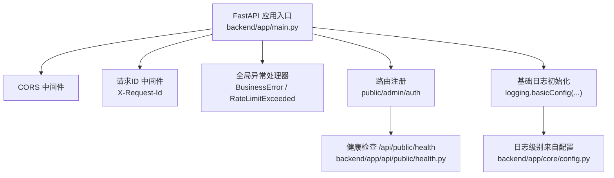
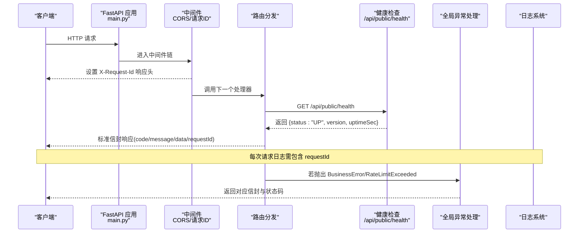
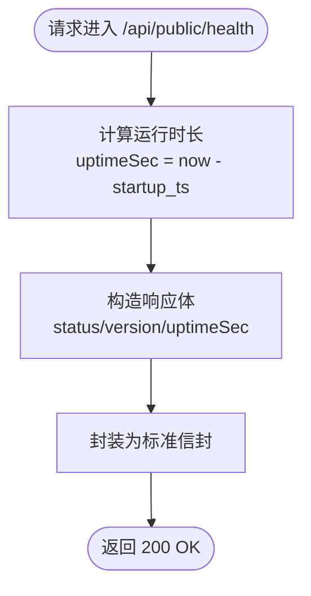
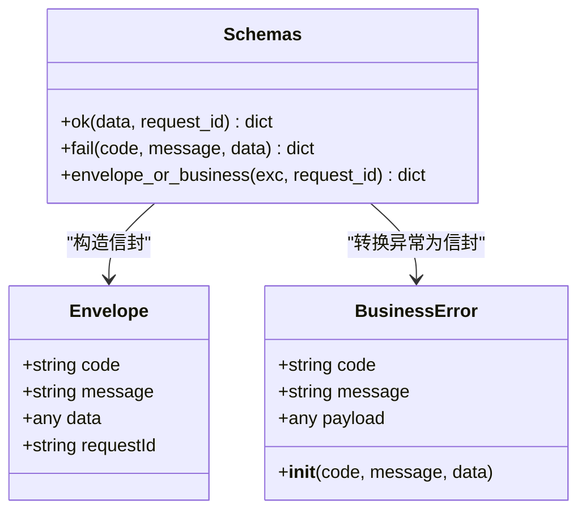
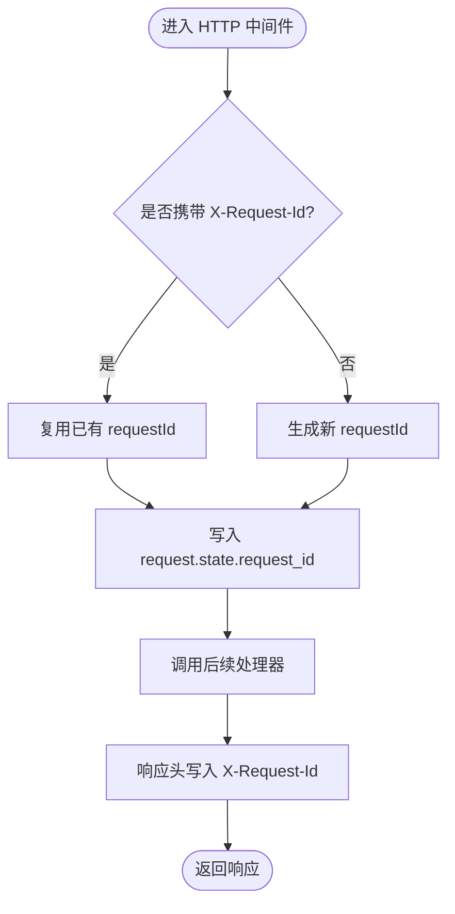
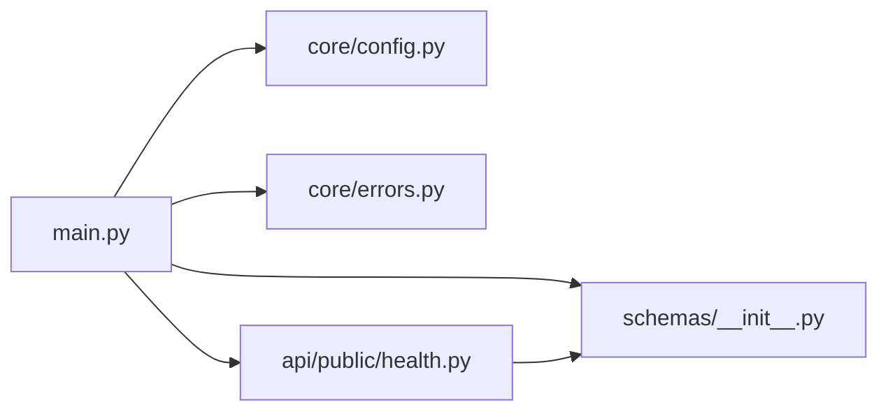

# 监控与日志

<cite>
**本文引用的文件**   
- [backend/app/main.py](file://backend/app/main.py)
- [backend/app/core/config.py](file://backend/app/core/config.py)
- [backend/app/api/public/health.py](file://backend/app/api/public/health.py)
- [backend/app/schemas/__init__.py](file://backend/app/schemas/__init__.py)
- [backend/app/core/errors.py](file://backend/app/core/errors.py)
- [doc/spec/06-非功能需求.md](file://doc/spec/06-非功能需求.md)
- [deploy/local/deploy-lh-local.ps1](file://deploy/local/deploy-lh-local.ps1)
</cite>

## 目录
1. [引言](#引言)
2. [项目结构](#项目结构)
3. [核心组件](#核心组件)
4. [架构总览](#架构总览)
5. [详细组件分析](#详细组件分析)
6. [依赖分析](#依赖分析)
7. [性能考虑](#性能考虑)
8. [故障排查指南](#故障排查指南)
9. [结论](#结论)
10. [附录](#附录)

## 引言
本方案面向 Learning Hub 后端服务，构建一套可落地的“监控 + 日志 + 健康检查 + 错误追踪 + 告警”一体化方案。目标包括：
- 明确关键指标（API 响应时间、数据库查询耗时、LLM 调用耗时、上传耗时、错误率等）的采集与展示路径
- 提供结构化日志配置（级别、格式、输出目标），并保证每条日志携带请求标识以便跨层对位
- 建立统一的异常处理与错误上报流程（含堆栈跟踪与业务码映射）
- 实现健康检查端点，支撑负载均衡与编排系统可用性探测
- 给出日志聚合与分析建议（如 ELK Stack），以及告警规则与通知机制

## 项目结构
当前后端基于 FastAPI，应用入口负责中间件装配、路由注册、全局异常处理与基础日志初始化；配置通过环境变量加载；健康检查以独立路由暴露。

图示来源
- [backend/app/main.py:32-37](file://backend/app/main.py#L32-L37)
- [backend/app/main.py:57-76](file://backend/app/main.py#L57-L76)
- [backend/app/main.py:78-90](file://backend/app/main.py#L78-L90)
- [backend/app/main.py:91-102](file://backend/app/main.py#L91-L102)
- [backend/app/api/public/health.py:16-25](file://backend/app/api/public/health.py#L16-L25)
- [backend/app/core/config.py:72-74](file://backend/app/core/config.py#L72-L74)

章节来源
- [backend/app/main.py:1-116](file://backend/app/main.py#L1-L116)
- [backend/app/core/config.py:1-88](file://backend/app/core/config.py#L1-L88)
- [backend/app/api/public/health.py:1-26](file://backend/app/api/public/health.py#L1-L26)

## 核心组件
- 统一响应信封：所有成功/失败响应均包裹为 {code, message, data, requestId}，便于前端与监控系统一致解析
- 全局异常处理：将业务异常 BusinessError 与限流异常 RateLimitExceeded 转换为标准信封响应，并附带 requestId
- 请求链路标识：中间件注入 X-Request-Id，并在响应头回写，确保全链路可追踪
- 健康检查：/api/public/health 返回 UP 状态、版本与运行时长，供探针使用
- 配置化日志：log_level 由 Settings 提供，启动时初始化 logging

章节来源
- [backend/app/schemas/__init__.py:24-61](file://backend/app/schemas/__init__.py#L24-L61)
- [backend/app/core/errors.py:130-143](file://backend/app/core/errors.py#L130-L143)
- [backend/app/main.py:70-76](file://backend/app/main.py#L70-L76)
- [backend/app/main.py:78-90](file://backend/app/main.py#L78-L90)
- [backend/app/api/public/health.py:16-25](file://backend/app/api/public/health.py#L16-L25)
- [backend/app/core/config.py:72-74](file://backend/app/core/config.py#L72-L74)

## 架构总览
下图展示了从请求进入、中间件处理、路由分发、异常处理到健康检查的整体流程，并标注了监控与日志的关键接入点。

图示来源
- [backend/app/main.py:57-76](file://backend/app/main.py#L57-L76)
- [backend/app/main.py:78-90](file://backend/app/main.py#L78-L90)
- [backend/app/api/public/health.py:16-25](file://backend/app/api/public/health.py#L16-L25)
- [backend/app/schemas/__init__.py:35-61](file://backend/app/schemas/__init__.py#L35-L61)

## 详细组件分析

### 健康检查与健康探针
- 端点：GET /api/public/health
- 行为：返回服务状态、版本与运行时长，用于 Liveness Probe 与外部监控
- 集成方式：容器编排或负载均衡器定时访问该端点判定存活

图示来源
- [backend/app/api/public/health.py:13-25](file://backend/app/api/public/health.py#L13-L25)
- [backend/app/schemas/__init__.py:35-42](file://backend/app/schemas/__init__.py#L35-L42)

章节来源
- [backend/app/api/public/health.py:1-26](file://backend/app/api/public/health.py#L1-L26)

### 统一响应与错误信封
- 成功响应：ok(data, request_id) → {code:"ok", message:"ok", data, requestId}
- 失败响应：fail(code, message, data) → {code, message, data, requestId:null}
- 业务异常：BusinessError 被全局处理器捕获，转为信封并附加 requestId

图示来源
- [backend/app/schemas/__init__.py:24-61](file://backend/app/schemas/__init__.py#L24-L61)
- [backend/app/core/errors.py:130-143](file://backend/app/core/errors.py#L130-L143)

章节来源
- [backend/app/schemas/__init__.py:1-65](file://backend/app/schemas/__init__.py#L1-L65)
- [backend/app/core/errors.py:1-144](file://backend/app/core/errors.py#L1-L144)

### 请求链路标识与中间件
- 注入 X-Request-Id：若请求未携带则生成，写入 request.state 并回写到响应头
- 目的：在日志、错误上报、分布式追踪中作为唯一关联键

图示来源
- [backend/app/main.py:70-76](file://backend/app/main.py#L70-L76)

章节来源
- [backend/app/main.py:70-76](file://backend/app/main.py#L70-L76)

### 结构化日志配置
- 日志级别：由 Settings.log_level 控制，默认 INFO
- 日志格式：包含时间戳、级别、模块名与消息文本
- 输出目标：默认输出至标准输出（容器环境下由编排系统收集）
- 最佳实践：在业务代码中使用 logger.getLogger(__name__) 记录结构化字段（如 requestId、userId、action、durationMs 等）

章节来源
- [backend/app/main.py:32-37](file://backend/app/main.py#L32-L37)
- [backend/app/core/config.py:72-74](file://backend/app/core/config.py#L72-L74)

### 健康检查与部署集成
- 本地开发可通过脚本查看健康端点地址
- 生产环境建议由 Nginx/Ingress 或编排系统定期访问 /api/public/health 进行存活探测

章节来源
- [deploy/local/deploy-lh-local.ps1:164-180](file://deploy/local/deploy-lh-local.ps1#L164-L180)

## 依赖分析
- main.py 依赖：
  - CORS 中间件、SlowAPI 限流、路由模块、配置、错误与信封工具
- health.py 依赖：
  - FastAPI Router、统一信封 ok()
- schemas/__init__.py 依赖：
  - BusinessError、ErrorCode 常量
- config.py 提供：
  - log_level、CORS 列表、LLM 开关等运行时配置

图示来源
- [backend/app/main.py:1-116](file://backend/app/main.py#L1-L116)
- [backend/app/api/public/health.py:1-26](file://backend/app/api/public/health.py#L1-L26)
- [backend/app/core/config.py:1-88](file://backend/app/core/config.py#L1-L88)
- [backend/app/core/errors.py:1-144](file://backend/app/core/errors.py#L1-L144)
- [backend/app/schemas/__init__.py:1-65](file://backend/app/schemas/__init__.py#L1-L65)

章节来源
- [backend/app/main.py:1-116](file://backend/app/main.py#L1-L116)
- [backend/app/api/public/health.py:1-26](file://backend/app/api/public/health.py#L1-L26)
- [backend/app/core/config.py:1-88](file://backend/app/core/config.py#L1-L88)
- [backend/app/core/errors.py:1-144](file://backend/app/core/errors.py#L1-L144)
- [backend/app/schemas/__init__.py:1-65](file://backend/app/schemas/__init__.py#L1-L65)

## 性能考虑
- 指标基线与阈值（来自非功能需求）：
  - lh.http.request.duration（P95）≤ 300ms（后台 CRUD）
  - lh.http.request.duration.search（P95）≤ 2s（含 LLM 与降级）
  - lh.db.query.duration（P95）≤ 50ms
  - lh.llm.call.duration（P95）≤ 1.5s
  - lh.llm.timeout.rate ≤ 5%（5 分钟滑动窗口）
  - lh.material.upload.duration（P95）≤ 60s（200MB）
  - lh.token.unlock.fail_rate ≤ 30%（5 分钟滑动窗口）
  - lh.error.5xx.rate ≤ 0.5%
- 日志要求：服务端日志均需包含 X-Request-Id，便于跨服务对位

章节来源
- [doc/spec/06-非功能需求.md:125-136](file://doc/spec/06-非功能需求.md#L125-L136)

## 故障排查指南
- 快速定位
  - 使用 X-Request-Id 在日志系统中检索一次请求的全量轨迹
  - 健康检查失败：优先确认 /api/public/health 可达性与上游依赖（DB、存储、LLM）
- 常见错误码与含义
  - unauthenticated、invalid_admin_token、rate_limited、llm_timeout、token_revoked、last_token_required 等
- 建议步骤
  - 复现问题并记录 requestId
  - 在日志平台按 requestId 过滤，观察中间件、路由、服务层与 DB/LLM 调用耗时
  - 结合错误码与业务上下文判断根因，必要时开启更细粒度日志

章节来源
- [backend/app/core/errors.py:9-127](file://backend/app/core/errors.py#L9-L127)
- [backend/app/main.py:78-90](file://backend/app/main.py#L78-L90)
- [doc/spec/06-非功能需求.md:125-136](file://doc/spec/06-非功能需求.md#L125-L136)

## 结论
当前后端已具备健康检查、统一信封与基础日志能力，满足最小可用监控与排障需求。建议在现有基础上逐步引入：
- 指标采集与可视化（Prometheus + Grafana）
- 结构化日志输出（JSON）与集中式聚合（ELK/ Loki）
- 错误上报与告警（Alertmanager/企业 IM）
- 可选：OpenTelemetry 端到端追踪

## 附录

### 指标采集与展示建议（落地清单）
- API 响应时间
  - 采集点：HTTP 中间件或框架自带计时
  - 指标名：lh.http.request.duration（分桶：CRUD、search、upload）
  - 展示：Grafana 面板（P50/P95/P99、QPS、错误率）
- 数据库查询性能
  - 采集点：ORM 事件或连接池拦截
  - 指标名：lh.db.query.duration、lh.db.query.count
  - 展示：慢查询 TopN、超时次数
- LLM 调用性能
  - 采集点：LLM 客户端前后
  - 指标名：lh.llm.call.duration、lh.llm.timeout.rate
  - 展示：成功率、超时率、模型分布
- 上传与转码
  - 采集点：上传接口与转码任务
  - 指标名：lh.material.upload.duration、lh.ppt.convert.duration
- 资源占用
  - 采集点：进程/容器指标
  - 指标名：process_cpu_seconds_total、process_resident_memory_bytes
- 错误率
  - 采集点：HTTP 状态码统计
  - 指标名：lh.error.5xx.rate、lh.error.by_code

[本节为通用建议，不直接分析具体文件]

### 结构化日志规范（建议）
- 字段建议：ts、level、requestId、service、version、method、path、status、durationMs、userId、action、detail
- 输出目标：stdout（容器编排收集）、可选文件轮转、可选远程服务（如 Kafka/HTTP）
- 级别策略：INFO 默认，DEBUG 仅开发/灰度；ERROR 必须包含 requestId 与必要上下文

[本节为通用建议，不直接分析具体文件]

### 健康检查与探针
- 端点：/api/public/health
- 探针：k8s liveness/readiness、负载均衡健康检查
- 扩展：可加入依赖检查（DB、存储、LLM）后返回整体状态

章节来源
- [backend/app/api/public/health.py:16-25](file://backend/app/api/public/health.py#L16-L25)

### 告警规则与通知（示例）
- 5xx 错误率 > 0.5% 持续 5 分钟
- lh.http.request.duration.search P95 > 2s 持续 10 分钟
- lh.llm.timeout.rate > 5% 持续 5 分钟
- lh.error.5xx.rate > 0.5% 持续 5 分钟
- 通知渠道：邮件、企业 IM、短信（根据严重等级分级）

[本节为通用建议，不直接分析具体文件]