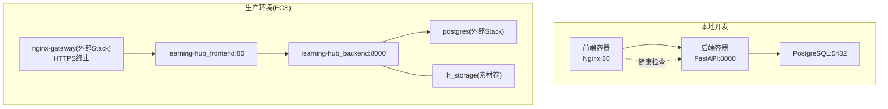
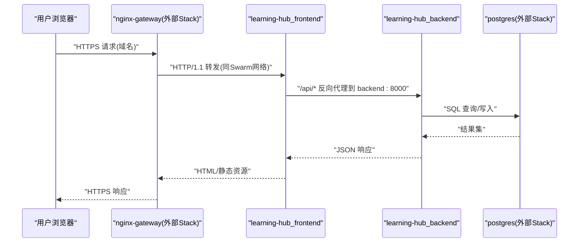
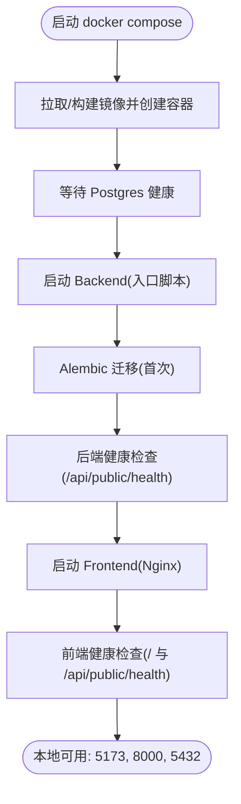
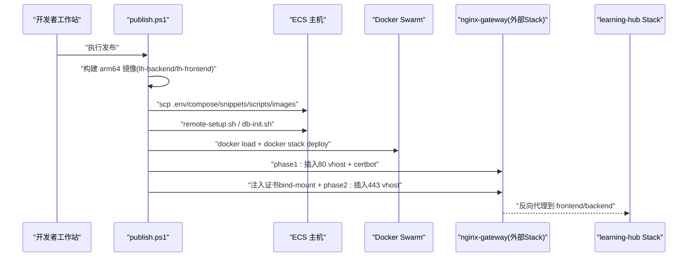
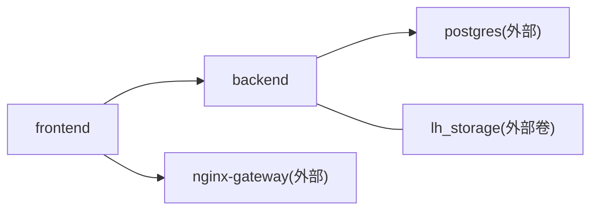

# 部署指南

<cite>
**本文引用的文件**   
- [docker-compose.yml](file://deploy/local/docker-compose.yml)
- [compose.yml](file://deploy/ecs/compose.yml)
- [Dockerfile（后端）](file://backend/Dockerfile)
- [Dockerfile（前端）](file://frontend/Dockerfile)
- [config.py](file://backend/app/core/config.py)
- [entrypoint.sh](file://backend/entrypoint.sh)
- [nginx.conf（前端内置）](file://frontend/nginx.conf)
- [nginx-vhost.snippet](file://deploy/ecs/nginx-vhost.snippet)
- [nginx-vhost-http.snippet](file://deploy/ecs/nginx-vhost-http.snippet)
- [nginx-vhost-https.snippet](file://deploy/ecs/nginx-vhost-https.snippet)
- [nginx-vhost-apply.sh](file://deploy/ecs/nginx-vhost-apply.sh)
- [publish.ps1](file://deploy/ecs/publish.ps1)
- [README.md（本地部署说明）](file://deploy/local/README.md)
- [README.md（ECS 部署文档）](file://doc/deploy/README.md)
</cite>

## 目录
1. [简介](#简介)
2. [项目结构](#项目结构)
3. [核心组件](#核心组件)
4. [架构总览](#架构总览)
5. [详细组件分析](#详细组件分析)
6. [依赖关系分析](#依赖关系分析)
7. [性能考虑](#性能考虑)
8. [故障排查指南](#故障排查指南)
9. [结论](#结论)
10. [附录](#附录)

## 简介
本指南面向 Learning Hub 的完整部署，覆盖本地开发环境（Docker Compose）与生产环境（阿里云 ECS + Docker Swarm）的端到端流程。内容包括服务编排、网络与数据持久化、镜像构建、Nginx 反向代理与 SSL 证书管理、外部依赖（PostgreSQL、Redis、LibreOffice 等）、环境变量与多环境策略、监控与日志、安全加固、故障排查与性能调优建议。

## 项目结构
Learning Hub 采用前后端分离与容器化部署：
- 后端：FastAPI + SQLAlchemy + Alembic，运行于 Python 3.11 容器，暴露 /api 接口，提供健康检查与健康探针。
- 前端：Vite + React 静态资源由 Nginx 提供服务，并反向代理 /api 到后端。
- 数据库：PostgreSQL 16（本地 Compose 自带；生产复用已有 Stack）。
- 可选：Redis（限流/缓存预留），LibreOffice（PPT→PDF 预览），FFmpeg（视频时长探测）。

图示来源
- [docker-compose.yml:1-74](file://deploy/local/docker-compose.yml#L1-L74)
- [compose.yml:1-79](file://deploy/ecs/compose.yml#L1-L79)
- [nginx-vhost.snippet:1-56](file://deploy/ecs/nginx-vhost.snippet#L1-L56)

章节来源
- [docker-compose.yml:1-74](file://deploy/local/docker-compose.yml#L1-L74)
- [compose.yml:1-79](file://deploy/ecs/compose.yml#L1-L79)
- [README.md（ECS 部署文档）:1-120](file://doc/deploy/README.md#L1-L120)

## 核心组件
- 后端镜像与启动
  - 多阶段构建，安装系统依赖（LibreOffice、Poppler、FFmpeg、字体等），Python 依赖通过 pip 安装，暴露 8000 端口，内置 HEALTHCHECK。
  - entrypoint 等待数据库可达后执行 Alembic 迁移，再启动 Uvicorn。
- 前端镜像与反代
  - 构建 Vite 产物，使用 Nginx 提供静态资源，配置大文件上传与 SPA fallback，并将 /api 反向代理到后端服务。
- 配置中心
  - Settings 从环境变量加载，支持 DATABASE_URL 优先、CORS、JWT、存储路径、LibreOffice 路径、LLM 开关等。
- 编排与发布
  - 本地：docker compose 一键拉起三服务，含健康检查与数据卷。
  - 生产：publish.ps1 负责构建 arm64 镜像、打包、scp、远程初始化、stack deploy、证书申请与 vhost 注入。

章节来源
- [Dockerfile（后端）:1-85](file://backend/Dockerfile#L1-L85)
- [entrypoint.sh:1-23](file://backend/entrypoint.sh#L1-L23)
- [Dockerfile（前端）:1-23](file://frontend/Dockerfile#L1-L23)
- [nginx.conf（前端内置）:1-56](file://frontend/nginx.conf#L1-L56)
- [config.py:1-88](file://backend/app/core/config.py#L1-L88)
- [docker-compose.yml:1-74](file://deploy/local/docker-compose.yml#L1-L74)
- [compose.yml:1-79](file://deploy/ecs/compose.yml#L1-L79)
- [publish.ps1:1-299](file://deploy/ecs/publish.ps1#L1-L299)

## 架构总览
下图展示生产环境的请求链路：公网用户经 nginx-gateway 进行 HTTPS 终止与安全头设置，随后将流量转发至 learning-hub_stack 中的 frontend 服务，再由 frontend 内的 Nginx 将 /api 请求反向代理到 backend 服务，最终访问 PostgreSQL 与持久化卷。

图示来源
- [nginx-vhost.snippet:1-56](file://deploy/ecs/nginx-vhost.snippet#L1-L56)
- [compose.yml:1-79](file://deploy/ecs/compose.yml#L1-L79)
- [nginx.conf（前端内置）:1-56](file://frontend/nginx.conf#L1-L56)

## 详细组件分析

### 本地开发环境（Docker Compose）
- 服务编排
  - postgres: 使用官方镜像，暴露 5432，挂载 pgdata 卷，带健康检查。
  - backend: 依赖 postgres 健康状态，挂载 storage 卷，注入数据库连接与管理员凭据、JWT 密钥等。
  - frontend: 依赖 backend，映射 5173:80，覆盖 healthcheck 以强制 IPv4 探测 / 与 /api/public/health。
- 网络与持久化
  - 默认 bridge 网络互通；pgdata 与 storage 为命名卷，保证重启不丢数据。
- 启动与验证
  - 一键启动、健康检查、初始凭据、素材预览与 AI 搜索依赖说明见本地 README。

图示来源
- [docker-compose.yml:1-74](file://deploy/local/docker-compose.yml#L1-L74)
- [entrypoint.sh:1-23](file://backend/entrypoint.sh#L1-L23)

章节来源
- [docker-compose.yml:1-74](file://deploy/local/docker-compose.yml#L1-L74)
- [README.md（本地部署说明）:1-120](file://deploy/local/README.md#L1-L120)

### 生产环境（ECS + Docker Swarm）
- 镜像构建与平台
  - publish.ps1 在本地使用 buildx 构建 linux/arm64 镜像（ECS 为 ARM64），保存为 tar 并 scp 到远端。
- 远程初始化与部署
  - remote-setup.sh 准备工作目录与共享卷 lh_storage。
  - db-init.sh 初始化数据库（如需要）。
  - docker load 载入镜像，docker stack deploy 启动 learning-hub Stack。
- 网络与外部依赖
  - 复用外部 overlay 网络 POSTGRES_NETWORK_NAME 与 NGINX_NETWORK_NAME，分别接入 postgres 与 nginx-gateway。
  - 复用 named volume lh_storage 用于 /app/storage 持久化。
- Nginx 反向代理与 SSL
  - nginx-vhost-apply.sh 分两阶段：phase1 插入 80 server block 并通过 certbot webroot 申请证书；phase2 注入 443 server block 并 reload。
  - 证书通过 bind-mount 注入 nginx-gateway 容器，vhost snippet 定义 upstream 与 proxy 参数。

图示来源
- [publish.ps1:1-299](file://deploy/ecs/publish.ps1#L1-L299)
- [compose.yml:1-79](file://deploy/ecs/compose.yml#L1-L79)
- [nginx-vhost-apply.sh:1-123](file://deploy/ecs/nginx-vhost-apply.sh#L1-L123)
- [nginx-vhost-http.snippet:1-12](file://deploy/ecs/nginx-vhost-http.snippet#L1-L12)
- [nginx-vhost-https.snippet:1-42](file://deploy/ecs/nginx-vhost-https.snippet#L1-L42)

章节来源
- [compose.yml:1-79](file://deploy/ecs/compose.yml#L1-L79)
- [nginx-vhost.snippet:1-56](file://deploy/ecs/nginx-vhost.snippet#L1-L56)
- [nginx-vhost-apply.sh:1-123](file://deploy/ecs/nginx-vhost-apply.sh#L1-L123)
- [publish.ps1:1-299](file://deploy/ecs/publish.ps1#L1-L299)

### 环境变量与配置管理
- 后端配置（Settings）
  - 数据库：DATABASE_HOST/PORT/USER/PASSWORD/NAME 或 DATABASE_URL 优先。
  - 认证：ADMIN_TOKEN、JWT_SECRET/ALGORITHM/TTL。
  - CORS：cors_allow_origins（逗号分隔）。
  - 时区：timezone。
  - 存储：storage_path（默认 /app/storage/documents）。
  - PPT 转图片：libreoffice_path、poppler_path、ppt_convert_timeout。
  - 限流/Redis：storage_redis_url（留空则禁用）。
  - LLM：dashscope_api_key、llm_search_model、超时与行数限制；未配置自动降级关键词检索。
  - 日志：log_level。
- 本地与环境差异
  - 本地 Compose 通过 env_file 与 environment 注入；生产通过 Stack 的 .env 与外部网络变量注入。
  - 敏感信息建议使用 Secrets Manager 或 Docker secrets 注入（生产建议）。

章节来源
- [config.py:1-88](file://backend/app/core/config.py#L1-L88)
- [docker-compose.yml:23-50](file://deploy/local/docker-compose.yml#L23-L50)
- [compose.yml:27-51](file://deploy/ecs/compose.yml#L27-L51)

### 外部依赖部署
- PostgreSQL
  - 本地：Compose 内自建，端口 5432，健康检查。
  - 生产：复用外部 Stack 的 postgres Service，通过 overlay 网络访问。
- Redis
  - 当前未启用（storage_redis_url 留空），可按需引入独立 Redis 服务并在配置中注入 URL。
- LibreOffice 与 FFmpeg
  - 后端镜像已安装 LibreOffice Core/Impress、Poppler、FFmpeg 与中日文字体；PPT→PDF 转换失败会降级为下载。
- PDF.js 静态资源
  - 前端构建期复制 pdf.worker.min.mjs 到 dist，Nginx 明确 MIME 类型并提供缓存。

章节来源
- [Dockerfile（后端）:33-41](file://backend/Dockerfile#L33-L41)
- [Dockerfile（前端）:11-14](file://frontend/Dockerfile#L11-L14)
- [nginx.conf（前端内置）:44-55](file://frontend/nginx.conf#L44-L55)
- [README.md（本地部署说明）:155-258](file://deploy/local/README.md#L155-L258)

### 安全加固措施
- 网络安全
  - 生产仅暴露 80/443 于 nginx-gateway，应用服务不直接对外。
  - 复用外部 overlay 网络隔离不同 Stack 的服务通信。
- 访问控制
  - 管理员令牌 ADMIN_TOKEN 与 JWT 密钥必须强随机且生产替换。
  - CORS 按需收紧 cors_allow_origins。
- 传输加密
  - 全站 HTTPS，证书由 certbot 申请并通过 bind-mount 注入 nginx-gateway。
- 请求体与大文件
  - Nginx 层提高 client_max_body_size、client_body_timeout、proxy_send/read_timeout，避免大文件上传中断。
- SQL 安全（LLM 直写 SQL）
  - 白名单表校验、关键字黑名单、强制 LIMIT、只读事务兜底，详见本地 README 的安全护栏说明。

章节来源
- [nginx-vhost.snippet:24-56](file://deploy/ecs/nginx-vhost.snippet#L24-L56)
- [nginx-vhost-https.snippet:1-42](file://deploy/ecs/nginx-vhost-https.snippet#L1-L42)
- [config.py:40-77](file://backend/app/core/config.py#L40-L77)
- [README.md（本地部署说明）:311-341](file://deploy/local/README.md#L311-L341)

### 监控与日志收集
- 健康检查
  - 后端：HEALTHCHECK 调用 /api/public/health。
  - 前端：覆盖 healthcheck 强制 IPv4 探测 / 与 /api/public/health。
- 日志
  - 后端 uvicorn 输出标准日志；可通过 docker service logs 查看。
  - 建议在生产接入集中式日志采集（如 Filebeat/Fluent Bit → ES/Loki），按容器 stdout/stderr 聚合。
- 应用性能监控
  - 可集成 APM（如 OpenTelemetry + Jaeger/Zipkin），对关键 API 埋点。
- 错误追踪
  - 结合结构化日志与错误码，配合告警规则（如 5xx 比例、慢请求阈值）。

章节来源
- [Dockerfile（后端）:80-83](file://backend/Dockerfile#L80-L83)
- [docker-compose.yml:64-69](file://deploy/local/docker-compose.yml#L64-L69)
- [compose.yml:73-78](file://deploy/ecs/compose.yml#L73-L78)

## 依赖关系分析
- 服务间依赖
  - frontend 依赖 backend（反向代理）。
  - backend 依赖 postgres（数据库）。
  - 生产环境下 frontend 还需接入 nginx-gateway 网络以被上游 vhost 解析。
- 外部依赖
  - PostgreSQL（必需）、Redis（可选）、LibreOffice/FFmpeg（后端镜像内置）。
- 发布流水线依赖
  - publish.ps1 依赖 SSH、SCP、Docker Buildx（ARM64 交叉编译）、certbot（在 nginx-gateway 容器内执行）。

图示来源
- [compose.yml:14-41](file://deploy/ecs/compose.yml#L14-L41)
- [nginx-vhost.snippet:24-56](file://deploy/ecs/nginx-vhost.snippet#L24-L56)

章节来源
- [compose.yml:1-79](file://deploy/ecs/compose.yml#L1-L79)
- [nginx-vhost.snippet:1-56](file://deploy/ecs/nginx-vhost.snippet#L1-L56)

## 性能考虑
- 大文件上传优化
  - Nginx 关闭 request body 缓冲，边收边转发，提升上传吞吐与稳定性。
- 超时与缓冲
  - 合理设置 client_body_timeout、proxy_send/read_timeout，避免长耗时操作被切断。
- 静态资源缓存
  - 前端静态资源开启长期缓存与 immutable 标记，减少带宽与服务器压力。
- 数据库连接
  - 使用连接池（SQLAlchemy 默认行为），确保并发下稳定；必要时调整 pool 参数。
- 镜像体积与构建速度
  - 使用国内镜像源与缓存层优化，减少首次构建时间。

章节来源
- [nginx.conf（前端内置）:7-42](file://frontend/nginx.conf#L7-L42)
- [nginx-vhost-https.snippet:22-41](file://deploy/ecs/nginx-vhost-https.snippet#L22-L41)
- [Dockerfile（后端）:17-31](file://backend/Dockerfile#L17-L31)

## 故障排查指南
- 常见症状与定位
  - 前端健康检查失败：确认 healthcheck 使用 IPv4 探测，且 /api/public/health 可达。
  - 后端无法连接数据库：检查 DATABASE_* 环境变量与网络连通性；entrypoint 会重试并退出。
  - PPT 预览不可用：确认 LibreOffice 安装与路径，查看转换超时与降级行为。
  - 大文件上传中断：核对 Nginx 层超时与缓冲配置。
- 快速命令
  - 查看服务状态：docker stack ps / docker compose ps。
  - 查看日志：docker service logs / docker compose logs。
  - 进入容器：docker exec <container> bash。
  - 验证迁移：alembic current。
- 证书与 vhost
  - 若 443 未生效，检查 phase2 是否成功插入 443 server block 与证书 bind-mount。

章节来源
- [docker-compose.yml:64-69](file://deploy/local/docker-compose.yml#L64-L69)
- [entrypoint.sh:1-23](file://backend/entrypoint.sh#L1-L23)
- [nginx-vhost-apply.sh:82-113](file://deploy/ecs/nginx-vhost-apply.sh#L82-L113)
- [README.md（本地部署说明）:148-154](file://deploy/local/README.md#L148-L154)

## 结论
本指南提供了 Learning Hub 从本地到生产的完整部署方案，涵盖服务编排、网络与持久化、镜像构建、Nginx 反向代理与 SSL、外部依赖、环境变量与多环境策略、监控与日志、安全加固、故障排查与性能调优。按照本文步骤，可在本地快速验证，在 ECS 上稳定发布与运维。

## 附录
- 本地一键启动与验证清单见本地 README。
- ECS 部署骨架与待补充项见 doc/deploy/README.md。

章节来源
- [README.md（本地部署说明）:1-120](file://deploy/local/README.md#L1-L120)
- [README.md（ECS 部署文档）:1-120](file://doc/deploy/README.md#L1-L120)