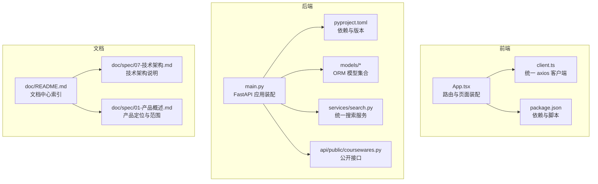
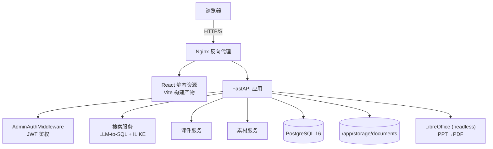
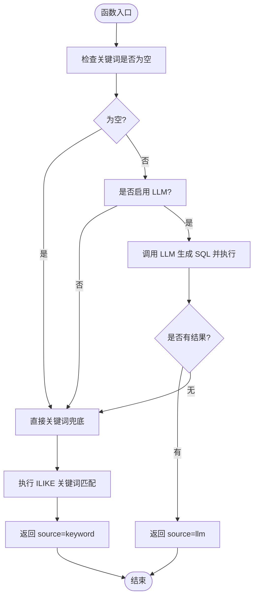
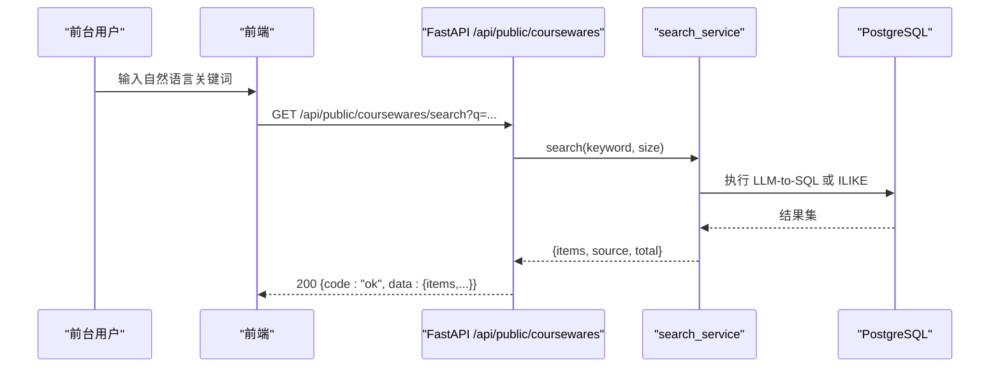
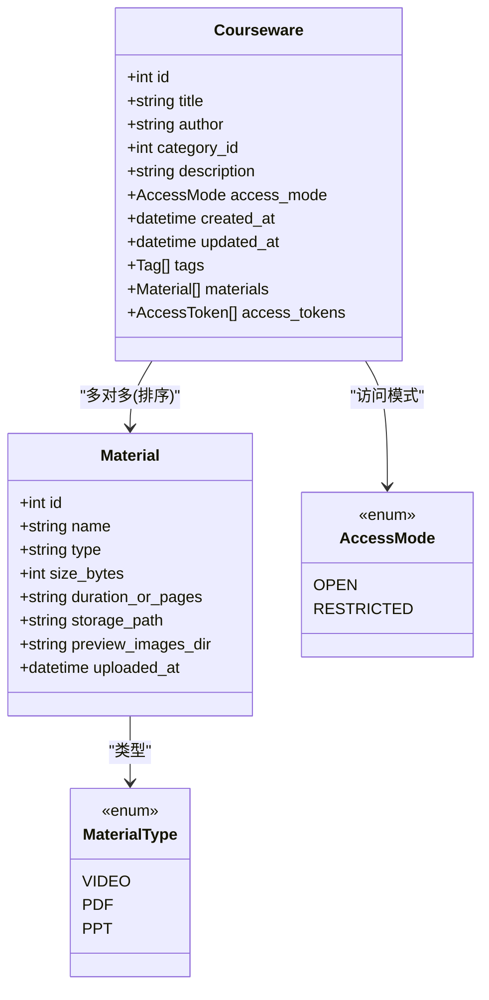
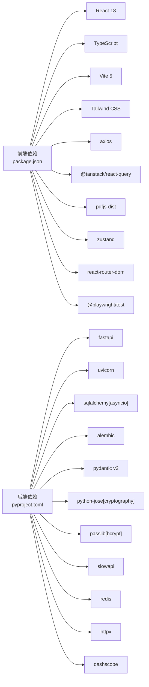

# 项目概述

<cite>
**本文引用的文件**   
- [backend/app/main.py](file://backend/app/main.py)
- [backend/pyproject.toml](file://backend/pyproject.toml)
- [frontend/src/App.tsx](file://frontend/src/App.tsx)
- [frontend/package.json](file://frontend/package.json)
- [doc/README.md](file://doc/README.md)
- [doc/spec/07-技术架构.md](file://doc/spec/07-技术架构.md)
- [doc/spec/01-产品概述.md](file://doc/spec/01-产品概述.md)
- [backend/app/models/__init__.py](file://backend/app/models/__init__.py)
- [backend/app/models/courseware.py](file://backend/app/models/courseware.py)
- [backend/app/models/material.py](file://backend/app/models/material.py)
- [backend/app/services/search.py](file://backend/app/services/search.py)
- [backend/app/api/public/coursewares.py](file://backend/app/api/public/coursewares.py)
- [frontend/src/api/client.ts](file://frontend/src/api/client.ts)
</cite>

## 目录
1. [简介](#简介)
2. [项目结构](#项目结构)
3. [核心组件](#核心组件)
4. [架构总览](#架构总览)
5. [详细组件分析](#详细组件分析)
6. [依赖分析](#依赖分析)
7. [性能考量](#性能考量)
8. [故障排查指南](#故障排查指南)
9. [结论](#结论)
10. [附录](#附录)

## 简介
Learning Hub 是一个以“AI 智能搜索”为核心入口的企业学习资料门户，聚焦于课件管理、素材在线预览与权限控制等核心能力。系统采用前后端分离架构：后端基于 Python FastAPI 提供高性能异步 API，前端基于 React + TypeScript + Vite 构建单页应用；数据层使用 PostgreSQL 进行结构化存储，并通过 LibreOffice 实现 PPT 转 PDF 的在线预览能力。整体设计强调极简检索体验、结构化运营与可观测性，支持前台自然语言搜索、后台全生命周期管理与受限课件访问控制。

## 项目结构
仓库采用多模块组织方式，前后端各自独立工程，文档集中存放于 doc 目录，部署脚本位于 deploy 目录。

图表来源
- [frontend/src/App.tsx:1-110](file://frontend/src/App.tsx#L1-L110)
- [frontend/src/api/client.ts:1-52](file://frontend/src/api/client.ts#L1-L52)
- [frontend/package.json:1-40](file://frontend/package.json#L1-L40)
- [backend/app/main.py:1-116](file://backend/app/main.py#L1-L116)
- [backend/pyproject.toml:1-47](file://backend/pyproject.toml#L1-L47)
- [backend/app/models/__init__.py:1-30](file://backend/app/models/__init__.py#L1-L30)
- [backend/app/services/search.py:1-263](file://backend/app/services/search.py#L1-L263)
- [backend/app/api/public/coursewares.py:1-133](file://backend/app/api/public/coursewares.py#L1-L133)
- [doc/README.md:1-112](file://doc/README.md#L1-L112)
- [doc/spec/07-技术架构.md:1-222](file://doc/spec/07-技术架构.md#L1-L222)
- [doc/spec/01-产品概述.md:1-95](file://doc/spec/01-产品概述.md#L1-L95)

章节来源
- [doc/README.md:1-112](file://doc/README.md#L1-L112)
- [doc/spec/07-技术架构.md:1-222](file://doc/spec/07-技术架构.md#L1-L222)
- [doc/spec/01-产品概述.md:1-95](file://doc/spec/01-产品概述.md#L1-L95)

## 核心组件
- 后端应用装配与中间件
  - 统一创建 FastAPI 应用，注册 CORS、限流、请求 ID、异常处理与路由。
  - 参考路径：[backend/app/main.py:1-116](file://backend/app/main.py#L1-L116)
- 前端 SPA 路由与状态同步
  - 前台单 URL 内通过 store/view 切换页面，后台走 /admin 子路由。
  - 参考路径：[frontend/src/App.tsx:1-110](file://frontend/src/App.tsx#L1-L110)
- 统一 HTTP 客户端
  - 自动注入 X-Request-Id、统一业务信封解析与错误抛出。
  - 参考路径：[frontend/src/api/client.ts:1-52](file://frontend/src/api/client.ts#L1-L52)
- 统一搜索服务（LLM-to-SQL + ILIKE 兜底）
  - 优先调用大模型生成 SQL，失败或禁用时回退到关键词匹配。
  - 参考路径：[backend/app/services/search.py:1-263](file://backend/app/services/search.py#L1-L263)
- 公开课件接口（搜索、详情、解锁）
  - 支持 OPEN/RESTRICTED 两种访问模式，令牌校验与 Cookie 下发。
  - 参考路径：[backend/app/api/public/coursewares.py:1-133](file://backend/app/api/public/coursewares.py#L1-L133)
- 数据模型（课件、素材、关联关系）
  - 定义 Courseware、Material、AccessMode 等实体与关系。
  - 参考路径：
    - [backend/app/models/__init__.py:1-30](file://backend/app/models/__init__.py#L1-L30)
    - [backend/app/models/courseware.py:1-74](file://backend/app/models/courseware.py#L1-L74)
    - [backend/app/models/material.py:1-69](file://backend/app/models/material.py#L1-L69)

章节来源
- [backend/app/main.py:1-116](file://backend/app/main.py#L1-L116)
- [frontend/src/App.tsx:1-110](file://frontend/src/App.tsx#L1-L110)
- [frontend/src/api/client.ts:1-52](file://frontend/src/api/client.ts#L1-L52)
- [backend/app/services/search.py:1-263](file://backend/app/services/search.py#L1-L263)
- [backend/app/api/public/coursewares.py:1-133](file://backend/app/api/public/coursewares.py#L1-L133)
- [backend/app/models/__init__.py:1-30](file://backend/app/models/__init__.py#L1-L30)
- [backend/app/models/courseware.py:1-74](file://backend/app/models/courseware.py#L1-L74)
- [backend/app/models/material.py:1-69](file://backend/app/models/material.py#L1-L69)

## 架构总览
系统采用前后端分离与分层架构：Nginx 作为反向代理，FastAPI 承载业务逻辑，PostgreSQL 持久化数据，LibreOffice 提供 PPT 转 PDF 能力，前端通过 React + Vite 构建静态资源并由 Nginx 提供。

图表来源
- [doc/spec/07-技术架构.md:1-222](file://doc/spec/07-技术架构.md#L1-L222)
- [backend/app/main.py:1-116](file://backend/app/main.py#L1-L116)
- [backend/app/services/search.py:1-263](file://backend/app/services/search.py#L1-L263)

## 详细组件分析

### 后端应用装配与中间件
- 职责
  - 初始化 FastAPI 实例，配置 OpenAPI 文档与版本信息。
  - 注册 CORS、SlowAPI 限流、请求 ID 透传、全局异常处理。
  - 挂载公共与管理路由，暴露根路径健康信息。
- 关键流程
  - 请求进入后注入 request_id，并在响应头回填。
  - 业务异常与限流异常统一返回信封格式。
- 参考路径
  - [backend/app/main.py:1-116](file://backend/app/main.py#L1-L116)

章节来源
- [backend/app/main.py:1-116](file://backend/app/main.py#L1-L116)

### 前端 SPA 路由与状态同步
- 职责
  - 前台单 URL 下通过 view 参数切换页面（home/result/detail/viewer）。
  - 后台 /admin 子路由由 AdminGuard 保护，未登录跳转登录页。
- 关键流程
  - 初始化时从 URL 恢复 view 与 token 状态，绑定 popstate 事件保持 URL 与状态一致。
- 参考路径
  - [frontend/src/App.tsx:1-110](file://frontend/src/App.tsx#L1-L110)

章节来源
- [frontend/src/App.tsx:1-110](file://frontend/src/App.tsx#L1-L110)

### 统一 HTTP 客户端
- 职责
  - 设置 baseURL=/api，自动附加 X-Request-Id。
  - 拦截器对业务信封 code 非 ok 时抛错，便于上层统一处理。
- 参考路径
  - [frontend/src/api/client.ts:1-52](file://frontend/src/api/client.ts#L1-L52)

章节来源
- [frontend/src/api/client.ts:1-52](file://frontend/src/api/client.ts#L1-L52)

### 统一搜索服务（LLM-to-SQL + ILIKE 兜底）
- 职责
  - 优先尝试 LLM 生成 SQL 并执行，失败或禁用则降级为关键词 ILIKE。
  - 中文查询清洗与候选提取，提升兜底命中率。
- 关键流程
  - 异步包装 LLM 调用，超时或异常捕获后回退。
  - 返回 SearchResult(items, source, total)，source 标识 llm 或 keyword。
- 参考路径
  - [backend/app/services/search.py:1-263](file://backend/app/services/search.py#L1-L263)

图表来源
- [backend/app/services/search.py:1-263](file://backend/app/services/search.py#L1-L263)

章节来源
- [backend/app/services/search.py:1-263](file://backend/app/services/search.py#L1-L263)

### 公开课件接口（搜索、详情、解锁）
- 职责
  - 提供前台搜索、课件详情与凭 Token 解锁能力。
  - 支持 OPEN/RESTRICTED 访问模式，校验 X-Token-Hash 或 Cookie。
- 关键流程
  - 搜索：委托 search_service，返回 items/source/total/page/size。
  - 详情：OPEN 直接返回；RESTRICTED 校验已解锁 token_hash，否则 403。
  - 解锁：POST 明文 token，命中且绑定该课件则写入 Cookie 并返回 tokenHash。
- 参考路径
  - [backend/app/api/public/coursewares.py:1-133](file://backend/app/api/public/coursewares.py#L1-L133)

图表来源
- [backend/app/api/public/coursewares.py:1-133](file://backend/app/api/public/coursewares.py#L1-L133)
- [backend/app/services/search.py:1-263](file://backend/app/services/search.py#L1-L263)

章节来源
- [backend/app/api/public/coursewares.py:1-133](file://backend/app/api/public/coursewares.py#L1-L133)

### 数据模型（课件、素材、访问模式）
- 职责
  - 定义课程实体、素材元数据、访问模式枚举及 M:N 关联表。
- 关键点
  - AccessMode.OPEN/RESTRICTED 控制前台访问策略。
  - MaterialType.VIDEO/PDF/PPT 与扩展名映射，infer_type 推断类型。
  - preview_images_dir 用于 PPT 转换后的图片预览目录。
- 参考路径
  - [backend/app/models/__init__.py:1-30](file://backend/app/models/__init__.py#L1-L30)
  - [backend/app/models/courseware.py:1-74](file://backend/app/models/courseware.py#L1-L74)
  - [backend/app/models/material.py:1-69](file://backend/app/models/material.py#L1-L69)

图表来源
- [backend/app/models/courseware.py:1-74](file://backend/app/models/courseware.py#L1-L74)
- [backend/app/models/material.py:1-69](file://backend/app/models/material.py#L1-L69)
- [backend/app/models/__init__.py:1-30](file://backend/app/models/__init__.py#L1-L30)

章节来源
- [backend/app/models/__init__.py:1-30](file://backend/app/models/__init__.py#L1-L30)
- [backend/app/models/courseware.py:1-74](file://backend/app/models/courseware.py#L1-L74)
- [backend/app/models/material.py:1-69](file://backend/app/models/material.py#L1-L69)

## 依赖分析
- 后端依赖
  - FastAPI、Uvicorn、SQLAlchemy、Alembic、Pydantic v2、PyJWT、passlib、httpx、dashscope、slowapi、redis、asyncpg、psycopg2-binary。
  - 参考路径：[backend/pyproject.toml:1-47](file://backend/pyproject.toml#L1-L47)
- 前端依赖
  - React 18、TypeScript、Vite、Tailwind CSS、axios、@tanstack/react-query、pdfjs-dist、zustand、react-router-dom、Playwright。
  - 参考路径：[frontend/package.json:1-40](file://frontend/package.json#L1-L40)

图表来源
- [frontend/package.json:1-40](file://frontend/package.json#L1-L40)
- [backend/pyproject.toml:1-47](file://backend/pyproject.toml#L1-L47)

章节来源
- [frontend/package.json:1-40](file://frontend/package.json#L1-L40)
- [backend/pyproject.toml:1-47](file://backend/pyproject.toml#L1-L47)

## 性能考量
- 后端
  - ASGI 异步框架与高并发服务器（Uvicorn），适合 I/O 密集场景（LLM 调用、数据库读写）。
  - 限流（SlowAPI）保护热点接口，避免滥用与雪崩。
  - 数据库连接池与只读事务保障安全与稳定。
- 前端
  - Vite 极速构建与 HMR，开发体验良好。
  - pdfjs-dist 渲染 PDF，结合 IntersectionObserver 优化滚动性能。
  - react-query 缓存与重试机制降低重复请求压力。
- 存储与预览
  - 本地 PV 存储文件，生产建议迁移至对象存储（OSS/S3）。
  - PPT 转 PDF 异步处理，失败不阻断上传，前端降级提示下载。

[本节为通用指导，无需具体文件引用]

## 故障排查指南
- 常见问题
  - AI 搜索不可用：检查 DASHSCOPE_API_KEY 与网络连通性；确认 LLM 超时与降级逻辑生效。
  - 令牌无效：确认 POST unlock 成功并写入 Cookie；GET 详情携带 X-Token-Hash 或 Cookie。
  - 预览失败：确认 PPT 转换是否成功（preview_images_dir 非空）；PDF.js worker 是否正确加载。
  - 限流触发：观察 429 响应与 rate_limited 消息，适当放宽阈值或优化调用频率。
- 可观测性
  - 所有响应包含 X-Request-Id，便于前后端日志对位。
  - 业务异常统一返回信封，前端拦截器抛错后可在 Toast 中展示 message。
- 参考路径
  - [backend/app/main.py:1-116](file://backend/app/main.py#L1-L116)
  - [frontend/src/api/client.ts:1-52](file://frontend/src/api/client.ts#L1-L52)

章节来源
- [backend/app/main.py:1-116](file://backend/app/main.py#L1-L116)
- [frontend/src/api/client.ts:1-52](file://frontend/src/api/client.ts#L1-L52)

## 结论
Learning Hub 以 AI 智能搜索为入口，结合结构化课件管理与素材在线预览，为企业提供了高效的学习资料检索与运营平台。前后端分离与分层架构清晰，技术选型兼顾性能与可维护性。后续可在 RBAC、分片上传、独立搜索服务等方面持续演进，进一步提升可用性与扩展性。

[本节为总结性内容，无需具体文件引用]

## 附录
- 主要特性
  - 自然语言搜索（LLM-to-SQL + ILIKE 兜底）
  - 课件全生命周期管理（分类/标签/素材）
  - 素材在线预览（PDF 连续阅读、PPT 幻灯片式、MP4 流媒体播放）
  - 双轨鉴权（Admin Token + AccessToken）
  - 限流与可观测（SlowAPI + X-Request-Id）
- 目标用户
  - 学习者：无须登录即可检索与浏览开放课件
  - 管理员：持有 Admin Token 进行内容与权限运营
- 使用场景
  - 企业内部培训资料聚合与检索
  - 团队知识沉淀与共享
  - 受限课件定向分发与访问控制

[本节为概念性内容，无需具体文件引用]