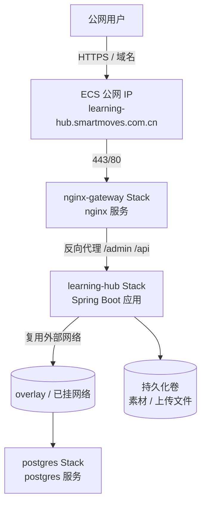

# Learning Hub 部署指南

> 本指南用于在阿里云 ECS 上的 Docker Swarm 集群中以 Stack 形式发布 `learning-hub` 应用，并复用已有的 `postgres` 与 `nginx-gateway` Stack 提供的服务。
>
> **文档状态**：骨架版（v0.1）—— 已记录关键背景信息，详细发布步骤待补充。
> **生成日期**：2026-07-06
> **目标环境**：ECS（公网）+ Docker Swarm
> **目标 Stack 名**：`learning-hub`
>
> ⚠️ **使用警告**：本文档当前**不建议直接用于生产部署**。待 §3 各小节补齐后方可作为可执行部署手册使用。详细优先级见 [§6 补齐优先级](#6-补齐优先级)。

---

## 1. 部署总览



### 1.1 一句话目标

将 `learning-hub` 应用以 Docker Stack 形式发布到 ECS 上现有的 Swarm 集群，复用同集群内已有的 `postgres`（数据库）和 `nginx-gateway`（反向代理 / HTTPS 终止）两个 Stack，仅在本 Stack 内承载应用本身的 Service。

---

## 2. 已知关键信息（已确认）

| 项 | 值 | 说明 |
| --- | --- | --- |
| 部署平台 | 阿里云 ECS（Docker Swarm 集群） | 已加入现有 Swarm |
| Stack 名称 | `learning-hub` | `docker stack deploy -c docker-stack.yml learning-hub` |
| 公网域名 | `learning-hub.smartmoves.com.cn` | 已映射到 ECS 公网 IP |
| HTTPS 终止 | 由 `nginx-gateway` Stack 统一负责 | 本 Stack 不暴露 443 |
| 反向代理 | 复用 `nginx-gateway` Stack 下的 `nginx` 服务 | 本 Stack 通过该 nginx 转发到应用 Service |
| 数据库 | 复用 `postgres` Stack 下的 `postgres` Service | 本 Stack 不启动独立 DB |
| 数据库网络 | 复用 Swarm 已有的 overlay 网络（具体网络名待确认） | 与 `postgres` Service 同网络可达 |
| 端口约定 | 应用容器内部 8080 → 由 nginx-gateway 反向代理暴露 | 不直接对外 |

### 2.1 复用资源清单

| 复用对象 | 来源 Stack / 服务 | 复用方式 | 备注 |
| --- | --- | --- | --- |
| PostgreSQL | `postgres` Stack → `postgres` Service | 跨 Stack 通过 Swarm overlay 网络连接，使用既有数据库账号 / 数据库名 | 不在 `learning-hub` Stack 内创建 DB Service |
| Nginx 反向代理 | `nginx-gateway` Stack → `nginx` Service | 由该 nginx 配置中新增 `server_name learning-hub.smartmoves.com.cn` 的 vhost，上游指向 `learning-hub` Stack 的应用 Service | `learning-hub` Stack 仅声明 Service，不直接处理 TLS |

> ⚠️ 任何对复用资源的修改（如 nginx vhost、PG 数据库 / 账号）都不属于本 Stack 范畴，需另行评估。

---

## 3. 待补充内容（占位清单）

> 后续将逐步完善以下章节。每个章节完成时同步把"待补充"标记去掉，并升一档小版本号。

### 3.1 Stack 清单与镜像
- [ ] `learning-hub` Stack 内的 Service 列表（应用、迁移、监控……）
- [ ] 镜像来源（私有仓库 / 公共仓库）、镜像 Tag 约定
- [ ] 多副本 / 滚动更新策略

### 3.2 Swarm 网络与复用约束
- [ ] 与 `postgres` Service 通信所用的 overlay 网络名称
- [ ] 与 `nginx-gateway` 中 `nginx` Service 通信所用的 overlay 网络名称
- [ ] 是否需要在 `learning-hub` Stack 内 `external: true` 声明这些网络

### 3.3 数据库 / 缓存
- [ ] PostgreSQL 连接信息（主机名 / 端口 / 数据库 / 账号 / 密码来源）
- [ ] 数据库初始化（首次发布是否需要 Flyway / Liquibase / 自定义 SQL 迁移）
- [ ] 凭据注入方式（Docker secret / env / config）

### 3.4 配置与环境变量
- [ ] Spring Boot 配置项清单
- [ ] 必需的环境变量与默认值
- [ ] 敏感信息（Admin Token、JWT 密钥、LLM Key 等）的来源

### 3.5 持久化与文件存储
- [ ] 素材上传目录 (`/app/storage/documents`) 的 volume 挂载方案
- [ ] 是否引入对象存储（OSS / S3）替代本地卷
- [ ] 备份策略

### 3.6 Nginx vhost（nginx-gateway Stack 内）
- [ ] `learning-hub.smartmoves.com.cn` 的 server 块草案
- [ ] upstream 指向 `learning-hub` Stack 的哪个 Service
- [ ] HTTPS 证书复用方式（是否与其它站点共用 wildcard）
- [ ] 静态资源 / 大文件上传 / AI 搜索超时的反代参数

### 3.7 发布与回滚
- [ ] 首次部署步骤（`docker stack deploy` 前的准备）
- [ ] 版本更新 / 滚动发布流程
- [ ] 回滚步骤与数据兼容性注意事项
- [ ] 健康检查 / 探活策略

### 3.8 验证
- [ ] ECS 远程验证（**禁止本地验证**）
- [ ] 域名解析、HTTPS 证书、反代连通性逐项 checklist
- [ ] 前后台功能冒烟用例

---

## 4. 命名与约定（拟定，待确认）

| 维度 | 拟定值 | 备注 |
| --- | --- | --- |
| Stack 名 | `learning-hub` | 已确认 |
| 应用 Service 名 | `learning-hub-app`（建议） | 便于 nginx upstream 引用 |
| 镜像名 | `learning-hub/app:<tag>` | tag 约定见 3.1 |
| 持久卷名 | `learning-hub_storage` | bind / nfs / OSS 待定 |
| 配置文件名 | `docker-stack.yml`（或 `stack.yml`） | 仓库根目录 |
| 环境变量来源 | `.env.production` + Docker secret | 不入仓库 |

---

## 5. 不在本部署范围

- `postgres` Stack 的部署与运维（已有）
- `nginx-gateway` Stack 的部署与运维（已有）
- HTTPS 证书的申请与续签（统一在 `nginx-gateway` 内管理）
- 域名 DNS 解析（已映射到 ECS 公网 IP）

---

## 6. 补齐优先级

下列顺序供后续作者参考，确保文档先解决`能不能部署`再解决`部署得顺手`：

| 优先级 | 章节 | 阻塞项 |
| ------ | ---- | ------ |
| P0 | [§3.3 数据库 / 缓存](./README.md) | 无 DB 连接信息无法部署任何环境 |
| P0 | [§3.6 Nginx vhost](./README.md) | 无 nginx vhost 草案 ECS 上无法提供 HTTPS |
| P0 | [§3.1 Stack 清单与镜像](./README.md) | 无镜像 / 副本数则 `docker stack deploy` 不可执行 |
| P1 | [§3.5 持久化与文件存储](./README.md) | 无 volume 方案部署后素材上传会丢 |
| P1 | [§3.4 配置与环境变量](./README.md) | 无环境变量清单则仅能启动默认账号 |
| P1 | [§3.7 发布与回滚](./README.md) | 无发布流程无法灰度 |
| P2 | [§3.8 验证](./README.md) | 无验证 checklist 则上线后无法人工复查 |
| P2 | [§3.2 Swarm 网络与复用约束](./README.md) | 网络名不清会导致 NGINX 上游不可达 |

> **验证原则**：所有部署后验证（冒烟用例 / 域名解析 / HTTPS 证书检查 / API 调用）均在 ECS 远程环境执行，**禁止本地验证**（参见用户偏好记忆 `部署验证执行环境偏好`）。

---

## 7. 素材预览依赖（PPT 转 PDF + PDF.js 静态资源）

> 对应规格 v1.2：素材详情页提供 PDF / PPT / MP4 三种行内浏览样式。PPT 依赖后端 LibreOffice 转 PDF（→ `material.preview_pdf_path`），PDF / PPT 共同依赖前端 PDF.js (`pdfjs-dist ^4.7.76`)。

### 7.1 PPT 转 PDF：LibreOffice 系统依赖

- **后端镜像**（[backend/Dockerfile](../../backend/Dockerfile)）在 `apt-get install` 段已加入 `libreoffice-core libreoffice-impress`（仅核心 + Impress 包，避免 writer / calc 冗余）：
  ```dockerfile
  RUN apt-get update && apt-get install -y --no-install-recommends \
          libreoffice-core \
          libreoffice-impress \
          fonts-noto-cjk \
      && rm -rf /var/lib/apt/lists/*
  ```
  预计额外镜像体积约 +200MB（Debian slim + 清华镜像源）。
- **后端配置**（[backend/.env.example](../../backend/.env.example)）：
  ```env
  # LibreOffice headless 调用路径（容器内默认 /usr/bin/libreoffice）
  LIBREOFFICE_PATH=/usr/bin/libreoffice
  # PPT → PDF 单文件超时（秒），超时后仅记 logger，不阻塞上传
  PPT_CONVERT_TIMEOUT=60
  ```
- **本地开发**：
  - macOS：`brew install --cask libreoffice`
  - Windows：`choco install libreoffice`
  - 验证：`libreoffice --version` 必须 ≥ 7.0；`which libreoffice`（macOS/Linux）输出可执行文件路径。
- **行为兜底**：转换失败 / 超时 / LibreOffice 未安装时仅写 logger；上传不阻塞；`material.preview_pdf_path` 保持为 NULL。详情页与 `/api/public/materials/{id}/stream` 对 NULL 情况自动降级为"下载到本地"，用户体验不破。

### 7.2 PDF.js 静态资源：`pdf.worker.min.mjs`

- 前端构建期：[frontend/vite.config.ts](../../frontend/vite.config.ts) + [frontend/package.json](../../frontend/package.json) 安装 `pdfjs-dist ^4.7.76`，构建后 `pdf.worker.min.mjs` 复制到 `frontend/dist/pdf.worker.min.mjs`。
- **镜像验证**：
  ```bash
  # 容器内检查
  docker stack exec learning-hub-app ls -la /usr/share/nginx/html/pdf.worker.min.mjs
  # 预期：文件存在，体积约 1MB

  # 远程验证
  curl -I https://learning-hub.smartmoves.com.cn/pdf.worker.min.mjs
  # 预期：HTTP/2 200 + content-type: application/javascript
  ```
- **nginx-gateway 适配**（`nginx-gateway` Stack 的 `learning-hub` vhost 内追加）：
  ```nginx
  location = /pdf.worker.min.mjs {
      proxy_pass http://learning-hub-app/static/pdf.worker.min.mjs;
      proxy_set_header Host $host;
      add_header Cache-Control "public, max-age=31536000, immutable";
      add_header Content-Type "application/javascript";
  }
  ```
  若 nginx-gateway 静态目录已挂载 `learning-hub-app` 容器内 `/usr/share/nginx/html/`，则该文件可被直接服务，无需反代。
- **本地开发**：启动 `cd frontend && npm run dev` 后 Vite 已内置 static file serving，访问 `http://localhost:5173/pdf.worker.min.mjs` 验证。

### 7.3 验证 checklist（§3.8 联动）

ECS 远程验证阶段追加：

- [ ] 容器内 `which libreoffice` 非空，`libreoffice --version` 正常输出
- [ ] 容器内 `ls /usr/share/nginx/html/pdf.worker.min.mjs` 存在
- [ ] 后端 `GET /api/public/materials/{ppt_id}/stream` 响应头 `Content-Type: application/pdf` + `Content-Disposition: inline`
- [ ] 前端 `https://learning-hub.smartmoves.com.cn/?view=viewer&id=<ppt_id>&cw=<courseware_id>` 加载 P-VIEWER-PPT 并能翻页

---

## 8. 修订记录

| 版本 | 日期 | 变更 |
| --- | --- | --- |
| v0.2 | 2026-07-07 | 新增 §7 素材预览依赖：LibreOffice 容器安装 + .env.example 配置 + 本地 brew/choco 安装路径 + `pdf.worker.min.mjs` nginx 静态资源 + 验证 checklist |
| v0.1 | 2026-07-06 | 骨架版：记录 ECS / Swarm / Stack 名 / 域名 / 复用资源等关键信息；后续章节待补充 |
