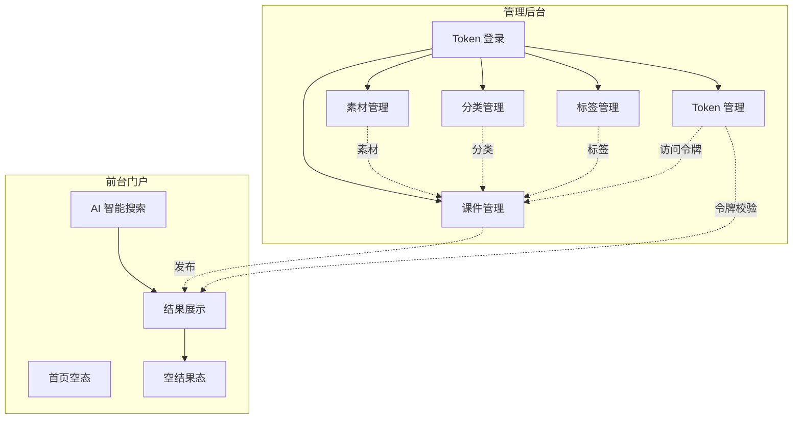
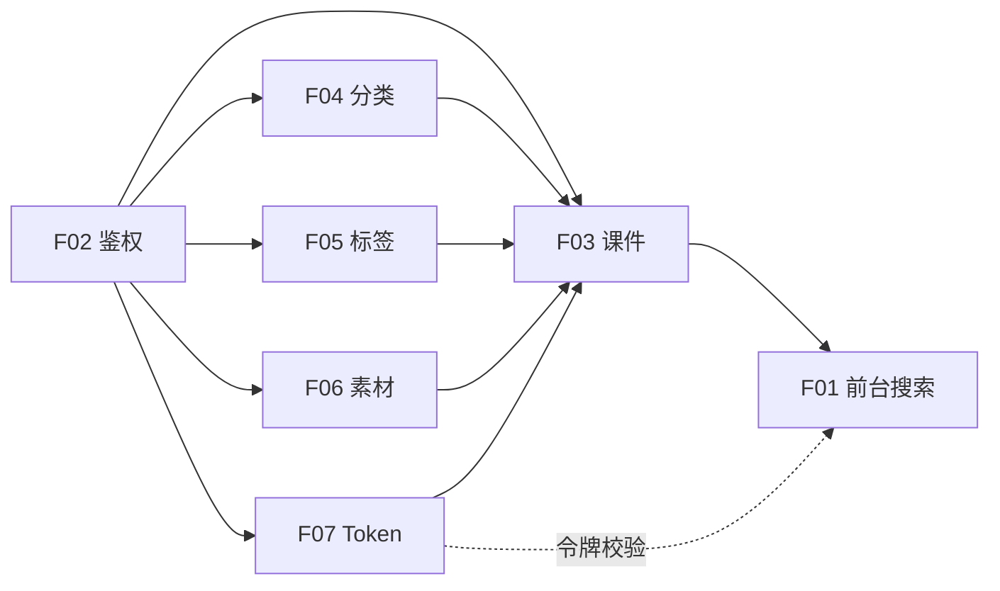

# 02. 功能需求

> 本章面向产品 / 开发 / 测试，定义 Learning Hub 的全部功能模块、用户故事与功能验收要点。

## 1. 功能全景

## 2. 功能模块清单

### 2.1 前台门户（F01）

| 编号 | 功能 | 优先级 | 简述 |
| ---- | ---- | ------ | ---- |
| F01.01 | 首页展示 | P0 | 极简首页，仅含品牌标题与搜索框 |
| F01.02 | 搜索输入 | P0 | 自然语言关键词输入 |
| F01.03 | AI 智能搜索 | P0 | 基于语义理解的课件检索；API 支持 `filters: { categoryId, tags[] }` 过滤（详见 [10-API §5.1.1](./10-API设计规范.md)），**v1.0 前端不暴露该参数**，结果按 AI 相关度排序 |
| F01.04 | 加载态 | P1 | "AI 搜索中，请稍候…"提示 |
| F01.05 | 结果列表 | P0 | 命中课件列表展示 |
| F01.06 | 空结果态 | P1 | 友好空态插画 + 引导文案 |
| F01.07 | 清空搜索 | P1 | 一键回到初始状态 |
| F01.08 | 素材在线浏览 | P0 | 课件详情页素材项提供"在线浏览"入口；PDF/PPT/MP4 全部支持行内预览；PPT 由后端自动转 PDF；保留"下载到本地"兜底 |

### 2.2 后台鉴权（F02）

| 编号 | 功能 | 优先级 | 简述 |
| ---- | ---- | ------ | ---- |
| F02.01 | Token 登录 | P0 | Admin Token 校验后写入会话 |
| F02.02 | 退出 | P0 | 清除会话回到登录页 |

### 2.3 课件管理（F03）

| 编号 | 功能 | 优先级 | 简述 |
| ---- | ---- | ------ | ---- |
| F03.01 | 课件列表 | P0 | 分页 + 标题模糊搜索 |
| F03.02 | 新建课件 | P0 | 填写标题 / 作者 / 分类 / 描述 / 标签 / 素材并发布 |
| F03.03 | 编辑课件 | P0 | 同新建表单，已发布课件可二次编辑 |
| F03.04 | 删除课件 | P1 | 二次确认后删除 |
| F03.05 | 素材库联动 | P0 | 在新建 / 编辑课件页内嵌素材搜索 + 关联 |
| F03.06 | 访问模式配置 | P0 | 在课件表单中选择"开放 / 受限"，默认"开放" |
| F03.07 | 关联访问 Token | P0 | 当访问模式 = 受限时，从 Token 管理列表中多选 1 个或多个 Token |
| F03.08 | 素材顺序编辑 | P1 | v1.5+ 课件表单内提供素材拖拽排序器，按管理员设定顺序渲染前台素材列表（US-11） |

### 2.4 分类管理（F04）

| 编号 | 功能 | 优先级 | 简述 |
| ---- | ---- | ------ | ---- |
| F04.01 | 分类树展示 | P0 | 三层缩进，最多 3 层 |
| F04.02 | 新建根分类 | P0 | 直接添加顶级分类 |
| F04.03 | 新建子分类 | P0 | 在指定分类下新增子节点，受 3 层限制 |
| F04.04 | 重命名分类 | P0 | 行内编辑 |
| F04.05 | 删除分类 | P1 | 二次确认，存在子节点 / 课件时禁止删除 |

### 2.5 标签管理（F05）

| 编号 | 功能 | 优先级 | 简述 |
| ---- | ---- | ------ | ---- |
| F05.01 | 标签列表 | P0 | 分页展示 |
| F05.02 | 新建标签 | P0 | 输入名称创建 |
| F05.03 | 重命名标签 | P1 | 改名后课件自动同步 |
| F05.04 | 删除标签 | P1 | 二次确认，从所有课件上解绑 |
| F05.05 | 关联课件数 | P1 | 列表实时展示标签被引用次数 |

### 2.6 素材管理（F06）

| 编号 | 功能 | 优先级 | 简述 |
| ---- | ---- | ------ | ---- |
| F06.01 | 素材列表 | P0 | 分页 + 关键字搜索 + 类型筛选 |
| F06.02 | 上传素材 | P0 | 拖拽 / 点选上传，支持 MP4 / PDF / PPT / PPTX，单文件 ≤ 200MB |
| F06.03 | 类型筛选 | P1 | 全部 / 视频 / PDF / PPT 四类 |
| F06.04 | 删除素材 | P1 | 二次确认，存在课件引用时禁止 |

### 2.7 Token 管理（F07）

| 编号 | 功能 | 优先级 | 简述 |
| ---- | ---- | ------ | ---- |
| F07.01 | Token 列表 | P0 | 分页 + 名称 / 值关键字搜索 |
| F07.02 | 新建 Token | P0 | 输入名称（**必填，全局唯一**）→ 服务端自动生成 Token 值 → 创建 |
| F07.03 | 编辑 Token | P0 | 仅允许改名；Token 值不可改，变更需走"重新生成" |
| F07.04 | 删除 Token | P0 | 二次确认；删除前自动从所有课件中解绑 |
| F07.05 | 重新生成 Token | P0 | 原地生成新 Token 值，旧值立即全局失效 |
| F07.06 | 关联课件数 | P1 | 列表展示 Token 当前解锁的课件数 |

#### F07 补充说明

- Token 值由服务端随机生成（推荐长度 24 字符 / base36），仅在创建或重新生成瞬间向管理员明文返回 1 次，之后只回显掩码（`AB12****CD34`）。
- Token 与课件是 M:N 关系：一个 Token 可解锁多个课件；一个课件可被多个 Token 解锁。
- `label` 必填且全局唯一：创建 / 重命名时若与现有 Token label 重名，服务端返回 `409 token_label_conflict`。
- 删除或重新生成 Token 后，所有相关课件立即按最新授权状态生效；前台已记忆的旧 Token 会被服务端拒绝，并触发前端重新输入流程。

## 3. 用户故事

### US-01 检索课件
> 作为学习者，我希望在首页用一句话描述我想要的学习内容，以便快速找到相关课件。

- **入口**: `http://localhost`
- **验收**:
  1. 在搜索框输入"项目管理"。
  2. 点击"搜索"按钮。
  3. 系统展示"AI 智能搜索"标签与"找到 N 个课件"统计。
  4. 命中课件以卡片 / 列表形式展示。
  5. 若无命中，展示 📭 空状态插画 + "没有找到匹配的课件，试试调整搜索条件"。

### US-02 管理员登录
> 作为管理员，我希望通过 Admin Token 进入后台，以便进行课件运营。

- **入口**: `http://localhost/admin`
- **验收**:
  1. 在 Token 输入框输入 Token。
  2. 点击"登录"按钮。
  3. Token 有效 → 进入 `/admin/coursewares`。
  4. Token 无效 → 提示错误并保持在登录页。

### US-03 新建课件
> 作为管理员，我希望快速创建一个新课件并挂载素材。

- **入口**: 课件管理 → "+ 新建课件"
- **验收**:
  1. 必填项：标题、分类。
  2. 选填项：作者、描述、标签、素材。
  3. 点击"发布"按钮后，课件进入列表并出现在前台可被搜索到。
  4. 点击"取消"按钮放弃编辑。

### US-04 维护分类
> 作为管理员，我希望通过树形视图组织分类，确保学习门户的内容结构清晰。

- **验收**:
  1. 根级分类通过"+ 新建根分类"创建。
  2. 在任一分类行点击"＋ 子分类"创建子节点。
  3. 当节点已为 3 级时禁止再创建子节点。
  4. "编辑"按钮支持行内改名。

### US-05 维护标签
> 作为管理员，我希望以扁平的标签维度补充课件的能力 / 主题信息。

- **验收**:
  1. "+ 新建标签"按钮弹出对话框，输入名称即可创建。
  2. 列表展示每个标签的"关联课件数"。
  3. 删除标签后，所有课件的对应标签自动移除。

### US-06 上传素材
> 作为管理员，我希望把视频 / PDF / PPT 上传到统一的素材库，并在新建课件时直接关联。

- **验收**:
  1. 点击"+ 上传素材"，弹窗支持拖拽或点选。
  2. 上传成功后，素材进入素材库列表。
  3. 在新建课件的"素材库"区域，可通过关键字 + 类型筛选定位素材并关联。
  4. 超出 200MB 或非白名单格式应被前端拦截并提示。

### US-07 创建访问 Token
> 作为管理员，我希望在 Token 管理中创建独立的访问令牌，以便将同一令牌分发给多个学习者，用于解锁一份或多份受限课件。

- **入口**: `Token 管理` → `+ 新建 Token`
- **验收**:
  1. 点击"+ 新建 Token"，输入名称（**必填，全局唯一**）并提交。
  2. 服务端自动生成 Token 值（24 位 base36），创建成功页一次性明文展示该值，并提示`请妥善保存，刷新后将不再显示`。
  3. 列表中该 Token 仅回显掩码（如 `AB12****CD34`）。
  4. 在课件表单的"关联 Token"多选中可勾选该 Token，保存后的课件在前台受令。

### US-08 配置受限课件
> 作为管理员，我希望将一份课件设为受限，并选定若干 Token，以决定谁可以解锁查看。

- **入口**: 课件管理 → `+ 新建课件` / 操作列 → `编辑`
- **验收**:
  1. 在课件表单新增"访问模式"单选控件，默认 `开放`。
  2. 选择`受限`后，下方出现"关联 Token"多选。
  3. 多选为空时点击`发布`阻止提交，提示`请至少关联一个访问令牌`。
  4. 选择 1 个或多个 Token 后发布，课件进入列表、`访问控制`列显示`受限 · N 个令牌`。
  5. 在已有课件上从`受限`切回`开放`后保存，不需选择 Token。

### US-09 用 Token 打开受限课件
> 作为学习者，我希望在搜索到一个受限课件后，输入对应的访问令牌即可进入详情，刷新后下次无需重复输入。

- **入口**: 前台搜索结果中标题右侧带 🔒 角标的课件
- **验收**:
  1. 点击受限课件后弹出 Token 输入框，输入令牌并点击`解锁`。
  2. 后台校验通过后写入本地记忆，自动进入详情。
  3. 错误令牌输入框下显示`令牌无效，请检查后重试`，不进入详情。
  4. 关闭再进入同一课件、刷新页面、`重新搜索`后点击同一课件，均无需再次输入。
  5. 后台对令牌重新生成后，前台再次进入该课件会提示`令牌已失效，请重新输入`并清除本地记忆。
  6. 如果点击`返回搜索`，跳过输入回到搜索结果页。

### US-10 在线浏览课件素材
> 作为学习者，我希望在课件详情页不下载就能预览视频 / PDF / PPT，以便快速决定是否需要保留离线副本。

- **入口**: 课件详情页 P-DETAIL 素材项右侧“在线浏览”按钮
- **验收**:
  1. 点击“在线浏览”后跳转 P-VIEWER，按素材类型展示三种样式：视频为简化流媒体播放，PDF 为连续滚动 Word 式阅读，PPT 为单页幻灯片(上一张 / 下一张 / 全屏 / 键盘 ←→ 切换)。
  2. P-VIEWER 顶部都有“下载到本地”链接作为兜底，跳转 `/api/public/materials/{id}/file`。
  3. PPT 转 PDF 失败时 P-VIEWER 提示“预览生成中”，仍能下载原文件。
  4. 返回按钮 / Logo / 浏览器后退均能正常返回到 P-DETAIL 或首页。

### US-11(v1.5+) 调整课件内素材顺序
> 作为管理员，我希望为课件内的素材指定学习顺序（拖拽排序），以便学员在前台按我设定的路径依次浏览，而不是按数据库物理顺序。
- **入口**: 后台 → 课件管理 → 编辑课件 → “关联素材（学习顺序）”区域
- **验收**:
  1. 旧版复选框选择器已替换为左“素材库”+ 右“已选顺序”两栏式排序器。
  2. 鼠标拖拽右栏手柄可改变顺序，松手后本地态立即更新。
  3. 键盘可达性：Tab 聚焦手柄 → Space 抓取 → ↑/↓ 移动 → Space 释放 → Esc 取消。
  4. 上移/下移/置顶/置底快捷按钮可用。
  5. 保存后调用专用 `PUT /api/admin/coursewares/{id}/materials/order` 接口，DB 中 sortOrder 与前端一致。
  6. 前台 P-DETAIL 按新顺序渲染素材列表。

## 4. 功能优先级矩阵

| 优先级 | 模块 | 说明 |
| ------ | ---- | ---- |
| P0 | F01.01/02/03/05/08、F02.01/02、F03.01/02/03/05/06/07、F04.01/02/03/04、F05.01/02、F06.01/02、F07.01/02/03/04/05 | 必须实现的核心链路（含课件访问 Token + 素材在线浏览） |
| P1 | F01.04/06/07、F03.04、F04.05、F05.03/04/05、F06.03/04、F07.06 | 体验增强与边界保护 |

## 5. 功能依赖

> 简言之：**没有素材 / 分类 / 标签，就没有课件；没有课件，就没有前台搜索结果。**