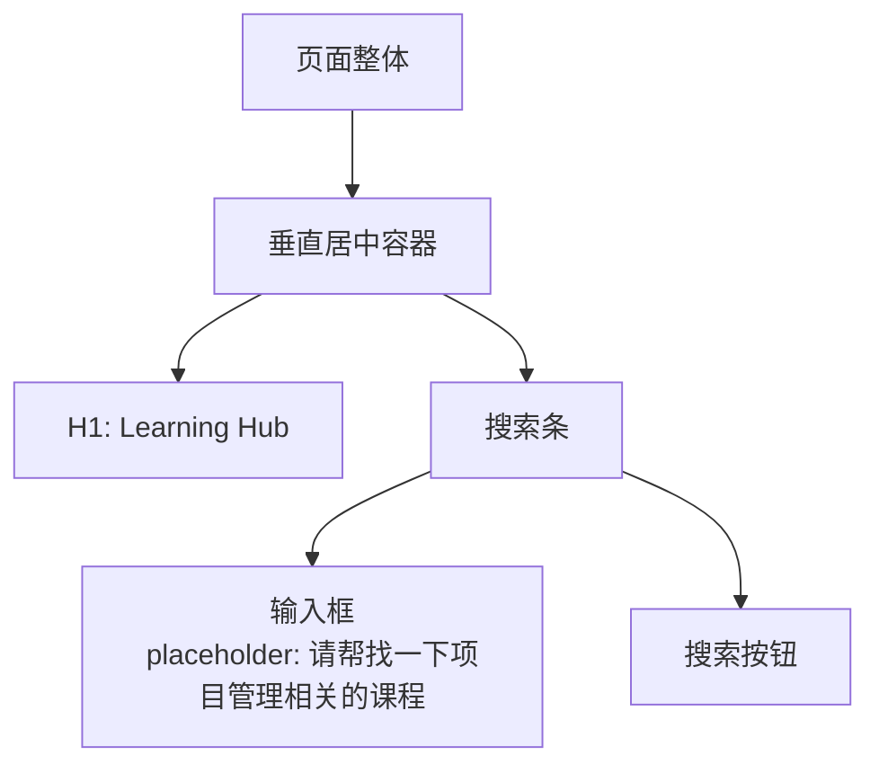
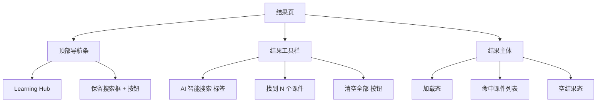
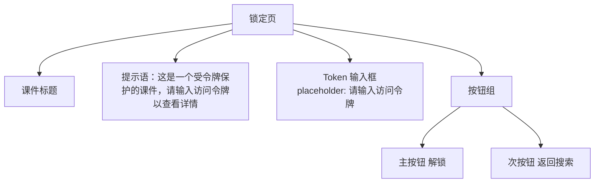
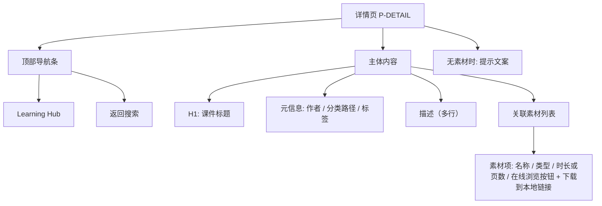
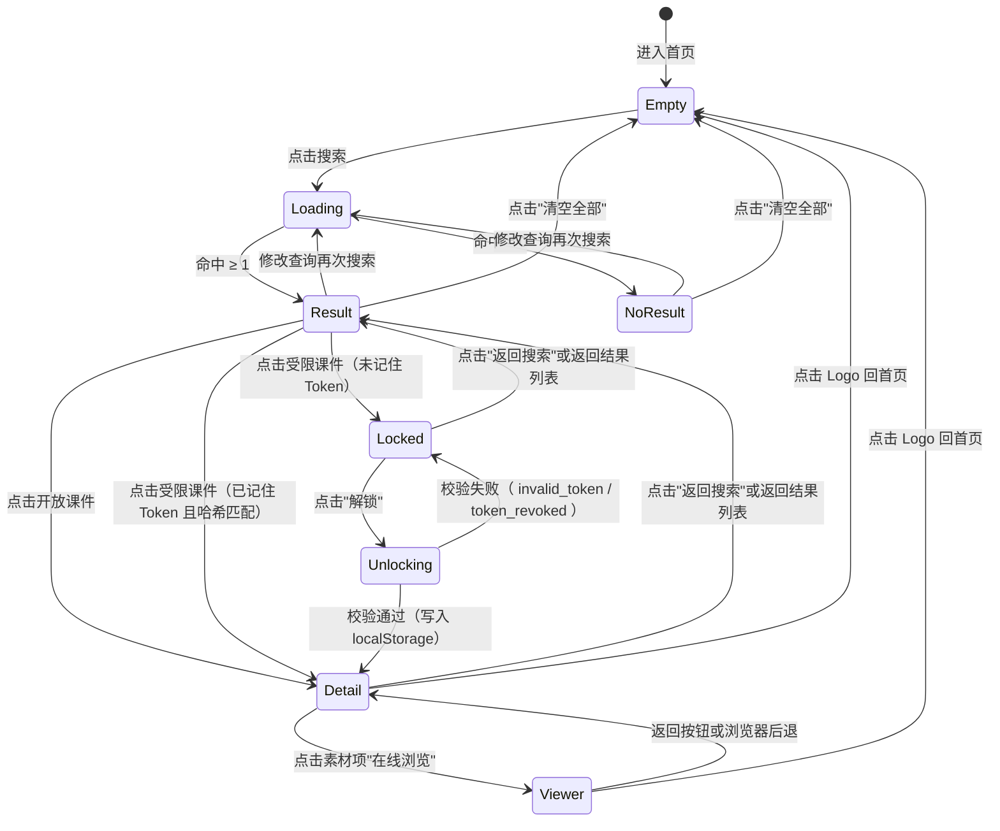

# 03. 前台门户规格

> 本章定义 `http://localhost` 前台门户的全部页面、状态、交互与文案。所有内容均来自对线上实例的反向观察。

## 1. 页面清单

| 页面 | URL | 触发条件 | 备注 |
| ---- | --- | -------- | ---- |
| 首页（空态） | `/` | 默认进入 | 极简布局，仅含标题与搜索框 |
| 搜索结果页 | `/` | 已输入查询并触发搜索 | 与首页同 URL，通过状态切换 |
| 受限课件锁定页（P-LOCKED） | `/` | 点击受限课件（未记忆 Token） | 同 URL 前端状态切换；输入 Token 后跳转详情页 |
| 课件详情页（P-DETAIL） | `/?view=detail&id=...` | 点击开放课件 / 受限课件解锁通过后 | 同 URL 前端状态切换；展示课件完整内容、素材列表与返回入口 |
| 素材在线浏览页（P-VIEWER） | `/?view=viewer&id=...&cw=...` | P-DETAIL 点击素材项的"在线浏览" | 同 URL 前端状态切换；按素材类型呈现三种样式（视频流媒体 / PDF Word 阅读 / PPT 幻灯片） |

> 当前实例为 SPA，搜索前后、详情页与锁定页都在 `/` 路径，通过前端状态切换不同视图。后续若引入独立 URL（推荐 `/courseware/:id`、`/courseware/:id?locked=true`），页面实体与状态机保持不变。

## 2. 首页（空态）

### 2.1 布局

### 2.2 文案

| 元素 | 文案 |
| ---- | ---- |
| 主标题（H1） | `Learning Hub` |
| 搜索框占位符 | `请帮找一下项目管理相关的课程` |
| 搜索按钮 | `搜索` |

### 2.3 行为

- 输入框获得焦点后高亮。
- 点击"搜索"按钮后跳转至结果状态；亦可通过键盘 Enter 触发。
- 不需要登录即可使用。

## 3. 搜索结果页

### 3.1 布局

### 3.2 顶部导航条

| 元素 | 文案 / 行为 |
| ---- | ----------- |
| Logo | 文本 `Learning Hub`，点击回首页 |
| 搜索框 | 保留当前查询词，可继续编辑 |
| 搜索按钮 | 触发新的查询 |

### 3.3 结果工具栏

| 元素 | 文案 / 行为 |
| ---- | ----------- |
| 标签 | `AI 智能搜索`（蓝色圆角徽标） |
| 数量 | `找到 N 个课件`（N 为命中数） |
| 按钮 | `清空全部`（位于右侧，点击后回到首页空态） |

### 3.4 加载态

- 文案：`⏳ AI 搜索中，请稍候…`
- 触发时机：从点击"搜索"到结果返回前。

### 3.5 命中课件列表

- 每个课件至少展示标题。
- 其他字段（分类、标签、描述、缩略图）由实现侧细化，但应至少满足可识别性。
- **受限课件识别**：受限课件（后台配置了 1 个或多个访问 Token）在列表中正常展示，但标题右侧显示 🔒 角标与 `受令牌保护` 提示标签（aria-label：`该课件需要访问令牌`）。角标与提示在 hover 时重复表述。

### 3.6 空结果态

- 插画：📭 邮件图标。
- 文案：`没有找到匹配的课件，试试调整搜索条件`。

## 4. 受限课件访问流程

受限课件完整保留于搜索结果中，但在点击进入详情前需要通过访问令牌解锁。本节定义锁定页 UI、校验接口与记忆逻辑。

### 4.1 触发条件

- 在结果列表（带 🔒 角标的课件）点击进入受限课件。
- 从分类导航/分享链接直接打开受限课件（后跟 `locked=true` 查询参数进入锁定态）。

### 4.2 锁定页元素

- 输入框为单行密码型（`type=password` 为默认，可提供 eye 图标切换为 text）。
- 按钮区为上下排列：上为 `解锁`（蓝色主按钮）、下为 `返回搜索`（文字按钮）。
- 锁定页不加载任何素材项 / 正文预览，避免信息泄露。

### 4.3 校验接口

- 调用 `POST /api/public/coursewares/{id}/unlock`，请求体 `{ "token": "<原文>" }`。
- **响应码与客户端处理**（与 [10-API §5.2](./10-API设计规范.md) 严格对齐）：

| HTTP | `code` | 客户端提示文案 | 锁定页状态 |
| ---- | ------ | -------------- | ---------- |
| 200 | `"ok"` | （成功后跳转 P-DETAIL，写入 localStorage） | 离开锁定页 |
| 400 | `"invalid_token_format"` | `令牌长度非法` | 保留输入 |
| 401 | `"invalid_token"` | `令牌无效，请检查后重试` | 保留输入 |
| 404 | `"courseware_not_found"` | `课件不存在` | 保留输入 |
| 410 | `"token_revoked"` | `令牌已失效，请重新输入`，并清除本地记忆 | 保留输入 |
| 429 | `"rate_limited"` | `解锁失败，请稍后重试` | 保留输入 |
| 5xx | - | `解锁失败，请稍后重试` | 保留输入 |

> 详绅接口字段与报文结构见 [10-API §2.4](./10-API设计规范.md)。

### 4.4 本地记忆规则

- 存储键：`localStorage.coursewareTokens`，值为 `{ [coursewareId]: '<sha256 哈希>' }`。
- 适用场景：关闭再进入同一课件、刷新页面、`重新搜索`后点击同一课件，均跳过输入框直接进入详情。
- 记忆永不过期；仅在以下情况下被服务端验证为失效并被前端清除：
  - 详情接口返回 `token_revoked`（Token 被重新生成或删除）。
  - 同一课件被后台从`受限`切换为`开放`。

### 4.5 与表单退出路径

- 点击 `返回搜索`：仅返回结果页，不覆盖本地记忆。
- 点击 `Logo（Learning Hub）`：返回首页空态，会同时清除本次会话的本地记忆项（本版本不强制，推荐后续版本迭代表）。

## 5. 课件详情页（P-DETAIL）

> 完整定义开放课件与受限课件解锁后的详情页 UI；当前演示实例为 SPA，通过前端状态切换展示。字段 100% 来自 `GET /api/public/coursewares/{id}` 响应（详见 [10-API §5.2](./10-API设计规范.md)）。

### 5.1 触发条件

- 在结果列表点击开放课件 → 直达详情页。
- 在结果列表点击受限课件（已记忆 Token 且哈希匹配）→ 直达详情页。
- 受限课件解锁通过（`POST /api/public/coursewares/{id}/unlock` 200 + `valid=true`）→ 写入 `localStorage.coursewareTokens[id]` → 跳详情页。
- 浏览器前进/后退直接打开详情 URL。

### 5.2 布局

### 5.3 字段映射

| 元素 | 来源（API 字段） | 说明 |
| ---- | ---------------- | ---- |
| H1 课件标题 | `data.title` | 1-100 字符（以 [10-API §4.1.2](./10-API设计规范.md) 为权威） |
| 作者 | `data.author` | 为空时整行隐藏 |
| 分类路径 | `data.categoryPath[]` | 从根到叶，仅展示，不交互 |
| 标签 | `data.tags[].name` | 仅展示，不交互 |
| 描述 | `data.description` | 多行纯文本，严格 HTML 转义后渲染 |
| 素材列表 | `data.materials[]` | 见 §5.4 |

### 5.4 素材呈现

| 类型 | 呈现方式 | 资源地址 |
| ---- | -------- | -------- |
| VIDEO（.mp4） | 列表项右侧"在线浏览"按钮，点击跳转 P-VIEWER，呈现**简化版流媒体样式**（详见 [§5a.2](#5a2-视频样式video)） | `streamUrl`（见 [10-API §5.2.1](./10-API设计规范.md)） |
| PDF | 列表项右侧"在线浏览"按钮，点击跳转 P-VIEWER，呈现**类似 Word 阅读样式**（详见 [§5a.3](#5a3-pdf-样式pdf)） | `streamUrl` |
| PPT / PPTX | 列表项右侧"在线浏览"按钮，点击跳转 P-VIEWER，呈现**幻灯片样式**（后端 LibreOffice 转 PDF，详见 [§5a.4](#5a4-ppt-幻灯片样式pptpptx)）；同步保留"下载到本地"文字链接作为兜底 | `streamUrl` |

- 多个素材按数组顺序展示，每项之间用 8px 分隔。
- 视频默认不自动播放；仅在用户点击播放时启动。
- 视频资源支持 HTTP Range 加载，服务端详见 [10-API §4.4.4](./10-API设计规范.md)。
- 访问受限课件的素材流地址时，服务端校验 `Referer` 与课件 ACL；不再二次要求 Token。
- 点击"在线浏览"跳转 `/?view=viewer&id=<materialId>&cw=<coursewareId>`，由 [§5a](#5a-素材在线浏览页p-viewer) 分发到对应子组件。
- 每项素材块携带 `data-testid="p-detail-material"`、`data-material-type`、`data-material-id`，便于 E2E 定位。

### 5.5 行为与异常

| 场景 | 期望 |
| ---- | ---- |
| 正常进入 | 渲染标题 / 描述 / 素材；保留来源 URL（Result 页 query） |
| Token 失效（详情接口返 `token_revoked`） | 清 `localStorage.coursewareTokens[id]` → 跳 P-LOCKED + 提示 `令牌已失效，请重新输入` |
| 受限课件被后台切为开放 | 清 `localStorage.coursewareTokens[id]` → 直接渲染开放内容（不再要求 Token） |
| 课件不存在（接口返 `courseware_not_found`） | 提示 `课件不存在` + 返回搜索按钮 |
| 受限课件未传 token（接口返 `token_required` / `courseware_acl_locked`） | 跳 P-LOCKED |
| 详情接口 5xx | Toast `加载失败，请稍后重试` + 重试按钮 |
| 网络断开 | Toast `网络异常，请稍后重试` + 保留返回按钮可用 |

### 5.6 跳转与返回

| 触发 | 行为 |
| ---- | ---- |
| 点击顶部 `返回搜索` | 返回 P-RESULT，保留 SearchQuery |
| 点击 Logo（`Learning Hub`） | 返回首页空态 P-HOME，**同时清除本次会话中受影响的 localStorage 记忆项** |
| 浏览器后退 | 等同点击 `返回搜索` |

### 5.7 跨文档一致性

- 本节为 P-DETAIL 的权威页面级定义。
- [09-UI §4.1](./09-UI规格.md) 互动矩阵中 P-DETAIL 行字段映射以本节为准。
- [10-API §5.2](./10-API设计规范.md) 字段为权威 API 字段定义；字段增减以 10 为准并同步本节。

## 5a. 素材在线浏览页（P-VIEWER）

> P-VIEWER 是 P-DETAIL 素材项"在线浏览"的落地页；URL 形式为 `/?view=viewer&id=<materialId>&cw=<coursewareId>`。根据 `material.type` 派发到三个独立子组件，三者共享统一顶栏。

### 5a.1 公共顶栏

- 返回按钮 `p-viewer-back-btn`：返回 P-DETAIL。
- 文件名 / 类型售标（`p-viewer-title`）。
- 文字链接 `下载到本地`（`p-viewer-download-link`），命中 `/api/public/materials/{id}/file`，作为浏览器不支持 / 转换失败的兜底。
- Logo 文本 `Learning Hub`，点击返回首页空态 P-HOME。

### 5a.2 视频样式（VIDEO）

- 左侧主播放区：黑色背景容器内嵌 `<video controls>`，最大高 80vh，宽度自适应。
- 右侧 280px 信息面板（`p-viewer-video-info`）：
  - 文件名
  - 类型：`视频`
  - 时长：`duration` 字段，缺失时显示 `--`
  - 大小：`formatSize(sizeBytes)`
  - 下载到本地链接
- 响应式：窗口 < 768px 时上下堆叠。
- 交互：原生 HTML5 video 控件；播放后 2 秒无操作隐藏光标。
- 错误态：`onError` 触发通用错误页。

### 5a.3 PDF 样式（PDF）

- 顶部工具条 `p-viewer-pdf-toolbar`：`返回` / `缩放 −` / `当前比例（p-viewer-pdf-zoom-label）` / `缩放 +` / `下载到本地`。
- 主体：浅灰背景（`bg-slate-100`），居中 `max-w-[820px]` 连续滚动渲染。
- 页码指示器 `p-viewer-pdf-page-indicator`：固定视口右下角，格式 `第 N / M 页`，`aria-live="polite"`。
- 缩放预设：`[0.75, 1.0, 1.25, 1.5, 2.0]`，默认 `1.25`。
- 交互：
  - 缩放 `+` / `−` 按钮（`p-viewer-pdf-zoom-in` / `p-viewer-pdf-zoom-out`）。
  - IntersectionObserver 驱动页码气泡更新。
  - 双击页面放大 / 还原。

### 5a.4 PPT 幻灯片样式（PPT/PPTX）

- 暗色背景（`bg-slate-900`），主区画布充满中下方，左右留 1.5rem padding。
- 底部控制条 `p-viewer-ppt-controls`：
  - `上一张` 按钮（`p-viewer-ppt-prev`）
  - 页码指示器 `p-viewer-ppt-indicator`（如 `3 / 20`，超过 1 位数右对齐）
  - `下一张` 按钮（`p-viewer-ppt-next`）
  - `全屏` 按钮（`p-viewer-ppt-fullscreen`）
- 交互：
  - `ArrowLeft` / `ArrowRight` 键盘切换。
  - 页面过渡 200ms 谈入谈出。
  - 到达首末页时按钮 `disabled` 且文案变 `已是第一张` / `已是最后一张`。
  - `全屏` 调用 `canvas.requestFullscreen()`。

### 5a.5 行为与异常

| 场景 | 期望 |
| ---- | ---- |
| `id` 不存在 | 调 `/api/public/materials/{id}` 返回 `material_not_found` → 跳通用错误页（参考 §11） |
| PPT 预览未生成（`previewReady=false`） | 控制台提示“正在生成预览”，但页面仍能加载（后端会回退原文件 + attachment） |
| PDF.js 渲染失败 | Toast `pdfjs_failed` + 提示「请改用下载到本地查看」 |
| 网络断 | Toast `网络异常` + 保留返回按钮 |
| 浏览器后退 | 等同点击返回按钮，返回 P-DETAIL |

### 5a.6 跳转与返回

| 触发 | 行为 |
| ---- | ---- |
| 点击 `返回` | 返回 P-DETAIL |
| 点击 Logo（`Learning Hub`） | 返回首页空态 P-HOME |
| 浏览器后退 | 等价返回 P-DETAIL |

### 5a.7 跨文档一致性

- 本节为 P-VIEWER 的权威页面级定义。
- [09-UI §4.1](./09-UI规格.md) 中的 P-VIEWER-VIDEO / P-VIEWER-PDF / P-VIEWER-PPT 三个 UI 实体以本节为准。
- [10-API §5.2.4](./10-API设计规范.md) 为 `/api/public/materials/{id}/stream` 接口定义；字段增减以 10 为准并同步本节。

---

## 6. 状态机

## 7. 交互细节

| 触发 | 行为 |
| ---- | ---- |
| 在搜索框按 Enter | 等同于点击"搜索"按钮 |
| 点击 Logo（`Learning Hub`） | 回到首页空态（清除查询） |
| 点击"清空全部" | 回到首页空态 |
| 修改搜索框内容但未触发搜索 | 仍处于原状态，按钮文案不变 |

## 8. 视觉规范（最小约束）

- 搜索框、按钮采用蓝色主题色（与后台一致）。
- 页面整体留白充足，居中布局。
- 结果页工具栏与列表之间留有明显分隔。
- 空状态插画使用 emoji 风格，保持轻量。

## 9. 文案规范

- 全部使用简体中文。
- 不出现英文混排（按钮文案除外）。
- 不显示 AI 生成的解释性长句，仅保留标签 / 统计 / 引导语。
- P-VIEWER 三个子组件使用统一文案：
  - VIDEO：`正在加载视频…` / `加载失败，请检查网络或下载到本地查看`
  - PDF：`正在加载 PDF…` / `第 X / Y 页` / `缩放 X%`
  - PPT：`上一张` / `下一张` / `已是第一张` / `已是最后一张` / `全屏` / `正在加载幻灯片…`

## 10. 异常与边界

| 场景 | 期望表现 |
| ---- | -------- |
| 网络异常 | 加载态被替换为错误提示，建议文案"搜索失败，请稍后重试" |
| 查询词为空 | 视为空操作，停留在首页空态 |
| 查询词极长（>200 字符） | 仍可提交，建议前端做截断提示 |
| 受限课件点击进入 | 命中本地记忆直接进入详情；未记忆则进入锁定页输入 Token |
| 本地记住的 Token 被服务端撤销（重新生成 / 删除） | 调详情接口返回 `token_revoked` → 前端清除记忆 → 返回锁定页并提示 `令牌已失效，请重新输入` |
| 输入的 Token 超过 64 字符 | 按钮提交前提示 `令牌长度非法`，不发送请求 |
| 输入框中 Token 被剪贴板注入恶意 HTML | 输入框 `type=password` 默认为文本控件，需对取值做严格 trim、不作为 HTML 渲染 |
| 受限课件被后台切为`开放` | 进入详情前清掉本地记忆项，直接渲染开放内容 |

---

## 11. 通用错误页

当资源不存在或服务端不可用时，前台 / 后台跳转至通用错误页。本节为默认实现约定。

### 11.1 通用规则

- 全部错误页采用与当前站点一致的极简风格，仅含品牌标题 + 错误原因 + 返回按钮。
- 返回按钮默认指向最近的可用页面：前台默认回首页空态，后台默认回 `/admin/coursewares`（课件管理）。
- 不在错误页展示堆栈、技术细节或服务端异常码。

### 11.2 错误页清单

| 错误码 | 场景 | 标题文案 | 返回按钮 |
| ------ | ---- | -------- | -------- |
| 404 | 资源不存在 | `课件不存在` / `页面走丢了` | `返回搜索`（前台）/ `返回列表`（后台） |
| 5xx | 服务端错误 | `服务异常，请稍后重试` | `返回搜索`（前台）/ `返回列表`（后台） |
| 网络断开 | `fetch` 失败 | `网络异常，请检查连接后重试` | `重试`（仅前台） |

### 11.3 前台错误页与锁定页的关系

- 详情页请求返 `courseware_not_found`（404）→ 跳通用错误页（不走锁定页）。
- 锁定页请求返 `courseware_not_found`（404）→ 锁定页内显示 `课件不存在` 提示（不走通用错误页），避免锁定页被错误页覆盖。

> 后台错误页仅在 `/admin/*` 路由树内生效；API 请求的 401 / 403 统一跳登录页（详见 [03-前台门户规格 §2.2](./03-前台门户规格.md) 与 [04-管理后台规格 §2.2](./04-管理后台规格.md)）。