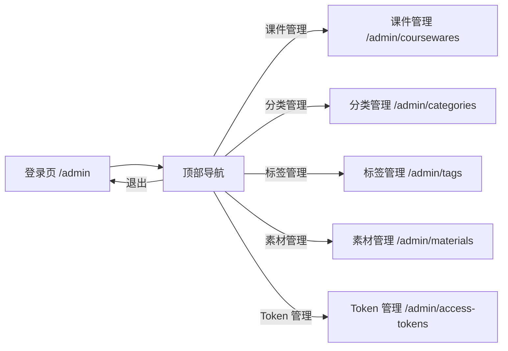
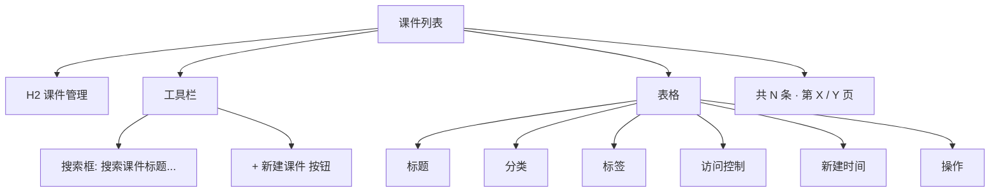
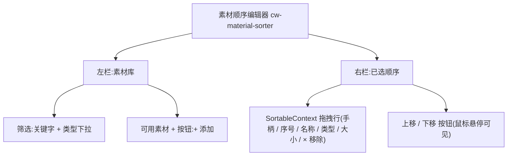
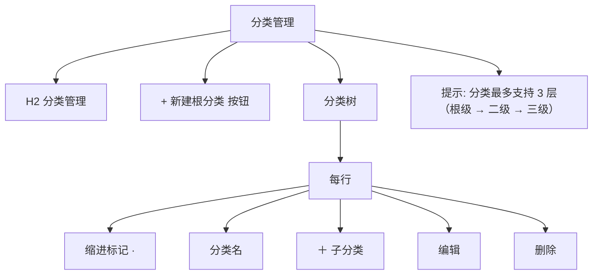
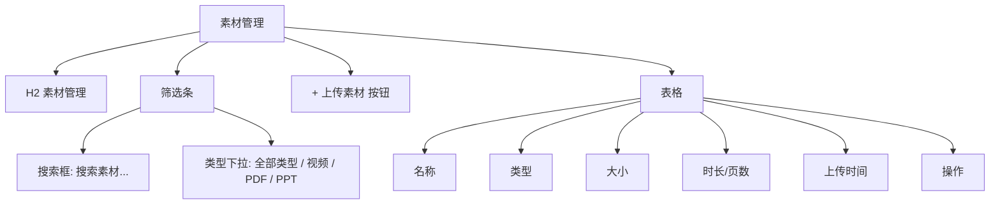
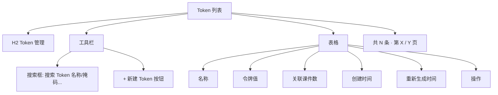
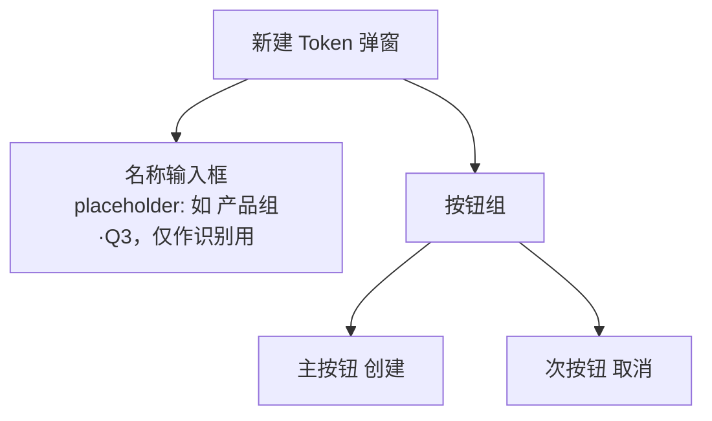

# 04. 管理后台规格

> 本章定义 `http://localhost/admin` 管理后台的全部页面、模块、字段、交互。所有内容来自对线上实例的反向观察。

## 1. 总览

### 1.1 入口与鉴权

- 入口：`http://localhost/admin`
- 鉴权方式：Admin Token（统一凭据）。
- 演示 Token：`demo`（本地环境）。
- 登录成功后默认进入 `课件管理` 模块。

### 1.2 导航结构

### 1.3 通用布局

- 顶部固定导航：左 `Learning Hub` 链接 / 中 5 个模块链接（含 Token 管理）/ 右 `退出` 按钮。
- 主区域：每个模块独立页面，标题 H2 + 内容区。
- 操作按钮统一蓝色，危险操作（删除）使用灰色或文本按钮 + 二次确认。

## 2. 登录页

### 2.1 布局

| 元素 | 描述 |
| ---- | ---- |
| 标题 | `Learning Hub` + 副标题 `管理后台` |
| 表单 | 单字段 `Admin Token`，占位符 `请输入管理员 Token` |
| 按钮 | 主按钮 `登录` |

### 2.2 行为

| 场景 | 期望 |
| ---- | ---- |
| Token 正确 | 进入 `/admin/coursewares`，导航条显示 |
| Token 错误 | 弹窗 / 输入框下提示"Token 无效"，并允许重新输入 |
| 空 Token | 按钮处于 disabled 或提示"请输入 Token" |
| 验证中 | 按钮 disabled，文案 `验证中...` |

## 3. 课件管理

### 3.1 列表页

- 默认按"新建时间"倒序。
- 操作列至少包含"编辑"与"删除"。
- `访问控制`列：`开放`显示纯文本；`受限 · N 个令牌`以偏色标签展示，hover 弹出该课件实际关联的 Token 名称列表（最多前 5 个 + `等 N 个`）。
- 暂无数据时显示 `暂无数据`。

### 3.2 新建 / 编辑课件

#### 3.2.1 字段

| 字段 | 类型 | 必填 | 备注 |
| ---- | ---- | ---- | ---- |
| 课件标题 | 文本 | ✅ | 占位符 `请输入课件标题` |
| 作者 | 文本 | ❌ | 占位符 `作者` |
| 分类 | 下拉 | ✅ | 占位符 `请选择分类`，值为分类树最深层节点 |
| 描述 | 多行文本 | ❌ | 占位符 `课件描述...` |
| 标签 | 多选 | ❌ | 仅可从已维护的标签池中选择 |
| 素材 | 排序 + 增减 | ❌ | v1.5+ 通过内嵌两栏式拖拽排序器：左“素材库”筛选 / 添加，右“已选顺序”拖拽调整 |
| 访问模式 | 单选 | ✅ | 默认 `开放`；值域 `开放 / 受限` |
| 关联 Token | 多选 | 条件必填 | 仅当 `访问模式 = 受限` 时启用，选项来自 Token 管理列表；至少选择 1 项 |

#### 3.2.2 素材库区域（v1.5+ 两栏式排序器）

- v1.5 起旧版复选框 + 关键字筛选块整体替换为左"素材库" + 右"已选顺序"两栏式排序器（`data-testid="cw-material-sorter"`）。
- 拖拽基于 `@dnd-kit/core` + `@dnd-kit/sortable`（`verticalListSortingStrategy`）。
- 键盘可达性：Tab 聚焦手柄 → Space 抓取 → ↑/↓ 移动 → Space 释放 → Esc 取消；`aria-live` 提示位置变更。
- 移除：右栏行末 `×` 按钮（点击立即从右栏移除）。
- 保存：表单提交时 `materialIds` 按右栏当前顺序写入 payload；后端根据是"集合替换"还是"专用排序"调用不同接口。
- `data-testid` 兼容：根 `cw-material-sorter`；行 `cw-material-sorter-row-{id}`；手柄 `cw-material-sorter-handle-{id}`；上/下移 `cw-material-sorter-up-{id}` / `cw-material-sorter-down-{id}`；移除 `cw-material-sorter-remove-{id}`；左栏项 `cw-material-available-{id}` / `cw-material-add-{id}`。
- **PPT/PPTX 上传成功后，后台自动调用 LibreOffice 转 PDF；若转换失败仅记录日志、不阻断上传，前台 P-VIEWER 会兜底为下载链接**。

#### 3.2.3 操作

| 按钮 | 行为 |
| ---- | ---- |
| 取消 | 放弃编辑，回到列表页 |
| 发布 | 校验必填字段后保存，成功后跳回列表页 |

#### 3.2.4 校验

- 标题为空 → 阻止提交，提示"请输入课件标题"。
- 分类未选 → 阻止提交，提示"请选择分类"。
- 标签无数据时显示"请先在标签管理中创建标签"。
- `访问模式 = 受限` 但 `关联 Token` 为空 → 阻止提交，提示"请至少关联一个访问令牌"。
- `访问模式 = 受限` 但 Token 管理为空 → `关联 Token` 多选不可选，提示"请先在 Token 管理中创建访问令牌"。

## 4. 分类管理

### 4.1 列表页

### 4.2 行为

| 操作 | 规则 |
| ---- | ---- |
| 新建根分类 | 直接创建顶级分类 |
| 新建子分类 | 在选中节点下新增子节点；当前节点已是 3 级时按钮 disabled |
| 编辑 | 行内编辑名称，回车保存 |
| 删除 | 二次确认；若存在子节点或课件关联，禁止删除并提示 |

### 4.3 示例（来自线上实例）

| 根分类 | 子分类（示例） |
| ------ | -------------- |
| 项目运营 | （按需扩展） |
| 项目管理 | （按需扩展） |
| 软件工程 | （按需扩展） |
| 组织变革 | （按需扩展） |
| 实践与案例 | （按需扩展） |

> 注：演示实例当前仅展示了 5 个根分类，未展开子分类。

## 5. 标签管理

### 5.1 列表页

| 列 | 描述 |
| ---- | ---- |
| 标签名称 | 文本 |
| 关联课件数 | 数字，被引用计数 |
| 操作 | 重命名 / 删除 |

### 5.2 新建标签

- 触发：`+ 新建标签` 按钮。
- 弹窗包含：标题 `新建标签`、单字段 `标签名（必填）`、按钮 `创建` / `取消`。
- 校验：名称为空时按钮 disabled。

### 5.3 重命名

- 行内编辑或弹窗编辑，按钮 `重命名`。

### 5.4 删除

- 二次确认。
- 删除后自动从所有课件的标签列表中解绑。

## 6. 素材管理

### 6.1 列表页

### 6.2 上传素材

| 元素 | 描述 |
| ---- | ---- |
| 触发区 | `📤 点击上传或拖拽文件` |
| 文案 | `支持 MP4 / PDF / PPT / PPTX，单文件最大 200MB` |
| 已选择 | `已选择：xxx.pdf（xx B）` |
| 操作按钮 | `确认上传` / `取消` |

#### 6.2.1 校验

| 规则 | 处理 |
| ---- | ---- |
| 文件扩展名不在白名单 | 弹窗提示"不支持的文件类型" |
| 文件大小 > 200MB | 弹窗提示"超出 200MB 上限" |
| 服务端存储不可写 | 弹窗显示后端错误（演示中曾出现 `/app/storage/documents` 不可写） |

#### 6.2.2 表格字段

| 列 | 说明 | 后端字段 |
| ---- | ---- | ---- |
| 名称 | 原文件名 | `name` |
| 类型 | VIDEO / PDF / PPT | `type` |
| 大小 | 自动格式化 KB / MB | `sizeBytes` |
| 时长 / 页数 | 视频为时长，PDF/PPT 为页数 | `duration` |
| 预览 PDF | PPT/PPTX 上传后由 LibreOffice 生成的预览 PDF 路径（后台可读，前台不返回）；其它类型留空 | `previewPdfPath` |
| 上传时间 | ISO-8601 | `uploadedAt` |
| 引用状态 | 已被课件引用时显示 `已引用` | `referenced` |
| 操作 | 下载 / 删除 | - |

### 6.3 删除素材

- 二次确认；存在课件引用时禁止删除并提示。
- 删除时会同步清理 `preview_pdf_path` 指向的物理 PDF 文件（如存在）。

## 7. Token 管理

### 7.1 列表页

- 名称**必填且全局唯一**（业务规则 R-04b），创建 / 重命名时需手动输入。
- 令牌值列默认以掩码形式显示（前 4 + `****` + 后 4），点击 列右侧 `查看明文` 仅限该 Token 创建后 5 分钟内，超时要求走重新生成。
- 关联课件数展示当前 Token 解锁的课件数；点击可前往课件列表并预过滤。

### 7.2 新建 Token

- 校验：名称长度 1-50 字符、可包含中文 / 字母 / 数字 / `-` / `_`，**必填且全局唯一**（业务规则 R-04b，与 spec 05/10 保持一致）。名称为空或与已存在 Token label 重名时按钮 disabled 或后端返回 `409 token_label_conflict`。
- 点击`创建`后提交，服务端生成 24 位 base36 Token 值，返回前端一次性明文展示，提示“请妥善保存，刷新后将不再显示”，同时提供`复制明文`按钮。

### 7.3 编辑 / 重新生成 Token

| 操作 | UI | 后台动作 |
| ---- | -- | -------- |
| 重命名 | 行内编辑名称 | 仅更新名称 |
| 重新生成 | 弹窗提示`重新生成将令旧令牌立即失效，确认继续？` → 确认 | 服务端生成新的 Token 值；原值（或原 `value_hash`）全局失效；前端一次性明文返回新值；**若该 Token 是某受限课件的最后一个有效 Token，弹窗转为 `422 last_token_required` 错误提示并拒绝执行**，后台列表给出转开放引导 |
| 删除 | 二次确认 | 从所有课件上解绑后删除 Token；**若该 Token 是某受限课件的最后一个有效 Token，服务端返 `422 last_token_required`，后台拒绝并提示`请先将课件转为开放模式`** |

### 7.4 弹窗与二次确认

| 弹窗 | 触发点 | 行为 | 校验 |
| ---- | ------ | ---- | ---- |
| 重新生成 Token 二次确认 | A-TK-LIST 行内 `重新生成` | 提示`重新生成将令旧令牌立即失效，确认继续？`；默认焦点落 `取消` | 若该 Token 是受限课件的最后一个有效 Token → 后端返 `422 last_token_required`，弹窗转为错误提示并拒绝执行 |
| 删除 Token 二次确认 | A-TK-LIST 行内 `删除` | 提示`确认删除该 Token？` + `从 N 个课件上解绑` 数量；默认焦点落 `取消` | 同上，业务规则 R-12 |
| 新建 Token 弹窗（A-TK-NEW） | A-TK-LIST `+ 新建 Token` | 单字段名称输入 + `创建` / `取消` | 名称长度 1-50；为空或重复时按钮 disabled / 后端返 `409 token_label_conflict` |
| 一次性明文展示 | A-TK-NEW 创建成功 / 重新生成成功 | 弹窗或独立页：`value` 全文 + `复制明文` 按钮 + 提示`请妥善保存，刷新后将不再显示` | 无需二次确认 |

### 7.5 校验

- 名称为必填，长度 1-50 字符，全局唯一（业务规则 R-04b）。
- 重新生成前必须二次确认，避免误操作丢失下发给学习者的 Token。
- **业务规则 R-12**：受限课件必须保留 ≥1 个有效 Token；删除或重新生成最后一个 Token 时拒绝并提示。

## 8. 通用交互

| 场景 | 期望 |
| ---- | ---- |
| 操作成功 | 当前列表自动刷新 |
| 操作失败 | 顶部 / 弹窗内提示错误信息 |
| 表单提交中 | 按钮 disabled，文案 `xxx中...` |
| 离开未保存表单 | 浏览器原生二次确认 |

## 9. 文案与视觉

- 全部简体中文。
- 主题色蓝色。
- 按钮圆角统一。
- 行内操作按钮使用文字按钮而非图标。

## 10. 接口契约

> 完整的 HTTP API 路径、方法、请求体、响应体、错误码、curl 示例见 [10-API设计规范](./10-API设计规范.md)。本节不再重复。

---

## 11. 访问记录(Access Token Usage)

> v1.4 引入:在访问令牌列表的操作区追加「访问记录」链接,展开该 token 在 P-VIEWER 中的访问台账。

### 11.1 入口

- 路径:/admin/access-tokens/:id/usage
- 触发:访问令牌列表行操作区点击「访问记录」按钮,导航到该路径。
- 鉴权:与其它管理页面一致,需 admin 已登录(AdminGuard)。

### 11.2 页面元素

- **标题区**:显示「访问记录」+ 标签 + 哈希前缀(16 位) + 创建时间;左下角「← 返回访问令牌」链接。
- **筛选区**:
  - 起 <date> / 止 <date>(默认近 7 天)
  - 快捷按钮:近 7 天 / 近 30 天
- **概览卡片**(4 张):总停留时长 / 总访问次数 / 覆盖课件 / 覆盖素材
- **Tabs**:
  - 「按素材汇总」(默认):素材名 / 类型 / 所属课件 / 访问次数 / 总停留(秒,转 mm:ss) / 最近访问;按 	otalDurationSeconds DESC。
  - 「访问台账」:开始时间 / 结束时间 / 停留 / 课件 / 素材 / 类型 / IP / 状态(进行中/已结束);分页(page=1&size=20)。

### 11.3 业务规则

- 仅 RESTRICTED 受限课件的素材浏览才会被记录;OPEN 课件不计入。
- 时间段为闭开区间 [start 00:00, end+1 00:00),按 UTC 落库。
- 进行中会话(ended_at IS NULL)的停留用 
ow() - started_at 实时估算,可能略变;已 leave 的会话使用客户端上报的 duration_seconds(并按 B-2 服务端校正)。
