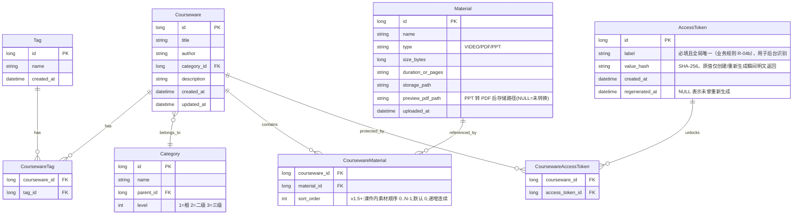
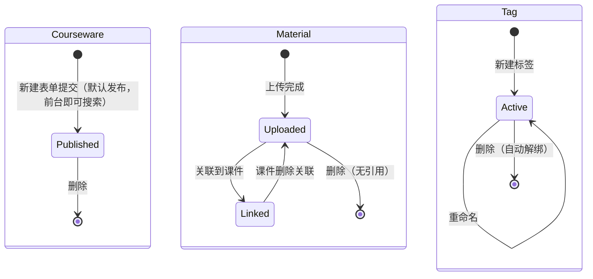

# 05. 数据模型

> 本章定义 Learning Hub 的核心数据实体、字段与关系模型。模型来源于对线上实例功能行为的反推，标注"推断"的字段表示仅根据 UI 推测、以实现为准。

## 1. 实体关系图

## 2. 字段详解

### 2.1 课件（Courseware）

| 字段 | 类型 | 必填 | 说明 |
| ---- | ---- | ---- | ---- |
| id | Long | ✅ | 主键 |
| title | String | ✅ | 课件标题 |
| author | String | ❌ | 作者 |
| category_id | Long | ✅ | 指向 Category.id，仅允许选择到 3 级节点 |
| description | Text | ❌ | 多行描述 |
| access_mode | Enum | ✅ | `OPEN` / `RESTRICTED`；默认 `OPEN`；受限模式下必须关联 ≥1 个生效的 AccessToken（业务约束 R-12） |
| created_at | DateTime | ✅ | 创建时间（列表按此倒序） |
| updated_at | DateTime | ✅ | 更新时间 |

### 2.2 分类（Category）

| 字段 | 类型 | 必填 | 说明 |
| ---- | ---- | ---- | ---- |
| id | Long | ✅ | 主键 |
| name | String | ✅ | 分类名称 |
| parent_id | Long | ❌ | 父分类 id，根分类为 NULL |
| level | Int | ✅ | 1 / 2 / 3，受 `level ≤ 3` 约束 |

> 业务规则：
> - 同一父节点下名称唯一。
> - 删除分类时若存在子节点或被课件引用，禁止删除。

### 2.3 标签（Tag）

| 字段 | 类型 | 必填 | 说明 |
| ---- | ---- | ---- | ---- |
| id | Long | ✅ | 主键 |
| name | String | ✅ | 标签名，全局唯一 |
| created_at | DateTime | ✅ | 创建时间 |

> 标签与课件是 M:N 关系，通过 `CoursewareTag` 关联。

### 2.4 素材（Material）

| 字段 | 类型 | 必填 | 说明 |
| ---- | ---- | ---- | ---- |
| id | Long | ✅ | 主键 |
| name | String | ✅ | 原始文件名 |
| type | Enum | ✅ | `VIDEO` / `PDF` / `PPT` |
| size_bytes | Long | ✅ | 文件字节数 |
| duration_or_pages | String | ❌ | 视频为时长（如 `12:34`），PDF/PPT 为页数 |
| storage_path | String | ✅ | 服务端物理路径（如 `/app/storage/documents/xxx.pdf`） |
| preview_pdf_path | String | ❌ | PPT/PPTX 上传后由 LibreOffice 转换出的 PDF 路径；为 `NULL` 表示未转换或转换失败未重试。其它类型始终为 `NULL`。 |
| uploaded_at | DateTime | ✅ | 上传时间 |

> 业务规则：
- 上传大小上限 200MB。
- 扩展名白名单：`.mp4` / `.pdf` / `.ppt` / `.pptx`。
- 删除素材若被课件引用，禁止删除。
- PPT/PPTX 上传成功后，后台自动调用 LibreOffice 转 PDF。转换失败仅记日志，不阻断上传；转换结果写入 `preview_pdf_path`。
- 删除素材时若 `preview_pdf_path` 存在，同步物理删除转换后的 PDF 文件。

### 2.5 访问 Token（AccessToken）

| 字段 | 类型 | 必填 | 说明 |
| ---- | ---- | ---- | ---- |
| id | Long | ✅ | 主键 |
| `label` | String | ✅ | Token 名称，**全局唯一**，用于后台识别 |
| `value_hash` | String | ✅ | Token 原值的 SHA-256 哈希；原文不持久化，仅在创建/重新生成瞬间返回 |
| `created_at` | DateTime | ✅ | 创建时间（原始值对应的时间） |
| `regenerated_at` | DateTime | ❌ | 最近一次重新生成时间，NULL 代表未重新生成过 |

> 业务规则：
> - Token 值由服务端随机生成（推荐长度 24 字符 / base36），足读性优先级低于碰撞概率。
> - `label` **必填且全局唯一**（含空格、特殊符号也不允许重名）；创建或重命名时若 label 重复，服务端返回 `409 token_label_conflict`。
> - `value_hash` 不应在 API 响应、对象序列化、日志、客户端存储中出现原文。

### 2.6 课件与素材关联（CoursewareMaterial）

| 字段 | 类型 | 必填 | 说明 |
| ---- | ---- | ---- | ---- |
| courseware_id | Long | ✅ | 指向 Courseware.id |
| material_id | Long | ✅ | 指向 Material.id |
| sort_order | Integer | ✅(v1.5+) | 课件内素材的展示顺序（学习路径），同一课件内 0..N-1 连续递增；迁移期默认 0 |

> 业务规则(v1.5+)：
> - R-13 课件内的素材有一个由管理员设定的 `sortOrder`（整数、非负、连续递增），用于前台展示与排序参考。
> - R-14 仅管理员可修改 `sortOrder`；前台只读，不暴露排序编辑入口。
> - R-15 `sortOrder` 是课件维度的相对顺序（每个课件内 0..N-1），跨课件不共享。
> - R-16 新增素材时默认追加到末尾（`sortOrder = 当前最大 + 1`）。删除素材时其余素材保持原 `sortOrder`，不重排。
> - R-17 `sortOrder` 与 `materialId` 一一对应；同一课件内不允许重复 `materialId`。
> - R-18 前台详情页（P-DETAIL）按 `sortOrder ASC` 渲染素材列表；存在则忽略 `materialId` 物理顺序。
> - R-19 专用排序接口 `PUT /api/admin/coursewares/{id}/materials/order` 接受完整 `materialIds` 数组，服务端按数组下标重写 `sortOrder`（0..N-1），并校验：课件存在、全部 ID 属于该课件、数量一致、无重复。
> - R-20 现有 `PUT /api/admin/coursewares/{id}` 中的 `materialIds` 字段**继续按集合语义处理**（仅替换素材集合；新素材追加到末尾，旧素材保留原 `sortOrder`），不破坏现有调用方。排序调整必须走专用接口。

### 2.7 课件与 Token 关联（CoursewareAccessToken）

| 字段 | 类型 | 必填 | 说明 |
| ---- | ---- | ---- | ---- |
| courseware_id | Long | ✅ | 指向 Courseware.id |
| access_token_id | Long | ✅ | 指向 AccessToken.id |

> 业务规则：
> - 该表是 Courseware 与 AccessToken 的 M:N 关联表。
> - 同一对（courseware_id, access_token_id）允许状态记录（UNIQUE 约束）。
> - 删除 AccessToken 时需同步清理该表记录（同事务）；删除课件亦同步清理。

## 3. 关系与级联

| 关系 | 基数 | 级联策略 |
| ---- | ---- | -------- |
| Category → Category | 1 : N（parent → children） | 删除父节点禁止；子节点保留 |
| Courseware → Category | N : 1 | 课件删除后释放分类引用；分类删除前须确保无引用 |
| Courseware ↔ Tag | M : N | 标签删除时自动解绑全部课件 |
| Courseware ↔ Material | M : N | 素材删除前须确保无引用 |
| Courseware ↔ AccessToken | M : N | 删除 Token 自动从所有课件解绑；删除课件同步清理授权 |

## 4. 生命周期

## 5. 业务规则清单

| 编号 | 规则 |
| ---- | ---- |
| R-01 | 课件标题不可为空 |
| R-02 | 课件必须挂载到 3 级分类中 |
| R-03 | 分类最大深度为 3 |
| R-04 | 标签名全局唯一 |
| R-04b | AccessToken.label 全局唯一且必填 |
| R-05 | 素材大小 ≤ 200MB |
| R-06 | 素材扩展名必须为 mp4/pdf/ppt/pptx |
| R-07 | 删除分类 / 标签 / 素材时若存在下游引用，禁止删除 |
| R-08 | 前台搜索返回的课件必须是已发布状态 |
| R-09 | 受限课件必须至少关联 1 个处于生效状态的 AccessToken |
| R-10 | AccessToken 值仅在创建 / 重新生成瞬间以明文返回 1 次，其余位置均以 `value_hash` 与掩码形式存储与展示 |
| R-11 | AccessToken 删除或重新生成后，所有相关课件立即按最新授权状态生效（無过渡期） |
| R-12 | **受限课件（access_mode = RESTRICTED）必须始终保持至少 1 个有效 AccessToken 关联**。删除或重新生成最后一个 Token 时，服务端拒绝该操作（`422 last_token_required`），前端引导管理员先将课件转为开放模式 |

## 6. 派生 / 计算字段（非持久化）

以下字段仅出现在 API 响应中，由服务端实时计算，不入库：

| 实体 | 字段 | 类型 | 说明 | 出现位置 |
| ---- | ---- | ---- | ---- | -------- |
| Courseware | `accessTokenCount` | int | 当前关联的 AccessToken 数 | [10 §4.1.1](./10-API设计规范.md) |
| Courseware | `categoryPath` | string[] | 从根到叶的分类名路径，服务端拼接 | [10 §4.1.1](./10-API设计规范.md) |
| Material | `referenced` | bool | 是否被任意课件引用；为 `true` 时禁止删除 | [10 §4.4.1](./10-API设计规范.md) |
| Material | `downloadUrl` / `streamUrl` | string | 间接访问路径，不返回 `storage_path` | [10 §4.4.1 / §5.2](./10-API设计规范.md) |
| Material | `previewReady` | bool | 派生：VIDEO/PDF 始终 `true`；PPT 在 `preview_pdf_path` 存在且文件可访问时为 `true`，供 P-VIEWER 提示“正在生成预览” | [10 §5.2.3](./10-API设计规范.md) |
| AccessToken | `maskedValue` | string | 掩码（前 4 + `****` + 后 4），由 `value_hash` 不可逆生成（仅为显示约定，不保证唯一性） | [10 §4.5.1](./10-API设计规范.md) |
| AccessToken | `coursewareCount` | int | 当前解锁的课件数 | [10 §4.5.1](./10-API设计规范.md) |
| AccessToken | `value`（明文） | string | 仅创建 / 重新生成瞬间返回 1 次；其它任何位置（响应体、日志、客户端存储）均不出现 | [10 §4.5.2 / §4.5.5](./10-API设计规范.md) |
| Tag | `coursewareCount` | int | 实时反向引用计数 | [10 §4.3.1](./10-API设计规范.md) |
| Category | - | - | 分类树由 `parent_id` + `level` 计算，无需额外字段 | [10 §4.2.1](./10-API设计规范.md) |

> 字段命名 / 枚举值以 [10-API §6](./10-API设计规范.md) 为权威。
>
> **注意**：`Courseware.access_mode` 是持久化字段（见 [§2.1](#21-课件courseware)），不属于本派生表；它在后台表单与 API 响应中均以字符串 `"OPEN"` / `"RESTRICTED"` 表示。

---

## 7. 索引建议（推断）

| 表 | 索引 |
| ---- | ---- |
| courseware | `(category_id)`、`(created_at DESC)`、标题 FULLTEXT |
| category | `(parent_id)`、`(name, parent_id)` UNIQUE |
| tag | `(name)` UNIQUE |
| material | `(type)`、`(uploaded_at DESC)`、名称 FULLTEXT |
| courseware_tag | `(courseware_id, tag_id)` UNIQUE |
| courseware_material | `(courseware_id, material_id)` UNIQUE、`(courseware_id, sort_order)`(v1.5+) |
| courseware_access_token | `(courseware_id, access_token_id)` UNIQUE |
| access_token | `(created_at DESC)` |

---

## 7. 访问会话(AccessSession) · v1.4

> 记录某个 token 持有者在 P-VIEWER 中对某条 RESTRICTED 课件素材的一次完整浏览(起 → 止 + 停留秒数)。用于在管理后台为该 token 提供"访问记录"页面。

### 7.1 表 `access_session`

| 字段 | 类型 | 约束 | 说明 |
| --- | --- | --- | --- |
| `id` | BIGSERIAL | PK | 主键 |
| `token_id` | INTEGER | NOT NULL, FK `access_token.id` ON DELETE CASCADE, INDEX | 所属访问令牌 |
| `courseware_id` | INTEGER | NOT NULL, FK `courseware.id` ON DELETE CASCADE, INDEX | 受限课件(同一素材被多个 RESTRICTED 课件引用时取 id 最小) |
| `material_id` | INTEGER | NOT NULL, FK `material.id` ON DELETE CASCADE, INDEX | 浏览的素材 |
| `started_at` | TIMESTAMPTZ | NOT NULL | 进入 P-VIEWER 时间 |
| `ended_at` | TIMESTAMPTZ | NULL | 离开时间(进行中为 NULL) |
| `duration_seconds` | INTEGER | NULL, CHECK ≥ 0 | 停留秒数(leave 时回填) |
| `client_leave` | BOOLEAN | NOT NULL DEFAULT FALSE | 是否收到客户端 close 信号 |
| `ip` | INET | NULL | 客户端 IP |
| `ua` | VARCHAR(256) | NULL | User-Agent |
| `created_at` | TIMESTAMPTZ | NOT NULL DEFAULT now() | 入库时间 |

**索引**

- `ix_access_session_token_started (token_id, started_at)` — 明细分页主索引
- `ix_access_session_token_material (token_id, material_id, started_at)` — 按素材聚合
- `ix_access_session_token_courseware (token_id, courseware_id, started_at)` — 按课件聚合(预留)

### 7.2 业务规则

- **B-1** 仅当素材被至少一个 RESTRICTED 课件引用时才允许落库;OPEN 课件的浏览不记录(`recorded=false`)。
- **B-2** 客户端上报 `duration_seconds` 与 `ended_at - started_at` 偏差 > 60s 时,按服务端时间校正(防客户端时钟漂移/篡改)。
- **B-3** token 重新生成(regenerate)后,旧 token_id 上的历史 session 仍归属该 id(不回写、不删除),与"同 label 多次明文切换"语义一致。
- **B-4** delete token 时通过 FK CASCADE 一并清理其 session(不必保留匿名历史)。
