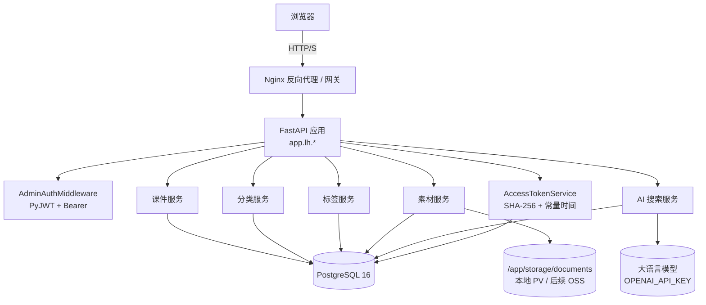
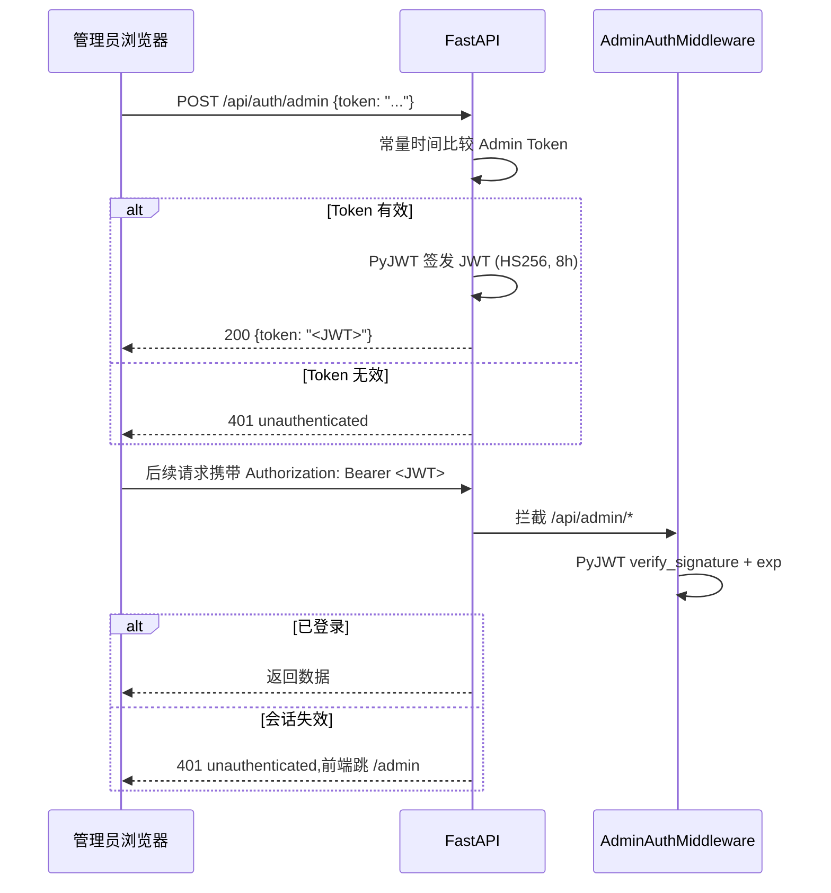
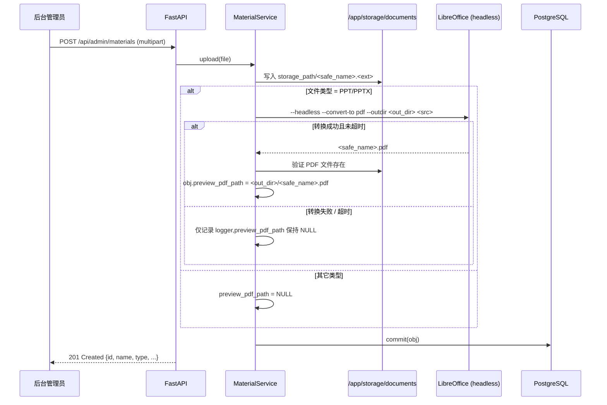
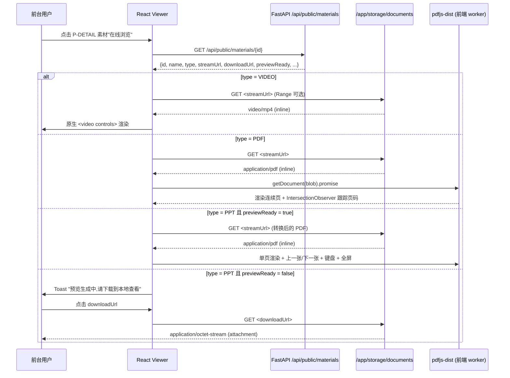

# 07. 技术架构

> 本章定义 Learning Hub v1.0 的正式技术架构。后端采用 **Python 3.11+ / FastAPI**,前端采用 **React 18 + Vite + TypeScript**,持久层采用 **PostgreSQL 16**。部署形态为 **Docker Compose 多容器**,生产可平滑迁移到阿里云 ECS + ACR。

## 1. 总体架构

## 2. 技术栈选型

### 2.1 后端

| 维度 | 选型 | 说明 |
| ---- | ---- | ---- |
| 语言 | Python 3.11+ | 类型注解 + Pydantic v2 强校验 |
| 框架 | FastAPI | 异步 ASGI、自动 OpenAPI、性能与 Spring Boot 对标 |
| ORM | SQLAlchemy 2.0 | 异步 API + Mapped[] 类型化风格 |
| 迁移 | Alembic | 与 SQLAlchemy 同生态,生产可滚动升级 |
| 校验 | Pydantic v2 | 与 FastAPI 同生态,Rust 核心理论性能优于 Bean Validation |
| 安全 | PyJWT + passlib | JWT 签发/校验、bcrypt 哈希 |
| Web 容器 | Uvicorn (uvloop) | ASGI 高性能服务器 |
| 包名空间 | `app.lh.*` | 模块化分层:`core / models / schemas / services / api` |
| 构建/依赖 | Poetry / pyproject.toml | 锁文件 + 可重现部署 |
| 限流 | SlowAPI (Redis 后端) | 与 Flask-Limiter 同源,支持 IP + 业务键双键限流 |
| 异步 HTTP | httpx | LLM 调用、超时与降级实现优雅 |
| PPT 转 PDF | LibreOffice（headless 模式，系统级依赖） | 调用 `--headless --convert-to pdf`；仅安装 `impress` + `core` 子包，避免 writer/calc 冗余；安装路径 / 二进制名可通过 `LIBREOFFICE_PATH` 环境变量配置 |

### 2.2 前端

| 维度 | 选型 | 依据 |
| ---- | ---- | ---- |
| 核心框架 | React 18（函数组件 + Hooks） | 生态成熟、企业内训主流、社区资源最丰富 |
| 语言 | TypeScript 5.x | 与 Pydantic v2 等价的强类型保障前后端契约 |
| 构建 | Vite 5 | 启动 < 1s、HMR 即时反馈、ESBuild 极速 |
| 状态管理 | Zustand | 比 Redux 轻量 90%,无样板代码,易做状态机切片 |
| 路由 | React Router 6 | 同时支持路径参数(`/courseware/:id`)与查询参数(`?locked=true`) |
| 视图组织 | TSX + Tailwind CSS | 组件 + 原子化样式,设计 token 统一在 `tailwind.config.ts` |
| HTTP 客户端 | axios + @tanstack/react-query | 拦截器统一错误处理 + 缓存与重试 |
| PDF 渲染 | pdfjs-dist ^4.7.76 | P-VIEWER-VIDEO/PDF/PPT 共用；`pdf.worker.min.mjs` 通过 Dockerfile `cp` 进 `frontend/dist` 根目录 |
| E2E 测试 | Playwright | 内置 test runner,与 Chrome DevTools MCP 联动 |
| 部署形态 | 编译为静态资源(JS / CSS),Nginx 提供或挂 FastAPI 静态路径;与后端 API 解耦,可独立构建 |

### 2.3 存储

| 维度 | 选型 | 说明 |
| ---- | ---- | ---- |
| 关系数据库 | PostgreSQL 16 | 主键 BIGSERIAL、外键 + 复合索引、ILIKE 关键词搜索已足够 v1.0 |
| 文件存储 | 本地 `/app/storage/documents` | v1.0 容器内 PV;v1.1 抽象为 S3 兼容对象存储(阿里云 OSS) |
| 缓存/限流后端 | Redis 7(可选) | SlowAPI 在多 worker 部署时切换 Redis 作为共享计数;单实例可走内存模式 |
| 搜索引擎 | PostgreSQL ILIKE + LLM 重排(可选) | v1.0 关键词回退已可验收;v2.0 可引入向量数据库(pgvector / Milvus) |

### 2.4 AI 能力

| 维度 | 选型 | 说明 |
| ---- | ---- | ---- |
| 大模型 | OpenAI / Anthropic / 任意兼容 OpenAI API 的服务 | 通过 `OPENAI_API_KEY` 环境变量启用 |
| 检索范式 | LLM 重排 + 关键词回退 | 默认 5s 硬超时,失败自动降级到 PostgreSQL ILIKE |
| 提示词 | `prompts/search_rerank.md` | 从课件标题/描述/标签中选 Top N,JSON 格式输出 |

## 3. 部署形态

- 本地开发：`docker-compose up -d` 启动 `postgres + backend + frontend`，Vite 前端 + FastAPI 后端均支持热重载。
- 生产部署：
  - 镜像化交付，后端 Dockerfile 多阶段构建(alpine-base → poetry-install → runtime-slim)。
  - 素材存储推荐 OSS / S3，通过 `STORAGE_BACKEND` 环境变量切换驱动实现。
  - 数据库独立部署，主从分离;敏感凭据走 Secrets Manager。
  - **PPT 转 PDF 服务节点**：LibreOffice 与 FastAPI 同容器部署（v1.0），通过 `libreoffice --headless` 子进程调用;后续如需瘦身可迁移到独立 sidecar 容器（v1.x 候选）。
- HTTPS：Nginx 终结 TLS;后端仅监听内网端口。
- 文件路径示意 `/app/storage/documents` 仍保留，容器初始化脚本创建该目录并挂载 PV;LibreOffice 转出的预览 PDF 存放在该目录与原素材同级的 `<safe_name>.pdf`。

## 4. 鉴权流程

## 5. 关键模块的边界

| 模块 | 主要职责 | 不应承担 |
| ---- | -------- | -------- |
| AdminAuthMiddleware (app.lh.middleware) | 解析 Authorization Bearer JWT、解码管理员身份 | 业务规则校验 |
| AccessTokenService (app.lh.services) | 创建/重命名/重新生成/删除 AccessToken、Token 与课件绑定 | 课件 CRUD |
| 课件服务 | 课件 CRUD + 关联管理(分类/标签/素材/Token) | AI 检索排序逻辑 |
| 分类服务 | 分类树维护与查询、3 级深度校验 | 文件管理 |
| 标签服务 | 标签 CRUD、全局唯一性约束 | 文件管理 |
| 素材服务 | 文件上传 / 删除 / 元数据管理、大小+扩展名校验;PPT 转 PDF 调度 | 课件业务规则 |
| 搜索服务 | 自然语言 → 课件列表,LLM 重排 + 关键词回退 | 课件 CRUD |

## 6. 关键数据流

### 6.1 素材上传（含 PPT 转 PDF）

### 6.2 素材预览（前台 P-VIEWER）

## 7. 演进建议

| 阶段 | 建议 |
| ---- | ---- |
| **V1.0(当前)** | **Python 3.11 + FastAPI + React 18 单实例 Docker 部署,统一 Admin Token + AccessToken 双轨鉴权** |
| V1.1 | 拆分为独立模块服务(课件 / 素材 / 搜索),引入 Celery 处理 200MB 上传转码 |
| V1.2 | 引入 RBAC 管理员账号,替换单一 Admin Token |
| V2.0 | 引入 pgvector / Milvus 向量数据库 + LLM 实现更高质量的语义检索 |
| V2.1 | 增加学习者侧能力:收藏、学习进度、推荐 |

## 8. 已知风险

| 风险 | 说明 |
| ---- | ---- |
| 文件存储耦合本地路径 | 容器重启 / 漂移可能导致文件丢失 → 后续接 OSS |
| 单一 Admin Token 鉴权 | 不可审计到人 → 后续接 RBAC |
| AI 搜索依赖外部 LLM | 外部服务故障将直接影响前台可用性 → 关键词回退 + 5s 超时降级 |
| 前端单页 + 同 URL 多状态 | 浏览器前进 / 后退可能与用户预期不一致 → 既支持路径参数也兼容查询参数 |
| Python 单 worker GIL | CPU 密集型任务受限;ASGI 多进程可绕开;LLM 调用为主 I/O 密集 |

> Token 服务模块接入说明:课件访问 Token 通过独立服务(`app.lh.services.AccessTokenService`)承担创建、重命名、重新生成、删除与课件授权绑定;在受限课件的详情接口上以 FastAPI Dependency 注入方式应用 ACL(模块:`app.lh.middleware.courseware_acl`),不走 `AdminAuthMiddleware`。该服务状态变化在同一进程的下一个请求周期生效。