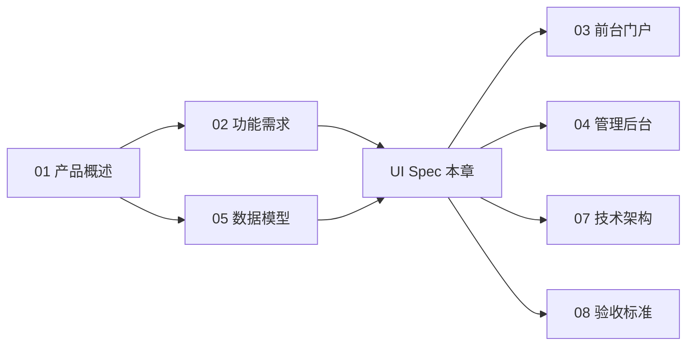
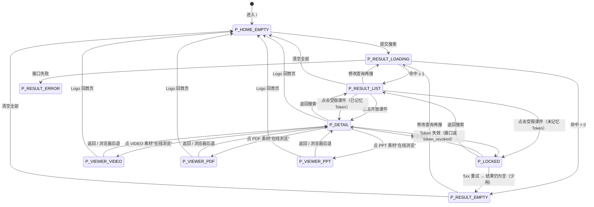
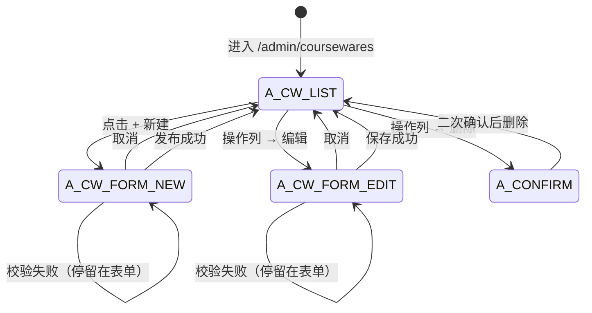
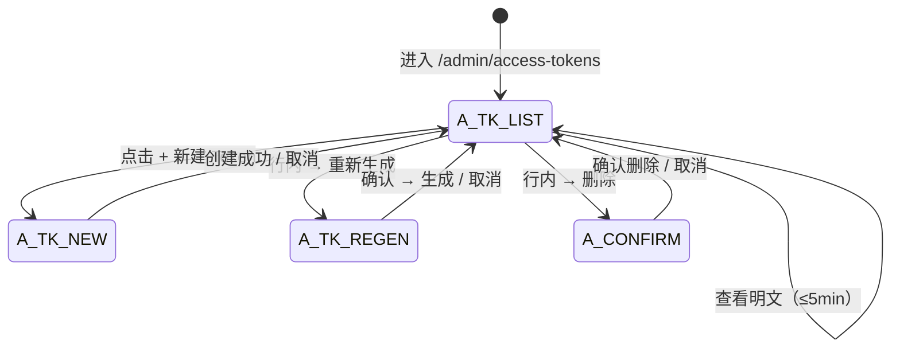
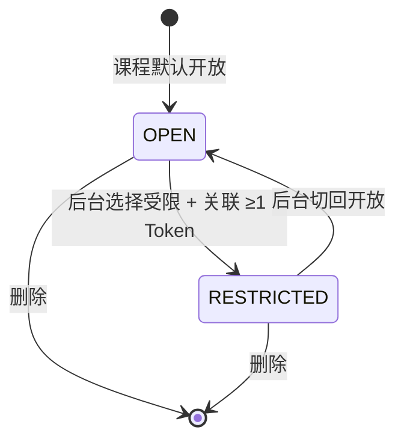

# 09. UI 规格说明

> 本章在 [03-前台门户规格](./03-前台门户规格.md) 与 [04-管理后台规格](./04-管理后台规格.md) 的基础上，把"页面"作为最小 UI 单元，对**UI 实体 ↔ 业务实体 ↔ 用户互动**做矩阵化呈现，便于设计、研发、测试三方在同一张表上对齐。
>
> **生成日期**: 2026-07-06
> **基准规格**: v1.0（含课件访问 Token 受控访问特性）
> **基准实例**: `http://localhost`（前台门户）/ `http://localhost/admin`（管理后台）

---

## 0. 本章导读

### 0.1 读者

| 角色 | 阅读建议 |
| ---- | -------- |
| 设计师 | 直接读 02. UI 实体清单与 04. 互动矩阵，确认页面归属、控件命名、视觉层级 |
| 前端开发 | 全部章节；尤其 04 矩阵 → 05 状态机 → 07 可访问性 |
| 后端开发 | 03 业务实体清单与 04 矩阵中的读 / 写列 |
| 测试 | 04 矩阵 + 05 状态机，可直接生成 [08-验收标准](./08-验收标准.md) 的用例 |

### 0.2 与其他章节的关系

- **02** 提供功能编号（F01.x、F03.x…），UI 矩阵的"关联条款"列直接回指。
- **03 / 04** 提供原页面层级说明；本章把它们按 UI 实体粒度重新组织。
- **05** 提供业务实体定义，本章矩阵的"业务实体"列直接采用。
- **08** 提供验收用例，矩阵的"失败处理"列与之一一对应。

### 0.3 矩阵化描述约定

- **行**：UI 实体（页面级，与 03 / 04 中的"页面"概念对齐）。
- **列字段**：
  - 关联业务实体
  - 触发时机（用户行为 / 系统事件 / 状态变化）
  - 前置条件（页面级）
  - 读（页面在该互动中消费哪些业务实体字段）
  - 写（页面在该互动中持久化哪些字段）
  - UI 反馈（跳转 / Toast / 状态更新）
  - 异常处理
  - 关联 Spec（回到 02 / 03 / 04 / 08 的具体条款）

---

## 1. 范围与原则

### 1.1 范围

- 前台门户全部页面（包括课件详情页与新增的受限课件锁定页）。
- 管理后台全部模块的列表 / 新建 / 编辑 / 删除 / 二次确认页面。
- 通用 UI 元素：导航条、Toast、确认弹窗、二次确认对话框。

### 1.2 原则

- **UI 实体粒度 = 页面**：每个独立 URL 或独立弹窗视为一个 UI 实体；不再向下钻取到字段级控件，避免矩阵爆炸。
- **互动单元**：每个页面对应一个或多个互动（用户行为 / 系统触发），互动是矩阵中的最小描述单元。
- **一致性基准**：UI 行为描述与 [03-前台门户规格](./03-前台门户规格.md)、[04-管理后台规格](./04-管理后台规格.md) 中已有的页面状态、状态机一致；当出现差异时以本文矩阵与 03 / 04 互相回链为准。

---

## 2. UI 实体清单

### 2.1 前台 UI 实体

| ID | UI 实体 | 所在路由 / 触发条件 | 模块归属 | 关键控件 |
| -- | ------- | ------------------ | -------- | -------- |
| P-HOME | 前台首页（空态） | `/` 首次进入 | F01 | 标题 / 搜索框 / 搜索按钮 |
| P-RESULT | 前台搜索结果页 | `/` 已输入查询并触发 | F01 | 顶部条 / AI 标签 / 计数 / 清空按钮 / 列表 |
| P-LOCKED | 受限课件锁定页 | 点击受限课件（未记忆 Token） | F01 + F07 | 课件标题 / Token 输入框 / 解锁 / 返回 |
| P-DETAIL | 课件详情页 | 受限课件解锁通过或开放课件点击 | F01 | 标题 / 描述 / 关联素材（在线浏览按钮 / 下载到本地）/ 返回结果 |
| P-VIEWER-VIDEO | 视频在线浏览 | 从 P-DETAIL 点击 VIDEO 素材的“在线浏览” | F01.08 | 顶栏 / 视频播放器 / 信息面板 / 下载链接 |
| P-VIEWER-PDF | PDF Word 式阅读 | 从 P-DETAIL 点击 PDF 素材的“在线浏览” | F01.08 | 顶栏 / 缩放工具条 / 连续滚动页 / 页码气泡 / 下载链接 |
| P-VIEWER-PPT | PPT 幻灯片浏览 | 从 P-DETAIL 点击 PPT/PPTX 素材的“在线浏览” | F01.08 | 顶栏 / 单页画布 / 上一张下一张 / 页码指示器 / 全屏按钮 |

### 2.2 后台 UI 实体

| ID | UI 实体 | 所在路由 | 模块归属 | 关键控件 |
| -- | ------- | -------- | -------- | -------- |
| A-LOGIN | 管理员登录页 | `/admin` | F02 | 标题 / Token 输入框 / 登录按钮 |
| A-NAV | 顶部导航条（共享） | 所有 `/admin/*` | F02 | Logo / 5 个模块链接 / 退出 |
| A-CW-LIST | 课件管理列表 | `/admin/coursewares` | F03 | 搜索框 / 新建按钮 / 表格 / 分页 |
| A-CW-FORM | 新建 / 编辑课件表单 | `/admin/coursewares/new`、`/admin/coursewares/{id}/edit` | F03 | 全部字段（含访问模式 / 关联 Token）/ 发布 / 取消 |
| A-CT-TREE | 分类管理树形页 | `/admin/categories` | F04 | 新建根 / ＋子分类 / 行内重命名 / 删除 |
| A-TG-LIST | 标签管理页 | `/admin/tags` | F05 | 新建 / 重命名 / 删除 / 关联课件数 |
| A-MT-LIST | 素材管理页 | `/admin/materials` | F06 | 搜索 / 类型筛选 / 上传 / 删除 |
| A-TK-LIST | Token 管理列表页 | `/admin/access-tokens` | F07 | 搜索 / 新建 / 名称 / 掩码 / 重新生成 / 删除 |
| A-TK-NEW | 新建 Token 弹窗 | 由 A-TK-LIST 触发 | F07 | 名称 / 创建 / 一次性明文展示 |
| A-TK-REGEN | 重新生成 Token 二次确认 | 由 A-TK-LIST 触发 | F07 | 二次确认 |
| A-TOAST | 全局 Toast 容器 | 全局 | - | 成功 / 失败 / 进度 |
| A-CONFIRM | 通用二次确认弹窗 | 全局 | - | 标题 / 描述 / 确认 / 取消 |

> 后续矩阵以本表 ID 作为主键引用。

---

## 3. 业务实体清单

UI 矩阵中涉及的"业务实体"来源于 [05-数据模型](./05-数据模型.md)，按本规格精简如下：

| 业务实体 | 关键字段（UI 暴露） | 用途 |
| -------- | ------------------ | ---- |
| Courseware | id, title, author, category_id, description, access_mode（推导出）, tag_ids, material_ids, token_ids | 前台检索 / 后台 CRUD |
| Category | id, name, parent_id, level | 后台树形组织 |
| Tag | id, name | 后台扁平词条 + 课件多选 |
| Material | id, name, type, size_bytes, duration_or_pages, preview_pdf_path(后台) | 后台素材库 + 课件内嵌素材 |
| AccessToken | id, label, value_hash, value_plain（仅一次性）, created_at, regenerated_at | 后台 Token 管理 + 前台 ACL |
| CoursewareAccessToken | courseware_id, access_token_id | M:N 关联（用户不可见） |
| SearchQuery | query, matched_count | 前台搜索行为（前端会话态，不持久化） |
| AdminSession | token, expires_at | 后台会话态（前端 localStorage / Cookie） |
| `CoursewareGrant` | `coursewareId` (long), `tokenHash` (string) | 前台 localStorage 记录已解锁 Token 哈希；**localStorage 键规范**：`coursewareTokens`，值结构 `{ [coursewareId: long]: '<sha256 hex 64 字符>' }`（详见 [03-前台门户规格 §4.4](./03-前台门户规格.md) 与本节 §7.2） |

---

## 4. UI 实体 ↔ 业务实体 互动矩阵

### 4.1 前台矩阵

| UI 实体 | 关联业务实体 | 互动 | 触发时机 | 前置条件 | 读 | 写 | UI 反馈 | 异常处理 | 关联 Spec |
| ------- | ------------ | ---- | -------- | -------- | -- | -- | -------- | -------- | --------- |
| P-HOME | SearchQuery, Courseware | 提交搜索 | 输入查询点击`搜索`按钮 / Enter | 无 | Courseware（按 AI 语义相关度前列） | SearchQuery（前端会话） | 切换为结果页（Loading → Result / NoResult） | 网络异常切换至错误态 | F01.02/03 / 03 §3 |
| P-HOME | - | 焦点进入搜索框 | 用户首次 focus 输入框 | 无 | - | - | 高亮输入框 | - | 03 §2.3 |
| P-RESULT | Courseware | 渲染结果列表 | 搜索返回命中 ≥ 1 | 命中数 ≥ 1 | Courseware.{id,title,access_mode} | - | 渲染 ResultItem，受限课件展示 🔒 / `受令牌保护` 标签 | 命中 = 0 时展示 📭 + 引导 | F01.05 / 03 §3.5/3.6 |
| P-RESULT | Courseware | 渲染空结果 | 搜索返回命中 = 0 | 命中 = 0 | - | - | 📭 + `没有找到匹配的课件，试试调整搜索条件` | - | F01.06 / 03 §3.6 |
| P-RESULT | - | 加载态展示 | 搜索从点击到返回前 | - | - | - | `⏳ AI 搜索中，请稍候…` | 5s 内未返回 → 提示 + 重试按钮 | F01.04 / 03 §3.4 |
| P-RESULT | SearchQuery | 修改查询再搜 | 改输入框按 Enter / 按钮 | - | - | SearchQuery 更新 | 重置为 Loading | 同上 | F01.07 / 03 §5 |
| P-RESULT | SearchQuery | 清空全部 | 点击`清空全部` | - | - | 清空 SearchQuery | 回到首页空态（P-HOME） | - | 03 §5 |
| P-RESULT | - | Logo 回首页 | 点击 Logo | - | - | - | 回到 P-HOME | - | 03 §5 |
| P-RESULT | Courseware | 点击开放课件 | 单击未带 🔒 的项 | - | - | - | 直接进入 P-DETAIL | - | 03 §5 |
| P-RESULT | Courseware, CoursewareGrant | 点击受限课件（已记忆 Token） | 单击带 🔒 的项 | localStorage.coursewareTokens 命中哈希匹配 | - | - | 直接进入 P-DETAIL | - | F01.05 / 03 §4.4 |
| P-RESULT | Courseware | 点击受限课件（未记忆 Token） | 单击带 🔒 的项 | localStorage 未命中 | - | - | 进入 P-LOCKED | - | 03 §4.1 |
| P-LOCKED | Courseware, AccessToken | 提交 Token 解锁 | 输入 Token 点`解锁` | 受限课件 id 已选定 | - | CoursewareGrant（写 localStorage 哈希） | 写入 localStorage 并跳转 P-DETAIL | 401/403 → `令牌无效`；410 → `令牌已失效`；5xx → `解锁失败请稍后重试` | F01.05 / 03 §4.3 |
| P-LOCKED | - | 返回搜索 | 点击`返回搜索` | - | - | - | 回到 P-RESULT，不清 localStorage | - | 03 §4.5 |
| P-DETAIL | Courseware, CoursewareGrant | 进入详情 | 从 P-RESULT 直达 / P-LOCKED 解锁后 | - | Courseware 完整字段、Material.{id,name,type,streamUrl,downloadUrl} | - | 渲染标题 / 描述 / 素材列表（在线浏览 + 下载到本地）/ 返回按钮 | 详情接口返回 `token_revoked` → 清 CoursewareGrant → 跳 P-LOCKED + `令牌已失效` | F01 / 03 §9 |
| P-DETAIL | Courseware, CoursewareGrant | 点击素材“在线浏览” | 点素材项“在线浏览”按钮 | - | - | - | 跳转 P-VIEWER-VIDEO/PDF/PPT(按 type 派发) | - | F01.08 / 03 §5.4 |
| P-DETAIL | Material | 点击素材“下载到本地” | 点素材项“下载到本地” | - | - | - | 浏览器下载 `/api/public/materials/{id}/file` | - | F01.08 / 03 §5.4 |
| P-DETAIL | Courseware, CoursewareGrant | 返回结果 | 点击`返回搜索` / 返回结果列表 | - | - | - | 回到 P-RESULT（保留 SearchQuery） | - | 03 §5 |
| P-DETAIL | - | Logo 回首页 | 点击 Logo | - | - | - | 回到 P-HOME | - | 03 §5 |
| P-VIEWER-VIDEO | Material | 加载 + 播放 | 从 P-DETAIL 点击 VIDEO “在线浏览” | - | Material.{id,name,type,streamUrl,sizeBytes,duration} | - | 渲染 `<video>` + 信息面板 | `readyState` 0 + 5s 未加载 → `加载失败，请检查网络或下载到本地查看` | F01.08 / 03 §5a.2 |
| P-VIEWER-VIDEO | - | 返回 P-DETAIL | 点击顶栏返回 | - | - | - | 跳回 P-DETAIL | - | 03 §5a.6 |
| P-VIEWER-VIDEO | - | Logo 回首页 | 点击 Logo | - | - | - | 回到 P-HOME | - | 03 §5a.6 |
| P-VIEWER-PDF | Material | 加载 + 连续滚动渲染 | 从 P-DETAIL 点击 PDF “在线浏览” | - | Material.{id,name,streamUrl} | - | 渲染多页 canvas + 页码气泡 + 缩放控件 | PDF.js 报错 → Toast `pdfjs_failed` + 兜底链接 | F01.08 / 03 §5a.3 |
| P-VIEWER-PDF | - | 缩放 +/- | 点击工具条 +/-  | - | - | - | 重渲染，update zoom-label | - | F01.08 / 03 §5a.3 |
| P-VIEWER-PDF | - | 返回 P-DETAIL | 点击顶栏返回 | - | - | - | 跳回 P-DETAIL | - | 03 §5a.6 |
| P-VIEWER-PPT | Material | 加载 + 幻灯片渲染 | 从 P-DETAIL 点击 PPT “在线浏览” | - | Material.{id,name,streamUrl} | - | 渲染暗色画布 + 控制条 | 预览未生成 → 回退原文件 + attachment(兜底) | F01.08 / 03 §5a.4 |
| P-VIEWER-PPT | - | 上一页 / 下一页 | 点控制条 或 ArrowLeft / ArrowRight | - | - | - | 重渲染单页 | 到达首末页时按钮 disabled | F01.08 / 03 §5a.4 |
| P-VIEWER-PPT | - | 全屏切换 | 点`全屏` | - | - | - | canvas.requestFullscreen() | - | F01.08 / 03 §5a.4 |
| P-VIEWER-PPT | - | 返回 P-DETAIL | 点击顶栏返回 | - | - | - | 跳回 P-DETAIL | - | 03 §5a.6 |

### 4.2 后台矩阵

| UI 实体 | 关联业务实体 | 互动 | 触发时机 | 前置条件 | 读 | 写 | UI 反馈 | 异常处理 | 关联 Spec |
| ------- | ------------ | ---- | -------- | -------- | -- | -- | -------- | -------- | --------- |
| A-LOGIN | AdminSession | 提交 Admin Token | 输入 Token 点`登录` | Admin Token 非空 | - | AdminSession（写入会话 / Cookie） | 跳转 `/admin/coursewares`（A-CW-LIST） | 错误 Token → 输入框提示 `Token 无效`；空 Token → 按钮 disabled | F02.01 / 04 §2 |
| A-LOGIN | - | 验证中态 | Token 已提交等待响应 | - | - | - | 按钮 disabled，文案 `验证中...` | - | 04 §2.2 |
| A-NAV | AdminSession | 退出 | 点击`退出` | AdminSession 有效 | - | 清 AdminSession | 跳 A-LOGIN | - | F02.02 / 04 §1.2 |
| A-NAV | - | 切换模块 | 点击任一模块链接 | AdminSession 有效 | - | - | 跳对应模块列表页 | - | 04 §1.2 |
| A-CW-LIST | Courseware, Category, Tag, AccessToken | 列表加载 | 进入 `/admin/coursewares` | - | Courseware.{id,title,category_id,tags,access_mode,token_count} | - | 渲染表格 + 访问控制列 | 接口失败 → Toast `加载失败` | F03.01 / 04 §3.1 |
| A-CW-LIST | Courseware | 搜索 | 输入关键字 | - | Courseware（标题 LIKE） | - | 表格刷新 | - | F03.01 / C-006 |
| A-CW-LIST | Courseware | 分页 | 翻页 | - | Courseware（按页） | - | 表格刷新 | - | C-007 |
| A-CW-LIST | Courseware, AccessToken | hover 访问控制列 | 鼠标进入受限行 | 课程为受限 | AccessToken.label（前 5 个） | - | 弹气泡 `受令牌保护 · [name1, name2…等 N 个]` | - | 04 §3.1 |
| A-CW-LIST | - | 新建课件 | 点击 `+ 新建课件` | - | - | - | 跳 A-CW-FORM（新建态） | - | F03.02 / 04 §3.2 |
| A-CW-LIST | Courseware | 编辑 | 操作列 → `编辑` | - | - | - | 跳 A-CW-FORM（编辑态） | - | F03.03 / C-009 |
| A-CW-LIST | Courseware | 删除 | 操作列 → `删除` | - | - | - | 弹 A-CONFIRM（二次确认） | 有引用 → 阻止 + 提示 | F03.04 / C-008 |
| A-CW-LIST | Courseware | 确认删除 | 二次确认弹窗 → 确认 | - | - | Courseware 删除（cascade CoursewareTag / CoursewareMaterial / CoursewareAccessToken） | 列表自动刷新 | - | 04 §3.2.4 |
| A-CW-FORM | Courseware, Category, Tag, Material, AccessToken | 加载分类 | 进入表单 | - | Category 树（最深 3 级）、Tag 全集、Material 全集 | - | 渲染分类下拉 / 标签多选 / 素材库 | 接口失败 → Toast | F03.02 / 04 §3.2 |
| A-CW-FORM | Material | 素材库内嵌搜索 | 输入关键字 / 选类型 点`搜索` | - | Material（按类型过滤） | - | 渲染可关联素材列表 | 空 → 提示 | F03.05 / 04 §3.2.2 |
| A-CW-FORM | Courseware, Material | 关联素材 | 素材库行点`+ 关联` | - | - | CoursewareMaterial（前端临时态） | 移入"已关联素材"区 | - | F03.05 / M-005 |
| A-CW-FORM | Courseware, Material | 取消素材关联 | 已关联行点`移除` | - | - | CoursewareMaterial（前端临时态） | 回到素材库列表 | - | F03.05 |
| A-CW-FORM | Courseware, AccessToken | 切换访问模式 | 选`开放`/`受限` | - | AccessToken 全集（仅受限态需） | - | `受限`时显示关联 Token 多选 | Token 管理为空时多选 disabled + 提示 | F03.06/07 / C-010 |
| A-CW-FORM | Courseware, AccessToken | 选择关联 Token | 多选控件勾选 | `访问模式 = 受限` | - | CoursewareAccessToken（前端临时态） | 多选显示已选 Token 数 | 无可选项 → 提示 | F03.07 |
| A-CW-FORM | Courseware | 发布（创建） | 点`发布`（新建态） | 校验通过 | - | Courseware（含 CoursewareTag / CoursewareMaterial / CoursewareAccessToken） | 跳 A-CW-LIST，Toast `发布成功` | 校验失败 → 字段级提示 | F03.02 / C-002/003/004/010 |
| A-CW-FORM | Courseware | 发布（更新） | 点`发布`（编辑态） | 校验通过 | - | Courseware 更新 + 关联表 diff | 跳 A-CW-LIST，Toast `保存成功` | 同上 | F03.03 / C-009 |
| A-CW-FORM | - | 取消 | 点`取消` / 离开 | - | - | 放弃编辑 | 跳 A-CW-LIST | 未保存离开 → 浏览器原生二次确认 | 04 §3.2.3 |
| A-CT-TREE | Category | 加载分类 | 进入 `/admin/categories` | - | Category 树 | - | 树形渲染 + 提示 | - | F04.01 / 04 §4 |
| A-CT-TREE | Category | 新建根分类 | 点 `+ 新建根分类` | - | - | Category（level=1） | 行内编辑态 | - | F04.02 / K-002 |
| A-CT-TREE | Category | 新建子分类 | 行内 `＋ 子分类` | 当前节点 level < 3 | - | Category（parent_id=当前, level=当前+1） | 行内编辑态 | 3 级节点按钮 disabled | F04.03 / K-003/004 |
| A-CT-TREE | Category | 行内编辑 | 行内点 `编辑` 改名 | - | - | Category.{name} | 名称更新 | - | F04.04 / K-005 |
| A-CT-TREE | Category | 删除 | 行内点 `删除` | 节点无引用 | - | Category 删除 | 节点消失 | 有子节点 / 课件引用 → 阻止 + 提示 | F04.05 / K-006/007 |
| A-TG-LIST | Tag, CoursewareTag | 加载标签 | 进入 `/admin/tags` | - | Tag、CoursewareTag（计算关联课件数） | - | 渲染表格 | - | F05.01 / 04 §5 |
| A-TG-LIST | Tag | 新建标签 | 点 `+ 新建标签` | - | - | Tag | 弹窗 + 列表新增 | 名称为空 → 按钮 disabled | F05.02 / T-002 |
| A-TG-LIST | Tag, CoursewareTag | 重命名 | 行内 `重命名` | - | - | Tag.name + CoursewareTag 行内同步 | 列表刷新 | 改名后与现有标签重名 → 后端返 `tag_name_conflict` → 前端 Toast `标签名已存在`；同名未冲突则允许保存 | F05.03 / T-003 |
| A-TG-LIST | Tag, CoursewareTag | 删除 | 行内 `删除` | - | - | Tag 删除 + CoursewareTag 自动解绑 | 列表刷新 | - | F05.04 / T-004 |
| A-MT-LIST | Material | 加载素材 | 进入 `/admin/materials` | - | Material | - | 渲染表格 | - | F06.01 / 04 §6 |
| A-MT-LIST | Material | 搜索 | 输入关键字 | - | Material（name LIKE） | - | 表格刷新 | - | F06.01 / M-006 |
| A-MT-LIST | Material | 类型筛选 | 下拉选类型 | - | Material（type=） | - | 表格刷新 | - | F06.03 / M-005 |
| A-MT-LIST | Material | 上传 | 点 `+ 上传素材` | - | - | Material（上传成功） | 表格新增 | 白名单 / 200MB 校验 | F06.02 / M-002/003/004 |
| A-MT-LIST | Material, CoursewareMaterial | 删除 | 行内 `删除` | - | - | Material 删除 + CoursewareMaterial 校验 | 行消失 | 有引用 → 阻止 | F06.04 / M-007/008 |
| A-TK-LIST | AccessToken, CoursewareAccessToken | 加载 Token | 进入 `/admin/access-tokens` | - | AccessToken、CoursewareAccessToken（计数） | - | 渲染表格 | - | F07.01 / 04 §7.1 |
| A-TK-LIST | AccessToken | 搜索 | 输入关键字 | - | AccessToken（label / 掩码 LIKE） | - | 表格刷新 | - | TKN-* / F07.01 |
| A-TK-LIST | - | 新建 Token | 点 `+ 新建 Token` | - | - | - | 弹 A-TK-NEW | - | F07.02 / TKN-002 |
| A-TK-LIST | AccessToken | 重命名 | 行内编辑名称 | - | - | AccessToken.label | 列表刷新 | - | F07.03 / TKN-004 |
| A-TK-LIST | AccessToken | 重新生成 | 行内 `重新生成` | - | - | AccessToken.{value_hash, regenerated_at} | 弹一次性明文页 | 二次确认 → A-CONFIRM | F07.05 / TKN-005 |
| A-TK-LIST | AccessToken, CoursewareAccessToken | 删除 | 行内 `删除` | - | - | AccessToken + CoursewareAccessToken 联动清理 | 列表刷新 | - | F07.04 / TKN-006 |
| A-TK-LIST | AccessToken | 查看明文 | 列右侧 `查看明文` | 创建后 ≤ 5min | AccessToken.value_plain | - | 弹明文 + 复制按钮 | 超时 → 走重新生成 | F07.02 / 04 §7.1 |
| A-TK-NEW | AccessToken | 创建 | 输入名称点`创建` | 名称合法（0-50 字符） | - | AccessToken（含 value_hash） | 一次性明文展示 + 复制按钮 | 名称过长 / 非法字符 → 提示 | F07.02 / TKN-002/008 |
| A-TK-REGEN | AccessToken | 重新生成确认 | 弹窗 → 确认 | - | - | AccessToken.{value_hash, regenerated_at}（旧哈希即失效） | 弹一次性明文页 | 取消 → 关闭弹窗 | F07.05 / TKN-005 |
| A-CONFIRM | - | 二次确认 | 任意页面触发 | 配置二次确认的需求 | - | 视调用方业务而定 | 弹窗 + 等待 | 取消 → 关闭 | 04 §7 通用 |
| A-TOAST | - | 提示渲染 | 全局操作反馈 | - | - | - | 三种类型：`成功` / `失败` / `进度` | 自动 3s 消失 | 04 §8 |

---

## 5. UI 状态机

> **权威性说明**：本节状态机为前台 / 后台 UI 状态机的权威定义。当本文与 [03-前台门户规格 §6](./03-前台门户规格.md) / [04-管理后台规格 §5](./04-管理后台规格.md) 出现差异时，以本文为准；本文未提及的状态转换，以 03 / 04 为准。

### 5.1 前台状态机

> 各状态对应 UI 实体：P_HOME_EMPTY → P-HOME；P_RESULT_LOADING / LIST / EMPTY → P-RESULT；P_LOCKED → P-LOCKED；P_DETAIL → P-DETAIL；P_VIEWER_VIDEO / P_VIEWER_PDF / P_VIEWER_PPT → P-VIEWER-VIDEO / P-VIEWER-PDF / P-VIEWER-PPT。

### 5.2 后台课件管理状态机

### 5.3 后台 Token 管理状态机

### 5.4 受限课件 ACL 一致性状态

> **业务规则 R-12**：受限课件必须始终保留 ≥1 个有效 Token。因此下图的 `INVALIDATED` 状态仅限理论推导：后端会在删除 / 重新生成最后一个 Token 时拒绝该操作（`422 last_token_required`），避免课件进入`有 RESTRICTED 标记但无 Token`的不一致状态。

---

## 6. 跨端 / 跨实体一致性

### 6.1 课件标题（Courseware.title）在前后台映射

- 后台 A-CW-FORM `课件标题` 字段 ← 写入 Courseware.title。
- 前台 P-RESULT 列表项 ← 读取 Courseware.title；P-LOCKED 顶部标题 ← 读取 Courseware.title。
- 前台 P-DETAIL H1 ← 读取 Courseware.title。
- 长度限制：以 [10-API §4.1.2](./10-API设计规范.md) 为权威，后台表单 / 服务端校验均限制为 1-100 字符；前端表单做客户端预校验，超限禁用发布按钮且 Toast 提示，UI 层不再硬截断。
- 一致性约束：所有页面读取同一字段，刷新应 ≤ 1 次接口就能拉到最新。

### 6.2 访问控制状态在前后台映射

| 业务事实 | 后台展示（A-CW-LIST） | 前台展示（P-RESULT / P-LOCKED） |
| -------- | ---------------------- | ------------------------------- |
| Courseware 无 Token 关联 | `访问控制 = 开放` | 列表项不带 🔒，点击直进 P-DETAIL |
| Courseware 关联 ≥1 Token | `访问控制 = 受限 · N 个令牌`；hover 弹 Token 名称列表（最多 5 + 等 N 个） | 列表项带 🔒 + `受令牌保护` 标签；点击未记忆 → P-LOCKED；已记忆 → P-DETAIL |
| Token 被重新生成或删除 → 该 Token 失效 | 受限课件状态保持（**业务规则 R-12**：受限课件必须始终保留 ≥1 个有效 Token，因此该情况仅限"该 Token 不是课件最后一个"；详情见 [05-数据模型 §5](./05-数据模型.md)） | 已记忆的哈希被详情接口识别为失效并返 `token_revoked`（410）→ 前端清 `CoursewareGrant` → 跳 P-LOCKED → 提示 `令牌已失效，请重新输入` |
| 受限课件 → 开放（后台取消 Token 绑定） | `访问控制 = 开放` | 重新进入 P-DETAIL 时清 CoursewareGrant，直接渲染开放内容 |

> 详细联动流程参见 [03-前台门户规格 §4](./03-前台门户规格.md) 与 [04-管理后台规格 §3 / §7](./04-管理后台规格.md)。

### 6.3 共用文案与微交互

| 共用文案 | 出现位置 |
| -------- | -------- |
| `令牌无效，请检查后重试` | P-LOCKED（错误态） |
| `令牌已失效，请重新输入` | P-LOCKED（被服务端撤销回退） |
| `解锁失败，请稍后重试` | P-LOCKED（5xx） |
| `请至少关联一个访问令牌` | A-CW-FORM（受限模式校验） |
| `Token 无效` | A-LOGIN |
| `AI 搜索中，请稍候…` | P-RESULT（加载态） |
| `在线浏览` / `下载到本地` | P-DETAIL 素材项 |
| `上一张` / `下一张` / `已是第一张` / `已是最后一张` / `全屏` / `正在加载幻灯片…` | P-VIEWER-PPT |
| `第 X / Y 页` / `缩放 X%` / `正在加载 PDF…` | P-VIEWER-PDF |
| `正在加载视频…` / `加载失败，请检查网络或下载到本地查看` | P-VIEWER-VIDEO |

---

## 7. 异常与边界

### 7.1 通用异常（覆盖全部 UI 实体）

| 异常 | 期望行为 | 关联 UI 实体 |
| ---- | -------- | ------------ |
| 网络断开 / 接口超时 | Toast `网络异常，请稍后重试`；表单停留，输入保留 | 全部 |
| 401 / 403（后台） | Toast + 跳转 A-LOGIN | 全部后台页面 |
| 403（前台 unlock） | P-LOCKED 输入框下红字 `令牌无效，请检查后重试` | P-LOCKED |
| 410（前台 unlock revoked） | P-LOCKED 输入框下红字 `令牌已失效，请重新输入` + 清 localStorage | P-LOCKED |
| 服务端 5xx | Toast `操作失败，请稍后重试`；表单/列表停留 | 全部 |
| 校验失败 | 字段级红色提示；按钮 disabled / 阻止提交 | A-CW-FORM / A-CW-NEW / A-LOGIN |

### 7.2 受限课件 ACL 异常

| 场景 | 触发 | 期望 |
| ---- | ---- | ---- |
| 记忆 Token 但被重新生成 | P-DETAIL 接口 `token_revoked` | 清 localStorage → 跳 P-LOCKED + 提示 `令牌已失效` |
| 受限课件被后台切为开放 | 重新进入 P-DETAIL | 清 localStorage + 直接渲染开放内容 |
| 用户复制了 HTML 字符串作为 Token | P-LOCKED 提交 | 严格 trim，不渲染 HTML，错误计数限流同 IP+Token 每分钟 ≤10 次 |
| Token 长度 > 64 字符 | P-LOCKED 提交 | 前端拦截，提示 `令牌长度非法`，不发请求 |

---

## 8. 可访问性 / 视觉一致性

### 8.1 键盘与读屏

- 所有按钮、链接、表单控件具备可见 `:focus` 样式。
- 受限课件列表项的 🔒 图标必须含 `aria-label="该课件需要访问令牌"`。
- P-LOCKED 输入框 `aria-invalid="true"` 配合错误提示建立关联。
- A-NAV 模块链接当前激活项 `aria-current="page"`。
- 二次确认对话框默认焦点落在 `取消` 按钮上，避免误触。
- PPT 幻灯片浏览页 `p-viewer-ppt` 容器内捕获键盘 `ArrowLeft` / `ArrowRight`，仅在该容器 focus 时响应，避免与浏览器全局快捷键冲突；离开容器时移除监听。
- PDF 阅读页 `p-viewer-pdf-page-indicator` 设置 `aria-live="polite"`，页码滚动更新时由读屏器报出当前可见页。

### 8.2 视觉一致性

- 全站统一蓝色主色（与 03 / 04 已定义一致）。
- 列表项、表格行 hover 背景色 `#f5f5f5`（参见既有 UI 极简规范）。
- 限制最小字号 ≥ 14px（与既有 UI 极简规范一致）。
- 按钮圆角与表单圆角统一。

#### 8.2.1 响应式断点（v1.0 最小实现）

| 断点 | 宽度 | 设计要求 |
| ---- | ---- | -------- |
| `lg`（桌面默认） | ≥ 1280px | 完整布局；后台两侧可展示，顶部导航保持 |
| `md`（平板 / 小桌面） | 768 – 1279px | 后台保持顶部导航 + 单列内容；侧边部件隐藏或转折叠；表格不滑动 |
| `sm`（窄屏 / 移动） | < 768px | 不保证完整可用，但**关键页面不破版**：首页 / 详情页 / 锁定页 / 后台课件管理列表可读可点击；表格允许横滚；后台表单在 `sm` 下由多列转为单列纵向堆叠 |

> 响应式不作为验收 P0 项，但首页与详情页在 `sm` 下的可读性是底线（与 [06-非功能需求 §4.2](./06-非功能需求.md) 一致）。

### 8.3 文案

- 全部简体中文；外文混排限制在按钮 / 标识（如 `API`、`localStorage`）等专用术语。
- 文案口语化，避免长句；状态行不超过 30 个汉字。

---

## 9. 与其他规范的关系

| 章节 | 引用关系 |
| ---- | -------- |
| [01-产品概述](./01-产品概述.md) | 术语表（Courseware / AccessToken 等）的权威定义 |
| [02-功能需求](./02-功能需求.md) | Fxx.xx 编号矩阵列"关联 Spec"使用 |
| [03-前台门户规格](./03-前台门户规格.md) | 前台页面级交互与状态机的来源 |
| [04-管理后台规格](./04-管理后台规格.md) | 后台页面级交互与状态机的来源 |
| [05-数据模型](./05-数据模型.md) | 业务实体字段定义 |
| [06-非功能需求](./06-非功能需求.md) | 性能、安全、可观测性约束 |
| [07-技术架构](./07-技术架构.md) | AccessToken 服务端落地方式（仅参考） |
| [08-验收标准](./08-验收标准.md) | UI 互动对应的验收用例 |

---

## 10. 演进与版本

- **v1.0**：包含全部前置 8 章已固化功能 + 课件访问 Token 受控访问（与 [03 / 04 / 05 / 08](./) 已修订版对齐）。
- **v1.1 候选**：将 Token 受限课件支持二次确认导出（导出包含 PDF 等场景）；为受限课件统计前端记忆命中率。
- **v1.2 候选**：把锁定页改造成支持"扫码授权 + 主账号一键解锁"，对应未来若有学习者账号体系。
- **v2.0 候选**：引入微前端壳，按模块拆分子应用；UI 实体清单从页面级扩展到子应用级。

---

> **本章结束**：UI 规格说明与 [03-前台门户规格](./03-前台门户规格.md)、[04-管理后台规格](./04-管理后台规格.md)、[05-数据模型](./05-数据模型.md) 保持一致；当出现冲突时，以本文矩阵 + 03 / 04 状态机的交集描述为准，并由本文矩阵回链至原章节。
