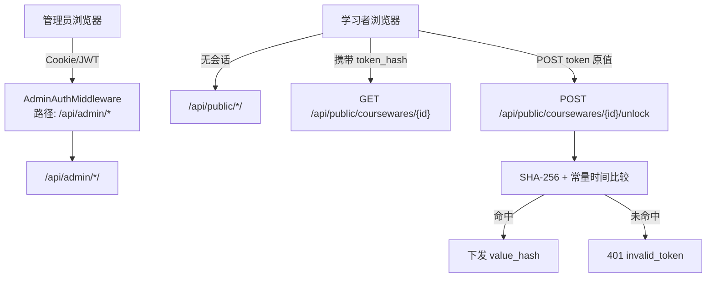

# 10. API 设计规范

> 本章定义 Learning Hub 对外暴露的 HTTP API 契约，作为前后端联调、自动化测试与第三方对接的**单一基准**。所有路径以 `/api/admin/*` 与 `/api/public/*` 前缀区分后台与前台；鉴权沿用 `07-技术架构` 中的双轨模型（Admin Token / 课件 AccessToken）。
>
> **适用范围**: `http://localhost`（前台）与 `http://localhost/admin`（后台）背后暴露的全部 JSON / multipart 接口。
>
> **不在本章范围**: 静态资源、HTML 页面渲染、SSE/WebSocket（当前实例未提供）。

---

## 1. 总览

### 1.1 设计原则

| 原则 | 落地方式 |
| ---- | -------- |
| REST 风格资源化 | 名词复数、HTTP 语义动作（GET / POST / PUT / DELETE） |
| JSON over HTTPS | `Content-Type: application/json; charset=utf-8`；生产强制 HTTPS |
| 字符与时区 | 请求 / 响应统一 UTF-8 编码；时间字段统一 ISO-8601 字符串（带时区 `Asia/Shanghai`，如 `2026-07-06T15:30:00+08:00`） |
| 双轨鉴权 | 后台走 Admin Token；前台课件级 ACL 走 AccessToken |
| 显式状态码 | 优先使用 HTTP 语义；业务码仅在 4xx / 5xx 响应体中表达 |
| 幂等性 | 资源创建类请求可携带 `Idempotency-Key`，避免重复提交 |
| 可观测 | 所有响应均带 `X-Request-Id` |

### 1.2 服务基址与路径前缀

| 维度 | 约定 |
| ---- | ---- |
| 默认域名 | `http://localhost`（开发）；生产使用反向代理后的真实域名 |
| 后台接口前缀 | `/api/admin/*`（受 Admin 会话保护） |
| 前台接口前缀 | `/api/public/*`（公开或仅依赖 AccessToken） |
| 认证端点 | `/api/auth/*`（不挂前缀，挂载于 `/api/auth/admin`、`/api/auth/logout`） |
| 健康检查 | `/api/public/health`（公开，详见 [§5.4](#54-健康检查)） |
| Content-Type（请求） | `application/json`；仅素材上传使用 `multipart/form-data` |
| Content-Type（响应） | `application/json; charset=utf-8` |
| 时区 | 服务器、数据库、响应统一 `Asia/Shanghai` |

### 1.3 鉴权模型双轨



- **双轨说明**:
  - **后台鉴权** (`AdminAuthMiddleware`,位于 `app.lh.middleware.admin_auth`):作为 FastAPI `Depends` 依赖注入,拦截 `/api/admin/*` 路由,从 `Authorization: Bearer` / `LH_ADMIN_SESSION` Cookie 还原管理员身份;缺失或失效返回 401 `unauthenticated`。
  - **课件 ACL** (`AccessTokenService`,位于 `app.lh.services.access_token` + `app.lh.middleware.courseware_acl`):作为独立 FastAPI `Depends`,拦截受限课件的 `GET /api/public/coursewares/{id}` 与 `POST /api/public/coursewares/{id}/unlock`;不通过 `AdminAuthMiddleware`,亦不依赖后台会话。
  - **互不干扰**: 重新生成 / 删除 AccessToken 不会影响 Admin 会话;反之亦然。

### 1.4 通用响应信封

所有接口（除上传素材返回分块进度外）的响应体均使用下列信封：

```json
{
  "code": "ok",
  "message": "ok",
  "data": { /* 业务负载，类型随接口而定；错误时可为 null */ },
  "requestId": "req-20260706-153000-7f3a"
}
```

| 字段 | 类型 | 说明 |
| ---- | ---- | ---- |
| `code` | string | 业务码；`"ok"` 表示成功，其它取值见 [§3 错误码体系](#3-错误码体系) |
| `message` | string | 人类可读消息；中文文案为主，便于前端直接 Toast |
| `data` | object \| null | 业务数据；错误时通常为 `null` |
| `requestId` | string | 与 `X-Request-Id` 同值；用于前后端日志对位 |

> HTTP 状态码与业务码并行：HTTP 表征传输层结果，业务码表征业务结果。例如 HTTP 200 + `code ≠ "ok"` 不应出现；HTTP 4xx/5xx 时 `code` 必为非 `"ok"` 的字符串且与 `message` 配套。

### 1.5 通用 Headers

| Header | 方向 | 说明 |
| ------ | ---- | ---- |
| `X-Request-Id` | 请求 / 响应 | 客户端可主动生成 UUID；否则服务端补齐；响应原样回填 |
| `X-Admin-Token` | 请求 | **仅供调试 / CLI 场景**使用；正式浏览器调用走 Cookie 会话 |
| `Authorization: Bearer <jwt>` | 请求 | 后台 API 备用鉴权头；与 Cookie 任选其一 |
| `Idempotency-Key: <uuid>` | 请求 | 写入类请求可附带，后端在 5 分钟窗口内去重 |
| `Accept-Language: zh-CN` | 请求 | 当前实例仅识别 zh-CN；其他值原样忽略 |

### 1.6 分页约定

```json
{
  "page": 1,
  "size": 20,
  "total": 137,
  "items": [ /* 列表 */ ]
}
```

| 字段 | 默认值 | 取值范围 |
| ---- | ------ | -------- |
| `page` | 1 | ≥ 1 |
| `size` | 20 | 1 ≤ size ≤ 100 |
| `total` | - | 服务端返回的精确总数 |
| `items` | - | 当前页条目列表 |

> 列表接口若无显式分页参数，等同 `page=1&size=20`。详情型 / 树形接口不分页。

### 1.7 限流策略

实现层采用 **SlowAPI**(内部封装 Flask-Limiter 风格算法,支持内存 / Redis 双后端),FastAPI 通过 `app.lh.core.rate_limit.limiter` 注册到路由 `Depends(_rate_limit(...))`。

| 范围 | 阈值 | 命中行为 | Key 构造 |
| ---- | ---- | -------- | ------- |
| 前台 AI 搜索(按 IP) | 30 req / 分钟 | 429 `rate_limited` | `ip:<remote_addr>` |
| 前台课件解锁(按 IP + Token 哈希) | 10 req / 分钟 | 429 `rate_limited`,持续 1 分钟后解除 | `ip:<remote_addr>+hash:<sha256[:8]>` |
| 前台课件详情(按 IP) | 120 req / 分钟 | 429 `rate_limited` | `ip:<remote_addr>` |
| 后台通用写接口(按会话) | 60 req / 分钟 | 429 `rate_limited` | `sess:<session_id or sub>` |
| 素材上传(按会话) | 10 req / 小时 | 429 `rate_limited` | `sess:<session_id or sub>:upload` |

> 生产部署多 worker 时,SlowAPI `storage_uri` 切换到 `redis://<host>:6379/1`,共享计数;
> 单实例开发可直接走内存模式(SlowAPI 默认)。配置项 `STORAGE_REDIS_URL` 控制切换。

### 1.8 幂等性约定

| 场景 | 推荐做法 |
| ---- | -------- |
| 后台创建课件 / 标签 / Token / 素材 | 携带 `Idempotency-Key`，5 分钟内同 key 视为同一次请求返回原结果 |
| 重新生成 Token | 不使用 Idempotency-Key；该操作要求"生成即生效"，重复请求会持续产生新值 |
| 删除类操作 | 接受幂等：首次返回 200 / 204；后续返回 200 但 `data.deleted = false` |

---

## 2. 鉴权

### 2.1 Admin Token 登录

#### `POST /api/auth/admin`

校验 Admin Token；成功写入服务端会话（默认 Cookie）。本接口**不需要**已登录状态；如已登录，调用会刷新一次会话。

**请求 Headers**

| Header | 必填 | 说明 |
| ------ | ---- | ---- |
| `Content-Type` | ✅ | `application/json` |

**请求体**

| 字段 | 类型 | 必填 | 说明 |
| ---- | ---- | ---- | ---- |
| `token` | string | ✅ | Admin Token；当前演示值 `demo` |

**请求示例**

```json
{ "token": "demo" }
```

**响应 `200 OK`**

```json
{
  "code": "ok",
  "message": "ok",
  "data": {
    "adminId": "single-admin",
    "expiresAt": "2026-07-06T16:00:00+08:00"
  },
  "requestId": "req-20260706-153000-7f3a"
}
```

| 字段 | 类型 | 说明 |
| ---- | ---- | ---- |
| `adminId` | string | 当前固定为 `single-admin`（V1.x 单一管理员身份） |
| `expiresAt` | string | 会话过期时间；超过该时间需重新登录 |

**响应错误**

| HTTP | `code` | `message` |
| ---- | ------ | --------- |
| 401 | `invalid_admin_token` | 管理员 Token 无效 |
| 400 | `missing_token` | 请输入 Token |

**curl 示例**

```bash
curl -X POST http://localhost/api/auth/admin \
  -H 'Content-Type: application/json' \
  -c cookies.txt \
  -d '{"token":"demo"}'
```

### 2.2 退出登录

#### `POST /api/auth/logout`

清除服务端会话 Cookie；幂等。

**请求**: 空体。

**响应 `200 OK`**

```json
{ "code": "ok", "message": "ok", "data": { "loggedOut": true }, "requestId": "req-..." }
```

### 2.3 后台会话维持

- 登录成功后服务端下发 `Set-Cookie: LH_ADMIN_SESSION=...; HttpOnly; SameSite=Lax; Path=/`。
- `AdminAuthMiddleware`(模块路径 `app.lh.middleware.admin_auth`)作为 FastAPI 依赖拦截 `/api/admin/**`,校验 `LH_ADMIN_SESSION` Cookie / `Authorization: Bearer` 二者之一;二者均无或 JWT 过期返回 401 `unauthenticated`。
- 会话过期时间默认 8 小时；后台无活跃调用 → 过期 → 下次访问跳回 `/admin`。
- 详见 [06-非功能需求 §2.1](./06-非功能需求.md) 与 [07-技术架构 §4](./07-技术架构.md)。

### 2.4 前台课件 AccessToken 校验

#### `POST /api/public/coursewares/{id}/unlock`

学习者提交 Token **原文**；服务端计算 SHA-256 后比对。若成功，向客户端**下发哈希值**，由前端写入 `localStorage.coursewareTokens[coursewareId]`，后续详情请求以该哈希形式回传比对。

**路径参数**

| 字段 | 类型 | 说明 |
| ---- | ---- | ---- |
| `id` | long | 课件 ID |

**请求体**

| 字段 | 类型 | 必填 | 约束 |
| ---- | ---- | ---- | ---- |
| `token` | string | ✅ | 1 ≤ 长度 ≤ 64；base36 字符集；服务端强制 trim 与常量时间比较 |

**请求示例**

```json
{ "token": "AB12CD34EF56GH78IJ90KL34" }
```

**响应 `200 OK`**

```json
{
  "code": "ok",
  "message": "ok",
  "data": {
    "coursewareId": 42,
    "valid": true,
    "tokenHash": "9f1c2a4d...",
    "issuedAt": "2026-07-06T15:30:00+08:00"
  },
  "requestId": "req-..."
}
```

| 字段 | 类型 | 说明 |
| ---- | ---- | ---- |
| `coursewareId` | long | 当前解锁的课件 ID |
| `valid` | bool | 固定为 `true`（本接口成功语义） |
| `tokenHash` | string | SHA-256 哈希值；客户端需将其存入 `localStorage.coursewareTokens[coursewareId]` |
| `issuedAt` | string | 解锁成功时间 |

**响应错误**

| HTTP | `code` | `message` | 客户端行为 |
| ---- | ------ | --------- | --------- |
| 400 | `invalid_token_format` | 令牌长度非法 | 锁定页提示 `令牌长度非法` |
| 401 | `invalid_token` | 令牌无效，请检查后重试 | 锁定页提示 `令牌无效，请检查后重试` |
| 404 | `courseware_not_found` | 课件不存在 | 锁定页提示 `课件不存在` |
| 410 | `token_revoked` | 令牌已失效，请重新输入 | 锁定页提示 `令牌已失效，请重新输入`；同时清除本地记忆 |
| 429 | `rate_limited` | 操作过于频繁，请稍后再试 | 锁定页提示 `解锁失败，请稍后重试`，保留输入 |

> **410 `token_revoked` 语义**: 后台对 AccessToken 重新生成 / 删除 / 从该课件解绑后，已记忆在 `localStorage` 的哈希会被服务端识别为失效；前端必须清除 `localStorage.coursewareTokens[coursewareId]` 并跳回锁定页。

**curl 示例**

```bash
curl -X POST http://localhost/api/public/coursewares/42/unlock \
  -H 'Content-Type: application/json' \
  -d '{"token":"AB12CD34EF56GH78IJ90KL34"}'
```

---

## 3. 错误码体系

### 3.1 HTTP 状态码与业务码语义

| HTTP | 触发场景 |
| ---- | -------- |
| `200` | 业务成功 |
| `201` | 资源创建成功（部分接口为兼容保留，亦可统一 `200`） |
| `204` | 删除成功且无返回体（少用，多数接口统一 `200` + `data={deleted:true}`） |
| `400` | 业务参数错误（如缺字段、类型错、枚举非法） |
| `401` | 未登录 / Token 校验失败 |
| `403` | 已登录但权限不足 / 受限课件拒绝访问 |
| `404` | 资源不存在 |
| `409` | 资源冲突（如标签名重复、分类名重复、父节点层级超限） |
| `410` | 资源曾经存在但已失效（**重点：AccessToken 已撤销**） |
| `422` | 业务语义不满足（如课件关联被删除的分类、删除有引用的素材） |
| `429` | 限流命中 |
| `5xx` | 服务端内部错误 |

### 3.2 业务码全表

#### 3.2.1 通用 / 认证类

| 业务码 | HTTP | message |
| ------ | ---- | ------- |
| `unauthenticated` | 401 | 未登录或会话已失效 |
| `forbidden` | 403 | 无权访问 |
| `missing_token` | 400 | 请输入 Token |
| `invalid_admin_token` | 401 | 管理员 Token 无效 |
| `rate_limited` | 429 | 操作过于频繁，请稍后再试 |
| `internal_error` | 500 | 服务器内部错误，请稍后重试 |
| `service_unavailable` | 503 | 服务暂不可用，请稍后重试 |

#### 3.2.2 课件类（Courseware）

| 业务码 | HTTP | message |
| ------ | ---- | ------- |
| `courseware_not_found` | 404 | 课件不存在 |
| `courseware_title_required` | 400 | 请输入课件标题 |
| `courseware_category_required` | 400 | 请选择分类 |
| `courseware_category_not_leaf` | 400 | 分类必须挂载到 3 级节点 |
| `courseware_token_required` | 400 | 请至少关联一个访问令牌 |
| `courseware_acl_locked` | 403 | 请先输入访问令牌 |
| `courseware_has_materials` | 422 | 课件已发布，删除受限 |
| `courseware_publish_conflict` | 409 | 课件保存失败，分类或标签已变更 |

#### 3.2.3 分类类（Category）

| 业务码 | HTTP | message |
| ------ | ---- | ------- |
| `category_not_found` | 404 | 分类不存在 |
| `category_name_required` | 400 | 请输入分类名称 |
| `category_name_conflict` | 409 | 同一父节点下名称已存在 |
| `category_max_level` | 409 | 分类最多支持 3 层 |
| `category_has_children` | 422 | 存在子分类，无法删除 |
| `category_has_coursewares` | 422 | 分类下仍有课件，无法删除 |

#### 3.2.4 标签类（Tag）

| 业务码 | HTTP | message |
| ------ | ---- | ------- |
| `tag_not_found` | 404 | 标签不存在 |
| `tag_name_required` | 400 | 请输入标签名 |
| `tag_name_conflict` | 409 | 标签名已存在 |
| `tag_has_coursewares` | 422 | 标签已关联课件，无法删除（仅文案，实际允许） |

#### 3.2.5 素材类（Material）

| 业务码 | HTTP | message |
| ------ | ---- | ------- |
| `material_not_found` | 404 | 素材不存在 |
| `material_extension_invalid` | 400 | 不支持的文件类型 |
| `material_size_exceeded` | 413 | 超出 200MB 上限 |
| `material_storage_unavailable` | 500 | 存储路径不可写 |
| `material_referenced` | 422 | 素材已被课件引用，无法删除 |
| `material_upload_failed` | 500 | 上传失败，请重试 |

#### 3.2.6 访问令牌类（AccessToken）

| 业务码 | HTTP | message |
| ------ | ---- | ------- |
| `token_not_found` | 404 | 访问令牌不存在 |
| `token_label_required` | 400 | 请输入令牌名称 |
| `token_label_too_long` | 400 | 令牌名称过长（≤ 50 字符） |
| `token_label_conflict` | 409 | 令牌名称已存在，请更换 |
| `invalid_token` | 401 | 令牌无效，请检查后重试 |
| `invalid_token_format` | 400 | 令牌长度非法 |
| `token_revoked` | 410 | 令牌已失效，请重新输入 |
| `token_required` | 401 | 该课件需要访问令牌 |
| `last_token_required` | 422 | 该课件仅剩 1 个有效 Token，请先将课件转为开放模式 |
| `token_referenced` | 422 | 令牌已关联课件，确认解除后再删除 |

#### 3.2.7 AI 搜索类（LLM）

| 业务码 | HTTP | message |
| ------ | ---- | ------- |
| `search_query_empty` | 400 | 请输入搜索关键词 |
| `search_query_too_long` | 400 | 关键词过长（> 200 字符） |
| `llm_timeout` | 504 | AI 搜索超时，请稍后重试 |
| `llm_unavailable` | 503 | AI 服务暂不可用，请稍后重试 |
| `search_no_result` | 200 | 没有找到匹配的课件，试试调整搜索条件（HTTP 200 + 空命中） |

### 3.3 错误响应统一示例

```json
{
  "code": "invalid_token",
  "message": "令牌无效，请检查后重试",
  "data": null,
  "requestId": "req-20260706-153000-7f3a"
}
```

> 错误码统一采用**字符串**格式（与 §3.2 全表保持一致），便于 grep / IDE 跳转 / 客户端精确匹配；按业务域分类组织：
> - `unauthenticated` / `forbidden` / `rate_limited` / `invalid_admin_token` 等通用认证；
> - `courseware_*` 课件相关；
> - `category_*` 分类相关；
> - `tag_*` 标签相关；
> - `material_*` 素材相关；
> - `token_*` 访问令牌相关；
> - `search_*` / `llm_*` AI 搜索相关。
>
> 客户端逻辑建议映射至 `code` 而非 `message`，文案仅用于 UI 兜底。

---

## 4. 后台管理 API（`/api/admin/*`）

> 所有 `/api/admin/*` 接口都需要有效的 Admin 会话。缺失 / 失效返回 `401 unauthenticated`。
> 除素材上传（`POST /api/admin/materials`）外，所有接口均为 `Content-Type: application/json` 请求。

### 4.1 课件管理（Courseware）

#### 4.1.1 `GET /api/admin/coursewares`

分页查询课件列表。

**Query 参数**

| 字段 | 类型 | 必填 | 说明 |
| ---- | ---- | ---- | ---- |
| `keyword` | string | ❌ | 标题模糊匹配；空字符串视为无过滤 |
| `page` | int | ❌ | 默认 1 |
| `size` | int | ❌ | 默认 20 |
| `categoryId` | long | ❌ | 按分类节点过滤（含其子树） |
| `accessMode` | string | ❌ | `OPEN` / `RESTRICTED` |

**响应 `200 OK`**

```json
{
  "code": "ok",
  "message": "ok",
  "data": {
    "page": 1,
    "size": 20,
    "total": 42,
    "items": [
      {
        "id": 42,
        "title": "项目管理入门",
        "author": "张三",
        "categoryId": 7,
        "categoryPath": ["项目运营", "通用", "入门"],
        "tags": [{"id": 3, "name": "项目管理"}],
        "accessMode": "RESTRICTED",
        "accessTokenCount": 2,
        "createdAt": "2026-07-01T10:00:00+08:00",
        "updatedAt": "2026-07-05T14:30:00+08:00"
      }
    ]
  },
  "requestId": "req-..."
}
```

| 字段 | 类型 | 说明 |
| ---- | ---- | ---- |
| `id` | long | 课件 ID |
| `title` | string | 标题 |
| `author` | string \| null | 作者 |
| `categoryId` | long | 所在 3 级分类 ID |
| `categoryPath` | string[] | 从根到叶的分类名路径，用于直接展示 |
| `tags` | array | 已关联标签 |
| `accessMode` | string | `OPEN` / `RESTRICTED` |
| `accessTokenCount` | int | 当前关联的 Token 数量；`OPEN` 时为 0 |
| `createdAt` | string | 创建时间 |
| `updatedAt` | string | 最近更新时间 |

#### 4.1.2 `POST /api/admin/coursewares`

新建课件；同时设置访问模式与 Token 关联。

**请求体**

| 字段 | 类型 | 必填 | 约束 |
| ---- | ---- | ---- | ---- |
| `title` | string | ✅ | 长度 1-100；不可全空白 |
| `author` | string | ❌ | 长度 0-50 |
| `categoryId` | long | ✅ | 必须指向 3 级节点（`level == 3`） |
| `description` | string | ❌ | 多行纯文本；长度 ≤ 5000 |
| `tagIds` | long[] | ❌ | 标签 ID 列表；重复 ID 去重 |
| `materialIds` | long[] | ❌ | 素材 ID 列表；重复 ID 去重 |
| `accessMode` | string | ✅ | `OPEN` / `RESTRICTED`；默认 `OPEN` |
| `accessTokenIds` | long[] | 条件必填 | 当 `accessMode = RESTRICTED` 时必填且 `length ≥ 1` |

**请求示例**

```json
{
  "title": "项目管理入门",
  "author": "张三",
  "categoryId": 7,
  "description": "面向新员工的项目管理课程。",
  "tagIds": [3, 8],
  "materialIds": [101],
  "accessMode": "RESTRICTED",
  "accessTokenIds": [11]
}
```

**响应 `201 Created`**

```json
{
  "code": "ok",
  "message": "ok",
  "data": {
    "id": 42,
    "createdAt": "2026-07-06T15:30:00+08:00"
  },
  "requestId": "req-..."
}
```

**响应错误**

| HTTP | `code` | 触发 |
| ---- | ------ | ---- |
| 400 | `courseware_title_required` | `title` 为空 |
| 400 | `courseware_category_required` | `categoryId` 缺失 |
| 400 | `courseware_category_not_leaf` | 分类不是 3 级节点 |
| 400 | `courseware_token_required` | `accessMode = RESTRICTED` 且 `accessTokenIds` 为空 |

#### 4.1.3 `GET /api/admin/coursewares/{id}`

**响应 `200 OK`**

```json
{
  "code": "ok",
  "message": "ok",
  "data": {
    "id": 42,
    "title": "项目管理入门",
    "author": "张三",
    "categoryId": 7,
    "categoryPath": ["项目运营", "通用", "入门"],
    "description": "面向新员工的项目管理课程。",
    "tags": [{"id": 3, "name": "项目管理"}],
    "materials": [
      {
        "id": 101,
        "name": "PM-101.mp4",
        "type": "VIDEO",
        "sizeBytes": 187654321,
        "duration": "12:34",
        "downloadUrl": "/api/admin/materials/101/file"
      }
    ],
    "accessMode": "RESTRICTED",
    "accessTokens": [
      {"id": 11, "label": "产品组·Q3", "maskedValue": "AB12****CD34"}
    ],
    "createdAt": "2026-07-01T10:00:00+08:00",
    "updatedAt": "2026-07-05T14:30:00+08:00"
  },
  "requestId": "req-..."
}
```

> 受限课件详情中只回显 Token 名称与掩码，不返回任何 `value_hash`、原值或敏感字段。

#### 4.1.4 `PUT /api/admin/coursewares/{id}`

更新课件；整体覆盖式（同 [04-管理后台规格 §3.2](./04-管理后台规格.md)）。请求体与新建一致并增加 `id` 隐含在路径。

- 当 `accessMode` 从 `OPEN` 切到 `RESTRICTED`：必须同时携带非空 `accessTokenIds`，否则 400。
- 当 `accessMode` 从 `RESTRICTED` 切回 `OPEN`：忽略 `accessTokenIds`，自动清空关联。
- **`materialIds` 按数组下标 0..N-1 完整重写 `sortOrder`**（与专用 §4.1.6 接口语义一致）。不在传入中的素材 → DELETE 关联行；传入中有但 DB 中没有的 ID → INSERT 后参与重排；**仅调换位置（无增删）的拖拽改序**也能正常保存。

#### 4.1.5 `DELETE /api/admin/coursewares/{id}`

删除课件；同时释放 Token 关联与素材引用计数。

**响应 `200 OK`**

```json
{ "code": "ok", "message": "ok", "data": { "id": 42, "deleted": true }, "requestId": "req-..." }
```

#### 4.1.6 `PUT /api/admin/coursewares/{id}/materials/order` · v1.5+

专用素材顺序重排接口；按 `materialIds` 数组下标重写 `courseware_material.sort_order`（0..N-1）。

- **语义**：仅修改顺序，不增删素材。
- **校验**：① 课件存在；② `materialIds` 数量与当前一致；③ 全部 ID 属于该课件；④ 无重复。任一失败 → 400 `courseware_materials_invalid`。
- **与 PUT §4.1.4 的关系**：从 v1.5.1 起，PUT §4.1.4 的 `materialIds` 与本接口语义一致（按数组下标重写 `sortOrder`）。本接口保留作为仅调整顺序、不修改其他字段的便捷入口。

**请求体**

```json
{ "materialIds": [12, 7, 33, 5] }
```

**响应 `200 OK`**

与 `GET /api/admin/coursewares/{id}` 响应一致（CoursewareItem 完整结构）。

**错误码**

| HTTP | code | 触发条件 |
| ---- | ---- | -------- |
| 400 | `courseware_materials_invalid` | 数量与当前不匹配 / 包含未绑定到该课件的 ID / 出现重复 |
| 404 | `courseware_not_found` | 课件不存在 |
| 401 | — | 未登录或 token 失效 |

#### 4.1.7 列表筛选特别说明

| 过滤参数 | 行为 |
| -------- | ---- |
| `keyword` | 对 `title` 做 `LIKE` 模糊匹配；忽略大小写、不命中空白 |
| `categoryId` | 命中节点 + 所有后代节点的课件 |
| `accessMode` | 不区分大小写；非法值忽略 |

### 4.2 分类管理（Category）

#### 4.2.1 `GET /api/admin/categories`

返回三级分类树。

**响应 `200 OK`**

```json
{
  "code": "ok",
  "message": "ok",
  "data": [
    {
      "id": 1,
      "name": "项目运营",
      "level": 1,
      "children": [
        {
          "id": 5,
          "name": "通用",
          "level": 2,
          "children": [
            {"id": 7, "name": "入门", "level": 3, "children": []}
          ]
        }
      ]
    }
  ],
  "requestId": "req-..."
}
```

#### 4.2.2 `POST /api/admin/categories`

**请求体**

| 字段 | 类型 | 必填 | 约束 |
| ---- | ---- | ---- | ---- |
| `name` | string | ✅ | 长度 1-30 |
| `parentId` | long | ❌ | 缺省视为根分类；若有值，目标节点 `level < 3` |

**响应 `201 Created`**

```json
{ "code": "ok", "message": "ok", "data": { "id": 13, "parentId": 5, "level": 3, "name": "模板" }, "requestId": "req-..." }
```

**错误**

| HTTP | `code` |
| ---- | ------ |
| 400 | `category_name_required` |
| 409 | `category_name_conflict` |
| 409 | `category_max_level` |

#### 4.2.3 `PUT /api/admin/categories/{id}`

仅修改名称。

**请求体**

| 字段 | 类型 | 必填 |
| ---- | ---- | ---- |
| `name` | string | ✅ |

#### 4.2.4 `DELETE /api/admin/categories/{id}`

无引用时删除。子节点禁止一并删除，需先手动清理。

**错误**

| HTTP | `code` |
| ---- | ------ |
| 422 | `category_has_children` |
| 422 | `category_has_coursewares` |

### 4.3 标签管理（Tag）

#### 4.3.1 `GET /api/admin/tags?keyword=&page=&size=`

**响应 `200 OK`**

```json
{
  "code": "ok",
  "message": "ok",
  "data": {
    "page": 1, "size": 20, "total": 12,
    "items": [
      {"id": 3, "name": "项目管理", "coursewareCount": 8, "createdAt": "2026-01-01T00:00:00+08:00"}
    ]
  },
  "requestId": "req-..."
}
```

| 字段 | 类型 | 说明 |
| ---- | ---- | ---- |
| `coursewareCount` | int | 实时反向引用计数 |

#### 4.3.2 `POST /api/admin/tags`

**请求体**

| 字段 | 类型 | 必填 | 约束 |
| ---- | ---- | ---- | ---- |
| `name` | string | ✅ | 长度 1-30；全局唯一 |

**响应 `201 Created`**

```json
{ "code": "ok", "message": "ok", "data": { "id": 3, "name": "项目管理", "createdAt": "2026-07-06T15:30:00+08:00" }, "requestId": "req-..." }
```

#### 4.3.3 `PUT /api/admin/tags/{id}`

仅改名。

#### 4.3.4 `DELETE /api/admin/tags/{id}`

删除并自动解绑全部课件。该操作为物理硬删，**不可恢复**。

### 4.4 素材管理（Material）

#### 4.4.1 `GET /api/admin/materials?keyword=&type=&page=&size=`

**Query 参数**

| 字段 | 必填 | 说明 |
| ---- | ---- | ---- |
| `keyword` | ❌ | 名称模糊匹配 |
| `type` | ❌ | `VIDEO` / `PDF` / `PPT` |
| `page`, `size` | ❌ | 见 [§1.6](#16-分页约定) |

**响应 `200 OK`**

```json
{
  "code": "ok",
  "message": "ok",
  "data": {
    "page": 1, "size": 20, "total": 137,
    "items": [
      {
        "id": 101,
        "name": "PM-101.mp4",
        "type": "VIDEO",
        "sizeBytes": 187654321,
        "duration": "12:34",
        "uploadedAt": "2026-07-01T10:00:00+08:00",
        "referenced": true,
        "downloadUrl": "/api/admin/materials/101/file"
      }
    ]
  },
  "requestId": "req-..."
}
```

| 字段 | 类型 | 说明 |
| ---- | ---- | ---- |
| `type` | string | `VIDEO` / `PDF` / `PPT`（含 `.ppt` 与 `.pptx`） |
| `duration` | string \| null | 视频为时长 `HH:MM:SS` 或 `MM:SS`；PDF/PPT 为页数 |
| `referenced` | bool | 是否被任意课件引用；为 `true` 时禁止删除 |
| `downloadUrl` | string | 受 `AdminAuthMiddleware` 保护;返回原始文件流 |

#### 4.4.2 `POST /api/admin/materials`

`multipart/form-data` 上传。

**Form 字段**

| 字段 | 必填 | 约束 |
| ---- | ---- | ---- |
| `file` | ✅ | 扩展名 `.mp4` / `.pdf` / `.ppt` / `.pptx`；size ≤ 200MB |
| `type` | ❌ | 未指定则按扩展名推断；与实际不一致以扩展名为准 |

**响应 `201 Created`**

```json
{ "code": "ok", "message": "ok", "data": { "id": 102, "name": "Onboarding.pdf", "type": "PDF", "sizeBytes": 4321098 }, "requestId": "req-..." }
```

**错误**

| HTTP | `code` |
| ---- | ------ |
| 400 | `material_extension_invalid` |
| 413 | `material_size_exceeded` |
| 500 | `material_storage_unavailable` |
| 500 | `material_upload_failed` |

**curl 示例**

```bash
curl -X POST http://localhost/api/admin/materials \
  -H "Authorization: Bearer ${ADMIN_JWT}" \
  -F "file=@/path/to/PM-101.mp4;type=video/mp4"
```

#### 4.4.3 `DELETE /api/admin/materials/{id}`

被课件引用时返回 `422 material_referenced`，禁止删除。

#### 4.4.4 `GET /api/admin/materials/{id}/file`

受 `AdminAuthMiddleware`(模块 `app.lh.middleware.admin_auth`)保护的文件下载。

**响应**: `Content-Type` 与上传一致；响应体为原始文件字节流（视频支持 HTTP Range）。

### 4.5 访问令牌管理（AccessToken）

#### 4.5.1 `GET /api/admin/access-tokens?keyword=&page=&size=`

**Query 参数**

| 字段 | 说明 |
| ---- | ---- |
| `keyword` | 同时匹配 `label` 与 `maskedValue` |
| `page`, `size` | 见 [§1.6](#16-分页约定) |

**响应 `200 OK`**

```json
{
  "code": "ok",
  "message": "ok",
  "data": {
    "page": 1, "size": 20, "total": 5,
    "items": [
      {
        "id": 11,
        "label": "产品组·Q3",
        "maskedValue": "AB12****CD34",
        "coursewareCount": 3,
        "createdAt": "2026-06-01T10:00:00+08:00",
        "regeneratedAt": null
      }
    ]
  },
  "requestId": "req-..."
}
```

> 列表与详情**绝不**返回 `value_hash` 或 Token 原值；仅展示 `maskedValue`（前 4 + `****` + 后 4）。

#### 4.5.2 `POST /api/admin/access-tokens`

**请求体**

| 字段 | 类型 | 必填 | 约束 |
| ---- | ---- | ---- | ---- |
| `label` | string | ✅ | 长度 1-50；**必填且全局唯一**（业务规则 R-04b）；重复时返回 `409 token_label_conflict` |

**响应 `201 Created`** ← **本接口唯一一次以明文形式返回 Token 原值**

```json
{
  "code": "ok",
  "message": "ok",
  "data": {
    "id": 11,
    "label": "产品组·Q3",
    "value": "AB12CD34EF56GH78IJ90KL34",
    "maskedValue": "AB12****KL34",
    "coursewareCount": 0,
    "createdAt": "2026-07-06T15:30:00+08:00",
    "regeneratedAt": null
  },
  "requestId": "req-..."
}
```

> **重要**: `data.value` 仅在创建 / 重新生成瞬间返回 1 次。前端拿到后必须立即提示用户复制 / 保存，刷新页面后**不再**可通过任何接口查看明文。

#### 4.5.3 `GET /api/admin/access-tokens/{id}`

**响应 `200 OK`**: 与 [§4.5.1](#451-get-apiadminaccess-tokenskeywordpagesize) 单项结构一致，**无 `value` 字段**。

#### 4.5.4 `PUT /api/admin/access-tokens/{id}`

仅修改 `label`；label 需保持全局唯一（业务规则 R-04b），冲突时返回 `409 token_label_conflict`。

#### 4.5.5 `POST /api/admin/access-tokens/{id}/regenerate`

服务端生成新 Token 原值；旧的立即全局失效；不再返回 `value_hash` 或旧值。

**响应 `200 OK`**

```json
{
  "code": "ok",
  "message": "ok",
  "data": {
    "id": 11,
    "label": "产品组·Q3",
    "value": "ZZ99YY88XX77WW66VV55UU44",
    "maskedValue": "ZZ99****UU44",
    "regeneratedAt": "2026-07-06T15:35:00+08:00"
  },
  "requestId": "req-..."
}
```

#### 4.5.6 `DELETE /api/admin/access-tokens/{id}`

删除 Token；同步解除全部课件关联。

**响应 `200 OK`**

```json
{ "code": "ok", "message": "ok", "data": { "id": 11, "deleted": true, "unboundFrom": [42, 45] }, "requestId": "req-..." }
```

---


## 5. 前台公开 API（`/api/public/*`）

> `/api/public/*` 默认公开，无需登录。
> 受限课件详情与解锁接口依赖 [§2.4 前台课件 AccessToken 校验](#24-前台课件-accesstoken-校验)。

### 5.1 AI 搜索

#### 5.1.1 `POST /api/public/coursewares/search`

v1.1 起,接收自然语言查询;服务端调用阿里云百炼 qwen-plus 生成检索 SQL,经白名单校验后在 PostgreSQL 只读事务中执行,失败 / 超时自动降级为关键词 ILIKE 匹配,返回命中的课件卡片列表。

> **架构概览(v1.1 LLM-to-SQL)**:用户输入 → LLM 直写 SELECT → `_sql_safety.validate_sql` 7 道闸白名单 → DB 只读事务执行 → 结果按 `updated_at DESC` 取前 `topK` 条 → 命中即返回 `source="llm"`;任一环节失败/超时/未配置 key,回退到 `_keyword_hits()` ILIKE 路径,`source="keyword"`。详见 [§5.1.3 v1.1 LLM-to-SQL 实现说明](#513-v11-llm-to-sql-实现说明)。

**请求体**

| 字段 | 类型 | 必填 | 约束 |
| ---- | ---- | ---- | ---- |
| `query` | string | ✅ | 长度 1-200；首尾空白 trim |
| `topK` | int | ❌ | 默认 20；最大 50 |
| `filters` | object | ❌ | `{ "categoryId": long, "tags": string[] }`，可选过滤；命中 0 时不强制返回 |

**请求示例**

```json
{ "query": "项目管理相关的课程", "topK": 10, "filters": { "tags": ["敏捷"] } }
```

**响应 `200 OK`**

```json
{
  "code": "ok",
  "message": "ok",
  "data": {
    "query": "项目管理相关的课程",
    "total": 6,
    "aiPowered": true,
    "hits": [
      {
        "id": 42,
        "title": "项目管理入门",
        "author": "张三",
        "categoryPath": ["项目运营", "通用", "入门"],
        "tags": [{"id": 3, "name": "项目管理"}],
        "accessMode": "RESTRICTED",
        "summary": "面向新员工的项目管理基础课程，包含 5 大过程组与 10 大知识领域。",
        "score": 0.92,
        "materialCount": 1
      }
    ]
  },
  "requestId": "req-..."
}
```

| 字段 | 类型 | 说明 |
| ---- | ---- | ---- |
| `aiPowered` | bool | `true` 表示走 LLM 语义排序；`false` 表示已降级为关键词检索 |
| `source` | string | 枚举：`"llm"`（qwen-plus NL2SQL 召回）/ `"keyword"`（ILIKE 降级）。前端按 `source === "keyword"` 显示"降级中"徽标，其他视为 AI 命中 |
| `score` | number | 0-1 之间的相关度；仅作 UI 调试，前端不必展示 |
| `summary` | string | 一句话摘要；服务端从 `description` 与素材元数据截取，> 60 字截断 |

**响应错误**

| HTTP | `code` | 客户端行为 |
| ---- | ------ | --------- |
| 400 | `search_query_empty` | 文案：请输入搜索关键词 |
| 400 | `search_query_too_long` | 文案：关键词过长，请精简后再试 |
| 504 | `llm_timeout` | 文案：AI 搜索超时，请稍后重试 |
| 503 | `llm_unavailable` | 文案：AI 服务暂不可用，请稍后重试 |
| 429 | `rate_limited` | 文案：操作过于频繁，请稍后再试 |

> **降级行为(v1.1)**: 当 LLM 超时、不可用、`DASHSCOPE_API_KEY` 未配置,或 LLM 输出的 SQL 未通过白名单校验(见 §5.1.3),服务端自动退化为 DB 关键词检索(命中 `title/description` 与标签名),`aiPowered` 置 `false` 且不返回 `score`。前端不感知差异,仍按 `hits` 渲染;`source` 字段返回 `"keyword"`,徽标显示"AI 智能搜索 · 降级中"。
>
> **超时配置**: 默认 `LLM_SQL_TIMEOUT_SECONDS=8`,单次 LLM 调用超过阈值即放弃本轮,回退关键词(默认不抛 `llm_timeout`,仅记 `WARNING` 日志;客户端拿到的是降级结果而非 504)。若需更激进的 504 行为,可调低 `LLM_SQL_TIMEOUT_SECONDS` 并在 FastAPI 路由层捕获 `asyncio.TimeoutError` 显式返回 504。

#### 5.1.3 v1.1 LLM-to-SQL 实现说明

> **适用范围**: 本段为后台实现说明,前台 / 客户端无需关心,仅供运维排障与新成员理解搜索降级路径使用。

##### a) LLM 调用契约

- 模型: `qwen-plus`(阿里云百炼,通过 `dashscope` SDK 调用)
- 配置: `DASHSCOPE_API_KEY`(必填,留空 → LLM 禁用,全部走 ILIKE);`LLM_SEARCH_MODEL`(默认 `qwen-plus`);`LLM_SQL_TIMEOUT_SECONDS`(默认 8.0);`LLM_SQL_MAX_ROWS`(默认 20)
- 调用入口: `backend/app/services/llm_sql.generate_sql(query, schema_hint=...)`;系统 prompt 在 `backend/app/services/llm_sql.py` 内固化,包含 5 张主表 + 3 张关联表的 schema、WHERE / LIMIT / 列名白名单要求
- 失败语义: 超时 / 解析失败 / 返回 None → 触发降级,**不抛 504**

##### b) 白名单校验(7 道闸)

LLM 输出 SQL 字符串必须依次通过 [backend/app/services/_sql_safety.py](file:///d:/szp/work/learning-hub/backend/app/services/_sql_safety.py) 的 `validate_sql`,任一失败 → 记 WARNING → fallback 关键词:

| # | 检查 | 规则 |
| --- | --- | --- |
| 1 | 去 markdown 包裹 | 剥离 ` ```sql ... ``` ` 或 ` ``` ... ``` ` |
| 2 | 单语句 | 不允许 `;`(末尾一个可去掉) |
| 3 | 无注释 | 不允许 `--`、`/*`、`*/` |
| 4 | 首词 SELECT | `^\s*SELECT\b`,不区分大小写 |
| 5 | 黑名单关键字(整词) | DROP/DELETE/UPDATE/INSERT/ALTER/CREATE/TRUNCATE/GRANT/REVOKE/EXEC/COPY/VACUUM/LOCK/COMMENT/SET/RESET/CALL/DO/UNION/INTERSECT/EXCEPT |
| 6 | 表白名单 | FROM/JOIN 提取的表名必须在 `{courseware, category, tag, material, courseware_tag, courseware_material, courseware_access_token}`;不允许 `pg_*`、`information_schema` |
| 7 | 强制 LIMIT | 显式 LIMIT 超过 50 时截断到 50;缺 LIMIT 时追加 `LIMIT {LLM_SQL_MAX_ROWS}` |

##### c) 安全护栏(read-only 事务)

通过校验的 SQL 在 `backend/app/services/llm_sql.execute_search_sql` 中按以下顺序执行:

1. `db.execute(text("SET TRANSACTION READ ONLY"))` — 显式声明只读事务(防止 LLM 写出意外 DML)
2. 同事务内执行 LLM 生成的 SELECT,只取 id 列(避免大字段 / N+1)
3. 事务立即 rollback(语义上是只读,但 rollback 释放资源更彻底)
4. 用拿到的 id 列表二次查询 `courseware` 主表,组装 `CoursewareItem` 返回

> **注入面分析**: LLM 输出是字面量,**不绑定外部参数**(无 `?` / `:name`),SQLAlchemy `text()` 自带转义;`db.execute` 不接受任意 SQL 片段拼接外部参数,无传统 SQL 注入面。

##### d) 降级路径表(运维排障用)

| 触发条件 | 行为 | `source` | 日志 |
| --- | --- | --- | --- |
| `DASHSCOPE_API_KEY` 未配置 | 直接走 ILIKE | `keyword` | INFO `LLM disabled` |
| `dashscope.Generation.call` 超时 / 抛异常 | fallback ILIKE | `keyword` | WARNING `LLM SQL search failed` |
| LLM 返回 None / 空字符串 | fallback ILIKE | `keyword` | WARNING `LLM returned empty SQL` |
| `validate_sql` 任一闸失败 | fallback ILIKE | `keyword` | WARNING `SQL safety check failed` |
| 只读事务执行异常 | fallback ILIKE | `keyword` | WARNING `LLM SQL execution failed` |
| 全部成功 | 返回 LLM 命中 | `llm` | INFO `LLM SQL search ok, ids=...` |

#### 5.1.2 备选: `GET /api/public/coursewares/search?q=&topK=`

为方便低代码与日志场景提供 GET 等价接口；语义与 POST 完全一致，仅请求体改为 query string。

### 5.2 课件详情

#### `GET /api/public/coursewares/{id}`

按课件 ID 获取详情；公开课件对所有人可见，受限课件需要携带 `token` 参数（即本地记忆的 SHA-256 哈希）。

**Query 参数**

| 字段 | 类型 | 必填 | 约束 |
| ---- | ---- | ---- | ---- |
| `token` | string | 受限课件必填 | SHA-256 哈希（64 个十六进制字符） |
| `include` | string | ❌ | 逗号分隔，支持 `materials` / `category` / `tags` |

**响应 `200 OK`**

```json
{
  "code": "ok",
  "message": "ok",
  "data": {
    "id": 42,
    "title": "项目管理入门",
    "author": "张三",
    "categoryPath": ["项目运营", "通用", "入门"],
    "description": "面向新员工的项目管理课程。",
    "tags": [{"id": 3, "name": "项目管理"}],
    "materials": [
      {
        "id": 101,
        "name": "PM-101.mp4",
        "type": "VIDEO",
        "sizeBytes": 12345678,
        "duration": "12:34",
        "downloadUrl": "/api/public/materials/101/file",
        "streamUrl": "/api/public/materials/101/stream"
      }
    ],
    "accessMode": "RESTRICTED",
    "createdAt": "2026-07-01T10:00:00+08:00",
    "updatedAt": "2026-07-05T14:30:00+08:00"
  },
  "requestId": "req-..."
}
```

**响应错误**

| HTTP | `code` | 触发 | 客户端动作 |
| ---- | ------ | ---- | --------- |
| 404 | `courseware_not_found` | 课件不存在 | 提示 `课件不存在` |
| 401 | `token_required` | 受限课件未传 `token` | 跳转锁定页 |
| 401 | `invalid_token` | `token` 与任何生效 Token 的哈希都不匹配 | 锁定页提示 `令牌无效，请检查后重试` |
| 410 | `token_revoked` | `token` 哈希曾匹配，但服务端已重新生成 / 删除 | 清除 `localStorage.coursewareTokens[id]` 后跳锁定页，提示 `令牌已失效，请重新输入` |
| 403 | `courseware_acl_locked` | 受限课件未通过 ACL | 锁定页占位 |

#### 5.2.1 公开课件的素材流地址

受限课件的 `streamUrl` 同开放课件：均为 `/api/public/materials/{id}/stream`；该路径在播放时校验 `Referer` 与课件 ACL；不再二次要求 Token。

`materials[]` 元素字段表：

| 字段 | 类型 | 说明 |
| ---- | ---- | ---- |
| `id` | long | 素材 ID |
| `name` | string | 原始文件名 |
| `type` | enum | `VIDEO` / `PDF` / `PPT`（详见 [§6.2.2](#622-素材类型-materialtype)） |
| `sizeBytes` | long | 字节数 |
| `duration` | string \| null | 视频为时长（如 `12:34`），PDF/PPT 为页数或 `null` |
| `downloadUrl` | string | `GET /api/public/materials/{id}/file`，以 `attachment` 下发 |
| `streamUrl` | string | `GET /api/public/materials/{id}/stream`，以 `inline` 下发（详见 [§5.2.4](#524-公开素材流式接口)） |
| `sortOrder` | int | v1.5+ 该素材在课件内的展示顺序（0..N-1）；客户端应以 `materials[]` 数组顺序作为权威，sortOrder 仅作字段冗余便于调试 |

#### 5.2.3 公开素材单条接口

##### `GET /api/public/materials/{material_id}`

拉取单个素材的公开快照，主要供 P-VIEWER 在打开页时获得 `streamUrl` / `downloadUrl` 与 `previewReady` 提示。响应**不返回** `storage_path`。

**路径参数**

| 字段 | 类型 | 必填 | 说明 |
| ---- | ---- | ---- | ---- |
| `material_id` | long | ✅ | 素材 ID |

**响应 `200 OK`**

```json
{
  "code": "ok",
  "message": "ok",
  "data": {
    "id": 101,
    "name": "PM-101.mp4",
    "type": "VIDEO",
    "sizeBytes": 12345678,
    "duration": "12:34",
    "streamUrl": "/api/public/materials/101/stream",
    "downloadUrl": "/api/public/materials/101/file",
    "previewReady": true
  },
  "requestId": "req-..."
}
```

- `previewReady`：VIDEO/PDF 始终为 `true`；PPT 在 `preview_pdf_path` 存在且文件可访问时为 `true`，供前端展示“预览生成中”提示。
- 限流：`60/minute/ip`。
- 受限课件中的素材同样需携带 `X-Token-Hash`（与 [§5.2](#52-课件详情) 一致）。

**响应错误**

| HTTP | `code` | 触发 |
| ---- | ------ | ---- |
| 404 | `material_not_found` | 素材不存在 |
| 403 | `courseware_acl_locked` | 仅 RESTRICTED 课件引用且未携带有效 Token 哈希 |
| 429 | `rate_limited` | 触发限流 |

#### 5.2.4 公开素材流式接口

##### `GET /api/public/materials/{material_id}/stream`

供 P-VIEWER 行内预览使用。以 `Content-Disposition: inline` 返回，浏览器 / `<video>` / `<iframe>` 可直接渲染。根据素材类型返回不同 `Content-Type` 与 disposition：

| 素材类型 | `Content-Type` | `Content-Disposition` | 说明 |
| ---- | ---- | ---- | ---- |
| VIDEO（mp4） | `video/mp4` | `inline; filename="<name>.mp4"` | 支持 HTTP Range |
| PDF | `application/pdf` | `inline; filename="<name>.pdf"` | 文件名会重命名为 `.pdf`，避免浏览器按原后缀下载 |
| PPT/PPTX 且 `preview_pdf_path` 存在 | `application/pdf` | `inline; filename="<name>.pdf"` | 后端已自动转换；返回转换后的 PDF |
| PPT/PPTX 且 `preview_pdf_path` 为 NULL | 嗅探的 mime 或 `application/octet-stream` | `attachment; filename="<name>"` | **兜底**：避免浏览器意外触发原生预览/下载逻辑；客户端应展示“预览生成中” |

- 限流：`60/minute/ip`。
- 受限课件中的素材同样需携带 `X-Token-Hash`。
- 素材文件丢失时返 `500 material_storage_unavailable`。

**响应错误**

| HTTP | `code` | 触发 |
| ---- | ------ | ---- |
| 404 | `material_not_found` | 素材不存在 |
| 403 | `courseware_acl_locked` | 仅 RESTRICTED 课件引用且未携带有效 Token 哈希 |
| 429 | `rate_limited` | 触发限流 |
| 500 | `material_storage_unavailable` | 物理文件丢失 |

### 5.3 健康检查

#### `GET /api/public/health`

**响应 `200 OK`**

```json
{ "code": "ok", "message": "ok", "data": { "status": "UP", "version": "1.0.0", "uptimeSec": 86400 }, "requestId": "req-..." }
```

> 标记为**推荐项**：上线 CI/CD / 监控时建议启用；当前演示版本默认实现即可。

---

## 6. 数据字典与枚举

### 6.1 通用字段类型

| 类型 | 序列化 | 备注 |
| ---- | ------ | ---- |
| `string` | UTF-8 字符串 | 不携带尾部空白 |
| `long` | JSON number | ≥ 0 |
| `int` | JSON number | |
| `bool` | JSON bool | |
| `decimal` | JSON number | 仅在 `score` 等场景使用；保留 4 位有效精度 |
| `datetime` | ISO-8601 string | `2026-07-06T15:30:00+08:00` |
| `enum` | JSON string | 见 [§6.2](#62-枚举) |
| `array<T>` | JSON array | 元素不可为 `null` |
| `object` | JSON object | 视字段含义而定 |

### 6.2 枚举

#### 6.2.1 课件访问模式 `CoursewareAccessMode`

| 值 | 说明 |
| -- | ---- |
| `OPEN` | 开放访问，无 ACL |
| `RESTRICTED` | 受限访问，依赖 AccessToken |

#### 6.2.2 素材类型 `MaterialType`

| 值 | 说明 | 扩展名 |
| -- | ---- | ------ |
| `VIDEO` | 视频 | `.mp4` |
| `PDF` | PDF 文档 | `.pdf` |
| `PPT` | 演示文稿 | `.ppt` / `.pptx` |

#### 6.2.3 课程状态（已于 v1.0 移除）

v1.0 取消 DRAFT / PUBLISHED 双状态枚举。课件创建后默认即发布（前台可搜、可点击进入详情）；未来若重新引入草稿状态，会同步更新本节并在 [05-数据模型](./05-数据模型.md) 与 [02-功能需求](./02-功能需求.md) 补全功能点。

#### 6.2.4 分类层级 `CategoryLevel`

固定枚举：`1` / `2` / `3`。

### 6.3 字段级脱敏

| 字段 | 出现位置 | 是否脱敏 |
| ---- | -------- | -------- |
| `access_token.value`（明文） | 仅 `POST /api/admin/access-tokens` 与 `POST /api/admin/access-tokens/{id}/regenerate` 响应 1 次 | **仅这一瞬间返回明文** |
| `access_token.value_hash` | 服务端存储 | **任何 API 响应、日志、客户端存储均不得出现** |
| `admin.session_id` / Cookie 值 | 响应 `Set-Cookie` | 不在响应体出现 |
| `material.storage_path`（服务端物理路径） | 任意 API | **不返回**，UI 仅通过 `downloadUrl` / `streamUrl` 间接访问 |

### 6.4 字段命名风格

> **v1.0 调整说明(2026-07-06,后端栈调整)**:由原 Java/Spring Boot 反推的 camelCase 风格统一改为 **Python/FastAPI 生态默认的 snake_case**,以省去双向别名维护成本;同时保留 camelCase 为请求体可选别名,通过 Pydantic `Field(alias=...)` 或 `model_config = ConfigDict(populate_by_name=True)` 实现双写兼容。

- **JSON 字段(请求体 / 响应体)**:**`snake_case`**(`access_mode`、`courseware_count`、`created_at`、`access_token_ids`)。开历史客户端若发送 camelCase,可被服务端以 alias 形式接受。
- **路径段**:复数小写连字符(`/api/admin/access-tokens`、`/api/admin/coursewares`)。
- **枚举值**:大写下划线(`OPEN` / `RESTRICTED` / `VIDEO` / `PDF` / `PPT`)。
- **错误码**:下划线小写(`invalid_token` / `courseware_not_found`)。
- **Python 模块命名**:包名小写、模块名小写、类名 PascalCase、变量 / 函数 snake_case,与 PEP8 一致(`app.lh.services.access_token.AccessTokenService`)。

---


## 7. 附录

### 7.1 完整 curl 示例

> 以下命令默认从 `http://localhost` 发起；演示 Admin Token 为 `demo`。

#### 7.1.1 后台：登录

```bash
curl -X POST http://localhost/api/auth/admin \
  -H 'Content-Type: application/json' \
  -c cookies.txt \
  -d '{"token":"demo"}'
```

#### 7.1.2 后台：分页查询课件列表

```bash
curl http://localhost/api/admin/coursewares?keyword=项目&page=1&size=10 \
  -b cookies.txt \
  -H 'X-Request-Id: req-demo-001'
```

#### 7.1.3 后台：创建受限课件

```bash
curl -X POST http://localhost/api/admin/coursewares \
  -b cookies.txt \
  -H 'Content-Type: application/json' \
  -d '{
    "title":"项目管理入门",
    "author":"张三",
    "categoryId":7,
    "description":"面向新员工的项目管理课程。",
    "tagIds":[3,8],
    "materialIds":[101],
    "accessMode":"RESTRICTED",
    "accessTokenIds":[11]
  }'
```

#### 7.1.4 后台：上传素材

```bash
curl -X POST http://localhost/api/admin/materials \
  -b cookies.txt \
  -F "file=@/path/to/PM-101.mp4;type=video/mp4"
```

#### 7.1.5 后台：创建访问 Token

```bash
curl -X POST http://localhost/api/admin/access-tokens \
  -b cookies.txt \
  -H 'Content-Type: application/json' \
  -d '{"label":"产品组·Q3"}'
```

#### 7.1.6 后台：重新生成 Token

```bash
curl -X POST http://localhost/api/admin/access-tokens/11/regenerate \
  -b cookies.txt
```

#### 7.1.7 后台：删除 Token

```bash
curl -X DELETE http://localhost/api/admin/access-tokens/11 \
  -b cookies.txt
```

#### 7.1.8 前台：AI 搜索

```bash
curl -X POST http://localhost/api/public/coursewares/search \
  -H 'Content-Type: application/json' \
  -d '{"query":"项目管理相关的课程","topK":10}'
```

#### 7.1.9 前台：解锁受限课件

```bash
curl -X POST http://localhost/api/public/coursewares/42/unlock \
  -H 'Content-Type: application/json' \
  -d '{"token":"AB12CD34EF56GH78IJ90KL34"}'
```

#### 7.1.10 前台：访问开放课件详情

```bash
curl http://localhost/api/public/coursewares/42
```

#### 7.1.11 前台：访问受限课件详情（带本地记忆的哈希）

```bash
curl "http://localhost/api/public/coursewares/42?token=9f1c2a4d..."
```

#### 7.1.12 后台：退出登录

```bash
curl -X POST http://localhost/api/auth/logout \
  -b cookies.txt -c cookies.txt
```

### 7.2 前后端约定速查

| 维度 | 约定 |
| ---- | ---- |
| 资源命名 | 名词复数小写连字符 |
| 字段命名 | **snake_case**(v1.0 由原 camelCase 调整;留 alias 兼容) |
| 响应信封 | 始终 `{code, message, data, requestId}` |
| 空值 | 字段缺失语义同 `null`；数组用 `[]` 而非 `null` |
| 错误 | 始终以 `code` 决策；`message` 仅作 UI 兜底 |
| 时间 | ISO-8601 + `+08:00`；前端展示可本地化为相对时间 |
| 文件下载 | 返回 `Content-Disposition: attachment`（后台）与 `inline`（前台流） |
| 上传进度 | 服务端不发 SSE；前端用 `XHR.upload.onprogress` 渲染进度条 |
| CORS | 仅同源 + 反代；本版本不开放 CORS |
| 国际化 | 暂不提供多语言；错误 message 走简体中文 |

### 7.3 与其它规格文档的同步声明

| 文档 | 关联 |
| ---- | ---- |
| `02-功能需求` | F01.x / F02.x / F03.x … → 接口契约（实现细节） |
| `03-前台门户规格` | §3.6 锁定页 / §4.3 校验接口 → 与本规范 [§2.4](#24-前台课件-accesstoken-校验) + [§5.2](#52-课件详情) 严格对齐 |
| `04-管理后台规格` | §10 已迁移至本文，原位置仅留索引 |
| `05-数据模型` | 本规范字段命名 / 枚举值与该文档保持一致 |
| `06-非功能需求` | §2 安全要求：哈希存储 / 常量时间比较 / IP+Token 限流 → 与本规范 [§1.7](#17-限流策略) + [§2.4](#24-前台课件-accesstoken-校验) 严格对齐 |
| `07-技术架构` | §4 鉴权流程 / §6 模块边界 / 末尾 AccessTokenService 说明 → 与本规范 [§1.3](#13-鉴权模型双轨) + [§2](#2-鉴权) 严格对齐 |
| `08-验收标准` | 用例编号 F-/A-/C-/K-/T-/M-/TKN-/FTK-/X-/N- 与本规范接口一一对应 |
| `04-管理后台规格` | §3.2 素材库区域与本规范 [§4.1](#41-课件管理courseware) 行为一致 |

### 7.4 变更日志

| 版本 | 日期 | 变更 |
| ---- | ---- | ---- |
| 1.0 | 2026-07-06 | 首次发布:覆盖 Admin Token 鉴权、5 大模块后台 CRUD、AI 搜索、课件详情 / 解锁、统一错误码体系 |
| 1.1 | 2026-07-06 | **技术栈调整**:后端由 Java/Spring Boot 转为 Python 3.11+/FastAPI;前端由 Vue 3 转为 React 18 + Vite + TS;鉴权由 `JwtAuthFilter` 重命名为 `AdminAuthMiddleware`(模块 `app.lh.middleware.admin_auth`);限流由 Spring 体系转为 SlowAPI;字段命名由 camelCase 调整为 snake_case(保留 alias 兼容) |
| 1.2 | 2026-07-07 | **素材在线浏览**:新增 `/api/public/materials/{id}` 单条接口、`/api/public/materials/{id}/stream` 流式接口；`materials[]` 元素补充 `streamUrl` / `downloadUrl` / `sizeBytes`；PPT 后端自动转 PDF(字段 `Material.preview_pdf_path`)；P-VIEWER 预览页使用，见 [03 §5a](./03-前台门户规格.md) |
| 1.5 | 2026-07-10 | **课件内素材顺序编辑**:新增 `PUT /api/admin/coursewares/{id}/materials/order` 专用排序接口；`materials[]` 元素新增 `sortOrder`(课件内 0..N-1)；新增错误码 `courseware_materials_invalid`(400)；详见 [05 §2.6](./05-数据模型.md)、[08 §15 AC-041~050](./08-验收标准.md) |

---

> **本规格说明书 API 契约到此结束。** 任何与运行实例不一致之处，请提交修订并同步更新对应章节；同时回写本规范 [§7.4](#74-变更日志)。


---

## §5.4 访问会话 API(公共 + 管理) · v1.4

### §5.4.1 公共 API(无需 admin 鉴权,凭 token hash)

| 方法 | 路径 | 鉴权 | 描述 |
| ---- | ---- | ---- | ---- |
| POST | `/api/public/access-sessions` | `X-Token-Hash` 或 `lh_token_hash` cookie | 开一条 access_session(埋点) |
| POST | `/api/public/access-sessions/{id}/leave` | 同上 | 结束一条 access_session;幂等 |

**POST `/api/public/access-sessions` 请求**

```json
{ "materialId": 123 }
```

成功响应(`envelope.data`):

```json
{ "sessionId": 1024, "startedAt": "2026-07-10T08:30:11+00:00", "recorded": true }
```

行为:
- 缺 `X-Token-Hash` / cookie → 400 `missing_token`
- `token_hash` 无效 → 401 `invalid_token`
- 素材仅出现在 OPEN 课件中 → 200 `recorded=false`(不写库,B-1)
- 素材被 RESTRICTED 课件引用但 token 未授权 → 403 `courseware_acl_locked`
- 写入失败 → 200 `recorded=false`(吞错,不阻塞前台,B-1 友好变体)

**POST `/api/public/access-sessions/{id}/leave` 请求**

```json
{ "durationSeconds": 73 }
```

成功响应: `{ "ok": true }`。幂等(不存在视为 `ok=true`)。B-2:客户端上报偏差 > 60s 时按服务端时间校正。

### §5.4.2 管理 API(`/api/admin/access-tokens/{id}/access-sessions*`)

| 方法 | 路径 | 描述 |
| ---- | ---- | ---- |
| GET | `/api/admin/access-tokens/{id}/access-sessions` | 某 token 在时间段内的访问台账(分页 + 概览) |
| GET | `/api/admin/access-tokens/{id}/access-sessions/material-summary` | 按素材聚合(本期重点) |

**通用查询参数**: `start`(必填,YYYY-MM-DD), `end`(必填), `materialId?`, `coursewareId?`, `page?`/`size?`(默认 1/20)

**GET `/access-sessions` 响应**:

```json
{
  "page": 1, "size": 20, "total": 134,
  "summary": {
    "totalDurationSeconds": 9123,
    "sessionCount": 134,
    "coursewareCount": 7,
    "materialCount": 22
  },
  "items": [
    {
      "id": 1024, "startedAt": "...", "endedAt": "...",
      "durationSeconds": 73, "clientLeave": true,
      "coursewareId": 12, "coursewareTitle": "...",
      "materialId": 88, "materialName": "...", "materialType": "PDF",
      "ip": "10.0.0.1", "ua": "Mozilla/5.0 ..."
    }
  ]
}
```

**GET `/access-sessions/material-summary` 响应**(按 `totalDurationSeconds DESC`):

```json
{
  "start": "2026-07-01", "end": "2026-07-10",
  "items": [
    {
      "materialId": 88, "materialName": "...", "materialType": "PDF",
      "coursewareId": 12, "coursewareTitle": "...",
      "totalDurationSeconds": 4820, "viewCount": 21,
      "lastViewedAt": "2026-07-10T08:30:11+00:00"
    }
  ]
}
```

## §7.4 修订记录(增量)

| 版本 | 日期 | 变更摘要 |
| ---- | ---- | -------- |
| 1.4 | 2026-07-10 | **访问记录(Access Token Usage)**:在管理后台为每个访问令牌追加「访问记录」入口与 P-VIEWER 访问台账<br>· 新增 `access_session` 表(详见 [05 §7](./05-数据模型.md))及 alembic 迁移 `c1d2e3f4a5b6_add_access_session`<br>· 新增公共 API `POST /api/public/access-sessions`(start/leave)与 `POST /api/public/access-sessions/{id}/leave`;行为见 §5.4.1<br>· 新增管理 API `GET /api/admin/access-tokens/{id}/access-sessions` 与 `/material-summary`;见 §5.4.2<br>· 前端 `AccessTokens.tsx` 列表行操作区追加「访问记录」链接(路由 `/admin/access-tokens/:id/usage`),新建 `AccessTokenUsage.tsx` 页面;P-VIEWER 集成 start/leave 埋点(sendBeacon → keepalive 兜底)<br>· 关键 B-1(仅 RESTRICTED 落库)、B-2(duration 偏差 > 60s 按服务端校正)、B-3(regenerate 不影响历史)业务规则<br>· 验证:`backend/tests/test_access_session.py` 13 个用例全绿;`frontend/e2e/admin-access-session.spec.ts` 5 个用例待部署后跑通<br>· 文档同步:04 §11 / 05 §7 / 08 §14 / 10 §5.4;README 修订表新增 v1.4 条目 |
