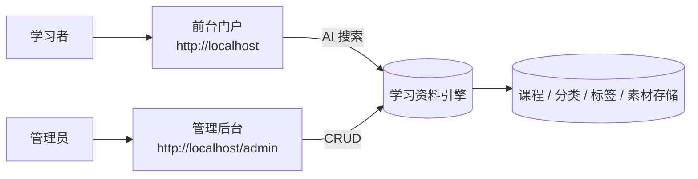

# Learning Hub 需求规格说明书

> 本文档基于对线上运行实例 (`http://localhost` 与 `http://localhost/admin`) 的反向工程梳理形成，旨在沉淀产品全貌并为后续开发、测试、验收提供唯一基准。
>
> **生成日期**: 2026-07-06
> **规格版本**: v1.0
> **参考实例**: `http://localhost`（前台门户）/ `http://localhost/admin`（管理后台）

---

## 目录索引

| 编号 | 文档 | 内容概述 |
| ---- | ---- | -------- |
| 01 | [01-产品概述](./01-产品概述.md) | 产品定义、目标用户、核心价值、术语表 |
| 02 | [02-功能需求](./02-功能需求.md) | 功能模块全景图与功能清单 |
| 03 | [03-前台门户规格](./03-前台门户规格.md) | `http://localhost` 前台搜索门户的页面、交互、状态 |
| 04 | [04-管理后台规格](./04-管理后台规格.md) | `http://localhost/admin` 后台各模块的页面与操作流程 |
| 05 | [05-数据模型](./05-数据模型.md) | 核心实体、字段、关系与生命周期 |
| 06 | [06-非功能需求](./06-非功能需求.md) | 性能、安全、可用性、兼容性、容量 |
| 07 | [07-技术架构](./07-技术架构.md) | 从运行实例反推的技术栈与部署形态 |
| 08 | [08-验收标准](./08-验收标准.md) | 按模块组织的验收用例与通过条件 |
| 09 | [09-UI规格](./09-UI规格.md) | UI 实体 ↔ 业务实体互动矩阵与状态机(页面级粒度) |
| 10 | [10-API设计规范](./10-API设计规范.md) | 全量 HTTP API 契约（/api/admin/*、/api/public/*、鉴权、错误码） |

> 课件详情页素材（PDF / PPT / MP4）的行内浏览能力（`P-VIEWER`）已纳入 v1.2，相关规格见 [03 §5a](./03-前台门户规格.md)、[05 §2.4](./05-数据模型.md)、[09 §2.1 / §4.1 / §5.1 / §6.3](./09-UI规格.md)、[10 §5.2.3 / §5.2.4](./10-API设计规范.md)。

---

## 1. 一句话定位

**Learning Hub** 是一个以"AI 智能搜索"为核心入口的企业学习资料门户。通过极简的前台搜索界面，让员工用自然语言快速定位到内部沉淀的课件（视频 / PDF / PPT）；通过结构化的管理后台，让运营人员可持续地组织课件、分类、标签与素材。

## 2. 系统全景

## 3. 核心角色

| 角色 | 入口 | 主要诉求 |
| ---- | ---- | -------- |
| 学习者（匿名访客） | `http://localhost` | 用一句话找到想要学习的课件 |
| 管理员 | `http://localhost/admin`（Token 鉴权） | 录入 / 维护课件，整理分类、标签、素材 |

## 4. 关键业务对象速览

| 对象 | 描述 |
| ---- | ---- |
| 课件（Courseware） | 学习门户的基本单元，由素材组成，属于某个分类，可携带多个标签 |
| 分类（Category） | 三层树形结构（根级 → 二级 → 三级），用于组织课件 |
| 标签（Tag） | 扁平词条，用于课件的横向能力 / 主题标识 |
| 素材（Material） | 课件内的具体内容载体，支持 MP4 / PDF / PPT / PPTX |

## 5. 阅读建议

- **产品 / 业务方**: 先读 `01-产品概述`，再按需查阅 `03 / 04`。
- **设计师**: 直接读 `03-前台门户规格` 与 `04-管理后台规格`，内含全部页面状态。
- **开发**: `02-功能需求` + `05-数据模型` + `07-技术架构` + `10-API设计规范`。
- **前端 / 设计师**: 在 `03` / `04` 之上补充 `09-ui-spec`，可直接读矩阵生成组件树与 API 表单契约。
- **测试**: `08-验收标准`，每条用例均可作为自动化测试用例的雏形。

### 5.1 流程图节点命名约定

| 文档 | 节点命名风格 | 示例 |
| ---- | ------------ | ---- |
| `03 / 04` | 中文名（面向阅读者） | `首页`、`搜索框`、`课件列表` |
| `09` | UI 实体 ID（面向开发） | `P-HOME`、`A-CW-FORM`、`P_LOCKED` |
| `05` | 实体名 + 字段名 | `Courseware`、`AccessToken` |
| `02` | 功能编号 + 描述 | `F01 首页展示`、`F03 课件管理` |

> 跨文档引用时以 `09-UI规格 §2.1` 中的 UI 实体 ID 表为准；中文节点为说明性引用。

---

## 6. 修订记录

| 版本 | 日期 | 变更摘要 |
| ---- | ---- | -------- |
| 1.3 | 近期 | **AI 搜索改为 LLM-to-SQL（qwen-plus） + ILIKE 兜底**，回滚 embedding / pgvector 设施： · L-01 [01 §2 定位](./01-产品概述.md) 调整"AI 智能搜索"描述为「qwen-plus 直写检索 SQL + 关键词 ILIKE 兜底」 · L-02 [02 §2.1 F01.05 / §3 US-05](./02-功能需求.md) 描述改为「LLM 直写检索 SQL」；走 `DASHSCOPE_API_KEY` 未配置即降级的语义 · L-03 [03 §3 搜索结果页](./03-前台门户规格.md) 补「徽标动态跟随 `data.source`」说明；F-007/008/009 用例联动 · L-04 [05 §2.7 / §6 派生字段表](./05-数据模型.md) 删除 `courseware_embedding` 表；§2.1 Courseware 表不新增字段（LLM 路径不持久化） · L-05 [06 §3 性能](./06-非功能需求.md) 补 `LLM_SQL_TIMEOUT_SECONDS=8` 指标与降级 SLA · L-06 [07 §2.3 存储](./07-技术架构.md) 去除 pgvector 入口；§2.4 AI 能力描述同步为「LLM NL2SQL(qwen-plus) + dashscope SDK + 关键词 ILIKE 兜底」；§3 部署形态追加 `DASHSCOPE_API_KEY` / `LLM_SEARCH_MODEL` / `LLM_SQL_TIMEOUT_SECONDS` / `LLM_SQL_MAX_ROWS` 环境变量；§7 演进建议 V2.0 去掉 pgvector / Milvus；§8 风险新增「LLM 输出需白名单校验」 · L-07 [08 §10a AI 搜索验收](./08-验收标准.md) 新增 AC-026~028（LLM 路径 / 降级路径 / 短关键词一致性） · L-08 [09 §4.1 / §5.1](./09-UI规格.md) `P-RESULT` 徽标状态机补 `source-keyword` 降级态 · L-09 [10 §5.1.1 / §5.1.3](./10-API设计规范.md) `data.source` 枚举改回 `("llm","keyword")`；新增 §5.1.3 v1.1 LLM-to-SQL 实现说明（LLM 调用契约 / 7 道闸 / read-only 事务护栏 / 降级路径表） · L-10 [doc/test/test-cases-front.md §3](./test-cases-front.md) 新增 F-007/008/009（自然语言长句 / 降级 / 短关键词） · L-11 [deploy/README §7.9](./deploy/README.md) 新增「AI 搜索依赖（v1.1 LLM-to-SQL · qwen-plus）」整段（环境变量 / 验证步骤 / 降级路径表 / 安全护栏 / 容器重建提醒 / 已知坑） · L-12 代码侧回滚 8 文件（`courseware_embedding.py` / `embedding.py` / `embedding_queue.py` / `scripts/__init__.py` / `backfill_embeddings.py` / `test_search_embedding.py` / `front-search-embedding.spec.ts` / alembic embedding 迁移），调整 14 文件（`main.py` / `courseware.py` / `tag.py` / `category.py` / `models/__init__.py` / `docker-compose.yml` / `pyproject.toml` / `Dockerfile` / `.env.example` / `config.py` / `services/__init__.py` 等）；新增 5 文件（`llm_sql.py` / `_sql_safety.py` / `test_llm_sql.py` / `test_search_llm.py` / `front-search-llm.spec.ts`） |
| 1.2 | 2026-07-07 | **素材在线浏览改造**（P-VIEWER）： · S-08 [01 §2 定位](./01-产品概述.md) 补一句"PDF / PPT / MP4 行内浏览"；[01 §4 术语表](./01-产品概述.md) 增 `P-VIEWER` / `预览 PDF（preview_pdf_path）` / `PPT 转 PDF 服务` · S-09 [02 §2.1 F01.08](./02-功能需求.md) 新增 F01.08 素材在线浏览 P0；[02 §3](./02-功能需求.md) 新增 US-10；[02 §4](./02-功能需求.md) F01.08 标 P0 · S-10 [03 §1 页面清单 + §5a P-VIEWER](./03-前台门户规格.md) 新增 P-VIEWER 章节（顶栏 / VIDEO / PDF / PPT / 行为异常 / 跳转 / 跨文档一致性） · S-11 [03 §5.2](./03-前台门户规格.md) P-DETAIL mermaid 改"播放或下载"→"`在线浏览` → P-VIEWER"；[03 §5.4](./03-前台门户规格.md) 素材表按类型拆三种样式；[03 §6 状态机](./03-前台门户规格.md) 增加 `P-DETAIL ↔ P-VIEWER` 迁移 · S-12 [04 §3.x 上传流程 + §5.x 字段表](./04-管理后台规格.md) 增 `preview_pdf_path` 展示与 PPT 转换失败降级说明 · S-13 [05 §1 ER / §2.4 Material / §6 派生字段表](./05-数据模型.md) 新增 `preview_pdf_path` + 业务规则（PPT 上传自动转 PDF、失败不阻塞、删除同步清理）+ `streamUrl` 派生字段 · S-14 [06 §3 性能 / §7 兼容性 / §8 安全](./06-非功能需求.md) 补 PPT 转 PDF 60s 超时 / PDF.js 4.7 浏览器矩阵 / 预览流 60/min/ip 限流 · S-15 [07 §3 部署形态 / §3.1 素材服务 / §6 关键数据流](./07-技术架构.md) 增 LibreOffice 节点 + PPT 转 PDF 序列图 + 素材预览序列图 · S-16 [08 §7 素材管理 / §8a 素材在线浏览 / §11a 集成验收 / §13 用例覆盖检查表](./08-验收标准.md) 新增 AC-019~025、INT-V-001~003 验收项 + 覆盖检查表 · S-17 [09 §2.1 UI 实体 + §4.1 前台矩阵 + §5.1 状态机 + §6.3 文案 + §8 可访问性](./09-UI规格.md) 新增 P-VIEWER-VIDEO/PDF/PPT + 跨子组件键盘行 + 文案与 a11y 注解 · S-18 [10 §5.2 / §5.2.3 / §5.2.4 / §7.4](./10-API设计规范.md) 增 `streamUrl` 字段、公开单素材接口 `/api/public/materials/{id}`、公开流式接口 `/api/public/materials/{id}/stream`（三种 disposition 表） + v1.2 变更日志条目 |
| 1.1 | 2026-07-06 | 集中修复访问控制与状态机一致性： · S-01 README 修复 `09-ui-spec` 文件名链接 · S-02 `05-数据模型 §2.1` 补充 `access_mode` 字段；新增 R-12 业务规则（受限课件必须保留 ≥1 Token） · S-03 `03-前台门户 §5` 补全 P-DETAIL 页面定义；§1 页面清单补全；原 §5–§9 改为 §6–§10 · S-04 `10-API §1.4 / §3.3` 统一错误码为字符串 `"ok"` · S-05 `09-UI §6.1` 与 `10-API §4.1.2` 对齐课程标题 1-100 · S-06 `09-UI §6.2` 修正 Token 失效课件状态描述（联动 R-12） · M-01 `05-数据模型` 新增 §6 派生字段表 · M-02 `04-管理后台 / 08-验收 / 09-UI / 10-API` 同步 R-12 与 `last_token_required` 错误码 · M-03 `05-数据模型 §4` 与 `10-API §6.2.3` 删除 DRAFT 枚举 · M-04 `09-UI §4.2` 修正 Tag 重命名错误码描述 · M-05 `09-UI §5` 明确状态机权威性 · M-06 `03-前台门户 §4.3` 错误处理表格化对齐 `10-API` · M-07 `09-UI §3 / §7.2` 统一 localStorage 键名规范 · L-01 `02-功能需求 F01.03` 明确 filters 参数 v1.0 前端不暴露 · L-04 `03-前台门户 §11` 新增通用错误页定义 · `doc/deploy/README` §6 新增补齐优先级表与生产部署警告 |
| 1.0 | 2026-07-06 | 首次发布 10 章规格集合（反向工程梳理形成）与 `doc/deploy` 部署骨架 |

---

> 反馈与修订：本规格说明书随线上实例同步演进，任何与 `http://localhost` / `http://localhost/admin` 不一致之处，以线上实际行为为准，并提交规格修订。
