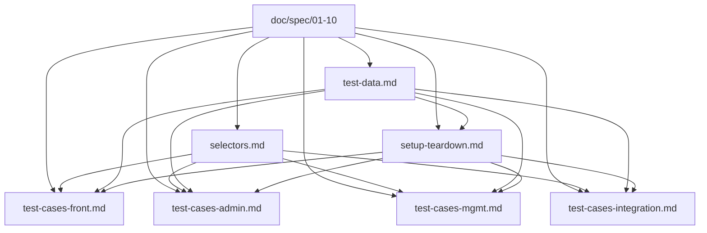

# Learning Hub 测试用例文档（Browser Agent 就绪）

> 本目录存放基于 [doc/spec](../spec/) 全量规格设计的测试用例与测试数据。
> 全部文档**针对 Browser Agent（Playwright / Cypress / k6 等）端到端执行**做了结构化与选择器约定。
> 文档版本：v1.0 — 与 [spec v1.1](../spec/README.md) 同步。

---

## 1. 文档清单

| 文件 | 内容 | 用例数 |
| ---- | ---- | ------ |
| [README.md](./README.md) | 本文件：总览、目录、约定 | - |
| [selectors.md](./selectors.md) | Browser Agent 选择器与 `data-testid` 命名规范（含 §3.5 P-VIEWER 三个子组件） | - |
| [test-data.md](./test-data.md) | 测试数据：账号、Token、素材、课件、标签种子（含 §4.1 PPT fixture 生成脚本） | - |
| [setup-teardown.md](./setup-teardown.md) | 测试准备（Setup）与测试还原（Teardown）步骤（含 §1.3 LibreOffice / PDF.js 依赖） | - |
| [test-cases-front.md](./test-cases-front.md) | 前台门户用例（F-*）含 §5a P-VIEWER | 48 |
| [test-cases-admin.md](./test-cases-admin.md) | 后台鉴权 + 课件管理用例（A-*） | 46 |
| [test-cases-mgmt.md](./test-cases-mgmt.md) | 后台分类/标签/素材/Token 用例（C/T/M/TKN/X，含 M-013~M-019 素材流接口） | 63 |
| [test-cases-integration.md](./test-cases-integration.md) | 跨模块集成 / 受限课件 / 非功能用例（含 §6a INT-V-001/002/003） | 48 |

> 合计：205 测试用例，覆盖 [08-验收标准](../spec/08-验收标准.md) F01~F07、A01~A06、N01~N10、AC-019~025、INT-V-001~003。
> 端到端 Playwright 脚本路径：[`frontend/e2e/front-viewer.spec.ts`](../../frontend/e2e/front-viewer.spec.ts)、[`frontend/e2e/front-detail.spec.ts`](../../frontend/e2e/front-detail.spec.ts)、[`frontend/e2e/admin-materials.spec.ts`](../../frontend/e2e/admin-materials.spec.ts)（如有）。

---

## 2. 快速执行流程

```text
1. 阅读 [selectors.md](./selectors.md) 了解 data-testid 约定
2. 阅读 [test-data.md](./test-data.md) 了解所有种子数据
3. 执行 [setup-teardown.md §3](./setup-teardown.md) 的 Setup 步骤
4. 按需选择并执行用例文件：
   - 前台：[test-cases-front.md](./test-cases-front.md)
   - 后台：[test-cases-admin.md](./test-cases-admin.md) + [test-cases-mgmt.md](./test-cases-mgmt.md)
   - 集成 / 非功能：[test-cases-integration.md](./test-cases-integration.md)
5. 执行 [setup-teardown.md §4](./setup-teardown.md) 的 Teardown 步骤
6. 校验 .artifacts / 日志 / 错误汇总
```

---

## 3. 文档关系图



---

## 4. 与规格文档的映射

| 规格章节 | 测试文档 / 用例 ID |
| -------- | ----------------- |
| [02-功能需求 §F01](../spec/02-功能需求.md) | F-001 ~ F-020, F-040 ~ F-047 |
| [02-功能需求 §F01.08](../spec/02-功能需求.md) | F-048 ~ F-056 |
| [02-功能需求 §F06/F07](../spec/02-功能需求.md) | F-030 ~ F-037, FTK-001 ~ FTK-007 |
| [03-前台门户规格 §1~§5](../spec/03-前台门户规格.md) | F-001 ~ F-047 |
| [03-前台门户规格 §5a P-VIEWER](../spec/03-前台门户规格.md) | F-048 ~ F-056 |
| [03-前台门户规格 §11](../spec/03-前台门户规格.md) | F-050 ~ F-052 |
| [04-管理后台规格 §2](../spec/04-管理后台规格.md) | A-001 ~ A-006 |
| [04-管理后台规格 §3](../spec/04-管理后台规格.md) | A-100 ~ A-171 |
| [04-管理后台规格 §4](../spec/04-管理后台规格.md) | C-001 ~ C-012 |
| [04-管理后台规格 §5](../spec/04-管理后台规格.md) | T-001 ~ T-012 |
| [04-管理后台规格 §6](../spec/04-管理后台规格.md) | M-001 ~ M-019（含 M-013~M-019 预览 PDF + 公开流接口） |
| [04-管理后台规格 §7](../spec/04-管理后台规格.md) | TKN-001 ~ TKN-016 |
| [05-数据模型 §R-12](../spec/05-数据模型.md) | A-127, A-140, TKN-006, TKN-008, FTK-004 |
| [05-数据模型 §2.4 preview_pdf_path](../spec/05-数据模型.md) | M-013, M-014, M-015, DI-005 |
| [06-非功能需求 §3](../spec/06-非功能需求.md) | N-001 ~ N-005 |
| [06-非功能需求 §4](../spec/06-非功能需求.md) | N-010 ~ N-014 |
| [06-非功能需求 §5](../spec/06-非功能需求.md) | N-020 ~ N-023 |
| [06-非功能需求 §10](../spec/06-非功能需求.md) | N-030 ~ N-032 |
| [07-技术架构 §5](../spec/07-技术架构.md) | N-013, N-014 |
| [07-技术架构 §6 关键数据流](../spec/07-技术架构.md) | INT-V-001 |
| [08-验收标准 A01](../spec/08-验收标准.md) | A-001 ~ A-006 |
| [08-验收标准 A02](../spec/08-验收标准.md) | A-100 ~ A-152 |
| [08-验收标准 A03](../spec/08-验收标准.md) | C-001 ~ C-012 |
| [08-验收标准 A04](../spec/08-验收标准.md) | T-001 ~ T-012 |
| [08-验收标准 A05](../spec/08-验收标准.md) | M-001 ~ M-019 |
| [08-验收标准 A06](../spec/08-验收标准.md) | TKN-001 ~ TKN-016 |
| [08-验收标准 AC-019~025](../spec/08-验收标准.md) | F-049, F-050, F-048, F-051, F-052, F-056 |
| [08-验收标准 INT-V-001/002](../spec/08-验收标准.md) | INT-V-001, INT-V-002, INT-V-003 |
| [10-API设计规范 §3.2](../spec/10-API设计规范.md) | ERR-001 ~ ERR-005, X-010 ~ X-013 |
| [10-API设计规范 §5.2.3 / §5.2.4](../spec/10-API设计规范.md) | M-016 ~ M-019, DI-006 |

---

## 5. 用例命名规范

| 前缀 | 含义 | 范围 |
| ---- | ---- | ---- |
| `F-NNN` | 前台门户 | [test-cases-front.md](./test-cases-front.md) |
| `F-NNN`（P-VIEWER 子集） | 素材在线浏览页 | [test-cases-front.md §5a](./test-cases-front.md) |
| `AC-NNN` | 素材浏览验收 | [08-验收标准 §8a](../spec/08-验收标准.md) / [test-cases-front.md §5a](./test-cases-front.md) |
| `INT-V-NNN` | 集成验收（PPT 转 PDF / PDF.js worker / 限流等） | [test-cases-integration.md §6a](./test-cases-integration.md) |
| `A-NNN` | 后台鉴权 + 课件管理 | [test-cases-admin.md](./test-cases-admin.md) |
| `C-NNN` | 分类管理 | [test-cases-mgmt.md](./test-cases-mgmt.md) |
| `T-NNN` | 标签管理 | [test-cases-mgmt.md](./test-cases-mgmt.md) |
| `M-NNN` | 素材管理 | [test-cases-mgmt.md](./test-cases-mgmt.md) |
| `TKN-NNN` | Token 管理 | [test-cases-mgmt.md](./test-cases-mgmt.md) |
| `X-NNN` | 跨模块 | [test-cases-mgmt.md](./test-cases-mgmt.md) §5 |
| `FTK-NNN` | 受限课件全链路 | [test-cases-integration.md](./test-cases-integration.md) §1 |
| `AUTH-NNN` | 鉴权闭环 | [test-cases-integration.md](./test-cases-integration.md) §2 |
| `ERR-NNN` | 错误码 | [test-cases-integration.md](./test-cases-integration.md) §3 |
| `SR-NNN` | 搜索联动 | [test-cases-integration.md](./test-cases-integration.md) §4 |
| `DI-NNN` | 数据完整性 | [test-cases-integration.md](./test-cases-integration.md) §5 |
| `N-NNN` | 非功能 | [test-cases-integration.md](./test-cases-integration.md) §6~§10 |

---

## 6. Browser Agent 调度示例

### 6.1 Playwright（TypeScript）

```typescript
// suite-front.spec.ts
import { test, expect } from '@playwright/test';
import { setup, teardown } from './setup-teardown';

test.beforeAll(async ({ request }) => { await setup(request); });
test.afterAll(async ({ request }) => { await teardown(request); });

test('F-001 访问首页加载', async ({ page }) => {
  await page.goto(process.env.BASE!);
  await expect(page.getByTestId('p-home-title')).toBeVisible();
  await expect(page.getByTestId('p-home-search-input')).toBeEditable();
});

test('F-032 锁定页输入有效 Token 解锁', async ({ page, context }) => {
  await context.addInitScript(() => localStorage.clear());
  await page.goto(`${process.env.BASE}/detail/CW_RESTRICTED`);
  await page.getByTestId('p-locked-token-input').fill(process.env.TKN_A!);
  await page.getByTestId('p-locked-unlock-btn').click();
  await expect(page.getByTestId('p-detail-title')).toHaveText('Java 后端工程实践');
});
```

### 6.2 Cypress

```javascript
// cypress/e2e/front.cy.js
describe('前台门户', () => {
  before(() => cy.exec('node ./scripts/setup.js'));
  after(() => cy.exec('node ./scripts/teardown.js'));

  it('F-010 搜索命中开放课件', () => {
    cy.visit('/result?q=项目管理');
    cy.get('[data-testid="p-result-card"][data-courseware-id="CW_OPEN_BASIC"]').should('be.visible');
    cy.get('[data-testid="p-result-card"][data-courseware-id="CW_OPEN_BASIC"] [data-testid="p-result-card-lock"]').should('not.exist');
  });
});
```

### 6.3 k6（性能用例）

```bash
# 解锁接口
k6 run -e BASE=https://learning-hub.smartmoves.com.cn \
       -e CW=CW_RESTRICTED \
       -e TKN=AB12CD34EF56GH78IJ90KL34 \
       scripts/script-unlock.js
```

---

## 7. 失败处理规范

| 等级 | 触发条件 | 行为 |
| ---- | -------- | ---- |
| P0 阻塞 | 鉴权失败 / 服务不可达 / Setup 失败 | 中断所有用例 |
| P1 严重 | 关键功能失败（搜索、解锁、发布） | 阻塞当前套件 |
| P2 一般 | 辅助功能失败（UI 样式、文案） | 不阻塞，记录 issue |
| P3 提示 | 偶发 / 性能轻微超标 | 记录观察项 |

---

## 8. 修订记录

| 版本 | 日期 | 变更 |
| ---- | ---- | ---- |
| v1.2 | 近期 | **AI 搜索改为 LLM-to-SQL（qwen-plus）+ ILIKE 兜底**测试集合：<br>· L-T01 [test-cases-front.md §3 F-007/008/009](./test-cases-front.md) 新增「自然语言长句命中（LLM 路径）」「无 DASHSCOPE_API_KEY 时降级」「短关键词仍按 ILIKE 命中」3 条用例，联动 [10 §5.1.3 v1.1 LLM-to-SQL 实现说明](../spec/10-API设计规范.md)<br>· L-T02 [test-cases-front.md §1 数据准备](./test-cases-front.md) 补 `增量绩效-{ts}` 课件的 Setup 步骤（仅 F-007 需要）<br>· L-T03 新增 [frontend/e2e/front-search-llm.spec.ts](../../frontend/e2e/front-search-llm.spec.ts) 3 个 Playwright 用例（后端 mock / 无 key 降级 / 短关键词一致性）<br>· L-T04 新增 [backend/tests/test_llm_sql.py](../../backend/tests/test_llm_sql.py) 覆盖 `_sql_safety.validate_sql` 7 道闸纯函数（无需 DB）<br>· L-T05 新增 [backend/tests/test_search_llm.py](../../backend/tests/test_search_llm.py) 覆盖主流程（LLM 命中 / 白名单拒绝 / 超时 / 无 key / 关键词兜底 / 空查询）<br>· L-T06 [selectors.md §3 P-RESULT](./selectors.md) 补 `source-llm` / `source-keyword` / `p-result-badge-llm` / `p-result-badge-keyword` 选择器定义（与 Result.tsx 徽标逻辑联动）<br>· L-T07 [setup-teardown.md §1.3 环境依赖](./setup-teardown.md) 补 `DASHSCOPE_API_KEY` 注入说明：默认留空 → 走降级路径；如需断言 LLM 路径需在 e2e 容器注入<br>· L-T08 废弃并删除 [front-search-embedding.spec.ts](../../frontend/e2e/front-search-embedding.spec.ts) 与 [test_search_embedding.py](../../backend/tests/test_search_embedding.py)（embedding / pgvector 方案已回滚） |
| v1.1 | 2026-07-07 | 新增素材在线浏览能力：[selectors §3.5 P-VIEWER](./selectors.md)、[test-cases-front §5a F-048~F-056](./test-cases-front.md)、[test-cases-mgmt M-013~M-019 素材流接口](./test-cases-mgmt.md)、[test-cases-integration §6a INT-V-001/002/003](./test-cases-integration.md)；同步 PPT fixture（[test-data §4.1](./test-data.md)）、LibreOffice 依赖（[setup-teardown §1.3](./setup-teardown.md)） |
