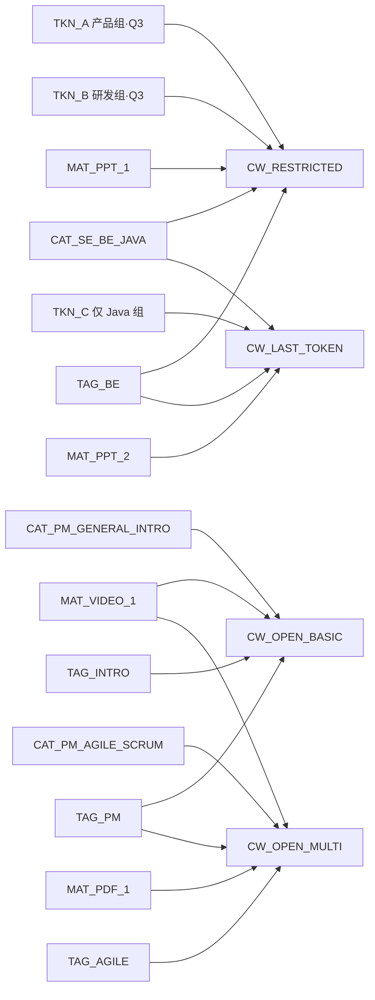

# Learning Hub 测试数据（种子 + 还原）

> 本文件定义测试执行所需的全部固定数据，由测试准备阶段（Setup）创建、由测试还原阶段（Teardown）清理。
> 适用范围：[08-验收标准](../spec/08-验收标准.md) 与 [test-cases-*](./) 全量用例。
>
> **数据原则**：
> - 所有 ID 在 Setup 中按递增顺序创建；Teardown 按反向顺序删除。
> - 所有字段值在 Setup 中以 API 调用写入；用例执行期间不再修改"基准数据"（即"基线快照"）。
> - 测试还原后系统状态应与全新部署等价（仅保留演示 Admin Token 与基础配置）。

---

## 1. 账号与凭据

| 项 | 值 | 说明 |
| ---- | ---- | ---- |
| 前台基础 URL | `http://localhost`（开发）/ `https://learning-hub.smartmoves.com.cn`（ECS） | 详见 [deploy/README §2](../deploy/README.md) |
| 后台基础 URL | `http://localhost/admin`（开发）/ `https://learning-hub.smartmoves.com.cn/admin`（ECS） | 同上 |
| Admin Token | `demo` | [02-功能需求 §2.1](../spec/02-功能需求.md) / [10-API §2.1](../spec/10-API设计规范.md) |
| 管理员会话 Cookie | `LH_ADMIN_SESSION=<jwt>` | 由 `POST /api/auth/admin` 颁发；详见 [10-API §2.3](../spec/10-API设计规范.md) |
| 受限课件 Token A 原值 | `AB12CD34EF56GH78IJ90KL34` | Setup 创建并保存明文一次 |
| 受限课件 Token B 原值 | `ZZ99YY88XX77WW66VV55UU44` | Setup 创建并保存明文一次 |
| 受限课件 Token C 原值 | `QQ11WW22EE33RR44TT55YY66` | 用于"删除最后一个 Token 拒绝"用例 |

> **凭据保存**：Token 原值仅在 Setup 创建瞬间返回 1 次；测试脚本必须将原值落地到测试上下文（如 `.env.test.local`，不入版本库），供后续用例引用。

---

## 2. 分类种子（Setup 阶段创建）

> 全部为 3 级结构；用作课件归属。命名均为简体中文，无特殊字符。

### 2.1 根分类

| name | id（Setup 后） |
| ---- | -------------- |
| 项目管理 | `CAT_ROOT_PM` |
| 软件工程 | `CAT_ROOT_SE` |

### 2.2 二级分类

| name | parent_id | id（Setup 后） |
| ---- | --------- | -------------- |
| 项目管理 → 通用 | `CAT_ROOT_PM` | `CAT_PM_GENERAL` |
| 项目管理 → 敏捷 | `CAT_ROOT_PM` | `CAT_PM_AGILE` |
| 软件工程 → 后端 | `CAT_ROOT_SE` | `CAT_SE_BE` |

### 2.3 三级分类（课件必须挂在 3 级）

| name | parent_id | id（Setup 后） | 用途 |
| ---- | --------- | -------------- | ---- |
| 项目管理 → 通用 → 入门 | `CAT_PM_GENERAL` | `CAT_PM_GENERAL_INTRO` | C-002 主课件归属 |
| 项目管理 → 敏捷 → Scrum | `CAT_PM_AGILE` | `CAT_PM_AGILE_SCRUM` | 多素材课件归属 |
| 软件工程 → 后端 → Java | `CAT_SE_BE` | `CAT_SE_BE_JAVA` | 受限课件归属（FTK-001） |

---

## 3. 标签种子（Setup 阶段创建）

| name | id（Setup 后） | 期望关联课件数（Teardown 前） |
| ---- | -------------- | ---------------------------- |
| 项目管理 | `TAG_PM` | 2 |
| 敏捷 | `TAG_AGILE` | 1 |
| 后端 | `TAG_BE` | 1 |
| 入门 | `TAG_INTRO` | 1 |
| 临时标签 | `TAG_TEMP` | 0（用于 T-002 → T-004 删除链路） |

> 标签名全局唯一（[05 §R-04](../spec/05-数据模型.md)）；同名创建必须失败。

---

## 4. 素材种子（Setup 阶段创建）

> 素材需先在测试环境 `/app/storage/documents/` 预置对应文件；Setup 阶段上传至服务端，记录返回的 `id`。

| 文件名 | type | size_bytes | duration_or_pages | id（Setup 后） | 文件本地路径 |
| ------ | ---- | ---------- | ----------------- | -------------- | ------------ |
| `pm-intro-101.mp4` | VIDEO | ~18MB | `12:34` | `MAT_VIDEO_1` | `test/fixtures/pm-intro-101.mp4` |
| `scrum-guide.pdf` | PDF | ~2MB | `32` | `MAT_PDF_1` | `test/fixtures/scrum-guide.pdf` |
| `java-backend.pptx` | PPT | ~5MB | `48` | `MAT_PPT_1` | `test/fixtures/java-backend.pptx` |
| `legacy.ppt` | PPT | ~1MB | `20` | `MAT_PPT_2` | `test/fixtures/legacy.ppt` |
| `courseware-with-pptx-20slides.pptx` | PPT | ~2MB | `20` | `MAT_PPTX_20` | `test/fixtures/courseware-with-pptx-20slides.pptx`（由 `scripts/gen_pptx_fixtures.py` 生成；用于 F-050/F-053 页码指示器与全屏） |
| `courseware-with-pptx-1slide.pptx` | PPT | ~10KB | `1` | `MAT_PPTX_1` | `test/fixtures/courseware-with-pptx-1slide.pptx`（用于验证首末页 `disabled` 状态） |
| `corrupt.pptx` | PPT | ~10KB | - | （仅用于 M-014 损坏用例，Setup 不创建） | `test/fixtures/corrupt.pptx` |
| `oversize.mp4` | VIDEO | > 200MB | - | （仅用于 M-003 拒绝用例，Setup 不创建） | `test/fixtures/oversize.mp4` |
| `notallowed.exe` | - | - | - | （仅用于 M-004 拒绝用例，Setup 不创建） | `test/fixtures/notallowed.exe` |

### 4.1 PPT fixture 生成脚本

`test/fixtures/scripts/gen_pptx_fixtures.py`（依赖 `python-pptx`）：

```python
# scripts/gen_pptx_fixtures.py
from pptx import Presentation
from pathlib import Path

OUT = Path(__file__).parent

# 20 页 fixture：用于 F-050 / F-053
prs = Presentation()
for i in range(1, 21):
    slide = prs.slides.add_slide(prs.slide_layouts[5])
    slide.shapes.title.text = f"Slide {i}"
prs.save(OUT / "courseware-with-pptx-20slides.pptx")

# 1 页 fixture：用于验证首末页 disabled 状态
prs = Presentation()
slide = prs.slides.add_slide(prs.slide_layouts[5])
slide.shapes.title.text = "Only Slide"
prs.save(OUT / "courseware-with-pptx-1slide.pptx")
```

> PPT fixture 默认不入 git；首次 Setup 前执行 `python scripts/gen_pptx_fixtures.py` 生成；CI 任务中可在 `setup-teardown §3` 之前预生成。

> 文件预置步骤见 [setup-teardown.md §3](./setup-teardown.md)；文件本体不入 git，使用 `.gitignore` 排除 `test/fixtures/*.bin`。

---

## 5. Token 种子（Setup 阶段创建）

| label | 原值（明文） | id（Setup 后） | 关联课件 |
| ----- | ------------ | -------------- | -------- |
| 产品组·Q3 | `AB12CD34EF56GH78IJ90KL34` | `TKN_A` | `CW_RESTRICTED`（多 Token 课件） |
| 研发组·Q3 | `ZZ99YY88XX77WW66VV55UU44` | `TKN_B` | `CW_RESTRICTED`（多 Token 课件） |
| 仅 Java 组 | `QQ11WW22EE33RR44TT55YY66` | `TKN_C` | `CW_LAST_TOKEN`（用于 TKN-005/TKN-006 拒绝用例，唯一 Token） |

> `CW_RESTRICTED` 关联 `TKN_A` + `TKN_B`（多 Token 课件，可用于 FTK-001 ~ FTK-007 大部分用例）。
> `CW_LAST_TOKEN` 仅关联 `TKN_C`，用于验证"删除 / 重新生成最后一个 Token 拒绝"。

---

## 6. 课件种子（Setup 阶段创建）

| title | category_id | tags | material_ids | accessMode | accessTokenIds | id（Setup 后） | 用途 |
| ----- | ----------- | ---- | ------------ | ---------- | -------------- | -------------- | ---- |
| 项目管理入门 | `CAT_PM_GENERAL_INTRO` | `TAG_PM`, `TAG_INTRO` | `MAT_VIDEO_1` | OPEN | （无） | `CW_OPEN_BASIC` | C-002 基础课件 |
| Scrum 实践指南 | `CAT_PM_AGILE_SCRUM` | `TAG_PM`, `TAG_AGILE` | `MAT_VIDEO_1`, `MAT_PDF_1` | OPEN | （无） | `CW_OPEN_MULTI` | 多素材课件；C-007 分页 |
| Java 后端工程实践 | `CAT_SE_BE_JAVA` | `TAG_BE` | `MAT_PPT_1` | RESTRICTED | `TKN_A`, `TKN_B` | `CW_RESTRICTED` | FTK-001 ~ FTK-007 受限课件主用例 |
| Java 后端幻灯片（20 页） | `CAT_SE_BE_JAVA` | `TAG_BE` | `MAT_PPTX_20` | RESTRICTED | `TKN_A` | `CW_PPTX_20` | F-050 / F-053 P-VIEWER-PPT 页码与全屏 |
| 内部培训（仅研发可见） | `CAT_SE_BE_JAVA` | `TAG_BE` | `MAT_PPT_2` | RESTRICTED | `TKN_C` | `CW_LAST_TOKEN` | TKN-005/006 拒绝用例 |
| 预览生成中用例 | `CAT_PM_AGILE_SCRUM` | `TAG_PM` | `MAT_PPTX_1`（手动设 `preview_pdf_path = NULL`） | OPEN | （无） | `CW_PPT_PENDING` | F-056 预览未生成兜底 |
| （Setup 不预创建） | - | - | - | - | - | `CW_DELETE_ME` | 由 C-008 用例现建现删 |

### 6.1 课件字段对照

| 字段 | `CW_OPEN_BASIC` | `CW_RESTRICTED` | `CW_LAST_TOKEN` |
| ---- | --------------- | --------------- | --------------- |
| title | `项目管理入门` | `Java 后端工程实践` | `内部培训（仅研发可见）` |
| author | `张三` | `李四` | `王五` |
| description | `面向新员工的项目管理基础课程。` | `面向 Java 后端工程师的进阶培训材料。` | `仅研发组可见。` |
| category_id | `CAT_PM_GENERAL_INTRO` | `CAT_SE_BE_JAVA` | `CAT_SE_BE_JAVA` |
| tag_ids | `[TAG_PM, TAG_INTRO]` | `[TAG_BE]` | `[TAG_BE]` |
| material_ids | `[MAT_VIDEO_1]` | `[MAT_PPT_1]` | `[MAT_PPT_2]` |
| accessMode | `OPEN` | `RESTRICTED` | `RESTRICTED` |
| accessTokenIds | `[]` | `[TKN_A, TKN_B]` | `[TKN_C]` |

---

## 7. localStorage 初始状态

| 键 | 值 | 用途 |
| ---- | ---- | ---- |
| `coursewareTokens` | `{}` | FTK-005 验证初始为空；FTK-001 前清空保证用例独立性 |

> 用例执行过程中由前端写入；Teardown 阶段清空。

---

## 8. 错误码速查

> 用例断言中出现的 `code` 字符串均来自 [10-API §3.2](../spec/10-API设计规范.md)；下表为高频用例引用：

| 业务码 | HTTP | 触发场景 |
| ------ | ---- | -------- |
| `"ok"` | 200 | 业务成功 |
| `"unauthenticated"` | 401 | 后台未登录 |
| `"invalid_admin_token"` | 401 | 登录 Token 错误 |
| `"courseware_title_required"` | 400 | 课件标题为空 |
| `"courseware_category_required"` | 400 | 课件未选分类 |
| `"courseware_token_required"` | 400 | 受限课件未关联 Token |
| `"courseware_category_not_leaf"` | 400 | 选了非 3 级分类 |
| `"category_max_level"` | 409 | 子分类超过 3 级 |
| `"category_name_conflict"` | 409 | 同父节点下重名 |
| `"tag_name_conflict"` | 409 | 标签名重复 |
| `"material_extension_invalid"` | 400 | 上传非白名单文件 |
| `"material_size_exceeded"` | 413 | 文件超过 200MB |
| `"invalid_token"` | 401 | 解锁 Token 无效 |
| `"token_revoked"` | 410 | Token 已失效 |
| `"last_token_required"` | 422 | 删除 / 重新生成最后一个 Token |
| `"search_query_empty"` | 400 | 搜索关键词为空 |
| `"search_query_too_long"` | 400 | 关键词超过 200 字符 |

---

## 9. 数据依赖图



> 还原（Teardown）顺序：先删课件（含其全部关联表），再删素材，最后删 Token / 标签 / 分类。

---

## 10. 不在测试范围内的数据

下列对象**不**作为种子创建，避免引入不确定因素：

- 任何 `DRAFT` 状态课件（[10 §6.2.3](../spec/10-API设计规范.md) 已删除 Draft 状态）
- 跨服务的 `postgres` / `nginx-gateway` Stack 配置（仅依赖学习 hub 服务接口）
- LLM 真实调用结果（搜索用例只断言命中数量与字段，不断言 `score`）